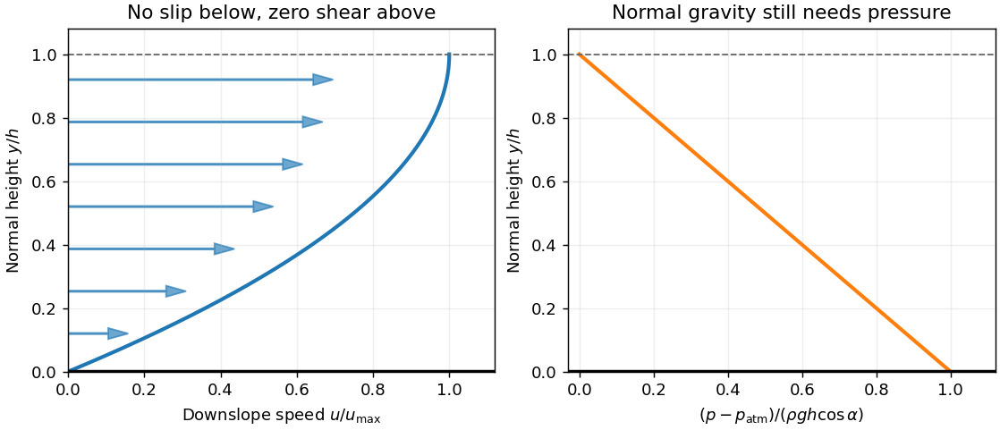
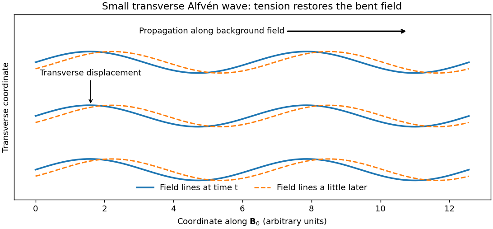
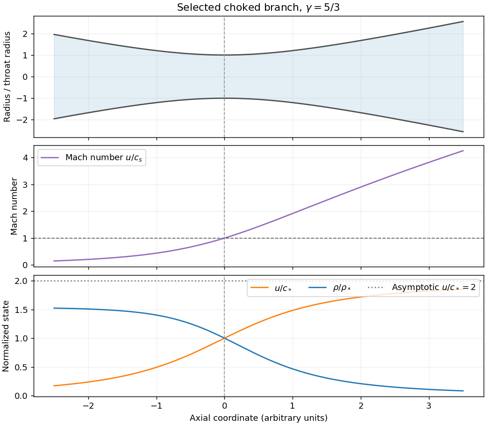

# Paper 1

↑ **Parent:** [2013](../2013.md)

Original public paper: [Physical PDF pages 258–261](https://www.whatdotheyknow.com/request/natural_science_tripos_physics_e_2/response/2340776/attach/2/FOI%202023%20399%20Zahid%20materials.pdf?cookie_passthrough=1#page=258). All three optional notes and both long questions are covered.

**Table of contents**

- [1](#1)
  - [a](#1/a)
    - [Solution](#1/a/solution)
  - [b](#1/b)
    - [Solution](#1/b/solution)
  - [c](#1/c)
    - [Solution](#1/c/solution)
- [2](#2)
  - [a](#2/a)
    - [Solution](#2/a/solution)
  - [b](#2/b)
    - [Solution](#2/b/solution)
  - [c](#2/c)
    - [Solution](#2/c/solution)
- [3](#3)
  - [Solution](#3/solution)
- [4](#4)
  - [Solution](#4/solution)

## 1

↑ **Parent:** [Paper 1](paper-1.md)

<h3 id="1/a">a</h3>

↑ **Parent:** [1](#1)

<h4 id="1/a/solution">Solution</h4>

↑ **Parent:** [A](#1/a)

Let $x$ measure distance down the incline and $y$ distance perpendicular to it, with the wall at $y=0$ and the [free surface](../../fluid-mechanics.md#free-surface) at $y=h$. A uniform steady [falling film flow](../../viscous-fluid-flow.md#falling-film-flow) has $\mathbf u=u(y)\mathbf e_x$. Its [convective acceleration](../../continuum-mechanics.md#convective-acceleration) vanishes because $\mathbf u\cdot\nabla=u\partial_x$ and $\partial_xu=0$. A flat surface exposed to constant atmospheric [pressure](../../pressure.md) has

$$
p(y)=p_{\rm atm}+\rho g\cos\alpha\,(h-y).
$$

Thus $\partial_xp=0$, and the downslope component of the [Navier-Stokes equations](../../viscous-fluid-flow.md#navier-stokes-equation) reduces to $0=g\sin\alpha+(\eta/\rho)u''$. The printed pressure-free equation must be understood as this **downslope projection**: its full vector version would incorrectly omit the normal [hydrostatic pressure](../../fluid-mechanics.md#hydrostatic-pressure) gradient that balances $g\cos\alpha$.

The [no-slip boundary condition](../../viscous-fluid-flow.md#no-slip-boundary-condition) gives $u(0)=0$. Neglecting air [shear stress](../../viscous-fluid-flow.md#shear-stress) makes the surface shear-free, so $u'(h)=0$. Two integrations give the [uniform gravity-driven Newtonian film](../../viscous-fluid-flow.md#uniform-gravity-driven-newtonian-film) profile

$$
u'(y)=\frac{\rho g\sin\alpha}{\eta}(h-y),\qquad
u(y)=\frac{\rho g\sin\alpha}{\eta}\left(hy-\frac{y^2}{2}\right).
$$

The [velocity](../../classical-mechanics.md#velocity) increases up to the [free surface](../../fluid-mechanics.md#free-surface), where

$$
\boxed{u_{\max}=\frac{\rho gh^2\sin\alpha}{2\eta}.}
$$

This assumes a uniform laminar [Newtonian fluid](../../viscous-fluid-flow.md#newtonian-fluid) film, a stationary wall and negligible surface shear; a varying thickness or externally imposed downslope [pressure gradient](../../fluid-mechanics.md#pressure-gradient) would alter the balance.

**[Figure 1](#1/a/image-uniform-inclined-film-surface-speed-maximum-and-normal-hydrostatic-pressure). Uniform inclined film: surface speed maximum and normal hydrostatic pressure**.

<h3 id="1/b">b</h3>

↑ **Parent:** [1](#1)

<h4 id="1/b/solution">Solution</h4>

↑ **Parent:** [B](#1/b)

By reflection symmetry the vertical [gravitational field](../../physics.md#gravitational-field) of the [self-gravitating incompressible slab](../../astrophysical-fluid-dynamics.md#self-gravitating-incompressible-slab) vanishes at its mid-plane. Inside the slab, the gravitational [Poisson equation](../../partial-differential-equation.md#poisson-s-equation) therefore integrates to $d\psi/dz=4\pi G\rho z$. Treat the [star](../../stellar-astrophysics.md#star) as a test particle, so its own [mass](../../classical-mechanics.md#mass) does not alter that field. Its [vertical stellar orbit in a uniform slab](../../astrophysical-fluid-dynamics.md#vertical-stellar-orbit-in-a-uniform-slab) obeys

$$
\ddot z=-4\pi G\rho z,\qquad z(0)=a,\qquad\dot z(0)=0.
$$

Hence $z(t)=a\cos(\omega t)$ with $\omega=\sqrt{4\pi G\rho}$. The first mid-plane crossing occurs after one quarter of this [simple harmonic motion](../../classical-mechanics.md#simple-harmonic-motion) period:

$$
\boxed{t_{\rm cross}=\frac{\pi}{2\sqrt{4\pi G\rho}}=\frac{\sqrt\pi}{4\sqrt{G\rho}}.}
$$

Its independence of $a$ follows from the linear interior [restoring force](../../force.md#restoring-force). The calculation neglects drag and changes to the slab, and it uses the infinite planar approximation rather than the field of a finite Galactic disk.

<h3 id="1/c">c</h3>

↑ **Parent:** [1](#1)

<h4 id="1/c/solution">Solution</h4>

↑ **Parent:** [C](#1/c)

Work in the rest frame of the [shock](../../transport-equation.md#shock-wave). The normal [momentum flux](../../mathematical-physics.md#momentum-flux) is conserved, so $p_1+\rho_1u_1^2=p_2+\rho_2u_2^2$. In the strong-shock limit $p_1\ll\rho_1u_1^2$, while [mass conservation](../../continuum-mechanics.md#mass-conservation) gives $\rho_2u_2=\rho_1u_1$. The given [Strong-shock Rankine-Hugoniot conditions](../../compressible-flow.md#strong-shock-rankine-hugoniot-conditions) therefore yield

$$
p_2\simeq\rho_1u_1^2\left(1-\frac{u_2}{u_1}\right)
=\frac{2\rho_1u_1^2}{\gamma+1},\qquad
\rho_2=\rho_1\frac{\gamma+1}{\gamma-1}.
$$

Using the downstream [ideal gas law](../../ideal-gas.md#ideal-gas-law) $p_2/\rho_2=k_BT_2/m$ gives

$$
\boxed{\frac{k_BT_2}{m}=\frac{2(\gamma-1)}{(\gamma+1)^2}u_1^2.}
$$

For a monatomic [perfect gas](../../ideal-gas.md), $\gamma=5/3$ and the coefficient is $3/16$. This is the immediate post-shock [temperature](../../temperature.md), before substantial [radiative cooling](../../heat.md#radiative-cooling); ionization, dissociation or unequal [electron](../../physics.md#electron) and ion [temperatures](../../temperature.md) require additional physical modeling.

## 2

↑ **Parent:** [Paper 1](paper-1.md)

<h3 id="2/a">a</h3>

↑ **Parent:** [2](#2)

<h4 id="2/a/solution">Solution</h4>

↑ **Parent:** [A](#2/a)

An [Alfvén wave](../../ideal-magnetohydrodynamics.md#alfven-wave) is a transverse disturbance restored by [magnetic tension](../../magnetohydrodynamics.md#magnetic-tension). In a uniform conducting [fluid](../../fluid-mechanics.md#fluid) with background $\mathbf B_0=B_0\mathbf e_z$, a small transverse displacement $\boldsymbol\xi_\perp(z,t)$ bends the [magnetic field lines](../../magnetic-field.md#magnetic-field-line). [Magnetic flux freezing](../../ideal-magnetohydrodynamics.md#magnetic-flux-freezing) gives $\mathbf b_\perp=B_0\partial_z\boldsymbol\xi_\perp$, and the linear transverse [Lorentz force density](../../relativistic-electromagnetism.md#lorentz-force-density) is $(B_0/\mu_0)\partial_z\mathbf b_\perp$. Thus the [Linear Alfvén wave equations](../../ideal-magnetohydrodynamics.md#linear-alfven-wave-equations) reduce to

$$
\rho\,\partial_t^2\boldsymbol\xi_\perp
=\frac{B_0^2}{\mu_0}\partial_z^2\boldsymbol\xi_\perp,\qquad
\boxed{v_A=\frac{B_0}{\sqrt{\mu_0\rho}},\quad\omega^2=k_\parallel^2v_A^2.}
$$

For this shear [polarization](../../wave.md#polarization-waves), $\delta\rho=\delta p=0$ at linear order. The disturbance transports [energy](../../energy.md) along the background [magnetic field](../../magnetic-field.md); a single traveling wave has equal perturbation [magnetic energy](../../electromagnetic-wave.md#magnetic-energy) and [kinetic energy](../../energy.md#kinetic-energy), with $\mathbf b_\perp=\mp\sqrt{\mu_0\rho}\,\mathbf u_\perp$ for propagation along $\pm\mathbf B_0$. These properties distinguish it from compressive [magnetosonic waves](../../ideal-magnetohydrodynamics.md#magnetosonic-wave).

**[Figure 2](#2/a/image-transverse-displacement-of-field-lines-in-a-traveling-alfven-wave). Transverse displacement of field lines in a traveling Alfvén wave**.

The [ideal magnetohydrodynamics](../../ideal-magnetohydrodynamics.md) approximation requires strong electrical coupling and wavelengths large compared with microscopic scales. Finite [electrical resistivity](../../electric-charge.md#electrical-resistivity) and [viscosity](../../dynamic-viscosity.md) dissipate the wave's [energy](../../energy.md). In [stellar winds](../../stellar-astrophysics.md#stellar-wind) and other astrophysical [plasmas](../../physics.md#plasma-physics), [Alfvén waves](../../ideal-magnetohydrodynamics.md#alfven-wave) carry disturbances and can contribute to heating when dissipated. The [Lundquist liquid-metal Alfvén wave experiment](../../ideal-magnetohydrodynamics.md#lundquist-liquid-metal-alfven-wave-experiment) provides a laboratory counterpart: a conducting liquid in a strong applied [magnetic field](../../magnetic-field.md) transmits a transverse magnetic disturbance, making the field's mechanical restoring action measurable.

<h3 id="2/b">b</h3>

↑ **Parent:** [2](#2)

<h4 id="2/b/solution">Solution</h4>

↑ **Parent:** [B](#2/b)

A geometrically thin [accretion disk](../../astrophysical-disk.md#accretion-disk) around a central [mass](../../classical-mechanics.md#mass) $M$ has nearly [Keplerian orbits](../../celestial-mechanics.md#kepler-orbit), with $\Omega^2\simeq GM/r^3$. Its vertical [hydrostatic equilibrium](../../statistical-physics.md#hydrostatic-equilibrium) gives $H\sim c_s/\Omega\ll r$. The [specific angular momentum](../../celestial-mechanics.md#specific-angular-momentum) $\ell=r^2\Omega\propto r^{1/2}$ decreases inward, so accreting matter must transfer [angular momentum](../../momentum.md#angular-momentum) to other matter. A [viscous stress](../../dynamic-viscosity.md#viscous-stress-tensor) couples neighboring annuli rotating at different [angular velocities](../../rigid-body-dynamics.md#angular-velocity).

Writing $\nu$ for effective [kinematic viscosity](../../dynamic-viscosity.md#kinematic-viscosity) and $\Sigma$ for surface [mass density](../../fluid-mechanics.md#density), the outward [viscous torque in an accretion disk](../../astrophysical-disk.md#viscous-torque-in-an-accretion-disk) is

$$
\mathcal G=-2\pi r^3\nu\Sigma\frac{d\Omega}{dr}>0.
$$

Steady [mass conservation](../../continuum-mechanics.md#mass-conservation) defines $\dot M=-2\pi r\Sigma u_r>0$. If the inner radius $r_{\rm in}$ has negligible applied torque, [angular momentum conservation](../../momentum.md#conservation-of-angular-momentum) gives $\mathcal G=\dot M(\ell-\ell_{\rm in})$, hence

$$
\boxed{\nu\Sigma=\frac{\dot M}{3\pi}\left[1-\left(\frac{r_{\rm in}}r\right)^{1/2}\right].}
$$

Well outside that boundary, $u_r\simeq-3\nu/(2r)$ and the inward drift time is of order $r^2/\nu$, much longer than an [orbital period](../../celestial-mechanics.md#orbital-period) in a thin disk with modest effective stress. Dissipation of orbital [energy](../../energy.md) heats the disk. If that heat escapes locally from two faces, the radiative flux from either face is

$$
F(r)=\frac{3GM\dot M}{8\pi r^3}\left[1-\left(\frac{r_{\rm in}}r\right)^{1/2}\right].
$$

Integration over both faces gives $L=GM\dot M/(2r_{\rm in})$ in this Newtonian zero-torque model. Material can lose [angular momentum](../../momentum.md#angular-momentum) while the disk's outer parts spread outward: outward transport does not imply that most of its [mass](../../classical-mechanics.md#mass) moves outward. In real ionized disks, [magnetorotational instability](../../astrophysical-disk.md#magnetorotational-instability) and magnetic stresses often provide the effective transport; molecular [viscosity](../../dynamic-viscosity.md) alone is generally insufficient.

<h3 id="2/c">c</h3>

↑ **Parent:** [2](#2)

<h4 id="2/c/solution">Solution</h4>

↑ **Parent:** [C](#2/c)

In a [radiative shock](../../transport-equation.md#radiative-shock), a narrow dissipative jump first converts upstream [kinetic energy](../../energy.md#kinetic-energy) into internal [energy](../../energy.md). The immediate strong adiabatic compression is $(\gamma+1)/(\gamma-1)$, and the immediate [temperature](../../temperature.md) is the result of part 1(c). Downstream gas then radiates, loses [specific enthalpy](../../enthalpy.md#specific-enthalpy) and compresses further. Its [shock cooling length](../../transport-equation.md#shock-cooling-length) is of order $u_2t_{\rm cool}$, with the immediate downstream speed used only as an estimate because the gas slows as it cools.

For the idealization of equal far-upstream and cooled downstream [temperatures](../../temperature.md), unchanged composition and negligible magnetic stress, write $p=c_T^2\rho$. Conserved [mass](../../classical-mechanics.md#mass) and normal [momentum flux](../../mathematical-physics.md#momentum-flux) across the whole layer give

$$
\rho_1u_1=\rho_fu_f,\qquad
c_T^2\rho_1+\rho_1u_1^2=c_T^2\rho_f+\rho_fu_f^2.
$$

With $r=\rho_f/\rho_1=u_1/u_f$, the nontrivial [isothermal shock](../../compressible-flow.md#isothermal-shock) root is

$$
\boxed{r=\frac{u_1^2}{c_T^2}=\mathcal M_{T,1}^2.}
$$

It can greatly exceed the adiabatic strong-shock compression. An upstream [adiabatic sound speed](../../compressible-flow.md#adiabatic-sound-speed) instead defines $\mathcal M_{{\rm ad},1}=u_1/(\sqrt\gamma c_T)$, so the same result is $r=\gamma\mathcal M_{{\rm ad},1}^2$; the two [Mach numbers](../../compressible-flow.md#mach-number) must not be confused. The radiated [energy](../../energy.md) flux is $\rho_1u_1(u_1^2-u_f^2)/2$ when the two endpoint [specific enthalpies](../../enthalpy.md#specific-enthalpy) agree. The gas's [specific entropy](../../entropy.md#specific-entropy) rises at the initial jump and falls during cooling, while the escaping radiation carries [entropy](../../entropy.md) away. A transverse frozen-in [magnetic field](../../magnetic-field.md), or an imposed [temperature](../../temperature.md) floor, can limit the compression. Strongly cooling shocks can therefore collect thin dense shells without violating total [conservation of energy](../../mathematical-physics.md#conservation-of-energy).

## 3

↑ **Parent:** [Paper 1](paper-1.md)

<h3 id="3/solution">Solution</h3>

↑ **Parent:** [3](#3)

For a [barotropic fluid](../../fluid-mechanics.md#barotropic-fluid), define $h(\rho)=\int dp/\rho$. Dotting the steady [Euler equation](../../euler-equations-for-an-inviscid-fluid.md) with $\mathbf u$ gives

$$
\mathbf u\cdot\nabla\left(\frac{u^2}{2}+h+\psi\right)=0.
$$

Thus the [Bernoulli function](../../euler-equations-for-an-inviscid-fluid.md#bernoulli-function) $H=u^2/2+h+\psi$ is constant along each [streamline](../../fluid-mechanics.md#streamline). Different streamlines can have different constants; steady flow alone does not imply one spatially uniform $H$.

In a [quasi-one-dimensional flow](../../compressible-flow.md#quasi-one-dimensional-flow) through area $A(z)$ with negligible [gravity](../../physics.md#gravity), the axial [momentum](../../momentum.md) equation and $dp=c_s^2d\rho$ give

$$
u\frac{du}{dz}=-\frac{c_s^2}{\rho}\frac{d\rho}{dz},\qquad
u^2\frac{d\ln u}{dz}=-c_s^2\frac{d\ln\rho}{dz}.
$$

Meanwhile the [mass flow rate](../../fluid-mechanics.md#mass-flow-rate) $\dot M=\rho uA$ is constant, so $d\ln\rho=-d\ln u-d\ln A$. Substitution proves the [nozzle area-velocity relation](../../fluid-mechanics.md#nozzle-area-velocity-relation)

$$
\boxed{(u^2-c_s^2)\,d\ln u=c_s^2\,d\ln A.}
$$

A [subsonic flow](../../compressible-flow.md#subsonic-flow) accelerates where $A$ decreases, whereas a [supersonic flow](../../compressible-flow.md#supersonic-flow) accelerates where $A$ increases. A smooth accelerating [transonic branch](../../compressible-flow.md#transonic-branch) in a [de Laval nozzle](../../fluid-mechanics.md#de-laval-nozzle) therefore crosses $u=c_s$ at a minimum-area throat. Suitable reservoir and downstream [pressures](../../pressure.md) are also required: a converging-diverging shape by itself does not exclude a wholly subsonic solution or a downstream [shock](../../transport-equation.md#shock-wave).

**[Figure 3](#3/image-choked-adiabatic-nozzle-minimum-area-sonic-crossing-and-continued-supersonic-acceleration). Choked adiabatic nozzle: minimum area, sonic crossing and continued supersonic acceleration**.

For the stipulated constant-$K$ [polytropic flow](../../compressible-flow.md#polytropic-flow), $c_s^2=\gamma K\rho^{\gamma-1}$. At the throat $u_m=c_{s,m}$, so

$$
\dot M=A_m\rho_m\sqrt{\gamma K\rho_m^{\gamma-1}},\qquad
\boxed{\rho_m=\left(\frac{\dot M}{A_m\sqrt{\gamma K}}\right)^{2/(\gamma+1)}.}
$$

The [specific enthalpy](../../enthalpy.md#specific-enthalpy) is $h=\gamma K\rho^{\gamma-1}/(\gamma-1)=c_s^2/(\gamma-1)$. Evaluating $H$ at the throat and substituting $\rho=\dot M/(Au)$ elsewhere gives

$$
\boxed{\frac{u^2}{2}+\frac{\gamma K}{\gamma-1}\left(\frac{\dot M}{Au}\right)^{\gamma-1}
=\frac{\gamma+1}{2(\gamma-1)}c_{s,m}^2.}
$$

On the outward supersonic branch, $A\sim Cr^2$ lets the gas expand and its [specific enthalpy](../../enthalpy.md#specific-enthalpy) tend to zero for $\gamma>1$. Consequently

$$
\boxed{u_\infty=\sqrt{\frac{\gamma+1}{\gamma-1}}\,c_{s,m},\qquad
\rho\sim\frac{\dot M}{Cu_\infty}\,r^{-2}.}
$$

For $\gamma=5/3$, $u_\infty=2c_{s,m}$. Also $T\propto\rho^{\gamma-1}\propto r^{-2(\gamma-1)}$. These are the [adiabatic nozzle terminal speed](../../fluid-mechanics.md#adiabatic-nozzle-terminal-speed) and expansion laws for a lossless escaping branch; a subsonic branch could instead approach finite [pressure](../../pressure.md) with $u\propto A^{-1}$. A pressure-shaped [astrophysical jet](../../astrophysics.md#astrophysical-jet) is being approximated by a nozzle here: the assumed geometry does not by itself explain the confinement or account for magnetic [forces](../../force.md) or relativistic motion in an actual [active galactic nucleus](../../astrophysical-black-hole.md#active-galactic-nucleus).

## 4

↑ **Parent:** [Paper 1](paper-1.md)

<h3 id="4/solution">Solution</h3>

↑ **Parent:** [4](#4)

In a spherical self-gravitating equilibrium with positive [mass density](../../fluid-mechanics.md#density), $d\psi/dr=GM(r)/r^2>0$ away from the center. Thus $r$ can locally be replaced by $\psi$, so both $p(r)$ and $\rho(r)$ can be expressed as functions of $\psi$. [Hydrostatic equilibrium](../../statistical-physics.md#hydrostatic-equilibrium) further gives

$$
\frac{dp}{d\psi}=-\rho.
$$

Since $p$ decreases outward wherever $\rho>0$, eliminating $\psi$ gives a [barotropic equation of state](../../cosmology.md#barotropic-equation-of-state) along this equilibrium. This is a relation describing its structure; it does not require all thermodynamic perturbations of an arbitrary material to be barotropic.

For $p=K\rho^{1+1/n}$, integrate the [polytropic enthalpy](../../enthalpy.md#polytropic-enthalpy) balance $dp/\rho=-d\psi$:

$$
(n+1)K\rho^{1/n}+\psi=\psi_T,\qquad
\boxed{\rho=\left[\frac{\psi_T-\psi}{(n+1)K}\right]^n.}
$$

For a finite-radius zero-pressure boundary with $K>0$ and $n>0$, $\rho(R)=0$ and therefore $\psi_T=\psi(R)$. With the gravitational potential zero at infinity, an isolated sphere has $\psi_T=-GM/R$. It is an integration constant tied to that boundary, not necessarily a zero of the [gravitational potential](../../newton-s-law-of-universal-gravitation.md#newtonian-potential-of-a-point-mass).

Put $\theta=(\rho/\rho_c)^{1/n}$ and $\xi=\alpha r$, with $\alpha^2=4\pi G\rho_c^{1-1/n}/[(n+1)K]$. The preceding relation gives $\psi=\psi_T-(n+1)K\rho_c^{1/n}\theta$. Substitution into the spherical gravitational [Poisson equation](../../partial-differential-equation.md#poisson-s-equation) yields the [Lane-Emden equation](../../nonlinear-analysis.md#lane-emden-equation)

$$
\boxed{\frac1{\xi^2}\frac d{d\xi}\left(\xi^2\frac{d\theta}{d\xi}\right)=-\theta^n,\qquad
\theta(0)=1,\quad\theta'(0)=0.}
$$

Let $\xi_1$ be the first zero of the regular [Lane-Emden function](../../nonlinear-analysis.md#lane-emden-function) and $Y_n=-\xi_1^2\theta'(\xi_1)>0$. Then the [Lane-Emden mass formula](../../stellar-structure.md#lane-emden-mass-formula) and radius are

$$
R=\frac{\xi_1}{\alpha},\qquad
M=\frac{4\pi\rho_c}{\alpha^3}Y_n.
$$

For a common fixed [polytropic index](../../stellar-structure.md#polytropic-index) with a finite first zero, their scalings are

$$
\boxed{M\propto K^{3/2}\rho_c^{3/(2n)-1/2},\qquad
R\propto K^{1/2}\rho_c^{1/(2n)-1/2}.}
$$

The usual regular zero-pressure models have a finite first zero for $0<n<5$; the $n=5$ model has infinite radius, so a finite-radius formula cannot simply be applied to it.

For an [ideal gas](../../ideal-gas.md) of fixed composition, $T_c\propto K\rho_c^{1/n}$. Consequently [homologous polytropes at fixed central temperature](../../stellar-structure.md#homologous-polytropes-at-fixed-central-temperature) have $K\propto\rho_c^{-1/n}$ and both $M,R\propto\rho_c^{-1/2}$, recovering $M\propto R$. The common central [temperature](../../temperature.md), composition and dimensionless structure are the relevant assumptions. Keeping $K$ fixed instead gives the different [polytropic mass-radius relation](../../stellar-structure.md#polytropic-mass-radius-relation), and no finite index makes its generic fixed-$K$ exponent exactly one.

For adiabatic monatomic [hydrogen](../../chemical-substance.md#hydrogen), $\gamma=5/3$ and $n=3/2$. At a common fixed [specific entropy](../../entropy.md#specific-entropy), hence common $K$, the same relations give

$$
\boxed{R\propto KM^{-1/3},\qquad M\propto R^{-3},\qquad\bar\rho\propto M^2\quad(K\text{ fixed}).}
$$

Here $\bar\rho=3M/(4\pi R^3)$, and the omitted constant in the last relation depends on $K$. A population with different cloud entropies need not follow that [mass](../../classical-mechanics.md#mass) sequence.

Efficient [radiative cooling](../../heat.md#radiative-cooling) in [molecular clouds](../../galaxy.md#molecular-cloud) prevents compression from forcing the [temperature](../../temperature.md) upward as steeply as in an adiabatic monatomic gas. Rotational transitions of molecules and radiation by dust provide low-temperature cooling channels; which dominates depends on composition, opacity and [temperature](../../temperature.md). It is therefore possible to assemble dense massive cold clouds while disposing of compressional [heat](../../heat.md). This explains the direction of the idealized comparison, rather than proving a universal cloud-mass cutoff.

For a common [isothermal sound speed](../../compressible-flow.md#isothermal-sound-speed) $c_T$, a spherical isothermal equilibrium has $GM/R$ equal to $c_T^2$ times a dimensionless structural factor. Holding that factor fixed gives the [homologous isothermal mass-radius relation](../../statistical-physics.md#homologous-isothermal-mass-radius-relation)

$$
\boxed{M\propto R\quad(T\text{ and dimensionless structure fixed}).}
$$

For example, the [singular isothermal sphere](../../galaxy.md#singular-isothermal-sphere) has $M(R)=2c_T^2R/G$. A regular finite cloud requires a [pressure-confined isothermal sphere](../../statistical-physics.md#pressure-confined-isothermal-sphere) or another outer boundary: an unconfined [isothermal sphere](../../statistical-physics.md#isothermal-sphere) does not end at a finite vacuum radius. Equal [temperature](../../temperature.md) alone, while allowing arbitrary truncation or density contrast, does not make the coefficient universal.

## ↑ Ancestors (11)

1. [2013](../2013.md)
2. [Past exam of the astrophysical fluid dynamics course of the University of Cambridge](../../past-exam-of-the-astrophysical-fluid-dynamics-course-of-the-university-of-cambridge.md)
3. [Astrophysical Fluid Dynamics course of the University of Cambridge](../../university-of-cambridge.md#astrophysical-fluid-dynamics-course-of-the-university-of-cambridge)
4. [Physics course of the year 3 of the natural sciences course of the University of Cambridge](../../university-of-cambridge.md#physics-course-of-the-year-3-of-the-natural-sciences-course-of-the-university-of-cambridge)
5. [Year 3 of the natural sciences course of the University of Cambridge](../../university-of-cambridge.md#year-3-of-the-natural-sciences-course-of-the-university-of-cambridge)
6. [Year of the natural sciences course of the University of Cambridge](../../university-of-cambridge.md#year-of-the-natural-sciences-course-of-the-university-of-cambridge)
7. [Natural sciences course of the University of Cambridge](../../university-of-cambridge.md#natural-sciences-course-of-the-university-of-cambridge)
8. [Course of the University of Cambridge](../../university-of-cambridge.md#course-of-the-university-of-cambridge)
9. [University of Cambridge](../../university-of-cambridge.md)
10. [List of universities](../../README.md#list-of-universities)
11. [Codex Wiki](../../README.md)
