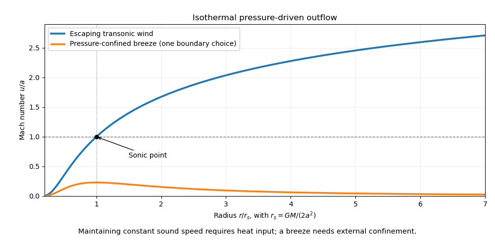

<h1 id="2/a/solution">Solution</h1>

↑ **Parent:** [A](../a.md)

A [stellar wind](../../../../../stellar-wind.md) carries matter away from a [star](../../../../../star.md), altering its [mass](../../../../../mass.md), [angular momentum](../../../../../angular-momentum.md) and surroundings. Hot coronal gas can escape through pressure-driven expansion; radiation transfers [momentum](../../../../../momentum-split.md) to gas through continuum or [spectral line](../../../../../spectral-line.md) absorption, or to dust that then drags gas. A [magnetic field](../../../../../magnetic-field-split.md) can transfer rotational [energy](../../../../../energy-split.md) and [angular momentum](../../../../../angular-momentum.md) to an outflow. These mechanisms need not give the same terminal speed or [mass loss rate](../../../../../mass-loss-rate.md).

For a steady spherical pressure-driven model, [conservation of mass](../../../../../mass-conservation.md) gives $\dot M=4\pi r^2\rho u$. Combining the radial [Euler equation](../../../../../euler-equations-for-an-inviscid-fluid-split.md) with an [isothermal equation of state](../../../../../globally-isothermal-equation-of-state.md) $p=\rho a^2$ gives the [Parker wind equation](../../../../../parker-wind-equation.md)

$$
\left(u-\frac{a^2}{u}\right)\frac{du}{dr}
=\frac{2a^2}{r}-\frac{GM}{r^2}.
$$

A smooth [transonic branch](../../../../../transonic-branch.md) passes through $u=a$ at $r_s=GM/(2a^2)$, connecting a subsonic inner atmosphere to an escaping supersonic wind. The [isothermal Parker wind](../../../../../isothermal-parker-wind.md) requires continuing heat input as the gas expands; a [polytropic stellar wind](../../../../../polytropic-stellar-wind.md) instead tracks a changing [temperature](../../../../../temperature-split.md) and must satisfy its own terminal-energy condition. A [subsonic isothermal breeze](../../../../../subsonic-isothermal-breeze.md) generally tends to a nonzero external [pressure](../../../../../pressure-split.md), so outward velocity alone does not select the escaping solution.

**[Figure 1](#2/a/image-transonic-isothermal-parker-wind-and-a-pressure-confined-breeze). Transonic isothermal Parker wind and a pressure-confined breeze**.

The [solar wind](../../../../../solar-wind.md) supplies a nearby example of an outward [plasma](../../../../../plasma-physics.md) flow carrying a [magnetic field](../../../../../magnetic-field-split.md). Profiles of [spectral lines](../../../../../spectral-line.md), especially absorption shifted by the [Doppler effect](../../../../../doppler-effect.md) together with emission, diagnose more distant [stellar winds](../../../../../stellar-wind.md). The critical-point condition and boundary heating constrain $\dot M$; it is not determined by an escape-speed estimate alone.

## ↑ Ancestors (14)

1. [A](../a.md)
2. [2](../../2.md)
3. [Paper 1](../../../paper-1-split.md)
4. [2014](../../../split.md)
5. [Past exam of the astrophysical fluid dynamics course of the University of Cambridge](../../../../split.md)
6. [Astrophysical Fluid Dynamics course of the University of Cambridge](../../../../../astrophysical-fluid-dynamics-course-of-the-university-of-cambridge.md)
7. [Physics course of the year 3 of the natural sciences course of the University of Cambridge](../../../../../physics-course-of-the-year-3-of-the-natural-sciences-course-of-the-university-of-cambridge.md)
8. [Year 3 of the natural sciences course of the University of Cambridge](../../../../../year-3-of-the-natural-sciences-course-of-the-university-of-cambridge.md)
9. [Year of the natural sciences course of the University of Cambridge](../../../../../year-of-the-natural-sciences-course-of-the-university-of-cambridge.md)
10. [Natural sciences course of the University of Cambridge](../../../../../natural-sciences-course-of-the-university-of-cambridge.md)
11. [Course of the University of Cambridge](../../../../../course-of-the-university-of-cambridge.md)
12. [University of Cambridge](../../../../../university-of-cambridge-split.md)
13. [List of universities](../../../../../list-of-universities.md)
14. [Codex Wiki](../../../../../split.md)
