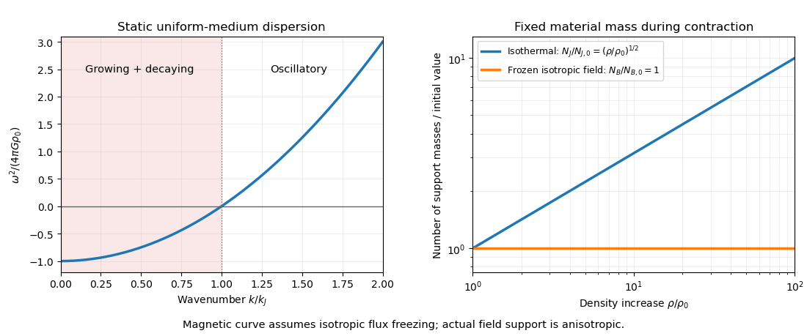

<h1 id="3/solution">Solution</h1>

↑ **Parent:** [3](../3.md)

For small isentropic perturbations of a fixed-composition [gas](../../../../gas.md), linearizing its [equation of state](../../../../equation-of-state.md) gives $p_1=(\partial p/\partial\rho)_s\rho_1=c_s^2\rho_1$. The [adiabatic sound speed](../../../../adiabatic-sound-speed.md) is evaluated at the uniform background, so it is spatially constant at this order. If fast heat exchange instead enforces constant [temperature](../../../../temperature-split.md), use the [isothermal sound speed](../../../../isothermal-sound-speed.md) consistently. A completely arbitrary [entropy](../../../../entropy-split.md) perturbation would require an additional thermodynamic variable.

The uniform static infinite medium requires the [Jeans swindle](../../../../jeans-swindle.md): its background gravitational field is subtracted or externally balanced, and only the perturbation sources the [Poisson equation for Newtonian gravity](../../../../poisson-equation-for-newtonian-gravity.md). Linearizing the [continuity equation](../../../../continuity-equation.md), [Euler equation](../../../../euler-equations-for-an-inviscid-fluid-split.md) and gravitational equation then gives

$$
\partial_t\rho_1+\rho_0\nabla\cdot\mathbf u_1=0,\qquad
\partial_t\mathbf u_1=-\frac{c_s^2}{\rho_0}\nabla\rho_1-\nabla\Psi_1,\qquad
\nabla^2\Psi_1=4\pi G\rho_1.
$$

Taking one more time derivative of the first equation and substituting the other two yields

$$
\partial_t^2\rho_1=c_s^2\nabla^2\rho_1+4\pi G\rho_0\rho_1.
$$

A [Fourier mode](../../../../fourier-mode.md) proportional to $e^{i(\mathbf k\cdot\mathbf x-\omega t)}$ therefore obeys the [Jeans instability](../../../../jeans-instability.md) relation

$$
\boxed{\omega^2=c_s^2k^2-4\pi G\rho_0
=c_s^2(k^2-k_J^2),\qquad k_J=\frac{\sqrt{4\pi G\rho_0}}{c_s}.}
$$

For $k>k_J$, the mode oscillates as a [sound wave](../../../../acoustic-wave.md). For $0<k<k_J$, $\omega=\pm i\sqrt{4\pi G\rho_0-c_s^2k^2}$ gives a growing and a decaying mode; the [static Jeans growth-rate spectrum](../../../../static-jeans-growth-rate-spectrum.md) has no preferred finite fastest-growing wavelength in the infinite-medium approximation. The threshold $k=k_J$ is marginal at linear order. The [Jeans length](../../../../jeans-length.md) is $\lambda_J=2\pi/k_J=c_s\sqrt{\pi/(G\rho_0)}$. Defining the [Jeans mass](../../../../jeans-mass.md) as a sphere whose diameter is this wavelength gives

$$
\boxed{M_J=\frac{4\pi}{3}\rho_0\left(\frac{\lambda_J}{2}\right)^3
=\frac{\pi^{5/2}}6\frac{c_s^3}{G^{3/2}\rho_0^{1/2}}.}
$$

Other radius conventions alter its numerical coefficient; the [mass](../../../../mass.md) scale compares [self-gravity](../../../../self-gravity.md) with [pressure](../../../../pressure-split.md) communication.

For the pressureless finite cloud, the [shell theorem](../../../../spherical-shell-theorem.md) gives an edge acceleration $\ddot r=-GM/r^2$, with fixed enclosed $M=4\pi r_0^3\rho_0/3$. Multiplication by $\dot r$ and integration from rest gives

$$
\frac{\dot r^2}{2}=GM\left(\frac1r-\frac1{r_0}\right),\qquad
\dot r=-\sqrt{2GM}\left(\frac1r-\frac1{r_0}\right)^{1/2}.
$$

The negative root describes collapse. Substituting $r=r_0\sin^2\theta$ gives the [free-fall time of a uniform sphere](../../../../free-fall-time-of-a-uniform-sphere.md)

$$
t_{\rm ff}=\frac{2r_0^{3/2}}{\sqrt{2GM}}\int_0^{\pi/2}\sin^2\theta\,d\theta
=\frac{\pi r_0^{3/2}}{2\sqrt{2GM}}
=\boxed{\sqrt{\frac{3\pi}{32G\rho_0}}}.
$$

The surface and inner shells reach the origin together in [pressureless homologous spherical collapse](../../../../pressureless-homologous-spherical-collapse.md); [pressure](../../../../pressure-split.md), rotation or shell crossing would change this ideal solution.

Equating this time to the specified radius-based [sound-crossing time](../../../../sound-crossing-time.md) $r_0/c_s$ gives $r_0=c_s\sqrt{3\pi/(32G\rho_0)}$. The resulting [crossing-time cloud support mass](../../../../crossing-time-cloud-support-mass.md) is

$$
\boxed{M_{\rm cross}=C_{\rm cross}\frac{c_s^3}{G^{3/2}\rho_0^{1/2}},\qquad
C_{\rm cross}=\frac{4\pi}{3}\left(\frac{3\pi}{32}\right)^{3/2}.}
$$

This is the same dimensional [mass](../../../../mass.md) scale as $M_J$, with a different coefficient because the adopted length and time criteria differ. In particular, $t_{\rm ff}=r_0/c_s$ is not the exact marginal dispersion-relation condition.

With the requested isotropic support approximation, replace $c_s$ by the [Alfvén speed](../../../../alfven-speed.md) $v_A=B/\sqrt{\mu_0\rho_0}$. In the crossing-time convention the [Magnetic Jeans mass](../../../../magnetic-jeans-mass.md) is

$$
\boxed{M_{B,{\rm cross}}=C_{\rm cross}\frac{v_A^3}{G^{3/2}\rho_0^{1/2}}
=C_{\rm cross}\frac{B^3}{(\mu_0G)^{3/2}\rho_0^2}.}
$$

Using the wavelength-based [Jeans mass](../../../../jeans-mass.md) convention instead replaces $C_{\rm cross}$ by $\pi^{5/2}/6$. The scaling, rather than a convention-independent coefficient, is the shared prediction.

For a fixed cloud [mass](../../../../mass.md) undergoing isothermal homologous contraction, $\rho/\rho_0=(r_0/r)^3$ and $c_s$ is constant. Its number of thermal [Jeans masses](../../../../jeans-mass.md) therefore grows as

$$
\boxed{N_J(\rho)=N_{J,0}\left(\frac{\rho}{\rho_0}\right)^{1/2}
=N_{J,0}\left(\frac{r_0}{r}\right)^{3/2}.}
$$

A cloud initially close to the support threshold has $N_{J,0}$ of order one, so smaller pieces can subsequently become independently unstable: this is [isothermal fragmentation](../../../../isothermal-fragmentation.md).

For approximately isotropic contraction with [magnetic flux freezing](../../../../magnetic-flux-freezing.md), $Br^2$ stays constant, so $B\propto\rho^{2/3}$. Hence $M_B\propto B^3/\rho^2$ stays constant and

$$
\boxed{N_B(\rho)=N_{B,0}.}
$$

This ideal magnetic support therefore does not create progressively more unstable masses in the way thermal isothermal support does. The same conclusion follows from the conserved [mass-to-flux ratio](../../../../mass-to-flux-ratio.md). A magnetically subcritical cloud cannot initiate unrestricted cross-field collapse under ideal flux freezing alone; flux loss or initially supercritical conditions are needed. A real [magnetic field](../../../../magnetic-field-split.md) also gives anisotropic support: motion and fragmentation along its field lines are not excluded by this scalar-speed estimate.

**[Figure 2](#3/image-jeans-dispersion-relation-and-the-changing-number-of-support-masses-during-idealized-collapse). Jeans dispersion relation and the changing number of support masses during idealized collapse**.

## ↑ Ancestors (13)

1. [3](../3.md)
2. [Paper 1](../../paper-1-split.md)
3. [2014](../../split.md)
4. [Past exam of the astrophysical fluid dynamics course of the University of Cambridge](../../../split.md)
5. [Astrophysical Fluid Dynamics course of the University of Cambridge](../../../../astrophysical-fluid-dynamics-course-of-the-university-of-cambridge.md)
6. [Physics course of the year 3 of the natural sciences course of the University of Cambridge](../../../../physics-course-of-the-year-3-of-the-natural-sciences-course-of-the-university-of-cambridge.md)
7. [Year 3 of the natural sciences course of the University of Cambridge](../../../../year-3-of-the-natural-sciences-course-of-the-university-of-cambridge.md)
8. [Year of the natural sciences course of the University of Cambridge](../../../../year-of-the-natural-sciences-course-of-the-university-of-cambridge.md)
9. [Natural sciences course of the University of Cambridge](../../../../natural-sciences-course-of-the-university-of-cambridge.md)
10. [Course of the University of Cambridge](../../../../course-of-the-university-of-cambridge.md)
11. [University of Cambridge](../../../../university-of-cambridge-split.md)
12. [List of universities](../../../../list-of-universities.md)
13. [Codex Wiki](../../../../split.md)
