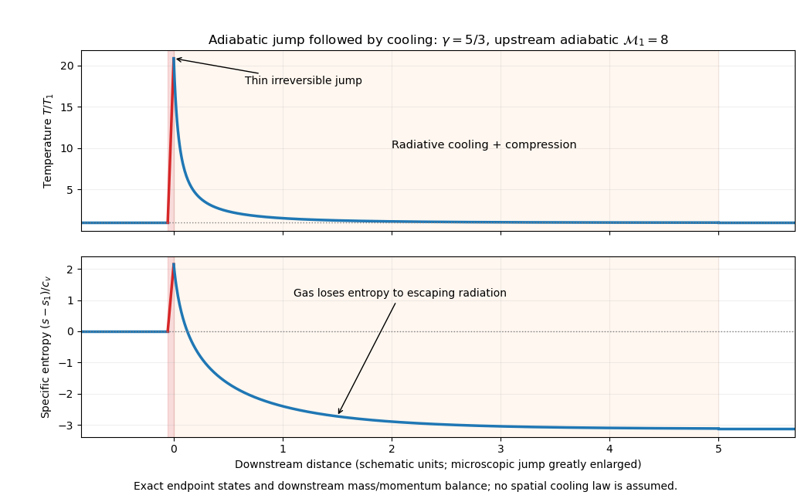

<h1 id="4/solution">Solution</h1>

↑ **Parent:** [4](../4.md)

The [Mach number](../../../../mach-number.md) is $\mathcal M=u/c_s$, comparing the flow speed relative to a disturbance with the local [sound speed](../../../../speed-of-sound.md). For a body moving supersonically, spherical acoustic disturbances emitted earlier have a tangent envelope with [Mach cone](../../../../mach-cone.md) half-angle $\sin\theta=1/\mathcal M$. Signals cannot propagate arbitrarily far upstream. Compressive characteristics can converge and steepen into a [shock wave](../../../../shock-wave.md), within which microscopic dissipation prevents a multivalued fluid state; supersonic motion alone does not require every flow to contain a shock.

Work in the [shock frame](../../../../shock-frame.md) with steady normal velocities $u_1,u_2>0$. Integrating [conservation of mass](../../../../mass-conservation.md), normal [momentum](../../../../momentum-split.md) and total [energy](../../../../energy-split.md) over a thin pillbox, neglecting gravity across the thin layer, gives the [Rankine-Hugoniot conditions for a perfect gas](../../../../rankine-hugoniot-conditions-for-a-perfect-gas.md):

$$
j=\rho_1u_1=\rho_2u_2,\qquad
p_1+\rho_1u_1^2=p_2+\rho_2u_2^2,
$$

$$
j\left(h_1+\frac{u_1^2}{2}\right)
=j\left(h_2+\frac{u_2^2}{2}\right),\qquad
h=\frac{\gamma p}{(\gamma-1)\rho}.
$$

The [energy](../../../../energy-split.md) equation includes [pressure](../../../../pressure-split.md) work through [specific enthalpy](../../../../specific-enthalpy.md). The shock is adiabatic if negligible [heat](../../../../heat-split.md) escapes the layer, but its irreversible dissipation means it is not isentropic.

Put $\chi=\rho_2/\rho_1=u_1/u_2$ and $\mathcal M_1=u_1/\sqrt{\gamma p_1/\rho_1}$. [Momentum](../../../../momentum-split.md) conservation gives $p_2=p_1+\rho_1u_1^2(1-1/\chi)$. Substitution in the [energy](../../../../energy-split.md) equation produces the unshocked root $\chi=1$ and the compressive root

$$
\chi=\frac{(\gamma+1)\mathcal M_1^2}{(\gamma-1)\mathcal M_1^2+2},\qquad
\frac{p_2}{p_1}=\frac{2\gamma\mathcal M_1^2-(\gamma-1)}{\gamma+1}.
$$

Since $\rho_1u_1^2/p_1=\gamma\mathcal M_1^2$, the strong-shock limit has negligible upstream thermal [pressure](../../../../pressure-split.md) compared with ram [pressure](../../../../pressure-split.md). The [Strong-shock Rankine-Hugoniot conditions](../../../../strong-shock-rankine-hugoniot-conditions.md) give

$$
\boxed{\frac{\rho_2}{\rho_1}=\frac{u_1}{u_2}\longrightarrow\frac{\gamma+1}{\gamma-1},\qquad
\frac{p_2}{p_1}\simeq\frac{2\gamma}{\gamma+1}\mathcal M_1^2.}
$$

For unchanged composition, the [ideal gas law](../../../../ideal-gas-law.md) implies $T_2/T_1=(p_2/p_1)/\chi$, so

$$
\boxed{\frac{T_2}{T_1}\simeq\frac{2\gamma(\gamma-1)}{(\gamma+1)^2}\mathcal M_1^2.}
$$

For $\gamma=5/3$, the compression tends to four and $T_2\simeq3\bar m u_1^2/(16k_B)$, where $\bar m$ is mean particle [mass](../../../../mass.md).

With constant specific heat $c_v$, [entropy production in a perfect-gas shock](../../../../entropy-production-in-a-perfect-gas-shock.md) is measured by the change in [specific entropy](../../../../specific-entropy.md)

$$
\Delta s=c_v\ln\left[\frac{p_2}{p_1}\left(\frac{\rho_1}{\rho_2}\right)^\gamma\right].
$$

The strong-shock expression is therefore

$$
\boxed{\Delta s\simeq c_v\ln\left[\frac{2\gamma\mathcal M_1^2}{\gamma+1}
\left(\frac{\gamma-1}{\gamma+1}\right)^\gamma\right].}
$$

The exact jump is positive for every compressive shock with $\mathcal M_1>1$, in accordance with the [Second law of thermodynamics](../../../../second-law-of-thermodynamics-split.md); the asymptotic expression is only for $\mathcal M_1\gg1$. There is a normalization issue in the printed description: this logarithmic formula with constant $c_v$ describes [entropy](../../../../entropy-split.md) per unit [mass](../../../../mass.md). The true [entropy density](../../../../entropy-density.md) is $\rho s$, so its difference is $\rho_2s_2-\rho_1s_1$, rather than the same logarithmic jump with a constant [heat capacity](../../../../heat-capacity.md) per unit [volume](../../../../volume.md). A material parcel's irreversible [entropy](../../../../entropy-split.md) increase should be assessed using $\Delta s$.

Downstream gas is denser and hotter. For optically thin collisional emission the loss per unit [volume](../../../../volume.md) is typically $n_en_i\Lambda(T)$, whereas stored thermal [energy](../../../../energy-split.md) scales approximately as $nT$. Compression can therefore reduce the [radiative gas cooling time](../../../../optically-thin-gas-cooling-time.md); excitation and ionization at the higher [temperature](../../../../temperature-split.md) can open additional cooling channels. The actual efficiency still depends on the [astrophysical cooling function](../../../../astrophysical-cooling-function.md), composition and [optical depth](../../../../optical-depth.md). In a radiative shock with separated scales, the [temperature](../../../../temperature-split.md) first rises across a narrow dissipative layer, then decreases through a much broader cooling region of characteristic length $\ell_{\rm cool}\sim u_2t_{\rm cool}$. Subsonic cooling usually brings further compression with approximately constant [pressure](../../../../pressure-split.md). The immediate microscopic shock thickness and the macroscopic cooling length are distinct.

Let state $f$ be the fully cooled gas, with $T_f=T_1$ and the same composition. Set $a^2=p_1/\rho_1$, the [isothermal sound speed](../../../../isothermal-sound-speed.md) squared. Across the entire shock plus cooling layer, [mass](../../../../mass.md) and [momentum](../../../../momentum-split.md) are still conserved, but gas [energy](../../../../energy-split.md) alone is not. With $\chi_f=\rho_f/\rho_1$,

$$
a^2+u_1^2=a^2\chi_f+\frac{u_1^2}{\chi_f},\qquad
(\chi_f-1)(a^2\chi_f-u_1^2)=0.
$$

The nontrivial [isothermal shock](../../../../isothermal-shock.md) therefore has

$$
\boxed{\rho_f=\rho_1\frac{u_1^2}{a^2}
=\gamma\mathcal M_1^2\rho_1.}
$$

If the upstream Mach number were defined with $a$ instead, this would be $\rho_f/\rho_1=\mathcal M_{\rm iso}^2$. Retaining the distinction avoids losing the factor $\gamma$.

The gas's [specific entropy](../../../../specific-entropy.md) rises irreversibly at the hot shock and then decreases as escaping radiation removes heat. Since the final [temperature](../../../../temperature-split.md) equals the initial [temperature](../../../../temperature-split.md),

$$
\boxed{s_f-s_1=-(\gamma-1)c_v\ln\chi_f<0.}
$$

This decrease for the gas is consistent with the [Second law of thermodynamics](../../../../second-law-of-thermodynamics-split.md): the emitted radiation and its eventual surroundings carry [entropy](../../../../entropy-split.md) away. It does not make the microscopic compressive shock reversible. The figure illustrates both the hot [entropy](../../../../entropy-split.md) jump and the subsequent cooling; its spatial cooling profile is schematic because no cooling law has been specified.

**[Figure 3](#4/image-temperature-and-specific-entropy-across-an-adiabatic-shock-followed-by-radiative-cooling). Temperature and specific entropy across an adiabatic shock followed by radiative cooling**.

## ↑ Ancestors (13)

1. [4](../4.md)
2. [Paper 1](../../paper-1-split.md)
3. [2014](../../split.md)
4. [Past exam of the astrophysical fluid dynamics course of the University of Cambridge](../../../split.md)
5. [Astrophysical Fluid Dynamics course of the University of Cambridge](../../../../astrophysical-fluid-dynamics-course-of-the-university-of-cambridge.md)
6. [Physics course of the year 3 of the natural sciences course of the University of Cambridge](../../../../physics-course-of-the-year-3-of-the-natural-sciences-course-of-the-university-of-cambridge.md)
7. [Year 3 of the natural sciences course of the University of Cambridge](../../../../year-3-of-the-natural-sciences-course-of-the-university-of-cambridge.md)
8. [Year of the natural sciences course of the University of Cambridge](../../../../year-of-the-natural-sciences-course-of-the-university-of-cambridge.md)
9. [Natural sciences course of the University of Cambridge](../../../../natural-sciences-course-of-the-university-of-cambridge.md)
10. [Course of the University of Cambridge](../../../../course-of-the-university-of-cambridge.md)
11. [University of Cambridge](../../../../university-of-cambridge-split.md)
12. [List of universities](../../../../list-of-universities.md)
13. [Codex Wiki](../../../../split.md)
