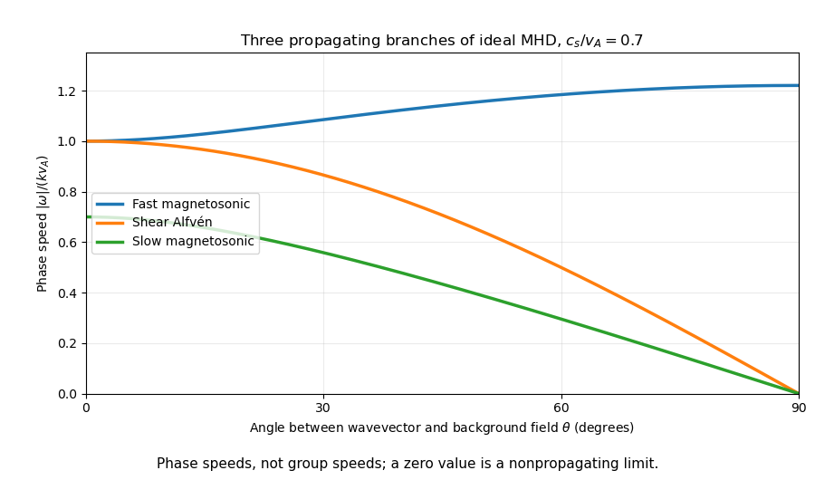
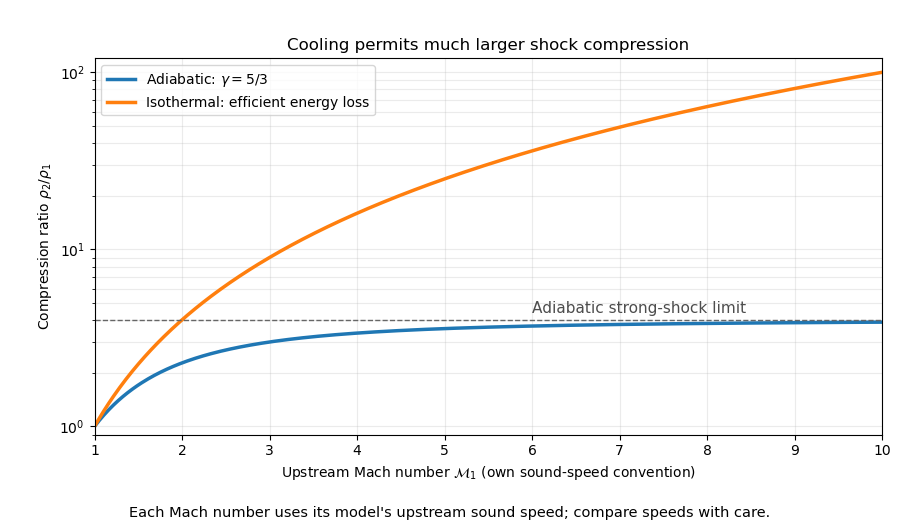

# Paper 1

↑ **Parent:** [2015](../2015.md)

Original public paper: [Physical PDF pages 351–354](https://www.whatdotheyknow.com/request/natural_science_tripos_physics_e_2/response/2340776/attach/2/FOI%202023%20399%20Zahid%20materials.pdf?cookie_passthrough=1#page=351). All questions and all optional notes are covered. The spherical accretion estimate and pressure-negligible wind approximation are stated explicitly; neither follows from steadiness or adiabaticity alone.

**Table of contents**

- [1](#1)
  - [a](#1/a)
    - [Solution](#1/a/solution)
  - [b](#1/b)
    - [Solution](#1/b/solution)
  - [c](#1/c)
    - [Solution](#1/c/solution)
- [2](#2)
  - [a](#2/a)
    - [Solution](#2/a/solution)
  - [b](#2/b)
    - [Solution](#2/b/solution)
  - [c](#2/c)
    - [Solution](#2/c/solution)
- [3](#3)
  - [Solution](#3/solution)
- [4](#4)
  - [a](#4/a)
    - [Solution](#4/a/solution)
  - [b](#4/b)
    - [Solution](#4/b/solution)
  - [c](#4/c)
    - [Solution](#4/c/solution)
  - [d](#4/d)
    - [Solution](#4/d/solution)
  - [e](#4/e)
    - [Solution](#4/e/solution)

## 1

↑ **Parent:** [Paper 1](paper-1.md)

<h3 id="1/a">a</h3>

↑ **Parent:** [1](#1)

<h4 id="1/a/solution">Solution</h4>

↑ **Parent:** [A](#1/a)

For a steady, spherically symmetric radial inflow, [conservation of mass](../../continuum-mechanics.md#mass-conservation) makes the [mass accretion rate](../../astrophysical-black-hole.md#mass-accretion-rate) independent of radius:

$$
\dot M=4\pi r^2\rho |v_r|.
$$

Atomic [hydrogen](../../chemical-substance.md#hydrogen) gives $\rho\simeq m_Hn$. The Newtonian [free-fall speed](../../astrophysical-black-hole.md#free-fall-speed) from rest at infinity is $|v_r|=\sqrt{2GM/r}$, obtained by setting the specific mechanical [energy](../../energy.md) $v_r^2/2-GM/r$ to zero. Hence the [spherical free-fall accretion rate](../../astrophysical-black-hole.md#spherical-free-fall-accretion-rate) is

$$
\boxed{\dot M=4\pi m_Hn\sqrt{2GM}\,r^{3/2}.}
$$

Using the given values gives $\rho\simeq1.67\times10^{-21}\,\mathrm{kg\,m^{-3}}$, $|v_r|\simeq2.98\times10^5\,\mathrm{m\,s^{-1}}$, and

$$
\boxed{\dot M\simeq5.65\times10^{18}\,\mathrm{kg\,s^{-1}}
\simeq8.96\times10^{-5}\,M_\odot\,\mathrm{yr^{-1}}.}
$$

The area factor assumes a full spherical inflow with negligible angular momentum. With only a local [number density](../../statistical-physics.md#number-density) and speed, an arbitrary nonspherical inflow's total rate is not fixed; one instead integrates $-\rho\mathbf v\cdot d\mathbf S$ over the inflow surface. This is a flux estimate, rather than the pressure-selected [Bondi accretion](../../astrophysical-black-hole.md#bondi-accretion) solution.

<h3 id="1/b">b</h3>

↑ **Parent:** [1](#1)

<h4 id="1/b/solution">Solution</h4>

↑ **Parent:** [B](#1/b)

Let all [velocity](../../classical-mechanics.md#velocity) amplitudes refer to the same positive normal direction, from medium 1 into medium 2. For a right-going linear [sound wave](../../fluid-mechanics.md#acoustic-wave), its [pressure](../../pressure.md) amplitude is $p'=Zu'$ with [acoustic impedance](../../elasticity-physics.md#acoustic-impedance) $Z=\rho c_s$; for a left-going wave it is $p'=-Zu'$. Continuity of normal [velocity](../../classical-mechanics.md#velocity) and [pressure](../../pressure.md) at the interface gives

$$
u_i+u_r=u_t,\qquad Z_1(u_i-u_r)=Z_2u_t.
$$

Eliminating $u_t$ yields the [normal-incidence acoustic velocity reflection coefficient](../../wave-equation.md#normal-incidence-acoustic-velocity-reflection-coefficient)

$$
\frac{u_r}{u_i}=\frac{Z_1-Z_2}{Z_1+Z_2}.
$$

The common [adiabatic index](../../ideal-gas.md#heat-capacity-ratio) and mean particle mass $\bar m$ give $c_{s,j}=\sqrt{\gamma k_BT_j/\bar m}$, so

$$
\boxed{\frac{u_r}{u_i}=\frac{\rho_1\sqrt{T_1}-\rho_2\sqrt{T_2}}
{\rho_1\sqrt{T_1}+\rho_2\sqrt{T_2}}.}
$$

A negative coefficient reverses the reflected [velocity](../../classical-mechanics.md#velocity) perturbation's phase in this fixed coordinate system. The reflected pressure coefficient has the opposite sign. Pressure balance also gives $\rho_1T_1=\rho_2T_2$, so the impedance ratio can equivalently be written $Z_2/Z_1=\sqrt{\rho_2/\rho_1}$. These are normal-incidence, small-amplitude results without a surface mass or tension.

<h3 id="1/c">c</h3>

↑ **Parent:** [1](#1)

<h4 id="1/c/solution">Solution</h4>

↑ **Parent:** [C](#1/c)

Work in an inertial [centre of mass](../../classical-mechanics.md#center-of-mass) frame and write $I=\sum_i m_i|\mathbf r_i|^2$. Differentiation and [Newton's second law](../../force.md#newton-s-second-law) give

$$
\frac12\ddot I=2T+\sum_i\mathbf r_i\cdot\mathbf F_i.
$$

The pairwise Newtonian [gravitational potential energy](../../energy.md#gravitational-energy) is

$$
\Omega=-\sum_{i<j}\frac{Gm_im_j}{|\mathbf r_i-\mathbf r_j|}.
$$

For each pair, combining the two force contributions gives $-Gm_im_j/|\mathbf r_i-\mathbf r_j|$. Therefore $\sum_i\mathbf r_i\cdot\mathbf F_i=\Omega$, and

$$
\frac12\ddot I=2T+\Omega.
$$

For a stationary configuration, or after a long-time average of a bounded system whose endpoint term vanishes, the [virial theorem](../../classical-mechanics.md#virial-theorem) gives

$$
\boxed{2\langle T\rangle+\langle\Omega\rangle=0.}
$$

The brackets may be suppressed when $T,\Omega$ denote equilibrium averages. A collapsing cloud or an eccentric [Kepler orbit](../../celestial-mechanics.md#kepler-orbit) need not obey $2T+\Omega=0$ instantaneously. Confining surface pressure, magnetic stress or other external forces add their own virial terms; the displayed result concerns an isolated gravitational particle system.

## 2

↑ **Parent:** [Paper 1](paper-1.md)

<h3 id="2/a">a</h3>

↑ **Parent:** [2](#2)

<h4 id="2/a/solution">Solution</h4>

↑ **Parent:** [A](#2/a)

A uniform conducting fluid supports three propagating [magnetohydrodynamic wave](../../ideal-magnetohydrodynamics.md#magnetohydrodynamic-wave) branches. [Ideal magnetohydrodynamics](../../ideal-magnetohydrodynamics.md) couples fluid [velocity](../../classical-mechanics.md#velocity) to the [magnetic field](../../magnetic-field.md) through the induction equation; the [Lorentz force](../../relativistic-electromagnetism.md#lorentz-force) then supplies magnetic tension and magnetic pressure restoring forces. Let $\theta$ be the angle between [wave vector](../../elasticity-physics.md#wavevector) $\mathbf k$ and background field $\mathbf B_0$, and define [Alfvén speed](../../ideal-magnetohydrodynamics.md#alfven-speed) $v_A=B_0/\sqrt{\mu_0\rho_0}$ and [adiabatic sound speed](../../compressible-flow.md#adiabatic-sound-speed) $c_s^2=\gamma p_0/\rho_0$.

The shear [Alfvén wave](../../ideal-magnetohydrodynamics.md#alfven-wave) has

$$
\boxed{\omega^2=k^2v_A^2\cos^2\theta.}
$$

Its [velocity](../../classical-mechanics.md#velocity) perturbation is perpendicular to both $\mathbf k$ and $\mathbf B_0$. It bends field lines without first-order compression, so magnetic tension is the restoring force. Its [group velocity](../../dispersion-relation.md#group-velocity) follows the background field; the displayed phase speed along $\mathbf k$ is not the full group speed.

The [fast magnetosonic wave](../../ideal-magnetohydrodynamics.md#fast-magnetosonic-wave) and [slow magnetosonic wave](../../ideal-magnetohydrodynamics.md#slow-magnetosonic-wave) involve coupled compression and magnetic perturbations, with displacement in the plane of $\mathbf k,\mathbf B_0$:

$$
\boxed{\frac{\omega_{f,s}^2}{k^2}=\frac12\left[c_s^2+v_A^2
\pm\sqrt{(c_s^2+v_A^2)^2-4c_s^2v_A^2\cos^2\theta}\right].}
$$

The plus sign is the fast branch. Parallel propagation gives characteristic speeds $c_s,v_A$; perpendicular propagation gives fast speed $\sqrt{c_s^2+v_A^2}$ while the other two phase frequencies vanish. Degenerate directions require care in assigning polarizations, rather than claiming three distinct nonzero frequencies everywhere.

**[Figure 1](#2/a/image-angular-dependence-of-the-three-ideal-magnetohydrodynamic-phase-speeds). Angular dependence of the three ideal magnetohydrodynamic phase speeds**. Original homogeneous ideal-fluid calculation for sound speed 0.7 times the Alfvén speed. The curves are phase speeds and do not depict group-velocity rays.

These [waves](../../wave.md) transport [energy](../../energy.md) and [momentum](../../momentum.md) through magnetized stellar atmospheres and astrophysical plasmas. Their restoring mechanisms distinguish them from ordinary acoustic waves. Resistivity, viscosity, ion-neutral friction and kinetic effects introduce damping or change the model; an ideal undamped [dispersion relation](../../dispersion-relation.md) alone does not calculate coronal heating.

<h3 id="2/b">b</h3>

↑ **Parent:** [2](#2)

<h4 id="2/b/solution">Solution</h4>

↑ **Parent:** [B](#2/b)

For steady inviscid motion of a [barotropic fluid](../../fluid-mechanics.md#barotropic-fluid) in a conservative [gravitational potential](../../newton-s-law-of-universal-gravitation.md#newtonian-potential-of-a-point-mass) $\Phi$, the [Euler equations for an inviscid fluid](../../euler-equations-for-an-inviscid-fluid.md) imply the [Bernoulli equation](../../euler-equations-for-an-inviscid-fluid.md#bernoulli-equation)

$$
\boxed{\frac{v^2}{2}+h+\Phi=B,\qquad dh=\frac{dp}{\rho},}
$$

along each streamline. The [barotropic enthalpy function](../../fluid-mechanics.md#barotropic-enthalpy-function) $h$ has units of energy per unit mass. For an isentropic [ideal gas](../../ideal-gas.md), $p=K\rho^\gamma$ gives $h=\gamma p/[(\gamma-1)\rho]$ up to an additive constant. For constant density, the corresponding term is $p/\rho$. Pressure work converts between kinetic, enthalpy and gravitational energy.

A converging subsonic nozzle can accelerate a fluid at the expense of its enthalpy; in the incompressible horizontal approximation, higher speed accompanies lower static [pressure](../../pressure.md). Together with [conservation of mass](../../continuum-mechanics.md#mass-conservation), this explains a [Venturi effect](../../euler-equations-for-an-inviscid-fluid.md#venturi-effect) measurement. Compressible nozzle flow additionally needs its equation of state and sonic conditions. In a stellar wind, the potential term is $-GM/r$, so enthalpy or mechanical energy can be spent escaping gravity. A pressure-negligible marginal-escape wind has $v^2/2-GM/r=0$.

The constant need not be the same on different streamlines. Irrotational barotropic flow in a connected region gives a common value; a general rotational flow does not. A pump, viscosity, a radiating shock, or heat addition changes the relevant energy balance. In particular, adiabaticity alone does not allow one to drop the enthalpy term.

<h3 id="2/c">c</h3>

↑ **Parent:** [2](#2)

<h4 id="2/c/solution">Solution</h4>

↑ **Parent:** [C](#2/c)

[Hydrostatic equilibrium](../../statistical-physics.md#hydrostatic-equilibrium) and dimensional scaling give characteristic stellar pressure $p\sim GM^2/R^4$ and [mass density](../../fluid-mechanics.md#density) $\rho\sim M/R^3$. For a fixed-index [stellar polytrope](../../stellar-structure.md#stellar-polytrope) with $p=K\rho^{1+1/n}$, eliminating density gives the [polytropic mass-radius relation](../../stellar-structure.md#polytropic-mass-radius-relation)

$$
\boxed{R\propto\left(\frac KG\right)^{n/(3-n)}M^{(1-n)/(3-n)},\qquad n\ne3.}
$$

The dimensionless coefficient is determined by the corresponding [Lane-Emden equation](../../nonlinear-analysis.md#lane-emden-equation) and boundary conditions. Both the index and $K$ must be held fixed to infer this mass dependence.

Nonrelativistic electron degeneracy has $n=3/2$, hence **$R\propto M^{-1/3}$** for cold fixed-composition [white dwarfs](../../stellar-astrophysics.md#white-dwarf): adding mass makes the object smaller. Relativistic electron degeneracy approaches $n=3$; the mass scale becomes proportional to $(K/G)^{3/2}$ independently of the radius, giving the ideal [Chandrasekhar limit](../../stellar-astrophysics.md#chandrasekhar-limit). The limiting model signals loss of the ordinary stable cold sequence; it does not determine a unique radius at that mass.

For a gas-pressure-supported star, the [virial theorem](../../classical-mechanics.md#virial-theorem) instead gives characteristic temperature $k_BT\sim G\bar mM/R$. Specifying a common characteristic temperature gives $R\propto M$, but stellar temperatures are not generally identical. A [main-sequence star](../../stellar-astrophysics.md#main-sequence-star) also requires nuclear energy generation and radiative or convective transport. Consequently there is no universal mass-radius exponent applicable to every main-sequence mass and composition. An isentropic convective model and a cold degeneracy-supported model can share index $3/2$ while having quite different physical meanings and values of $K$.

## 3

↑ **Parent:** [Paper 1](paper-1.md)

<h3 id="3/solution">Solution</h3>

↑ **Parent:** [3](#3)

The [Rankine-Hugoniot conditions for a perfect gas](../../compressible-flow.md#rankine-hugoniot-conditions-for-a-perfect-gas) express conservation of mass flux, normal momentum flux, and total energy flux through a steady planar [shock wave](../../transport-equation.md#shock-wave) in its rest frame. With mass flux $j=\rho_1u_1=\rho_2u_2$, momentum flux is $\rho u^2+p$ and specific transported energy is $u^2/2+e+p/\rho$. The last term is pressure work, so the energy equation contains [specific enthalpy](../../enthalpy.md#specific-enthalpy) rather than only [specific internal energy](../../internal-energy.md#specific-internal-energy). Neglect gravity across the thin front, magnetic stresses and radiative energy loss for the adiabatic case.

For a calorically perfect [ideal gas](../../ideal-gas.md), $e=p/[(\gamma-1)\rho]$ and $c_s^2=\gamma p/\rho$. Therefore

$$
\boxed{\frac{u_1^2}{2}+\frac{c_{s,1}^2}{\gamma-1}
=\frac{u_2^2}{2}+\frac{c_{s,2}^2}{\gamma-1}.}
$$

Put $\chi=\rho_2/\rho_1$, so $u_2=u_1/\chi$. Momentum conservation gives

$$
\frac{p_2}{p_1}=1+\gamma\mathcal M_1^2\left(1-\frac1\chi\right),
\qquad \mathcal M_1=\frac{u_1}{c_{s,1}}.
$$

Insert this and $c_{s,2}^2/c_{s,1}^2=(p_2/p_1)/\chi$ into the energy equation. After multiplying out, its two factors are

$$
(\chi-1)\left[\big((\gamma-1)\mathcal M_1^2+2\big)\chi
-(\gamma+1)\mathcal M_1^2\right]=0.
$$

The first root is the unchanged flow. The compressive [shock](../../transport-equation.md#shock-wave) branch is

$$
\boxed{\chi=\frac{(\gamma+1)\mathcal M_1^2}{(\gamma-1)\mathcal M_1^2+2}
=\frac{\gamma+1}{\gamma-1+2/\mathcal M_1^2}.}
$$

It has $\chi>1$ for upstream supersonic flow. A strong shock approaches $(\gamma+1)/(\gamma-1)$: **four for a monatomic gas**, or six for a fixed rotationally excited diatomic gas with $\gamma=7/5$. The assumed fixed heat capacity ceases to describe the gas when dissociation or ionization becomes important. Adiabatic here means no net heat lost from the shock-plus-flow energy budget; the irreversible front still increases [entropy](../../entropy.md).

For an [isothermal shock](../../compressible-flow.md#isothermal-shock) of unchanged composition, let $a^2=p/\rho=k_BT/\bar m$ be the common [isothermal sound speed](../../compressible-flow.md#isothermal-sound-speed) squared. Mass and momentum conservation give

$$
u_1^2+a^2=\frac{u_1^2}{\chi}+a^2\chi,
\qquad (\chi-1)(a^2\chi-u_1^2)=0.
$$

The compressive branch is therefore

$$
\boxed{\chi=\mathcal M_{T,1}^2,\qquad \mathcal M_{T,1}=u_1/a.}
$$

Unlike the adiabatic ratio, it has no fixed upper bound as its upstream Mach number grows. Heat removal prevents the pressure increase that would otherwise resist compression. This approximation describes an efficiently cooled jump between equal-temperature far states, not an adiabatic shock with its energy equation left unchanged. For the same upstream physical temperature and velocity, $\mathcal M_{T,1}=\sqrt\gamma\mathcal M_1$; the two sound-speed conventions must not be confused.

**[Figure 2](#3/image-bounded-adiabatic-compression-and-increasing-isothermal-compression). Bounded adiabatic compression and increasing isothermal compression**. Original comparison for fixed composition. The horizontal Mach coordinate uses each model's own upstream sound speed, so equal plotted Mach numbers do not mean identical upstream temperatures and velocities.

Full dissociation changes the equation of state even when the temperature is held constant. With negligible electron and binding-energy mass corrections, upstream molecular [hydrogen](../../chemical-substance.md#hydrogen) has $a_1^2=k_BT/(2m_H)$ and downstream atomic [hydrogen](../../chemical-substance.md#hydrogen) has $a_2^2=k_BT/m_H=2a_1^2$. The conserved quantity is mass flux; particle number flux doubles. Thus

$$
\boxed{\chi=\frac{u_1}{u_2},\qquad
u_1^2+a_1^2=u_1u_2+2a_1^2\frac{u_1}{u_2}.}
$$

Equivalently, the [dissociating isothermal shock](../../compressible-flow.md#dissociating-isothermal-shock) relation between temperature and the two velocities is

$$
\boxed{a_1^2=\frac{u_1u_2(u_1-u_2)}{2u_1-u_2}.}
$$

Writing $\mathcal M_{T,1}=u_1/a_1$ gives

$$
2\chi^2-(\mathcal M_{T,1}^2+1)\chi+\mathcal M_{T,1}^2=0.
$$

The high-compression branch is

$$
\boxed{\chi=\frac{\mathcal M_{T,1}^2+1+
\sqrt{(\mathcal M_{T,1}^2+1)^2-8\mathcal M_{T,1}^2}}4.}
$$

Its strong-shock limit is $\chi\sim\mathcal M_{T,1}^2/2$, rather than $\mathcal M_{T,1}^2$. The pressure per unit mass has doubled, reducing the compression available at a fixed upstream temperature and speed. A real compressive branch in this prescribed fully dissociated, equal-temperature model requires $\mathcal M_{T,1}\ge1+\sqrt2$; the high root has downstream speed no greater than the downstream isothermal sound speed. These mass and momentum conditions do not themselves establish that sufficient energy is available to dissociate every molecule. The chemical energy and any required radiative loss must also be included in a physical energy budget.

## 4

↑ **Parent:** [Paper 1](paper-1.md)

<h3 id="4/a">a</h3>

↑ **Parent:** [4](#4)

<h4 id="4/a/solution">Solution</h4>

↑ **Parent:** [A](#4/a)

For a uniform sphere, $M=4\pi\rho R^3/3$ and its [gravitational potential energy](../../energy.md#gravitational-energy) is $\Omega=-3GM^2/(5R)$. The ideal-gas [kinetic energy](../../energy.md#kinetic-energy) is $E_{\rm kin}=3Mk_BT/(2\bar m)$. Equating these magnitudes using the [virial theorem](../../classical-mechanics.md#virial-theorem) gives $GM/R=5k_BT/\bar m$. Eliminating $R$ yields the [uniform-sphere pressure-work collapse criterion](../../stellar-astrophysics.md#uniform-sphere-pressure-work-collapse-criterion)

$$
M_{\rm crit}=\left(\frac{5k_BT}{G\bar m}\right)^{3/2}
\left(\frac3{4\pi\rho}\right)^{1/2}.
$$

In particular, for fixed composition,

$$
\boxed{M_J\propto T^{3/2}\rho^{-1/2}.}
$$

The same [Jeans mass](../../stellar-astrophysics.md#jeans-mass) scaling follows from $c_s^2k^2\sim4\pi G\rho$ in the [Jeans instability](../../linear-cosmological-density-perturbation.md#jeans-instability) dispersion relation and a characteristic size $k^{-1}$. Pressure communicates support in a sound-crossing time; sufficiently strong self-gravity wins when the gravitational time is shorter.

The numerical coefficient depends on the equilibrium, boundary and wavelength-to-cloud conventions. A sphere with both exactly uniform density and uniform temperature is not an exact hydrostatic self-gravitating ideal-gas equilibrium without additional stresses. The uniform-sphere argument establishes the characteristic mass scaling; it does not prove an exact stability boundary for that nonexistent equilibrium.

<h3 id="4/b">b</h3>

↑ **Parent:** [4](#4)

<h4 id="4/b/solution">Solution</h4>

↑ **Parent:** [B](#4/b)

Let $\mathcal L$ be net cooling per unit volume, positive when energy is lost. At thermal equilibrium $\mathcal L=0$. For a slow perturbation that maintains [pressure](../../pressure.md) balance, the linearized thermal equation is

$$
\rho_0c_p\frac{d\delta T}{dt}=-\left(\frac{\partial\mathcal L}{\partial T}\right)_P\delta T.
$$

The heat capacity factor is positive. A positive derivative restores equilibrium: hotter gas cools more strongly, while cooler gas is heated. This is [isobaric thermal stability of a heated ideal gas](../../astrophysical-fluid-dynamics.md#isobaric-thermal-stability-of-a-heated-ideal-gas).

For fully ionized [hydrogen](../../chemical-substance.md#hydrogen), both protons and electrons contribute to the [ideal gas law](../../ideal-gas.md#ideal-gas-law), so **$P=2nk_BT$**. Treat the stated constant heat input $\Gamma$ as a fixed heating rate per unit volume. Substituting $n=P/(2k_BT)$ into the cooling gives

$$
\mathcal L(T;P)=\frac{3P^2\alpha_B(T)}{8k_BT}-\Gamma.
$$

At equilibrium $T_0$, its derivative is

$$
\boxed{\left(\frac{\partial\mathcal L}{\partial T}\right)_{P,T_0}
=\frac\Gamma{T_0}\left(\frac{d\ln\alpha_B}{d\ln T}-1\right)_{T_0}.}
$$

With a temperature-independent recombination coefficient, the derivative is $-\Gamma/T_0$: **the equilibrium is thermally unstable to isobaric perturbations**. More generally, any nonincreasing $\alpha_B(T)$ also gives instability; stability requires its logarithmic slope to exceed one. Heating at fixed volume and pressure-balanced perturbations are distinct assumptions: the density falls as a parcel is heated, reducing the quadratic-density cooling.

No temperature law for $\alpha_B$ is supplied, so the displayed slope criterion states the general result without inventing one. A constant incident ultraviolet flux need not imply constant local volumetric heating in a self-consistent ionization-balance calculation. If the heating instead varies with density, temperature or neutral fraction, its derivative must be included; the conclusion here uses the explicit constant-$\Gamma$ model.

<h3 id="4/c">c</h3>

↑ **Parent:** [4](#4)

<h4 id="4/c/solution">Solution</h4>

↑ **Parent:** [C](#4/c)

In the stated gravity-dominated approximation, neglect the pressure force in the radial momentum equation. A steady outward [stellar wind](../../stellar-astrophysics.md#stellar-wind) then obeys

$$
v\frac{dv}{dr}=-\frac{GM_*}{r^2},\qquad
\frac{v^2}{2}-\frac{GM_*}{r}=C.
$$

At $R_e=R_{\rm esc}$, the [escape velocity](../../energy.md#escape-velocity) is $v_e=\sqrt{2GM_*/R_e}$, so $C=0$. The [ballistic marginal-escape stellar wind](../../stellar-astrophysics.md#ballistic-marginal-escape-stellar-wind) has

$$
\boxed{v(r)=\sqrt{\frac{2GM_*}{r}}
=v_e\left(\frac r{R_e}\right)^{-1/2}.}
$$

The outward flow decelerates and approaches zero speed at infinity; it is exactly at the escape threshold in this pressure-negligible model. An initial speed above that threshold gives a nonzero asymptotic speed.

Adiabaticity alone would instead conserve the full [Bernoulli equation](../../euler-equations-for-an-inviscid-fluid.md#bernoulli-equation) $v^2/2+h-GM_*/r=B$. If finite pressure is retained and $v_e$ equals the mechanical escape speed, then $B=h_e$, not zero. With $p=K\rho^\gamma$ and [conservation of mass](../../continuum-mechanics.md#mass-conservation), the more general implicit solution is

$$
\frac{v^2}{2}-\frac{GM_*}{r}
+h_e\left(\frac{R_e^2v_e}{r^2v}\right)^{\gamma-1}=h_e.
$$

It needs $h_e$ and $\gamma$ in addition to the escape-speed datum. The boxed explicit power law is the leading gravity-dominated result, not an exact solution for an arbitrary warm adiabatic wind.

<h3 id="4/d">d</h3>

↑ **Parent:** [4](#4)

<h4 id="4/d/solution">Solution</h4>

↑ **Parent:** [D](#4/d)

For a steady spherical wind, [conservation of mass](../../continuum-mechanics.md#mass-conservation) gives

$$
\dot M_w=4\pi r^2\rho(r)v(r)
=4\pi R_e^2m_Hn_e\sqrt{\frac{2GM_*}{R_e}}.
$$

Thus

$$
\boxed{\dot M_w=4\pi m_Hn_e\sqrt{2GM_*}\,R_e^{3/2}
\simeq7.99\times10^9\,\mathrm{kg\,s^{-1}}
\simeq1.27\times10^{-13}M_\odot\,\mathrm{yr^{-1}}.}
$$

Here $n_e$ denotes the given number density at the escape radius, rather than electron density; the composition is atomic [hydrogen](../../chemical-substance.md#hydrogen). The reference speed is $v_e\simeq4.22\times10^4\,\mathrm{m\,s^{-1}}$. This boundary flux remains fixed even if pressure changes the subsequent radial velocity profile.

<h3 id="4/e">e</h3>

↑ **Parent:** [4](#4)

<h4 id="4/e/solution">Solution</h4>

↑ **Parent:** [E](#4/e)

Insert the pressure-negligible velocity law into the steady spherical mass flux. With $x=r/R_e$,

$$
\rho(r)=\rho_e\frac{R_e^2v_e}{r^2v(r)}=\rho_ex^{-3/2}.
$$

An [adiabatic equation of state](../../pressure.md#adiabatic-equation-of-state) $p\rho^{-\gamma}=\text{constant}$ and the [ideal gas law](../../ideal-gas.md#ideal-gas-law) give

$$
\boxed{p(r)=p_ex^{-3\gamma/2},\qquad
T(r)=T_ex^{-3(\gamma-1)/2}.}
$$

For a monatomic gas with $\gamma=5/3$,

$$
\boxed{p\propto r^{-5/2},\qquad T\propto r^{-1}.}
$$

The normalization $T_e$, and hence $p_e=n_ek_BT_e$, was not specified and remains a boundary parameter. If it is large enough for the pressure gradient to affect acceleration, replace the ballistic velocity by the full adiabatic [Bernoulli equation](../../euler-equations-for-an-inviscid-fluid.md#bernoulli-equation) solution. The general mass-flux and thermodynamic relations still hold, but these particular radius powers then need not hold.

**[Figure 3](#4/e/image-normalized-velocity-density-temperature-and-pressure-of-a-marginal-escape-wind). Normalized velocity, density, temperature and pressure of a marginal-escape wind**. Original power-law calculation for a monatomic gas in the pressure-negligible momentum approximation. Finite enthalpy requires a coupled wind solution.

## ↑ Ancestors (11)

1. [2015](../2015.md)
2. [Past exam of the astrophysical fluid dynamics course of the University of Cambridge](../../past-exam-of-the-astrophysical-fluid-dynamics-course-of-the-university-of-cambridge.md)
3. [Astrophysical Fluid Dynamics course of the University of Cambridge](../../university-of-cambridge.md#astrophysical-fluid-dynamics-course-of-the-university-of-cambridge)
4. [Physics course of the year 3 of the natural sciences course of the University of Cambridge](../../university-of-cambridge.md#physics-course-of-the-year-3-of-the-natural-sciences-course-of-the-university-of-cambridge)
5. [Year 3 of the natural sciences course of the University of Cambridge](../../university-of-cambridge.md#year-3-of-the-natural-sciences-course-of-the-university-of-cambridge)
6. [Year of the natural sciences course of the University of Cambridge](../../university-of-cambridge.md#year-of-the-natural-sciences-course-of-the-university-of-cambridge)
7. [Natural sciences course of the University of Cambridge](../../university-of-cambridge.md#natural-sciences-course-of-the-university-of-cambridge)
8. [Course of the University of Cambridge](../../university-of-cambridge.md#course-of-the-university-of-cambridge)
9. [University of Cambridge](../../university-of-cambridge.md)
10. [List of universities](../../README.md#list-of-universities)
11. [Codex Wiki](../../README.md)
