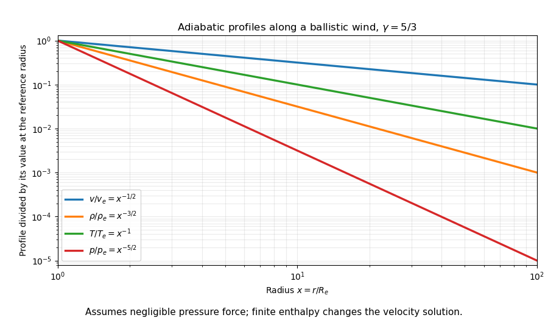

<h1 id="4/e/solution">Solution</h1>

↑ **Parent:** [E](../e.md)

Insert the pressure-negligible velocity law into the steady spherical mass flux. With $x=r/R_e$,

$$
\rho(r)=\rho_e\frac{R_e^2v_e}{r^2v(r)}=\rho_ex^{-3/2}.
$$

An [adiabatic equation of state](../../../../../adiabatic-equation-of-state.md) $p\rho^{-\gamma}=\text{constant}$ and the [ideal gas law](../../../../../ideal-gas-law.md) give

$$
\boxed{p(r)=p_ex^{-3\gamma/2},\qquad
T(r)=T_ex^{-3(\gamma-1)/2}.}
$$

For a monatomic gas with $\gamma=5/3$,

$$
\boxed{p\propto r^{-5/2},\qquad T\propto r^{-1}.}
$$

The normalization $T_e$, and hence $p_e=n_ek_BT_e$, was not specified and remains a boundary parameter. If it is large enough for the pressure gradient to affect acceleration, replace the ballistic velocity by the full adiabatic [Bernoulli equation](../../../../../bernoulli-equation.md) solution. The general mass-flux and thermodynamic relations still hold, but these particular radius powers then need not hold.

**[Figure 3](#4/e/image-normalized-velocity-density-temperature-and-pressure-of-a-marginal-escape-wind). Normalized velocity, density, temperature and pressure of a marginal-escape wind**. Original power-law calculation for a monatomic gas in the pressure-negligible momentum approximation. Finite enthalpy requires a coupled wind solution.

## ↑ Ancestors (14)

1. [E](../e.md)
2. [4](../../4.md)
3. [Paper 1](../../../paper-1-split.md)
4. [2015](../../../split.md)
5. [Past exam of the astrophysical fluid dynamics course of the University of Cambridge](../../../../split.md)
6. [Astrophysical Fluid Dynamics course of the University of Cambridge](../../../../../astrophysical-fluid-dynamics-course-of-the-university-of-cambridge.md)
7. [Physics course of the year 3 of the natural sciences course of the University of Cambridge](../../../../../physics-course-of-the-year-3-of-the-natural-sciences-course-of-the-university-of-cambridge.md)
8. [Year 3 of the natural sciences course of the University of Cambridge](../../../../../year-3-of-the-natural-sciences-course-of-the-university-of-cambridge.md)
9. [Year of the natural sciences course of the University of Cambridge](../../../../../year-of-the-natural-sciences-course-of-the-university-of-cambridge.md)
10. [Natural sciences course of the University of Cambridge](../../../../../natural-sciences-course-of-the-university-of-cambridge.md)
11. [Course of the University of Cambridge](../../../../../course-of-the-university-of-cambridge.md)
12. [University of Cambridge](../../../../../university-of-cambridge-split.md)
13. [List of universities](../../../../../list-of-universities.md)
14. [Codex Wiki](../../../../../split.md)
