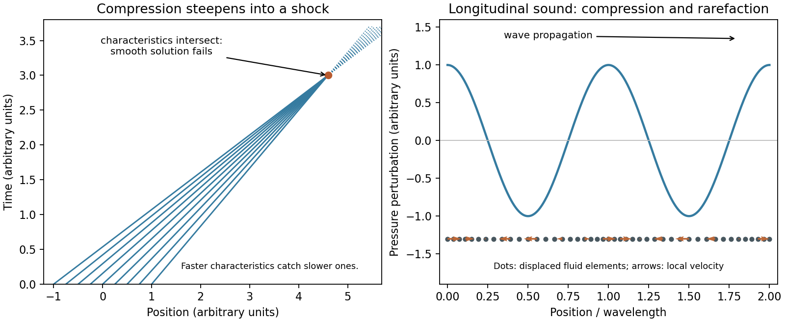
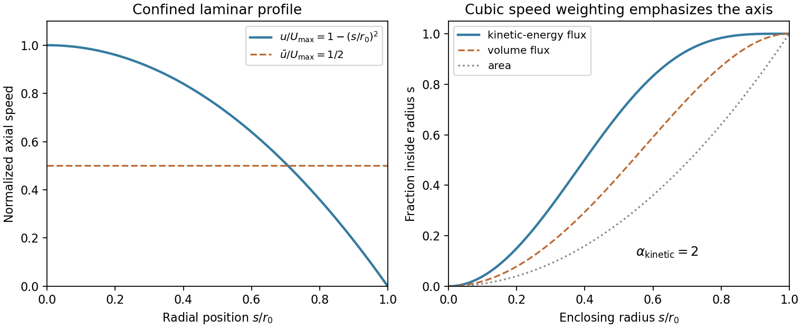
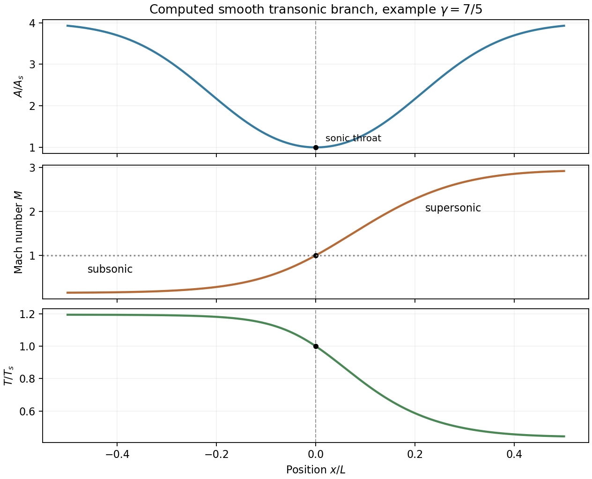

# Paper 1

↑ **Parent:** [2016](../2016.md)

Original source: [Cambridge FOI 2023/399 released PDF, physical pages 398–402](https://www.whatdotheyknow.com/request/natural_science_tripos_physics_e_2/response/2340776/attach/2/FOI%202023%20399%20Zahid%20materials.pdf?cookie_passthrough=1#page=398).

**Table of contents**

- [1](#1)
  - [a](#1/a)
    - [Solution](#1/a/solution)
  - [b](#1/b)
    - [Solution](#1/b/solution)
  - [c](#1/c)
    - [Solution](#1/c/solution)
- [2](#2)
  - [a](#2/a)
    - [Solution](#2/a/solution)
  - [b](#2/b)
    - [Solution](#2/b/solution)
  - [c](#2/c)
    - [Solution](#2/c/solution)
- [3](#3)
  - [a](#3/a)
    - [Solution](#3/a/solution)
  - [b](#3/b)
    - [Solution](#3/b/solution)
  - [c](#3/c)
    - [Solution](#3/c/solution)
- [4](#4)
  - [a](#4/a)
    - [Solution](#4/a/solution)
  - [b](#4/b)
    - [Solution](#4/b/solution)

## 1

↑ **Parent:** [Paper 1](paper-1.md)

<h3 id="1/a">a</h3>

↑ **Parent:** [1](#1)

<h4 id="1/a/solution">Solution</h4>

↑ **Parent:** [A](#1/a)

Let $z$ increase upwards and let $g>0$ denote the downward [gravitational acceleration](../../newton-s-law-of-universal-gravitation.md#gravitational-acceleration). The environment obeys [hydrostatic equilibrium](../../statistical-physics.md#hydrostatic-equilibrium), $dp/dz=-\rho g$. Displace a small parcel by $\zeta$ while it remains in [pressure](../../pressure.md) balance with its surroundings and exchanges negligible heat. For fixed composition and [adiabatic index](../../ideal-gas.md#heat-capacity-ratio) $\gamma$, its density change at constant [specific entropy](../../entropy.md#specific-entropy) satisfies $d\rho_{\rm par}/dp=\rho/(\gamma p)$. At the displaced position, its density excess over the environment is therefore

$$
\Delta\rho=\left(\frac{\rho}{\gamma p}\frac{dp}{dz}-\frac{d\rho}{dz}\right)\zeta+O(\zeta^2).
$$

The [buoyancy](../../fluid-mechanics.md#buoyancy) acceleration is $\ddot\zeta\simeq-g\Delta\rho/\rho$. Hence

$$
\ddot\zeta=-N^2\zeta,\qquad N^2=\frac g\rho\left(\frac{\rho}{\gamma p}\frac{dp}{dz}-\frac{d\rho}{dz}\right).
$$

**Stability requires $N^2>0$**, equivalently

$$
\boxed{\frac{\rho}{p\gamma}\frac{dp}{dz}>\frac{d\rho}{dz}}.
$$

An upward-displaced parcel is then denser than its surroundings and falls back; a downward-displaced parcel is lighter and rises. Equality gives neutral stability in this parcel model. For a [perfect gas](../../ideal-gas.md) with constant composition, $ds=c_v\,d\ln(p/\rho^\gamma)$ gives $N^2=(g/c_p)\,ds/dz$, so a rising [specific entropy](../../entropy.md#specific-entropy) is stable. This is the parcel form of the [Schwarzschild criterion](../../stellar-structure.md#schwarzschild-criterion). Rapid [pressure](../../pressure.md) equilibration, negligible heat diffusion during displacement and no composition-driven [buoyancy](../../fluid-mechanics.md#buoyancy) are the assumptions behind this test.

<h3 id="1/b">b</h3>

↑ **Parent:** [1](#1)

<h4 id="1/b/solution">Solution</h4>

↑ **Parent:** [B](#1/b)

For a Newtonian [circular orbit](../../classical-mechanics.md#circular-orbit), $v_\phi^2=GM/r$, so the specific orbital [energy](../../energy.md) is $e=v_\phi^2/2-GM/r=-GM/(2r)$. Half of the released potential [energy](../../energy.md) remains in circular orbital motion. The binding-energy estimate between the specified edges is therefore

$$
L_{\rm bind}\simeq\frac{GM\dot m}{2}\left(\frac1{r_{\rm in}}-\frac1{r_{\rm out}}\right)=\frac{GM\dot m}{2R_s}\left(\frac16-\frac1{30}\right)=\frac{\dot m c^2}{30}.
$$

Using $M_\odot=1.98847\times10^{30}\,\mathrm{kg}$ and one Julian year $=3.15576\times10^7\,\mathrm s$ gives $\dot m=6.30\times10^{22}\,\mathrm{kg\,s^{-1}}$. Thus **the radiative [luminosity](../../astrophysics.md#luminosity) scale is $L\sim1.9\times10^{38}\,\mathrm W$**, approximately $1.9\times10^{45}\,\mathrm{erg\,s^{-1}}$ or $4.9\times10^{11}L_\odot$. The black-hole [mass](../../classical-mechanics.md#mass) cancels because both edge radii scale with $M$. The specified inner edge is $6R_s$; it must not be silently replaced with a different relativistic orbit radius.

For a finite viscous disc, the precise radiated power also depends on boundary work: [torque transport of energy in a steady accretion disk](../../astrophysical-disk.md#torque-transport-of-energy-in-a-steady-accretion-disk) means that orbital binding-energy release need not all be radiated inside the two stated edges. If the intended model is a radiatively efficient steady [Keplerian accretion disk](../../astrophysical-disk.md#keplerian-accretion-disk) with a [zero-torque inner boundary condition](../../astrophysical-disk.md#zero-torque-inner-boundary-condition), integrate the one-face flux $F=3GM\dot m[1-\sqrt{r_{\rm in}/r}]/(8\pi r^3)$ over both faces. It gives

$$
L_{\rm diss}=\frac{GM\dot m}{2r_{\rm in}}\left[1-3\frac{r_{\rm in}}{r_{\rm out}}+2\left(\frac{r_{\rm in}}{r_{\rm out}}\right)^{3/2}\right]\simeq\boxed{1.37\times10^{38}\,\mathrm W}.
$$

The difference from $L_{\rm bind}$ is the outward [torque](../../momentum.md#torque) power at the outer edge. The question supplies neither boundary [torque](../../momentum.md#torque) nor the external material-supply [energy](../../energy.md) budget, so the two calculations state their assumptions explicitly: about $2\times10^{38}$ W is the binding-energy estimate, while $1.37\times10^{38}$ W is the finite-disc zero-inner-torque dissipation result. Both neglect [radiation](../../physics.md#radiation) advection, winds and relativistic corrections as required for this model.[§5.2, printed pp.3–4: steady-disc surface flux and outward torque transport of energy](../../physics-bibliography.md#dynamics-of-astrophysical-discs-lecture-5-boundary-conditions-and-steady-accretion-by-gordon-i-ogilvie)

<h3 id="1/c">c</h3>

↑ **Parent:** [1](#1)

<h4 id="1/c/solution">Solution</h4>

↑ **Parent:** [C](#1/c)

Immediately upstream, free fall from rest at infinity gives $u_1^2=2GM_0/r_0$. Treat the surface shock as locally planar and stationary, with negligible upstream [pressure](../../pressure.md). The [Strong-shock Rankine-Hugoniot conditions](../../compressible-flow.md#strong-shock-rankine-hugoniot-conditions) for a [monatomic gas](../../ideal-gas.md#monatomic-gas), $\gamma=5/3$, give $\rho_2/\rho_1=4$ and $u_2=u_1/4$. [momentum conservation](../../momentum.md#momentum-conservation) then gives

$$
p_2=\rho_1u_1^2-\rho_2u_2^2=\frac34\rho_1u_1^2,\qquad\frac{p_2}{\rho_2}=\frac3{16}u_1^2.
$$

Use the source's gas-constant convention $p=\rho(R^*/\mu)T$. The immediate postshock [temperature](../../temperature.md) is

$$
\boxed{T_2=\frac\mu{R^*}\frac3{16}\frac{2GM_0}{r_0}=\frac\mu{R^*}\frac38\frac{GM_0}{r_0}}.
$$

Here adiabatic means that the jump does not lose appreciable heat to the surroundings; the shock is nevertheless irreversible and raises [entropy](../../entropy.md). The gas still has [velocity](../../classical-mechanics.md#velocity) $u_1/4$ immediately downstream, so setting all upstream [kinetic energy](../../energy.md#kinetic-energy) equal to downstream internal [energy](../../energy.md) would give the wrong coefficient. Later settling, [radiative cooling](../../heat.md#radiative-cooling) or changing ionization can alter the [temperature](../../temperature.md); they are outside this immediate, fixed-composition perfect-gas jump.

## 2

↑ **Parent:** [Paper 1](paper-1.md)

<h3 id="2/a">a</h3>

↑ **Parent:** [2](#2)

<h4 id="2/a/solution">Solution</h4>

↑ **Parent:** [A](#2/a)

The [Rayleigh-Taylor instability](../../continuum-mechanics.md#rayleigh-taylor-instability) extracts [gravitational potential energy](../../energy.md#gravitational-energy) when a heavy fluid is supported above a lighter one. A small downward excursion of heavy material and upward excursion of light material can grow instead of experiencing restoring [buoyancy](../../fluid-mechanics.md#buoyancy). The [Kelvin-Helmholtz instability](../../fluid-mechanics.md#kelvin-helmholtz-instability) instead extracts [kinetic energy](../../energy.md#kinetic-energy) from a [velocity](../../classical-mechanics.md#velocity) difference across an interface or [shear layer](../../fluid-mechanics.md#shear-layer). The interface displacement and its induced flow reinforce one another by tapping the background shear; a reversed density ordering is not required.

A useful common model has two inviscid, incompressible, semi-infinite fluids separated at $z=0$, with lower density/[velocity](../../classical-mechanics.md#velocity) $\rho_1,U_1$, upper density/[velocity](../../classical-mechanics.md#velocity) $\rho_2,U_2$, downward [gravity](../../physics.md#gravity) $g$, and [surface tension](../../surface-tension.md) $\sigma$. For a disturbance proportional to $e^{i(kx-\omega t)}$, with $k>0$, the [two-fluid interfacial gravity-shear dispersion relation](../../fluid-mechanics.md#two-fluid-interfacial-gravity-shear-dispersion-relation) is

$$
\left(\omega-k\frac{\rho_1U_1+\rho_2U_2}{\rho_1+\rho_2}\right)^2=\frac{gk(\rho_1-\rho_2)+\sigma k^3}{\rho_1+\rho_2}-\frac{\rho_1\rho_2}{(\rho_1+\rho_2)^2}k^2(U_1-U_2)^2.
$$

A negative right side gives exponential growth. With no shear or [surface tension](../../surface-tension.md) and $\rho_2>\rho_1$, the [growth rate](../../dispersion-relation.md#growth-rate) of the [Rayleigh-Taylor instability](../../continuum-mechanics.md#rayleigh-taylor-instability) is $s=\sqrt{\mathcal A gk}$, where $\mathcal A=(\rho_2-\rho_1)/(\rho_2+\rho_1)$ is the [Atwood number](../../continuum-mechanics.md#atwood-number). With equal densities and no restoring force, the [growth rate](../../dispersion-relation.md#growth-rate) of the [Kelvin-Helmholtz instability](../../fluid-mechanics.md#kelvin-helmholtz-instability) is $s=k|U_1-U_2|/2$. **Heavy-over-light stratification drives Rayleigh-Taylor growth; [velocity](../../classical-mechanics.md#velocity) shear drives Kelvin-Helmholtz growth.** A heavy lower fluid supplies gravitational stabilization, and [surface tension](../../surface-tension.md) stabilizes sufficiently short waves in this ideal interface model.

Finite shear-layer thickness, [viscosity](../../dynamic-viscosity.md), compressibility and [magnetic tension](../../magnetohydrodynamics.md#magnetic-tension) can change the [growth rates](../../dispersion-relation.md#growth-rate) and unstable [wavelength](../../wave-equation.md#wavelength) range. In particular, unlimited growth with increasing $k$ is a limitation of the zero-thickness, zero-surface-tension idealization. Density-interface overturning and jet-boundary mixing are appropriate physical applications of the two mechanisms, but the nonlinear mixed state is not determined by the linear [growth rate](../../dispersion-relation.md#growth-rate) alone.

**[Figure 1](#2/a/image-original-schematics-of-rayleigh-taylor-instability-and-kelvin-helmholtz-instability). Original schematics of Rayleigh-Taylor instability and Kelvin-Helmholtz instability**.

<h3 id="2/b">b</h3>

↑ **Parent:** [2](#2)

<h4 id="2/b/solution">Solution</h4>

↑ **Parent:** [B](#2/b)

A finite-amplitude compression can steepen because different parts of the wave travel at different characteristic speeds. For a right-moving [simple wave](../../compressible-flow.md#simple-wave) in a [perfect gas](../../ideal-gas.md), one may write $dx/dt=c_0+(\gamma+1)u/2$ in terms of the local [velocity](../../classical-mechanics.md#velocity) perturbation $u$. Faster compressive characteristics catch slower ones. When the smooth inviscid description would become multivalued, a physical compression shock replaces it. A rarefaction normally spreads rather than forming an entropy-violating expansion shock.[§§6.1.3–6.2, simple-wave reduction and characteristic crossing](../../physics-bibliography.md#lecture-notes-astrophysical-fluid-dynamics-by-gordon-i-ogilvie)

Across a locally planar shock, use [velocities](../../classical-mechanics.md#velocity) relative to its moving front. The [Rankine-Hugoniot conditions for a perfect gas](../../compressible-flow.md#rankine-hugoniot-conditions-for-a-perfect-gas) conserve [mass](../../classical-mechanics.md#mass), momentum and total [energy](../../energy.md) flux:

$$
\rho_1u_1=\rho_2u_2=j,\qquad p_1+\rho_1u_1^2=p_2+\rho_2u_2^2,\qquad h_1+\frac12u_1^2=h_2+\frac12u_2^2,
$$

where $h=\gamma p/[(\gamma-1)\rho]$ is the [specific enthalpy](../../enthalpy.md#specific-enthalpy). For upstream normal [Mach number](../../compressible-flow.md#mach-number) $M_1>1$,

$$
\frac{\rho_2}{\rho_1}=\frac{(\gamma+1)M_1^2}{2+(\gamma-1)M_1^2},\quad\frac{p_2}{p_1}=\frac{2\gamma M_1^2-(\gamma-1)}{\gamma+1},\quad M_2^2=\frac{1+(\gamma-1)M_1^2/2}{\gamma M_1^2-(\gamma-1)/2}.
$$

Thus a normal compression shock increases [pressure](../../pressure.md), density and [temperature](../../temperature.md), reduces the normal [velocity](../../classical-mechanics.md#velocity), and changes a supersonic upstream flow to subsonic downstream flow in the [shock frame](../../compressible-flow.md#shock-frame). In the strong-shock limit, compression approaches $(\gamma+1)/(\gamma-1)$, which is four for a [monatomic gas](../../ideal-gas.md#monatomic-gas). **A shock conserves total [energy](../../energy.md) but generates [entropy](../../entropy.md); an adiabatic shock is not an isentropic compression.** For a calorically [perfect gas](../../ideal-gas.md), [stagnation temperature](../../compressible-flow.md#stagnation-temperature) is conserved while [stagnation pressure](../../fluid-mechanics.md#stagnation-pressure) falls.[normal-shock property ratios, total-temperature conservation and total-pressure loss](../../physics-bibliography.md#normal-shock-wave-equations-by-nasa-glenn-research-center)

Real dissipative processes resolve the narrow front; the jump conditions do not require its detailed internal profile. In a continuum-gas experiment a [shock tube](../../compressible-flow.md#shock-tube) can produce a moving shock by releasing a [pressure](../../pressure.md) discontinuity. [pressure](../../pressure.md) probes separated along the tube measure arrival speed and the [pressure](../../pressure.md) jump; distinguishing the shock from the following contact surface is essential. A contact surface can have a density/[entropy](../../entropy.md) jump with continuous [pressure](../../pressure.md) and normal [velocity](../../classical-mechanics.md#velocity), whereas a shock carries nonzero [mass](../../classical-mechanics.md#mass) flux through its front.

**[Figure 2](#2/b/image-original-characteristic-crossing-and-longitudinal-acoustic-wave-diagrams). Original characteristic-crossing and longitudinal acoustic wave diagrams**.

<h3 id="2/c">c</h3>

↑ **Parent:** [2](#2)

<h4 id="2/c/solution">Solution</h4>

↑ **Parent:** [C](#2/c)

A small [pressure](../../pressure.md) disturbance propagates because compression raises the [pressure](../../pressure.md), the [pressure gradient](../../fluid-mechanics.md#pressure-gradient) accelerates nearby fluid, and the induced convergence compresses the next region. For a uniform fluid at rest, linearizing [mass](../../classical-mechanics.md#mass) and [momentum conservation](../../momentum.md#momentum-conservation) and using the adiabatic pressure-density response gives

$$
\frac{\partial\rho'}{\partial t}+\rho_0\nabla\cdot\mathbf u'=0,\qquad\rho_0\frac{\partial\mathbf u'}{\partial t}=-\nabla p',\qquad p'=c_s^2\rho',\qquad c_s^2=\left(\frac{\partial p}{\partial\rho}\right)_s.
$$

Eliminating $\rho'$ and $\mathbf u'$ gives $\partial_t^2p'=c_s^2\nabla^2p'$. A [plane wave](../../wave-function.md#plane-wave) has $\omega^2=c_s^2|\mathbf k|^2$ and longitudinal [velocity](../../classical-mechanics.md#velocity) parallel to $\mathbf k$. In a [perfect gas](../../ideal-gas.md),

$$
\boxed{c_s=\sqrt{\gamma p_0/\rho_0}=\sqrt{\gamma(R^*/\mu)T_0}}.
$$

The adiabatic response is appropriate when heat cannot diffuse appreciably out of each compressed region during a period; an isothermal response would give a different derivative. In a moving uniform medium, the acoustic characteristics travel at $U\pm c_s$ along the flow, rather than at $\pm c_s$ in the laboratory.

For a progressive wave, $p'=\rho_0c_su'_\parallel$; [pressure](../../pressure.md), density and longitudinal [velocity](../../classical-mechanics.md#velocity) are in phase. The [acoustic energy density](../../linear-acoustics.md#acoustic-energy-density) is the sum of kinetic and compression energies,

$$
E_{\rm ac}=\frac12\rho_0|\mathbf u'|^2+\frac{p'^2}{2\rho_0c_s^2},\qquad\langle I\rangle=\frac{p_{\rm rms}^2}{\rho_0c_s}.
$$

**Sound transports [energy](../../energy.md) while fluid elements execute small oscillations about their mean positions.** The ideal uniform-fluid acoustic mode is nondispersive. Spherical spreading reduces [pressure](../../pressure.md) amplitude as $1/r$ when total power is conserved; [viscosity](../../dynamic-viscosity.md) and [heat conduction](../../heat.md#thermal-conduction) attenuate waves, while sufficiently large compressions can steepen into shocks. In a stratified astrophysical gas the uniform result is local: [wavelengths](../../wave-equation.md#wavelength) short compared with background scale heights justify it, whereas long waves can couple to [buoyancy](../../fluid-mechanics.md#buoyancy) and acoustic-cutoff behavior.

## 3

↑ **Parent:** [Paper 1](paper-1.md)

<h3 id="3/a">a</h3>

↑ **Parent:** [3](#3)

<h4 id="3/a/solution">Solution</h4>

↑ **Parent:** [A](#3/a)

Let $e=c_vT$ be the [specific internal energy](../../internal-energy.md#specific-internal-energy) of a calorically [perfect gas](../../ideal-gas.md) and define its [specific gas constant](../../ideal-gas.md#specific-gas-constant) $\mathcal R=R^*/\mu$, so $p=\mathcal R\rho T$. A reversible adiabatic change has no heat input and obeys

$$
de+p\,d(1/\rho)=0\quad\Longrightarrow\quad c_v\,dT-\frac{\mathcal RT}{\rho}\,d\rho=0.
$$

Using $c_p-c_v=\mathcal R$ and $\gamma=c_p/c_v$ gives

$$
\frac{dT}{T}=(\gamma-1)\frac{d\rho}{\rho},\qquad d\ln p=d\ln\rho+d\ln T=\gamma\,d\ln\rho.
$$

Integration yields **$p/\rho^\gamma=K$, or $\boxed{p=K\rho^\gamma}$**, with $K$ fixed on that isentrope. Equivalently $s-s_{\rm ref}=c_v\ln[(p/\rho^\gamma)/K_{\rm ref}]$, so $K$ specifies [entropy](../../entropy.md) as well as composition. In a smooth nondissipative flow this means $D(p\rho^{-\gamma})/Dt=0$ along each parcel. A single common $K$ throughout the fluid additionally requires a [homentropic flow](../../compressible-flow.md#homentropic-flow). No heat transfer alone does not forbid [entropy](../../entropy.md) production: different sides of an adiabatic shock generally have different $K$ values. Constant composition and heat capacities are needed for the fixed exponent used here.

<h3 id="3/b">b</h3>

↑ **Parent:** [3](#3)

<h4 id="3/b/solution">Solution</h4>

↑ **Parent:** [B](#3/b)

Write $\boldsymbol\omega=\nabla\times\mathbf u$ and use the vector identity $(\mathbf u\cdot\nabla)\mathbf u=\nabla(|\mathbf u|^2/2)-\mathbf u\times\boldsymbol\omega$. Taking the [curl](../../multivariable-calculus.md#curl) of the momentum equation eliminates all pure [gradients](../../multivariable-calculus.md#gradient), including [gravity](../../physics.md#gravity) and the $\nabla(\nabla\cdot\mathbf u)$ viscous contribution. Before invoking barotropy, the [pressure](../../pressure.md) term gives

$$
\nabla\times\left(-\frac1\rho\nabla p\right)=-\nabla(1/\rho)\times\nabla p=\frac{\nabla\rho\times\nabla p}{\rho^2}.
$$

This is [baroclinic vorticity generation](../../mathematical-physics.md#baroclinic-vorticity-generation). For a [barotropic fluid](../../fluid-mechanics.md#barotropic-fluid), $p=p(\rho)$, so $\nabla p$ is parallel to $\nabla\rho$ and this source vanishes. Constant $\nu$ permits the [curl](../../multivariable-calculus.md#curl) and [Laplacian](../../multivariable-calculus.md#laplacian) to commute. The result is

$$
\boxed{\frac{\partial\boldsymbol\omega}{\partial t}=\nabla\times(\mathbf u\times\boldsymbol\omega)+\nu\nabla^2\boldsymbol\omega}.
$$

No incompressibility assumption was used. Since $\nabla\cdot\boldsymbol\omega=0$, an equivalent form is

$$
\frac{D\boldsymbol\omega}{Dt}=(\boldsymbol\omega\cdot\nabla)\mathbf u-\boldsymbol\omega\,\nabla\cdot\mathbf u+\nu\nabla^2\boldsymbol\omega.
$$

The terms represent [vortex stretching](../../mathematical-physics.md#vortex-stretching)/tilting, compression/dilatation and viscous diffusion. In particular, removing the baroclinic source does not make the [vorticity](../../vorticity.md) of a three-dimensional parcel constant. A spatially varying entropy-dependent $K$ in $p=K\rho^\gamma$ need not define a single barotropic law; the common-pressure-law assumption matters.

<h3 id="3/c">c</h3>

↑ **Parent:** [3](#3)

<h4 id="3/c/solution">Solution</h4>

↑ **Parent:** [C](#3/c)

Use the idealized fully developed, laminar cylindrical-flow model implied by the fixed cross-section and zero [velocity](../../classical-mechanics.md#velocity) at its sides. Take the jet length to be $R$, as for a central source reaching the cloud boundary; if the source is off-centre, the actual path length must replace $R$. Let $s$ denote distance from the jet axis and write the axial [velocity](../../classical-mechanics.md#velocity) as $u(s)$. Then $(\mathbf u\cdot\nabla)\mathbf u=0$, the [pressure gradient](../../fluid-mechanics.md#pressure-gradient) is $dp/dz=-p_0/R$, and the axial [Navier-Stokes equation](../../viscous-fluid-flow.md#navier-stokes-equation) reduces to

$$
0=\frac{p_0}{R}+\rho\nu\frac1s\frac d{ds}\left(s\frac{du}{ds}\right).
$$

Regularity at $s=0$ excludes a logarithmic term. The imposed [no-slip boundary condition](../../viscous-fluid-flow.md#no-slip-boundary-condition) $u(r_0)=0$ gives the [Hagen-Poiseuille flow](../../viscous-fluid-flow.md#hagen-poiseuille-equation) profile

$$
u(s)=\frac{p_0}{4\rho\nu R}(r_0^2-s^2)=U_{\max}\left(1-\frac{s^2}{r_0^2}\right),\qquad U_{\max}=\frac{p_0r_0^2}{4\rho\nu R}.
$$

The [kinetic energy](../../energy.md#kinetic-energy) crossing each area element per unit time is $(\rho u^2/2)u\,dA$, so the [velocity](../../classical-mechanics.md#velocity) must be cubed before integration. Thus

$$
P=\frac12\rho\int u^3\,dA=\pi\rho U_{\max}^3\int_0^{r_0}\left(1-\frac{s^2}{r_0^2}\right)^3s\,ds=\frac{\pi\rho U_{\max}^3r_0^2}{8}.
$$

Consequently

$$
\boxed{P=\frac{\pi p_0^3}{512\rho^2\nu^3R^3}\,r_0^8,\qquad A=\frac{\pi p_0^3}{512\rho^2\nu^3R^3}}.
$$

The [mean velocity](../../kinetic-theory.md#mean-velocity-of-a-kinetic-distribution) is $\bar u=U_{\max}/2$. Replacing the profile by $\bar u$ in $\tfrac12\rho\pi r_0^2\bar u^3$ underestimates the flux by two; the [kinetic energy correction factor](../../energy.md#kinetic-energy-correction-factor) is two for this profile. The radius dependence follows from $u\propto r_0^2$ and cross-sectional area $\propto r_0^2$.

The specified $P$ is outgoing bulk kinetic-energy flux, not the pressure-work rate $p_0Q$, which scales as $r_0^4$. In a fully developed section the profile is independent of $z$ and [pressure](../../pressure.md) work is dissipated as heat; entrance acceleration and [energy](../../energy.md) supply establish the profile. A turbulent or freely entraining astrophysical jet need not have this no-slip parabolic structure. The model assumes a long enough, laminar confined region and neglects entrance losses and [gravity](../../physics.md#gravity).

**[Figure 3](#3/c/image-parabolic-hagen-poiseuille-flow-and-its-cubic-velocity-weighting-in-kinetic-energy-flux). Parabolic Hagen-Poiseuille flow and its cubic velocity weighting in kinetic-energy flux**.

## 4

↑ **Parent:** [Paper 1](paper-1.md)

<h3 id="4/a">a</h3>

↑ **Parent:** [4](#4)

<h4 id="4/a/solution">Solution</h4>

↑ **Parent:** [A](#4/a)

Write the polytropic law as $p=K\rho^{1+1/n}$, with constant $K$ and $n>0$. Its [pressure](../../pressure.md) potential, or [polytropic enthalpy](../../enthalpy.md#polytropic-enthalpy) relative to zero density, is

$$
H(\rho)=\int_0^\rho\frac1{\widetilde\rho}\frac{dp}{d\widetilde\rho}\,d\widetilde\rho=(n+1)K\rho^{1/n}.
$$

Hydrostatic balance is $dH/dr=-d\psi/dr$. If the surface has zero density and potential $\psi_0$, integration gives $H=\psi_0-\psi$. At the centre, $\Delta\psi\equiv\psi_0-\psi_c=(n+1)K\rho_c^{1/n}>0$. Therefore

$$
\theta=\frac H{\Delta\psi}=\left(\frac\rho{\rho_c}\right)^{1/n},\qquad r=\alpha\xi,\qquad\alpha^2=\frac{\Delta\psi}{4\pi G\rho_c}.
$$

Insert $\psi=\psi_0-\Delta\psi\theta$ and $\rho=\rho_c\theta^n$ into the spherical [Poisson equation for Newtonian gravity](../../newton-s-law-of-universal-gravitation.md#poisson-equation-for-newtonian-gravity):

$$
\frac1{r^2}\frac d{dr}\left(r^2\frac{d\psi}{dr}\right)=4\pi G\rho\quad\Longrightarrow\quad\boxed{\frac1{\xi^2}\frac d{d\xi}\left(\xi^2\frac{d\theta}{d\xi}\right)=-\theta^n}.
$$

The central conditions are $\theta(0)=1$ and $\theta'(0)=0$; the latter follows from a regular spherically symmetric centre. This reproduces the supplied coordinate and potential scaling rather than introducing an unrelated normalization.

For the sound-speed task, the [adiabatic sound speed](../../compressible-flow.md#adiabatic-sound-speed) of a perfect polytropic gas is

$$
c_s^2=\frac{dp}{d\rho}=\gamma K\rho^{\gamma-1}=(\gamma-1)H=(\gamma-1)(\psi_0-\psi),\qquad n=\frac1{\gamma-1}.
$$

A [diatomic gas](../../ideal-gas.md#diatomic-gas) with active rotational but frozen vibrational degrees of freedom has $\gamma=7/5$ and $n=5/2$. With the requested surface-potential gauge $\psi_0=0$,

$$
\boxed{c_s=\sqrt{-\frac25\psi}}.
$$

The interior potential is then negative. Choosing zero potential at the surface is legitimate; for a finite isolated sphere it is a different additive gauge from setting potential to zero at infinity. Both choices cannot generally be imposed simultaneously.

For the mass-radius task, let $\xi_1$ be the first zero of the regular [Lane-Emden function](../../nonlinear-analysis.md#lane-emden-function) and $Y_n=-\xi_1^2\theta'(\xi_1)$. A finite-radius [polytrope](../../astrophysical-fluid-dynamics.md#polytrope) has

$$
R=\alpha\xi_1,\qquad M=4\pi\alpha^3\rho_cY_n,\qquad\frac{GM}{R}=\Delta\psi\frac{Y_n}{\xi_1}=(n+1)\frac{Y_n}{\xi_1}\frac{R^*T_c}{\mu}.
$$

Thus

$$
\boxed{M=\frac{(n+1)Y_n}{\xi_1}\frac{R^*T_c}{G\mu}\,R}.
$$

**At fixed central [temperature](../../temperature.md), fixed composition and fixed [polytropic index](../../stellar-structure.md#polytropic-index), $M\propto R$.** These are [homologous polytropes at fixed central temperature](../../stellar-structure.md#homologous-polytropes-at-fixed-central-temperature). They do not in general have constant $K$; imposing constant [entropy](../../entropy.md) instead gives a different polytropic mass-radius sequence. If $n$ or $\mu$ varies between stars, the displayed dimensionless structure factor and composition factor must be retained: equal $T_c$ alone is not a universal exact proportionality for arbitrary stellar models.

<h3 id="4/b">b</h3>

↑ **Parent:** [4](#4)

<h4 id="4/b/solution">Solution</h4>

↑ **Parent:** [B](#4/b)

Treat the gas as a smooth [quasi-one-dimensional flow](../../compressible-flow.md#quasi-one-dimensional-flow) through a rigid passage, neglecting axial body forces and heat input. It is the confining medium that is incompressible; the flowing gas must remain compressible. With area $\mathcal A(x)$ and axial speed $u$, continuity and inviscid momentum balance give

$$
\rho u\mathcal A=\dot M,\qquad u\,du=-\frac{dp}{\rho},\qquad dp=c_s^2\,d\rho.
$$

Combining their logarithmic differentials yields the [nozzle area-velocity relation](../../fluid-mechanics.md#nozzle-area-velocity-relation)

$$
\frac{d\mathcal A}{\mathcal A}=(\mathcal M^2-1)\frac{du}{u},\qquad\mathcal M=\frac u{c_s}.
$$

A smooth crossing of $\mathcal M=1$ requires an area extremum. The given radius is positive and has derivative $r'(x)=16r_0x\exp[-16x^2/L^2]/L^2$, which vanishes only at $x=0$ within the slab and changes from negative to positive there. Thus this station is the unique throat, with $r_s=r_0/2$ and $\mathcal A_s=\pi r_0^2/4$. The specified subsonic inlet and supersonic outlet select the smooth accelerating branch, so

$$
\boxed{x_s=0}.
$$

A throat by itself does not guarantee transonic flow for arbitrary reservoir and back [pressures](../../pressure.md); that branch is specified here. Before the throat a converging section accelerates [subsonic flow](../../compressible-flow.md#subsonic-flow); beyond it a diverging section accelerates [supersonic flow](../../compressible-flow.md#supersonic-flow).[Supersonic and Subsonic Flow, continuity/momentum derivation of the area-velocity relation and choked throat](../../physics-bibliography.md#nozzle-design-by-nasa-glenn-research-center)

For the [temperature](../../temperature.md) task, evaluate the [mass](../../classical-mechanics.md#mass) flux and [sound speed](../../compressible-flow.md#speed-of-sound) at the throat using $p=K\rho^\gamma$:

$$
\dot M=\mathcal A_s\rho_sc_s=\mathcal A_s\sqrt{\gamma K}\,\rho_s^{(\gamma+1)/2},\qquad\rho_s=\left(\frac{\dot M}{\mathcal A_s\sqrt{\gamma K}}\right)^{2/(\gamma+1)}.
$$

The ideal-gas relation then gives

$$
\boxed{T_{x_s}=\frac{\mu K}{R^*}\left(\frac{4\dot M}{\pi r_0^2\sqrt{\gamma K}}\right)^{2(\gamma-1)/(\gamma+1)}}.
$$

This expresses the sonic [temperature](../../temperature.md) in terms of the [entropy](../../entropy.md) constant, geometry, [mass](../../classical-mechanics.md#mass) flux and composition; no numerical value of $K$ or $\dot M$ is provided. Equivalently $c_s^{\gamma+1}=\gamma K(\dot M/\mathcal A_s)^{\gamma-1}$ and $T_s=\mu c_s^2/(\gamma R^*)$. The slab length drops out because the sonic thermodynamic state depends on the minimum area, not on the axial distance over which a lossless smooth [nozzle](../../fluid-mechanics.md#nozzle) contracts. As a check, conserved stagnation enthalpy gives $T_s=2T_{\rm stag}/(\gamma+1)$.[equations 1–10 and 19, sonic mass-flow maximum and temperature/Mach relation](../../physics-bibliography.md#mass-flow-choking-by-nasa-glenn-research-center)

The result assumes cross-sectional thermodynamic uniformity and negligible transverse [kinetic energy](../../energy.md#kinetic-energy). Exact multidimensional flow through a sharply varying passage can have a curved sonic surface; the radius profile alone does not solve that boundary-value problem. The original numerical plot below computes the standard quasi-one-dimensional branch, rather than reproducing the supplied passage sketch.

**[Figure 4](#4/b/image-calculated-area-mach-number-and-temperature-along-the-smooth-transonic-nozzle-branch). Calculated area, Mach number and temperature along the smooth transonic nozzle branch**.

## ↑ Ancestors (11)

1. [2016](../2016.md)
2. [Past exam of the astrophysical fluid dynamics course of the University of Cambridge](../../past-exam-of-the-astrophysical-fluid-dynamics-course-of-the-university-of-cambridge.md)
3. [Astrophysical Fluid Dynamics course of the University of Cambridge](../../university-of-cambridge.md#astrophysical-fluid-dynamics-course-of-the-university-of-cambridge)
4. [Physics course of the year 3 of the natural sciences course of the University of Cambridge](../../university-of-cambridge.md#physics-course-of-the-year-3-of-the-natural-sciences-course-of-the-university-of-cambridge)
5. [Year 3 of the natural sciences course of the University of Cambridge](../../university-of-cambridge.md#year-3-of-the-natural-sciences-course-of-the-university-of-cambridge)
6. [Year of the natural sciences course of the University of Cambridge](../../university-of-cambridge.md#year-of-the-natural-sciences-course-of-the-university-of-cambridge)
7. [Natural sciences course of the University of Cambridge](../../university-of-cambridge.md#natural-sciences-course-of-the-university-of-cambridge)
8. [Course of the University of Cambridge](../../university-of-cambridge.md#course-of-the-university-of-cambridge)
9. [University of Cambridge](../../university-of-cambridge.md)
10. [List of universities](../../README.md#list-of-universities)
11. [Codex Wiki](../../README.md)
