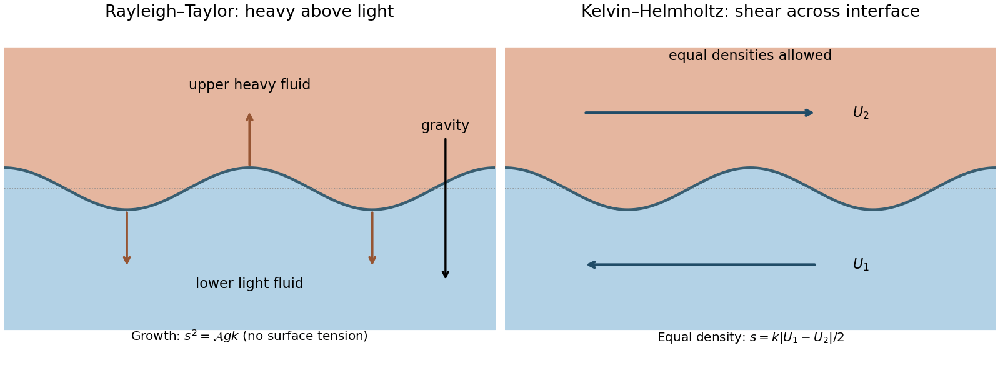

<h1 id="2/a/solution">Solution</h1>

↑ **Parent:** [A](../a.md)

The [Rayleigh-Taylor instability](../../../../../rayleigh-taylor-instability.md) extracts [gravitational potential energy](../../../../../gravitational-energy.md) when a heavy fluid is supported above a lighter one. A small downward excursion of heavy material and upward excursion of light material can grow instead of experiencing restoring [buoyancy](../../../../../buoyancy.md). The [Kelvin-Helmholtz instability](../../../../../kelvin-helmholtz-instability.md) instead extracts [kinetic energy](../../../../../kinetic-energy.md) from a [velocity](../../../../../velocity.md) difference across an interface or [shear layer](../../../../../shear-layer.md). The interface displacement and its induced flow reinforce one another by tapping the background shear; a reversed density ordering is not required.

A useful common model has two inviscid, incompressible, semi-infinite fluids separated at $z=0$, with lower density/[velocity](../../../../../velocity.md) $\rho_1,U_1$, upper density/[velocity](../../../../../velocity.md) $\rho_2,U_2$, downward [gravity](../../../../../gravity.md) $g$, and [surface tension](../../../../../surface-tension-split.md) $\sigma$. For a disturbance proportional to $e^{i(kx-\omega t)}$, with $k>0$, the [two-fluid interfacial gravity-shear dispersion relation](../../../../../two-fluid-interfacial-gravity-shear-dispersion-relation.md) is

$$
\left(\omega-k\frac{\rho_1U_1+\rho_2U_2}{\rho_1+\rho_2}\right)^2=\frac{gk(\rho_1-\rho_2)+\sigma k^3}{\rho_1+\rho_2}-\frac{\rho_1\rho_2}{(\rho_1+\rho_2)^2}k^2(U_1-U_2)^2.
$$

A negative right side gives exponential growth. With no shear or [surface tension](../../../../../surface-tension-split.md) and $\rho_2>\rho_1$, the [growth rate](../../../../../growth-rate.md) of the [Rayleigh-Taylor instability](../../../../../rayleigh-taylor-instability.md) is $s=\sqrt{\mathcal A gk}$, where $\mathcal A=(\rho_2-\rho_1)/(\rho_2+\rho_1)$ is the [Atwood number](../../../../../atwood-number.md). With equal densities and no restoring force, the [growth rate](../../../../../growth-rate.md) of the [Kelvin-Helmholtz instability](../../../../../kelvin-helmholtz-instability.md) is $s=k|U_1-U_2|/2$. **Heavy-over-light stratification drives Rayleigh-Taylor growth; [velocity](../../../../../velocity.md) shear drives Kelvin-Helmholtz growth.** A heavy lower fluid supplies gravitational stabilization, and [surface tension](../../../../../surface-tension-split.md) stabilizes sufficiently short waves in this ideal interface model.

Finite shear-layer thickness, [viscosity](../../../../../dynamic-viscosity-split.md), compressibility and [magnetic tension](../../../../../magnetic-tension.md) can change the [growth rates](../../../../../growth-rate.md) and unstable [wavelength](../../../../../wavelength.md) range. In particular, unlimited growth with increasing $k$ is a limitation of the zero-thickness, zero-surface-tension idealization. Density-interface overturning and jet-boundary mixing are appropriate physical applications of the two mechanisms, but the nonlinear mixed state is not determined by the linear [growth rate](../../../../../growth-rate.md) alone.

**[Figure 1](#2/a/image-original-schematics-of-rayleigh-taylor-instability-and-kelvin-helmholtz-instability). Original schematics of Rayleigh-Taylor instability and Kelvin-Helmholtz instability**.

## ↑ Ancestors (14)

1. [A](../a.md)
2. [2](../../2.md)
3. [Paper 1](../../../paper-1-split.md)
4. [2016](../../../split.md)
5. [Past exam of the astrophysical fluid dynamics course of the University of Cambridge](../../../../split.md)
6. [Astrophysical Fluid Dynamics course of the University of Cambridge](../../../../../astrophysical-fluid-dynamics-course-of-the-university-of-cambridge.md)
7. [Physics course of the year 3 of the natural sciences course of the University of Cambridge](../../../../../physics-course-of-the-year-3-of-the-natural-sciences-course-of-the-university-of-cambridge.md)
8. [Year 3 of the natural sciences course of the University of Cambridge](../../../../../year-3-of-the-natural-sciences-course-of-the-university-of-cambridge.md)
9. [Year of the natural sciences course of the University of Cambridge](../../../../../year-of-the-natural-sciences-course-of-the-university-of-cambridge.md)
10. [Natural sciences course of the University of Cambridge](../../../../../natural-sciences-course-of-the-university-of-cambridge.md)
11. [Course of the University of Cambridge](../../../../../course-of-the-university-of-cambridge.md)
12. [University of Cambridge](../../../../../university-of-cambridge-split.md)
13. [List of universities](../../../../../list-of-universities.md)
14. [Codex Wiki](../../../../../split.md)
