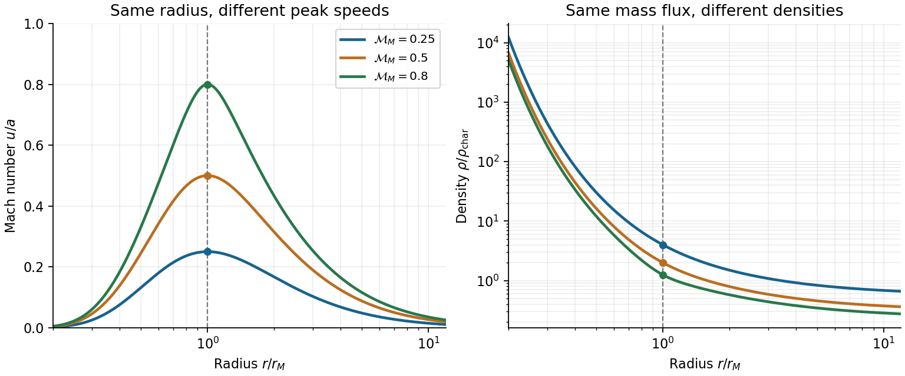

<h1 id="4/c/solution">Solution</h1>

↑ **Parent:** [C](../c.md)

Assume a steady spherical outflow of fixed composition. Let $\bar m$ be its mean particle [mass](../../../../mass.md), and define the constant [isothermal sound speed](../../../../isothermal-sound-speed.md) by $a^2=k_BT_0/\bar m$. Subsonic here refers to this isothermal closure, so $0<u<a$. [Mass conservation](../../../../mass-conservation.md) and radial momentum balance give

$$
\dot M=4\pi r^2\rho u,\qquad
u\frac{du}{dr}=-a^2\frac{d\ln\rho}{dr}-\frac{GM}{r^2}.
$$

Logarithmically differentiating the first equation yields $d\ln\rho/dr=-2/r-u'/u$. Substitution eliminates the density gradient and gives the [isothermal Parker wind](../../../../isothermal-parker-wind.md) equation

$$
\left(u-\frac{a^2}{u}\right)\frac{du}{dr}
=\frac{2a^2}{r}-\frac{GM}{r^2}.
$$

At a smooth speed maximum, $u'=0$, while the left prefactor is finite and negative. The right side must vanish, hence

$$
\boxed{r_M=\frac{GM}{2a^2}=\frac{GM\bar m}{2k_BT_0}.}
$$

For $r<r_M$ both the right side and the prefactor are negative, so $u'>0$; for $r>r_M$, $u'<0$. This is a true maximum on a [subsonic isothermal breeze](../../../../subsonic-isothermal-breeze.md), not the accelerating [transonic branch](../../../../transonic-branch.md).

There is an underdetermination in the requested density estimate. Introduce the peak [Mach number](../../../../mach-number.md) $\mathcal M_M=u_M/a$, where $0<\mathcal M_M<1$. The [density at the maximum speed of an isothermal breeze](../../../../density-at-the-maximum-speed-of-an-isothermal-breeze.md) is exactly

$$
\boxed{\rho_M=\frac{\dot M}{4\pi r_M^2u_M}
=\frac{\dot M a^3}{\pi G^2M^2\mathcal M_M}
=\frac{\dot M}{\pi G^2M^2\mathcal M_M}
\left(\frac{k_BT_0}{\bar m}\right)^{3/2}.}
$$

The hypotheses do not fix $\mathcal M_M$. A boundary density or [pressure](../../../../pressure-split.md), or an equivalent wind integration constant, is needed. The definite statement following from subsonicity is the lower bound

$$
\boxed{\rho_M>\rho_{\rm char},\qquad
\rho_{\rm char}=\frac{\dot M}{\pi G^2M^2}
\left(\frac{k_BT_0}{\bar m}\right)^{3/2}.}
$$

If a maximum speed of order $a$ is intended as an extra estimate, then $\rho_M\sim\rho_{\rm char}\propto\dot M T_0^{3/2}M^{-2}$. A very slow breeze can have a much larger density, so setting $u_M=a$ as an exact equality would contradict the stated always-subsonic assumption. The mean particle mass is another implicit fixed-composition input needed to express a [temperature](../../../../temperature-split.md) as a squared sound speed.

One can see the free parameter directly by integrating the wind equation:

$$
\frac{u^2}{2}-a^2\ln\frac ua
=2a^2\ln\frac r{r_M}+\frac{GM}{r}+C.
$$

Different $C$ give different subsonic maxima at the same radius. The original plot illustrates this nonuniqueness. These breeze branches require nonzero ambient [pressure](../../../../pressure-split.md) at large radius; they are not the usual transonic escape into a low-pressure exterior.

**[Figure 2](#4/c/image-different-subsonic-breeze-maxima-at-the-same-critical-radius-demonstrate-the-free-density-parameter). Different subsonic breeze maxima at the same critical radius demonstrate the free density parameter**.

Maintaining an isothermal expanding wind generally requires heat exchange; isothermal motion is not adiabatic motion.[PDF p. 4, printed p. 667, section III: uniform temperature maintained by heating](https://nnp.ucsd.edu/the_mhd_muddle/PDF/Parker_1958_Dynamics_Gas_MagneticFields_HL.pdf)

## ↑ Ancestors (13)

1. [C](../c.md)
2. [4](../../4.md)
3. [2017](../../../2017-split.md)
4. [Past exam of the astrophysical fluid dynamics course of the University of Cambridge](../../../split.md)
5. [Astrophysical Fluid Dynamics course of the University of Cambridge](../../../../astrophysical-fluid-dynamics-course-of-the-university-of-cambridge.md)
6. [Physics course of the year 3 of the natural sciences course of the University of Cambridge](../../../../physics-course-of-the-year-3-of-the-natural-sciences-course-of-the-university-of-cambridge.md)
7. [Year 3 of the natural sciences course of the University of Cambridge](../../../../year-3-of-the-natural-sciences-course-of-the-university-of-cambridge.md)
8. [Year of the natural sciences course of the University of Cambridge](../../../../year-of-the-natural-sciences-course-of-the-university-of-cambridge.md)
9. [Natural sciences course of the University of Cambridge](../../../../natural-sciences-course-of-the-university-of-cambridge.md)
10. [Course of the University of Cambridge](../../../../course-of-the-university-of-cambridge.md)
11. [University of Cambridge](../../../../university-of-cambridge-split.md)
12. [List of universities](../../../../list-of-universities.md)
13. [Codex Wiki](../../../../split.md)
