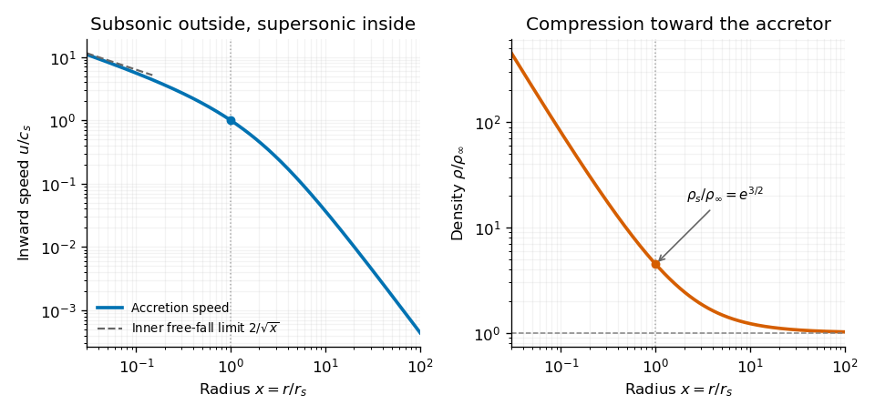

<h1 id="section-b/b3/solution">Solution</h1>

↑ **Parent:** [B3](../b3.md)

**Following a parcel.** Let $\mathbf X(t)$ be a fluid [pathline](../../../../pathline.md), with $\dot{\mathbf X}=\mathbf u(\mathbf X,t)$. The [multivariable chain rule](../../../../multivariable-chain-rule.md) gives the [material derivative](../../../../material-derivative.md),

$$
\boxed{\frac{DQ}{Dt}=\frac{d}{dt}Q(\mathbf X(t),t)
=\frac{\partial Q}{\partial t}+\mathbf u\cdot\nabla Q.}
$$

The first term measures change at fixed position; the [advection](../../../../advection.md) term accounts for the parcel moving through spatial gradients. The derivative is also called the Lagrangian derivative.

**The forces on a parcel.** A material volume $dV$ has mass $\rho\,dV$. The pressure forces on its boundary sum to $-\nabla p\,dV$, while the [gravitational acceleration](../../../../gravitational-acceleration.md) is $-\nabla\psi$. [Newton's second law](../../../../newton-s-second-law.md) therefore gives the [Euler equations for an inviscid fluid](../../../../euler-equations-for-an-inviscid-fluid-split.md),

$$
\boxed{\partial_t\mathbf u+(\mathbf u\cdot\nabla)\mathbf u
=-\frac1\rho\nabla p-\nabla\psi.}
$$

This neglects viscosity and other body forces. The left side is the parcel's acceleration, not just the time derivative at a fixed spatial location.

**Bernoulli conservation.** The claimed streamline result needs [steady flow](../../../../steady-flow.md) and a [barotropic fluid](../../../../barotropic-fluid.md), $p=p(\rho)$, or an equivalent enthalpy relation along each isentropic streamline. These hypotheses are necessary; the unsteady Euler equation alone does not imply the stated conservation law. Define the [barotropic enthalpy function](../../../../barotropic-enthalpy-function.md)

$$
h_b(p)=\int_{p_{\rm ref}}^p\frac{dp'}{\rho(p')},
\qquad \nabla h_b=\frac{\nabla p}{\rho}.
$$

Dot the steady Euler equation with $\mathbf u$, using $\mathbf u\cdot[(\mathbf u\cdot\nabla)\mathbf u]=\mathbf u\cdot\nabla(u^2/2)$. This gives

$$
\mathbf u\cdot\nabla\left(\frac12u^2+h_b+\psi\right)=0.
$$

Thus the [Bernoulli function](../../../../bernoulli-function.md) is

$$
\boxed{H=\frac12u^2+\int\frac{dp}{\rho}+\psi
=\text{constant along each streamline}.}
$$

Every term has units of energy per mass, $\mathrm{m^2\,s^{-2}}$. Different streamlines can have different constants.

**The spherical accretion equation.** Write the inward speed as $u(r)>0$, so the velocity vector is $-u(r)\widehat{\mathbf r}$ and the positive [mass accretion rate](../../../../mass-accretion-rate.md) is

$$
\dot M=4\pi r^2\rho u,\qquad
\frac{d\ln\rho}{dr}=-\frac2r-\frac{d\ln u}{dr}.
$$

Assume a prescribed central potential $\psi=-GM/r$ and negligible gas self-gravity. The steady radial Euler equation is

$$
u\frac{du}{dr}=-\frac1\rho\frac{dp}{dr}-\frac{GM}{r^2}.
$$

For a barotropic equation of state, $dp/dr=c_s^2\,d\rho/dr$, with $c_s^2=dp/d\rho$. Eliminate the density derivative to obtain

$$
\boxed{(u^2-c_s^2)\frac{d\ln u}{dr}
=\frac{2c_s^2}{r}-\frac{GM}{r^2}
=\frac{2c_s^2}{r}\left(1-\frac{GM}{2c_s^2r}\right).}
$$

A smooth [sonic point](../../../../sonic-point.md) requires the right side to vanish where $u=c_s$, hence

$$
\boxed{r_s=\frac{GM}{2c_s(r_s)^2},\qquad u(r_s)=c_s(r_s).}
$$

For a nonisothermal gas this is an implicit relation involving the local sound speed. In the isothermal case $c_s$ is constant and this is the [Bondi sonic point](../../../../bondi-sonic-point.md).

**The isothermal integral.** For $p=c_s^2\rho$, choose the enthalpy reference so that $h_b=c_s^2\ln(\rho/\rho_\infty)$. The reservoir is at rest at infinity and $\psi(\infty)=0$, making its Bernoulli constant zero. Thus

$$
\frac12u^2+c_s^2\ln\frac{\rho}{\rho_\infty}-\frac{GM}{r}=0,
$$

or

$$
\boxed{u^2=2c_s^2\ln\frac{\rho_\infty}{\rho}+\frac{2GM}{r}.}
$$

The logarithm has a dimensionless argument. Constant temperature during compression generally requires heat removal, so this is [Isothermal Bondi accretion](../../../../isothermal-bondi-accretion.md), rather than adiabatic accretion with $\gamma>1$.

**The critical accretion rate.** Select the smooth reservoir-connected [transonic branch](../../../../transonic-branch.md). Evaluate the last relation at $u_s=c_s$ and $GM/r_s=2c_s^2$:

$$
c_s^2=2c_s^2\ln\frac{\rho_\infty}{\rho_s}+4c_s^2,
\qquad
\boxed{\rho_s=e^{3/2}\rho_\infty.}
$$

Mass conservation then gives the [isothermal Bondi accretion rate](../../../../isothermal-bondi-accretion-rate.md),

$$
\boxed{\dot M=4\pi r_s^2\rho_sc_s
=\pi e^{3/2}\frac{G^2M^2\rho_\infty}{c_s^3}.}
$$

The units are $\mathrm{kg\,s^{-1}}$. Equivalently $\dot M=4\pi\lambda G^2M^2\rho_\infty/c_s^3$, with $\lambda=e^{3/2}/4\simeq1.12$.

The [inner-boundary selection of isothermal Bondi flow](../../../../inner-boundary-selection-of-isothermal-bondi-flow.md) is important: a standard absorbing accretor inside the sonic radius selects this critical solution. The steady equations and $\rho_\infty$ alone also admit subcritical subsonic branches supported by a different inner boundary; they do not by themselves fix a unique rate. The usual answer presumes transonic capture.

**[Figure 1](#section-b/b3/image-original-numerical-transonic-isothermal-accretion-profiles-normalized-by-the-sonic-radius-and-outer-density-the-speed-becomes-supersonic-inside-the-sonic-point). Original numerical transonic isothermal accretion profiles, normalized by the sonic radius and outer density; the speed becomes supersonic inside the sonic point**.

## ↑ Ancestors (13)

1. [B3](../b3.md)
2. [Section B](../../section-b.md)
3. [2018](../../../2018-split.md)
4. [Past exam of the astrophysical fluid dynamics course of the University of Cambridge](../../../split.md)
5. [Astrophysical Fluid Dynamics course of the University of Cambridge](../../../../astrophysical-fluid-dynamics-course-of-the-university-of-cambridge.md)
6. [Physics course of the year 3 of the natural sciences course of the University of Cambridge](../../../../physics-course-of-the-year-3-of-the-natural-sciences-course-of-the-university-of-cambridge.md)
7. [Year 3 of the natural sciences course of the University of Cambridge](../../../../year-3-of-the-natural-sciences-course-of-the-university-of-cambridge.md)
8. [Year of the natural sciences course of the University of Cambridge](../../../../year-of-the-natural-sciences-course-of-the-university-of-cambridge.md)
9. [Natural sciences course of the University of Cambridge](../../../../natural-sciences-course-of-the-university-of-cambridge.md)
10. [Course of the University of Cambridge](../../../../course-of-the-university-of-cambridge.md)
11. [University of Cambridge](../../../../university-of-cambridge-split.md)
12. [List of universities](../../../../list-of-universities.md)
13. [Codex Wiki](../../../../split.md)
