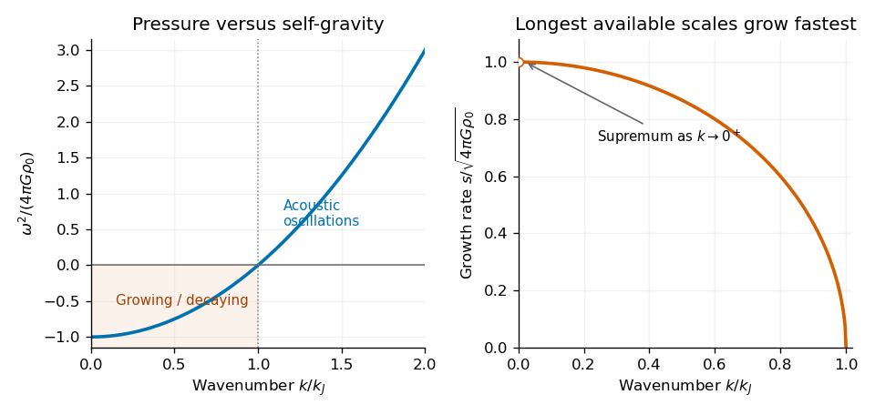

<h1 id="section-b/b4/solution">Solution</h1>

↑ **Parent:** [B4](../b4.md)

**The background and the Jeans prescription.** For a resting fluid, $\mathbf u_0=0$ and continuity is automatic. The remaining [hydrostatic equilibrium](../../../../hydrostatic-equilibrium.md) equations are

$$
\boxed{\nabla p_0=-\rho_0\nabla\psi_0,\qquad
\nabla^2\psi_0=4\pi G\rho_0.}
$$

An infinite uniform static medium with constant $p_0$ and $\rho_0>0$ would require $\nabla\psi_0=0$ by force balance, but then its Laplacian would vanish, contradicting the Poisson equation. An isolated static uniform background is therefore not an exact equilibrium of this system.

The [Jeans swindle](../../../../jeans-swindle.md) suppresses the gravitational field of the uniform background and retains only the field sourced by perturbations. Formally it replaces the source by $\rho-\rho_0$ in the perturbation problem. This can be regarded as a specified compensating background or a local idealization; it does not prove that the original infinite isolated medium can be static.

**Linearized equations.** Put $\delta\rho=\Delta\rho$, $\delta p=\Delta p$, $\delta\psi=\Delta\psi$, and $\mathbf v=\Delta\mathbf u$. For uniform $\rho_0,p_0$, neglect products of perturbations. Continuity gives

$$
\boxed{\partial_t\delta\rho+\rho_0\nabla\cdot\mathbf v=0.}
$$

The advective acceleration is quadratic, and the background pressure gradient vanishes, so the Euler equation becomes

$$
\boxed{\partial_t\mathbf v=-\frac1{\rho_0}\nabla\delta p-\nabla\delta\psi.}
$$

With the Jeans prescription and constant [sound speed](../../../../speed-of-sound.md), the gravitational and pressure closures are

$$
\boxed{\nabla^2\delta\psi=4\pi G\delta\rho,\qquad
\delta p=c_s^2\delta\rho.}
$$

The density correction to $1/\rho$ multiplying $\nabla\delta p$ is second order and is consistently omitted.

**The longitudinal dispersion relation.** Differentiate continuity in time and substitute the divergence of the linearized Euler equation:

$$
\partial_t^2\delta\rho
=\nabla^2\delta p+\rho_0\nabla^2\delta\psi
=c_s^2\nabla^2\delta\rho+4\pi G\rho_0\delta\rho.
$$

For a [plane wave](../../../../plane-wave.md) proportional to $e^{i(\mathbf k\cdot\mathbf x-\omega t)}$, $\partial_t^2\mapsto-\omega^2$ and $\nabla^2\mapsto-k^2$. Therefore

$$
\boxed{\omega^2=c_s^2k^2-4\pi G\rho_0
=c_s^2(k^2-k_J^2),\qquad
k_J=\frac{\sqrt{4\pi G\rho_0}}{c_s}.}
$$

The physical [Jeans length](../../../../jeans-length.md) is

$$
\boxed{\ell_J=\frac{2\pi}{k_J}
=c_s\sqrt{\frac{\pi}{G\rho_0}}.}
$$

Since $G\rho_0$ has units inverse square seconds, $k_J$ has units $\mathrm{m^{-1}}$ and $\ell_J$ metres. This is the compressive density branch of the [Jeans instability](../../../../jeans-instability.md); transverse velocity disturbances have no pressure or gravity restoring force in this static nonrotating model and are neutral at linear order.

**Which scales grow.** For $0<k<k_J$, or wavelength $\ell>\ell_J$, $\omega^2<0$ and one temporal solution grows exponentially. The [static Jeans growth-rate spectrum](../../../../static-jeans-growth-rate-spectrum.md) is

$$
\boxed{s(k)=\sqrt{4\pi G\rho_0-c_s^2k^2},\qquad
\delta\rho\propto e^{s(k)t}.}
$$

Its derivative is negative for $0<k<k_J$, so longer wavelengths grow faster. The supremum is $s\to\sqrt{4\pi G\rho_0}$ as $k\to0^+$: there is no selected finite fastest wavelength in this infinite-medium calculation. The exactly uniform $k=0$ density change is not an ordinary finite-potential Fourier perturbation with the fixed background subtraction. In a finite cloud, boundaries set the longest allowed scale.

For $k>k_J$, the density perturbation oscillates as a stable [acoustic wave](../../../../acoustic-wave.md). At $k=k_J$ the linear equation is $\partial_t^2\delta\rho=0$, so the mode is marginal rather than exponentially growing.

**[Figure 2](#section-b/b4/image-original-calculated-jeans-dispersion-and-growth-rate-curves-only-wavelengths-longer-than-the-jeans-length-grow-with-faster-growth-toward-the-longest-available-scales). Original calculated Jeans dispersion and growth-rate curves; only wavelengths longer than the Jeans length grow, with faster growth toward the longest available scales**.

**Comparing acoustic and gravitational times.** A sound-crossing estimate for a region of size $\ell$ is $t_{\rm sound}\sim\ell/c_s$. Self-gravitational acceleration scales as $G\rho_0\ell$, so collapse over a distance $\ell$ takes $t_{\rm grav}\sim(G\rho_0)^{-1/2}$. Equating these scales gives

$$
\ell\sim\frac{c_s}{\sqrt{G\rho_0}},
$$

which agrees with the Jeans length up to its numerical factor $\sqrt\pi$. This is the physical competition between pressure communication and gravitational contraction.

The constants can be checked using the [free-fall time of a uniform sphere](../../../../free-fall-time-of-a-uniform-sphere.md). For a pressureless shell initially at radius $a$, enclosing fixed mass $M_a$, energy conservation gives $\dot r^2=2GM_a(1/r-1/a)$. Thus

$$
t_{\rm ff}=\int_0^a\frac{dr}{\sqrt{2GM_a(1/r-1/a)}}
=\frac{\pi}{2\sqrt2}\sqrt{\frac{a^3}{GM_a}}
=\sqrt{\frac{3\pi}{32G\rho_0}},
$$

where $M_a=4\pi\rho_0a^3/3$. Consequently the [Jeans length and gravitational time conventions](../../../../jeans-length-and-gravitational-time-conventions.md) satisfy

$$
\boxed{\frac{\ell_J}{c_s}=\sqrt{\frac{\pi}{G\rho_0}}
=\sqrt{\frac{32}{3}}\,t_{\rm ff}\simeq3.27\,t_{\rm ff}.}
$$

They agree as characteristic scales, not as identical exact times. Alternatively, using the length $k_J^{-1}$ gives $1/(c_sk_J)=1/\sqrt{4\pi G\rho_0}$, exactly the gravitational inverse frequency entering the dispersion relation. The actual growth time of a marginal Jeans mode is infinite because pressure and gravity cancel there; it should not be confused with a pressureless free-fall time.

## ↑ Ancestors (13)

1. [B4](../b4.md)
2. [Section B](../../section-b.md)
3. [2018](../../../2018-split.md)
4. [Past exam of the astrophysical fluid dynamics course of the University of Cambridge](../../../split.md)
5. [Astrophysical Fluid Dynamics course of the University of Cambridge](../../../../astrophysical-fluid-dynamics-course-of-the-university-of-cambridge.md)
6. [Physics course of the year 3 of the natural sciences course of the University of Cambridge](../../../../physics-course-of-the-year-3-of-the-natural-sciences-course-of-the-university-of-cambridge.md)
7. [Year 3 of the natural sciences course of the University of Cambridge](../../../../year-3-of-the-natural-sciences-course-of-the-university-of-cambridge.md)
8. [Year of the natural sciences course of the University of Cambridge](../../../../year-of-the-natural-sciences-course-of-the-university-of-cambridge.md)
9. [Natural sciences course of the University of Cambridge](../../../../natural-sciences-course-of-the-university-of-cambridge.md)
10. [Course of the University of Cambridge](../../../../course-of-the-university-of-cambridge.md)
11. [University of Cambridge](../../../../university-of-cambridge-split.md)
12. [List of universities](../../../../list-of-universities.md)
13. [Codex Wiki](../../../../split.md)
