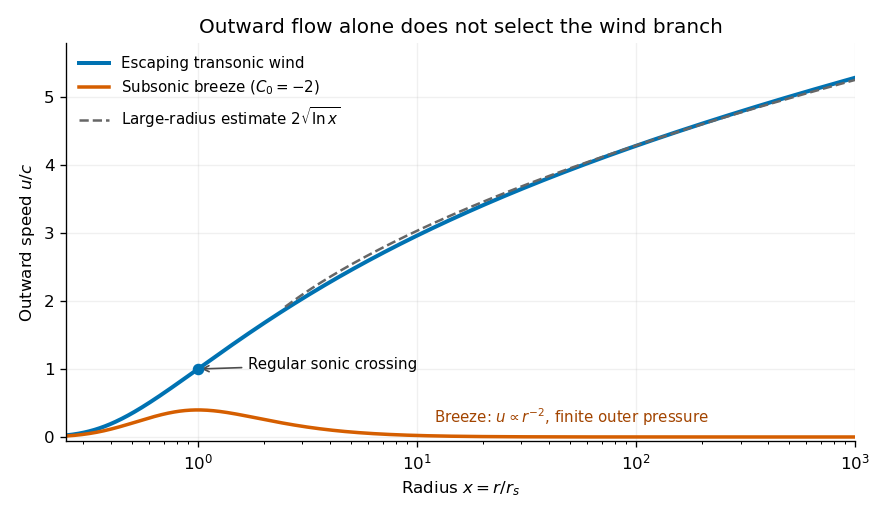

<h1 id="section-b/6/solution">Solution</h1>

↑ **Parent:** [6](../6.md)

**Hydrostatic equilibrium with self-gravity.** A resting [fluid](../../../../fluid.md) obeys $\nabla p=-\rho\nabla\Psi$. Spherical symmetry and the [Poisson equation for Newtonian gravity](../../../../poisson-equation-for-newtonian-gravity.md) give

$$
\frac{dp}{dr}=-\rho\frac{d\Psi}{dr},\qquad
\frac1{r^2}\frac{d}{dr}\left(r^2\frac{d\Psi}{dr}\right)=4\pi G\rho.
$$

Eliminate the [Newtonian gravitational potential](../../../../newtonian-gravitational-potential.md) derivative to obtain

$$
\boxed{\frac{d}{dr}\left(\frac{r^2}{\rho}\frac{dp}{dr}\right)
=-4\pi Gr^2\rho.}
$$

Equivalently, the [shell theorem](../../../../spherical-shell-theorem.md) gives $\Psi'=GM(r)/r^2$ and $M'(r)=4\pi r^2\rho$, which leads to the same [hydrostatic equilibrium](../../../../hydrostatic-equilibrium.md) equation.

**A uniform-density liquid.** With constant $\rho$, $M(r)=4\pi\rho r^3/3$. There is no central point mass, so the interior [gravitational acceleration](../../../../gravitational-acceleration.md) magnitude is $4\pi G\rho r/3$. Thus

$$
\frac{dp}{dr}=-\frac{4\pi G\rho^2}{3}r.
$$

Use $p(R)=0$ at a vacuum boundary, neglecting surface tension. The [uniform-density planetary pressure profile](../../../../uniform-density-planetary-pressure-profile.md) is

$$
\boxed{p(r)=\frac{2\pi G\rho^2}{3}(R^2-r^2),\quad 0\le r\le R.}
$$

The central value can also be written

$$
\boxed{p_c=\frac{2\pi G\rho^2R^2}{3}=\frac{3GM^2}{8\pi R^4}.}
$$

It has units pascals and decreases smoothly from its maximum at the centre to zero at the surface.

**An isothermal gas.** Here $c$ is the constant [isothermal sound speed](../../../../isothermal-sound-speed.md), with $p=c^2\rho$. Try $p=A/r^2$, so $\rho=A/(c^2r^2)$. The two sides of the equilibrium equation become

$$
\frac{d}{dr}\left(\frac{r^2}{\rho}\frac{dp}{dr}\right)
=\frac{d}{dr}(-2c^2r)=-2c^2,
\qquad -4\pi Gr^2\rho=-\frac{4\pi GA}{c^2}.
$$

Thus $A=c^4/(2\pi G)$, giving the [singular isothermal sphere](../../../../singular-isothermal-sphere.md),

$$
\boxed{p(r)=\frac{c^4}{2\pi Gr^2},\qquad
\rho(r)=\frac{c^2}{2\pi Gr^2},\qquad
M(r)=\frac{2c^2r}{G}.}
$$

This does **not describe a finite gaseous sphere in vacuum**. Both [pressure](../../../../pressure-split.md) and [mass density](../../../../density.md) diverge at the centre, and $p(R)>0$ for every finite outer radius $R$, so it cannot meet $p=0$ there. Extending it to infinity removes the finite-radius pressure jump but makes the total mass infinite. It is useful as an idealized profile over an intermediate radial range, or as a truncated model with nonzero external pressure. The [vacuum boundary obstruction for an isothermal sphere](../../../../vacuum-boundary-obstruction-for-an-isothermal-sphere.md) also applies to the regular, nonsingular isothermal solution; removing the central singularity does not produce a finite vacuum surface.

**Steady outflow.** In the wind calculation, take the central mass $M$ to be fixed and neglect the wind's own [self-gravity](../../../../self-gravity.md). Constant [mass flow rate](../../../../mass-flow-rate.md) and the [isothermal equation of state](../../../../globally-isothermal-equation-of-state.md) give

$$
4\pi r^2\rho u=\dot M,\qquad
\frac1\rho\frac{d\rho}{dr}=-\frac2r-\frac1u\frac{du}{dr},\qquad p=c^2\rho.
$$

The steady radial [Euler equation](../../../../euler-equations-for-an-inviscid-fluid-split.md) is

$$
u\frac{du}{dr}=-c^2\frac1\rho\frac{d\rho}{dr}-\frac{GM}{r^2}.
$$

Substituting the density derivative gives

$$
\boxed{\left(u-\frac{c^2}{u}\right)\frac{du}{dr}
=\frac{2c^2}{r}-\frac{GM}{r^2}.}
$$

This is the [isothermal Parker wind](../../../../isothermal-parker-wind.md) equation. A smooth [sonic point](../../../../sonic-point.md) requires both sides to vanish when $u=c$, so

$$
\boxed{r_s=\frac{GM}{2c^2},\qquad u(r_s)=c.}
$$

Maintaining constant [temperature](../../../../temperature-split.md) during expansion generally requires heat input; it is an isothermal model, not the adiabatic blast-wave model of Question 5.

**The escaping branch at large radius.** Integrate the wind equation, using dimensionless logarithm arguments:

$$
\frac{u^2}{2}-c^2\ln\frac uc
=2c^2\ln\frac r{r_s}+\frac{GM}{r}+C_E.
$$

Set $x=r/r_s$ and $w=u^2/c^2$. Then

$$
w-\ln w=4\ln x+\frac4x+C_0.
$$

For the accelerating [transonic branch](../../../../transonic-branch.md), $w(1)=1$, which fixes $C_0=-3$. At $x\gg1$ on its supersonic branch, $w\to\infty$ and $\ln w$ is smaller than $w$. Consequently

$$
w\sim4\ln x,\qquad
\boxed{u(r)\sim2c\sqrt{\ln(r/r_s)}.}
$$

A first correction makes the ordering explicit:

$$
w=4\ln x+\ln(4\ln x)-3+o(1).
$$

This is the [large-radius asymptotics of an isothermal Parker wind](../../../../large-radius-asymptotics-of-an-isothermal-parker-wind.md). The leading expression also holds for other supersonic branches with finite $C_0$.

The source implicitly selects an escaping wind. Positive steady outward flow alone does not determine that branch: a [subsonic isothermal breeze](../../../../subsonic-isothermal-breeze.md) also satisfies the differential equation. Its $w\ll1$ limit gives $w\sim e^{-C_0}x^{-4}$, hence $u\propto r^{-2}$ and $\rho\to\rho_\infty>0$. Such a breeze needs nonzero pressure at infinity. Selecting a regular outflow from a subsonic base into vanishing ambient pressure instead gives the accelerating transonic wind used above.

**[Figure 1](#section-b/6/image-original-numerical-branches-of-the-integrated-isothermal-wind-equation-showing-the-escaping-wind-its-logarithmic-asymptote-and-a-pressure-confined-subsonic-breeze). Original numerical branches of the integrated isothermal wind equation, showing the escaping wind, its logarithmic asymptote, and a pressure-confined subsonic breeze**.

The asymptotic speed has the same units as $c$; the logarithm is dimensionless. Its unlimited growth is a formal feature of indefinite isothermal heating and a prescribed point-mass potential. Real heating, surrounding pressure, and eventually the neglected wind mass limit that extrapolation.

## ↑ Ancestors (13)

1. [6](../6.md)
2. [Section B](../../section-b.md)
3. [2019](../../../2019-split.md)
4. [Past exam of the astrophysical fluid dynamics course of the University of Cambridge](../../../split.md)
5. [Astrophysical Fluid Dynamics course of the University of Cambridge](../../../../astrophysical-fluid-dynamics-course-of-the-university-of-cambridge.md)
6. [Physics course of the year 3 of the natural sciences course of the University of Cambridge](../../../../physics-course-of-the-year-3-of-the-natural-sciences-course-of-the-university-of-cambridge.md)
7. [Year 3 of the natural sciences course of the University of Cambridge](../../../../year-3-of-the-natural-sciences-course-of-the-university-of-cambridge.md)
8. [Year of the natural sciences course of the University of Cambridge](../../../../year-of-the-natural-sciences-course-of-the-university-of-cambridge.md)
9. [Natural sciences course of the University of Cambridge](../../../../natural-sciences-course-of-the-university-of-cambridge.md)
10. [Course of the University of Cambridge](../../../../course-of-the-university-of-cambridge.md)
11. [University of Cambridge](../../../../university-of-cambridge-split.md)
12. [List of universities](../../../../list-of-universities.md)
13. [Codex Wiki](../../../../split.md)
