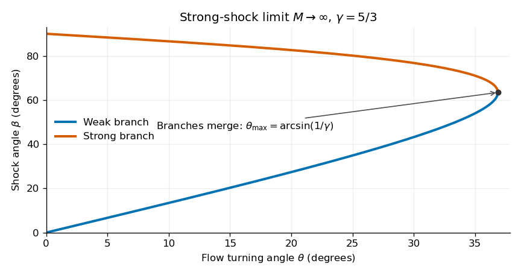

<h1 id="section-b/4/d/solution">Solution</h1>

↑ **Parent:** [D](../d.md)

Rewrite the relation from part (c) as

$$
(\gamma-1)\sin\beta\cos(\beta-\theta)
=(\gamma+1)\cos\beta\sin(\beta-\theta).
$$

The angle-addition identities reduce this to

$$
\sin(2\beta-\theta)=\gamma\sin\theta.
$$

For $0<\theta<\arcsin(1/\gamma)$, the right side lies strictly between zero and one. There are two physically admissible [strong oblique-shock angle branches](../../../../../strong-oblique-shock-angle-branches.md):

$$
\boxed{\begin{aligned}
\beta_{\rm weak}&=\frac12\left[\theta+\arcsin(\gamma\sin\theta)\right],\\
\beta_{\rm strong}&=\frac12\left[\theta+\pi-\arcsin(\gamma\sin\theta)\right].
\end{aligned}}
$$

Both lie between $\theta$ and $\pi/2$. They merge when $\gamma\sin\theta=1$, proving the [maximum deflection through a strong perfect-gas shock](../../../../../maximum-deflection-through-a-strong-perfect-gas-shock.md),

$$
\boxed{\theta_{\max}=\arcsin(1/\gamma),\qquad
\beta_* =\frac\pi4+\frac{\theta_{\max}}2.}
$$

For small positive $\theta$, the formal strong-shock-limit asymptotics are

$$
\boxed{\beta_{\rm weak}\sim\frac{\gamma+1}{2}\theta,\qquad
\beta_{\rm strong}\sim\frac\pi2-\frac{\gamma-1}{2}\theta.}
$$

The weak branch is normally observed for an unconfined supersonic stream turning through a modest compression corner. It has a smaller normal component of upstream [velocity](../../../../../velocity.md), hence a smaller downstream [pressure](../../../../../pressure-split.md) increase; for small turns the downstream flow remains supersonic. The nearly normal strong branch can be selected by suitable downstream [pressure](../../../../../pressure-split.md) conditions, so it is not mathematically forbidden.

The two limits must be ordered honestly. At finite $M$, the weak [oblique shock](../../../../../oblique-shock.md) approaches the [Mach angle](../../../../../mach-angle.md) $\arcsin(1/M)$ as $\theta\to0$, rather than zero. The displayed weak-branch asymptotic applies when the large-$M$ limit is taken first, or in the overlapping range $1/M\ll\theta\ll1$, where $M\sin\beta\gg1$ remains valid.

**[Figure 1](#section-b/4/d/image-calculated-weak-and-strong-shock-angle-branches-in-the-infinite-mach-number-limit-for-a-monatomic-gas). Calculated weak and strong shock-angle branches in the infinite-Mach-number limit, for a monatomic gas**.

## ↑ Ancestors (14)

1. [D](../d.md)
2. [4](../../4.md)
3. [Section B](../../../section-b.md)
4. [2021](../../../../2021-split.md)
5. [Past exam of the astrophysical fluid dynamics course of the University of Cambridge](../../../../split.md)
6. [Astrophysical Fluid Dynamics course of the University of Cambridge](../../../../../astrophysical-fluid-dynamics-course-of-the-university-of-cambridge.md)
7. [Physics course of the year 3 of the natural sciences course of the University of Cambridge](../../../../../physics-course-of-the-year-3-of-the-natural-sciences-course-of-the-university-of-cambridge.md)
8. [Year 3 of the natural sciences course of the University of Cambridge](../../../../../year-3-of-the-natural-sciences-course-of-the-university-of-cambridge.md)
9. [Year of the natural sciences course of the University of Cambridge](../../../../../year-of-the-natural-sciences-course-of-the-university-of-cambridge.md)
10. [Natural sciences course of the University of Cambridge](../../../../../natural-sciences-course-of-the-university-of-cambridge.md)
11. [Course of the University of Cambridge](../../../../../course-of-the-university-of-cambridge.md)
12. [University of Cambridge](../../../../../university-of-cambridge-split.md)
13. [List of universities](../../../../../list-of-universities.md)
14. [Codex Wiki](../../../../../split.md)
