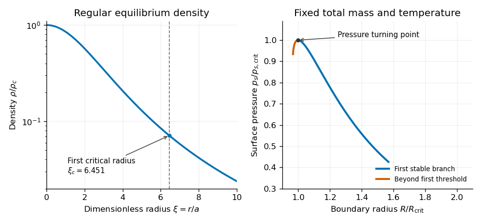

<h1 id="section-b/5/e/solution">Solution</h1>

↑ **Parent:** [E](../e.md)

Using the supplied first critical value $\xi_c\simeq6.5$, the [critical radius of a pressure-confined isothermal sphere](../../../../../critical-radius-of-a-pressure-confined-isothermal-sphere.md) is

$$
\boxed{r_c=6.5\sqrt{\frac{K}{4\pi G\rho_c}}
\simeq1.83\frac{c_s}{\sqrt{G\rho_c}},\qquad c_s^2=K.}
$$

No radius in metres can be specified without $K$ and a central [mass density](../../../../../density.md). Here $c_s$ is the [isothermal sound speed](../../../../../isothermal-sound-speed.md), consistent with the fixed-temperature variations in part (d). At a given central [mass density](../../../../../density.md), equilibria truncated at $\xi<\xi_c$ lie on the first stable branch, while increasing the dimensionless outer radius beyond this first threshold gives an unstable configuration. Numerical integration gives $\xi_c\simeq6.451$, consistent with the paper's rounded $6.5$.

For a transparent comparison with the given [Jeans length](../../../../../jeans-length.md), set the uniform comparison density $\rho_0=\rho_c$ and use the same [speed of sound](../../../../../speed-of-sound.md). Then

$$
\boxed{\frac{r_c}{\lambda_J}=\frac{6.5}{2\pi}\simeq1.03.}
$$

Both scales express the competition between [pressure](../../../../../pressure-split.md) support and [self-gravity](../../../../../self-gravity.md), with characteristic length $c_s/\sqrt{G\rho}$. Their numerical closeness under this density choice does not mean that the models impose the same threshold: $r_c$ is a boundary radius, whereas $\lambda_J$ is the wavelength of a perturbation. Comparing $r_c$ with $\lambda_J/2$ would instead give a factor about $2.07$. Using the sphere's mean or boundary density instead of its central density changes the coefficient again, so the reference density must always be stated.

The [pressure-confined isothermal sphere](../../../../../pressure-confined-isothermal-sphere.md) gives an actual finite, centrally concentrated [hydrostatic equilibrium](../../../../../hydrostatic-equilibrium.md) and an explicit confining [pressure](../../../../../pressure-split.md), making its radial stability threshold more self-consistent for a roughly spherical isothermal cloud. The uniform [Jeans instability](../../../../../jeans-instability.md) model gives a simpler local criterion, includes perturbations at different [wavelengths](../../../../../wavelength.md), and does not require constructing a spherical equilibrium. Its ideal uniform static infinite background requires the [Jeans swindle](../../../../../jeans-swindle.md) or an explicitly specified treatment of background gravity. Neither model includes rotation, [magnetic fields](../../../../../magnetic-field-split.md), turbulent support or a realistic temperature evolution, so neither is a universal collapse criterion.

**[Figure 2](#section-b/5/e/image-numerically-integrated-isothermal-sphere-density-profile-and-the-first-pressure-turning-point-along-a-fixed-mass-sequence). Numerically integrated isothermal-sphere density profile and the first pressure turning point along a fixed-mass sequence**.

## ↑ Ancestors (14)

1. [E](../e.md)
2. [5](../../5.md)
3. [Section B](../../../section-b.md)
4. [2021](../../../../2021-split.md)
5. [Past exam of the astrophysical fluid dynamics course of the University of Cambridge](../../../../split.md)
6. [Astrophysical Fluid Dynamics course of the University of Cambridge](../../../../../astrophysical-fluid-dynamics-course-of-the-university-of-cambridge.md)
7. [Physics course of the year 3 of the natural sciences course of the University of Cambridge](../../../../../physics-course-of-the-year-3-of-the-natural-sciences-course-of-the-university-of-cambridge.md)
8. [Year 3 of the natural sciences course of the University of Cambridge](../../../../../year-3-of-the-natural-sciences-course-of-the-university-of-cambridge.md)
9. [Year of the natural sciences course of the University of Cambridge](../../../../../year-of-the-natural-sciences-course-of-the-university-of-cambridge.md)
10. [Natural sciences course of the University of Cambridge](../../../../../natural-sciences-course-of-the-university-of-cambridge.md)
11. [Course of the University of Cambridge](../../../../../course-of-the-university-of-cambridge.md)
12. [University of Cambridge](../../../../../university-of-cambridge-split.md)
13. [List of universities](../../../../../list-of-universities.md)
14. [Codex Wiki](../../../../../split.md)
