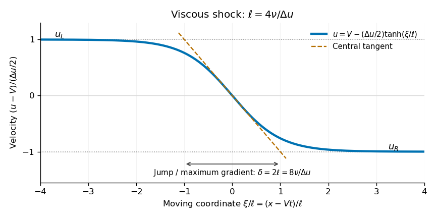

<h1 id="section-b/5/d/solution">Solution</h1>

↑ **Parent:** [D](../d.md)

Let $a_j=\nu\kappa_j^2t+\kappa_jx$. Differentiating the logarithm gives

$$
u=-2\nu\frac{\kappa_1e^{a_1}+\kappa_2e^{a_2}}{e^{a_1}+e^{a_2}}.
$$

For definiteness order $\kappa_1<\kappa_2$. Then $e^{a_1}$ dominates as $x\to-\infty$, while $e^{a_2}$ dominates as $x\to+\infty$. The limiting states are

$$
\boxed{u_L=-2\nu\kappa_1,\qquad u_R=-2\nu\kappa_2,\qquad u_L>u_R.}
$$

Without this ordering convention, $u(-\infty)=-2\nu\min(\kappa_1,\kappa_2)$ and $u(+\infty)=-2\nu\max(\kappa_1,\kappa_2)$. Thus the states $u_{1,2}$ correspond to $-2\nu\kappa_{1,2}$ after matching each label to its dominant exponential; the propagation speed does not depend on the naming of the two states.

Their exponent difference is

$$
a_2-a_1=(\kappa_2-\kappa_1)\left[x+\nu(\kappa_1+\kappa_2)t\right].
$$

Consequently, the [Viscous Burgers travelling shock](../../../../../viscous-burgers-travelling-shock.md) moves at

$$
\boxed{V=-\nu(\kappa_1+\kappa_2)=\frac{u_L+u_R}{2}=\frac{u_1+u_2}{2}.}
$$

Set $\Delta u=u_L-u_R=2\nu(\kappa_2-\kappa_1)>0$ and $\xi=x-Vt$. Factoring out the mean exponential gives the [hyperbolic tangent](../../../../../hyperbolic-tangent.md) profile

$$
\boxed{u(x,t)=V-\frac{\Delta u}{2}\tanh\left(\frac{\Delta u\,\xi}{4\nu}\right).}
$$

A precise measure of the width must be stated. The natural length in the [hyperbolic tangent](../../../../../hyperbolic-tangent.md) argument is

$$
\boxed{\ell=\frac{4\nu}{\Delta u}=\frac{2}{|\kappa_2-\kappa_1|}.}
$$

Thus the layer has thickness of order $\nu/\Delta u$. A different common convention, jump divided by maximum gradient, gives $\delta=\Delta u/|u_x(0)|=8\nu/\Delta u=2\ell$; the far-tail exponential e-folding length is $\ell/2$. These differ only by their stated definitions, rather than by different solutions.

Two distinct limits require $\kappa_1\ne\kappa_2$. The source permits arbitrary real constants, but in the degenerate case $\kappa_1=\kappa_2$ the solution is uniform, $u=-2\nu\kappa_1$, and there is no [shock wave](../../../../../shock-wave.md) or finite shock width.

**[Figure 1](#section-b/5/d/image-calculated-travelling-shock-profile-and-its-tangent-width-the-horizontal-coordinate-moves-with-the-shock). Calculated travelling shock profile and its tangent width; the horizontal coordinate moves with the shock**.

## ↑ Ancestors (14)

1. [D](../d.md)
2. [5](../../5.md)
3. [Section B](../../../section-b.md)
4. [2022](../../../../2022-split.md)
5. [Past exam of the astrophysical fluid dynamics course of the University of Cambridge](../../../../split.md)
6. [Astrophysical Fluid Dynamics course of the University of Cambridge](../../../../../astrophysical-fluid-dynamics-course-of-the-university-of-cambridge.md)
7. [Physics course of the year 3 of the natural sciences course of the University of Cambridge](../../../../../physics-course-of-the-year-3-of-the-natural-sciences-course-of-the-university-of-cambridge.md)
8. [Year 3 of the natural sciences course of the University of Cambridge](../../../../../year-3-of-the-natural-sciences-course-of-the-university-of-cambridge.md)
9. [Year of the natural sciences course of the University of Cambridge](../../../../../year-of-the-natural-sciences-course-of-the-university-of-cambridge.md)
10. [Natural sciences course of the University of Cambridge](../../../../../natural-sciences-course-of-the-university-of-cambridge.md)
11. [Course of the University of Cambridge](../../../../../course-of-the-university-of-cambridge.md)
12. [University of Cambridge](../../../../../university-of-cambridge-split.md)
13. [List of universities](../../../../../list-of-universities.md)
14. [Codex Wiki](../../../../../split.md)
