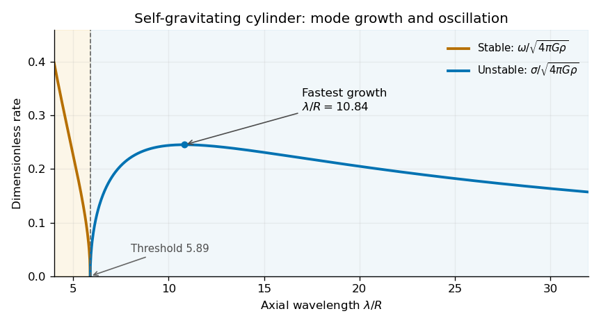

<h1 id="section-b/6/e/solution">Solution</h1>

↑ **Parent:** [E](../e.md)

Define the dimensionless right-hand side of part (d) by $F(\kappa)$. Then $\omega^2=-4\pi G\rho F(\kappa)$. Because $I'_0(\kappa)=I_1(\kappa)>0$ and $I_0(\kappa)>0$ for $\kappa>0$, its sign is the sign of $I_0(\kappa)K_0(\kappa)-1/2$. The original plot is positive for sufficiently long [wavelengths](../../../../../wavelength.md) and negative at short [wavelengths](../../../../../wavelength.md); the nonzero crossing is approximately $\kappa_c\simeq1.07$. Numerically solving the displayed equation gives $\kappa_c\simeq1.0667$.

For $0<\kappa<\kappa_c$, $\omega^2<0$. Write $\omega=i\sigma$ with $\sigma=\sqrt{4\pi G\rho F}>0$. The time factor $e^{-i\omega t}$ then contains an exponentially growing solution. For $\kappa>\kappa_c$, $\omega^2>0$ and the ideal inviscid modes oscillate stably, without damping. At the crossing the [frequency](../../../../../frequency.md) is zero and the mode is marginal. In terms of the axial [wavelength](../../../../../wavelength.md) $\lambda_z=2\pi/k$,

$$
\boxed{\begin{aligned}
\lambda_z>\frac{2\pi R}{\kappa_c}\simeq5.89R&:\quad\text{gravitationally unstable},\\
\lambda_z<5.89R&:\quad\text{oscillatory and stable}.
\end{aligned}}
$$

The [growth rate](../../../../../growth-rate.md) tends to zero as $kR\to0^+$, so the very longest [wavelengths](../../../../../wavelength.md) are not the fastest growing. The source plot has its maximum near $kR\simeq0.58$, corresponding to $\lambda_z\simeq11R$ and $\sigma\simeq0.25\sqrt{4\pi G\rho}$. Thus a characteristic fragmentation spacing is several cylinder diameters; a quantitative nonlinear fragment mass is beyond this [linear stability](../../../../../linear-stability.md) calculation.

For unstable modes the physical displacement must be interpreted as $\operatorname{Re}[\epsilon e^{i(kz-\omega t)}]$ with complex amplitudes handled consistently throughout. The paper's real-part notation is harmless for the squared [dispersion relation](../../../../../dispersion-relation-split.md), but it should not be read as imposing real $\omega$ in a [gravitational instability](../../../../../gravitational-instability.md) calculation. The exactly uniform mode $k=0$ is excluded from the finite-$k$ derivation; the limit of the curve alone does not establish a separate volume-preserving uniform-radius mode.

**[Figure 2](#section-b/6/e/image-rates-computed-from-the-cylinder-dispersion-relation-as-a-function-of-wavelength-showing-stable-oscillation-and-unstable-growth). Rates computed from the cylinder dispersion relation as a function of wavelength, showing stable oscillation and unstable growth**.

## ↑ Ancestors (14)

1. [E](../e.md)
2. [6](../../6.md)
3. [Section B](../../../section-b.md)
4. [2022](../../../../2022-split.md)
5. [Past exam of the astrophysical fluid dynamics course of the University of Cambridge](../../../../split.md)
6. [Astrophysical Fluid Dynamics course of the University of Cambridge](../../../../../astrophysical-fluid-dynamics-course-of-the-university-of-cambridge.md)
7. [Physics course of the year 3 of the natural sciences course of the University of Cambridge](../../../../../physics-course-of-the-year-3-of-the-natural-sciences-course-of-the-university-of-cambridge.md)
8. [Year 3 of the natural sciences course of the University of Cambridge](../../../../../year-3-of-the-natural-sciences-course-of-the-university-of-cambridge.md)
9. [Year of the natural sciences course of the University of Cambridge](../../../../../year-of-the-natural-sciences-course-of-the-university-of-cambridge.md)
10. [Natural sciences course of the University of Cambridge](../../../../../natural-sciences-course-of-the-university-of-cambridge.md)
11. [Course of the University of Cambridge](../../../../../course-of-the-university-of-cambridge.md)
12. [University of Cambridge](../../../../../university-of-cambridge-split.md)
13. [List of universities](../../../../../list-of-universities.md)
14. [Codex Wiki](../../../../../split.md)
