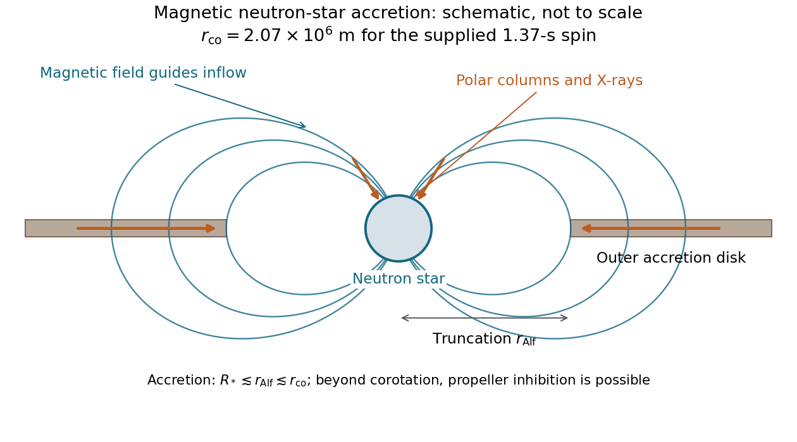

<h1 id="2/c/solution">Solution</h1>

↑ **Parent:** [C](../c.md)

In [magnetically channelled accretion](../../../../magnetically-channelled-accretion.md), an outer [accretion disk](../../../../accretion-disk.md) supplies nearly Keplerian material. Near the [magnetospheric truncation radius](../../../../magnetospheric-truncation-radius.md), magnetic stresses disrupt the disk and guide matter along field lines onto polar [accretion columns](../../../../accretion-column.md). Shocks and settling near the surface release gravitational binding [energy](../../../../energy-split.md), and an oblique magnetic geometry makes the rotating emission pattern pulsate.

The [corotation radius](../../../../corotation-radius.md) satisfies $\Omega_K(r_{\rm co})=\Omega_*=2\pi/P$, hence

$$
\boxed{r_{\rm co}=\left(\frac{GMP^2}{4\pi^2}\right)^{1/3}=2.07\times10^6\ \mathrm m}.
$$

The [accretion Alfvén radius](../../../../accretion-alfven-radius.md) estimates where magnetic stress becomes comparable with the inflow's dynamical stress; it is the magnetic truncation scale in this application, not the Alfvén critical point of an outward stellar wind. The supplied seventh-root scaling follows from a dipole's rapidly decreasing [magnetic pressure](../../../../magnetic-pressure.md) and an accretion-pressure estimate. Its coefficient depends on disk geometry. Ordinary inward surface [accretion](../../../../accretion.md) requires the magnetosphere to remain outside the star and usually inside or near corotation, $R\lesssim r_{\rm Alf}\lesssim r_{\rm co}$. Beyond corotation, a rapidly moving magnetosphere can transfer [angular momentum](../../../../angular-momentum.md) outward and inhibit inflow through the [propeller effect](../../../../propeller-effect.md).

**[Figure 1](#2/c/image-magnetic-channeling-from-a-truncated-accretion-disk-to-neutron-star-polar-caps-with-the-corotation-condition-shown-separately). Magnetic channeling from a truncated accretion disk to neutron-star polar caps, with the corotation condition shown separately**.

## ↑ Ancestors (12)

1. [C](../c.md)
2. [2](../../2.md)
3. [2015](../../../2015-split.md)
4. [Past exam of the astrophysics course of the University of Oxford](../../../split.md)
5. [Astrophysics course of the University of Oxford](../../../../astrophysics-course-of-the-university-of-oxford.md)
6. [Year 4 of the physics course of the University of Oxford](../../../../year-4-of-the-physics-course-of-the-university-of-oxford.md)
7. [Physics course of the University of Oxford](../../../../physics-course-of-the-university-of-oxford.md)
8. [Undergraduate course of the University of Oxford](../../../../undergraduate-course-of-the-university-of-oxford.md)
9. [Course of the University of Oxford](../../../../course-of-the-university-of-oxford.md)
10. [University of Oxford](../../../../university-of-oxford-split.md)
11. [List of universities](../../../../list-of-universities.md)
12. [Codex Wiki](../../../../split.md)
