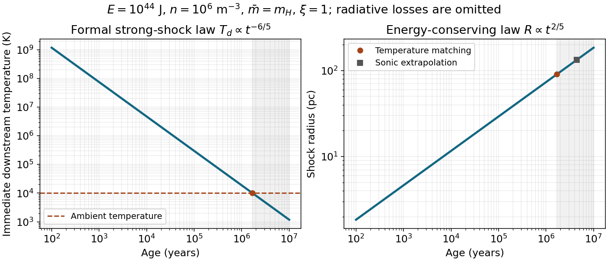

<h1 id="4/c/solution">Solution</h1>

↑ **Parent:** [C](../c.md)

Let the mean particle [mass](../../../../mass.md) be $\bar m=\mu m_H$, with $n_u$ counting total particles so that $\rho_u=n_u\bar m$. The ideal-gas law and the strong-shock [pressure](../../../../pressure-split.md) give the immediate post-shock [temperature](../../../../temperature-split.md)

$$
\boxed{T_d=\frac{p_d\bar m}{\rho_dk_B}=\frac{3\bar mV_s^2}{16k_B}
=\frac{3\bar m\xi^2}{100k_B}\left(\frac E{\rho_u}\right)^{2/5}t^{-6/5}}.
$$

The robust prediction is $T_d\propto t^{-6/5}$. For a transparent numerical convention take $\mu=1$, $n_u=10^6\ \mathrm{m^{-3}}$ and $\xi=1$. Then

$$
R\simeq4.63\left(\frac t{10^3\ \mathrm{yr}}\right)^{2/5}\ \mathrm{pc},\qquad
\boxed{T_d\simeq7.45\times10^7\left(\frac t{10^3\ \mathrm{yr}}\right)^{-6/5}\ \mathrm K}.
$$

For an ionized mixture with $\mu=0.6$ under the same total-particle-density convention, these normalizations become $5.13$ pc and $5.49\times10^7$ K. The paper does not specify composition or whether its quoted density instead counts hydrogen nuclei; that convention must be stated, not hidden in a precise age.

The [ambient-temperature limit of an adiabatic blast wave](../../../../ambient-temperature-limit-of-an-adiabatic-blast-wave.md) gives a formal matching estimate, $T_d\sim10^4$ K, gives

$$
\boxed{t_T\sim1.7\times10^6\ \mathrm{yr},\qquad R_T\sim90\ \mathrm{pc}\quad(\mu=1,\ \xi=1)}.
$$

With $\mu=0.6$ the age is about $1.3\times10^6$ yr and the radius stays about 90 pc. This matching criterion already lies outside a very strong shock: $T_d=T_u$ in the strong-shock formula corresponds to $\mathcal M_s=\sqrt{16/(3\gamma)}\simeq1.79$. A separate sonic estimate $V_s\sim c_{s,u}$ gives about $4.4\times10^6$ yr and 133 pc for $\mu=1$; neither extrapolation is a precise transition solution. Using $\xi=1.15$ increases these inferred matching ages and radii by factors $\xi^{5/3}$.

In a real supernova remnant, substantial radiation losses commonly end the energy-conserving phase before these formal pressure-merging limits. The relevant comparison is $t_{\rm cool}\sim(3/2)nk_BT/(n_en_i\Lambda(T))$ against the expansion time. A cooling function, composition and ionization state are needed to calculate that earlier age and radius; they are not supplied. The numerical values above answer the ambient-temperature breakdown estimate under explicit assumptions and must not be presented as a uniquely determined radiative shell-formation age.

After cooling, an interior-pressure-driven shell can approximately follow $R\propto t^{2/7}$ while [pressure](../../../../pressure-split.md) remains important. In the limiting momentum-conserving stage, $M_s\dot R\simeq\mathrm{const}$ and $M_s\propto\rho_uR^3$ give $\boxed{R\propto t^{1/4}}$. Ultimately ambient [pressure](../../../../pressure-split.md) and turbulent motions make the disturbance merge with the ISM. These slower stages respect the reduced [energy](../../../../energy-split.md) budget rather than continuing an adiabatic strong-shock law indefinitely.

**[Figure 2](#4/c/image-the-formal-energy-conserving-supernova-shock-temperature-and-radius-with-ambient-temperature-and-sonic-matching-distinguished). The formal energy-conserving supernova shock temperature and radius, with ambient-temperature and sonic matching distinguished**.

## ↑ Ancestors (12)

1. [C](../c.md)
2. [4](../../4.md)
3. [2015](../../../2015-split.md)
4. [Past exam of the astrophysics course of the University of Oxford](../../../split.md)
5. [Astrophysics course of the University of Oxford](../../../../astrophysics-course-of-the-university-of-oxford.md)
6. [Year 4 of the physics course of the University of Oxford](../../../../year-4-of-the-physics-course-of-the-university-of-oxford.md)
7. [Physics course of the University of Oxford](../../../../physics-course-of-the-university-of-oxford.md)
8. [Undergraduate course of the University of Oxford](../../../../undergraduate-course-of-the-university-of-oxford.md)
9. [Course of the University of Oxford](../../../../course-of-the-university-of-oxford.md)
10. [University of Oxford](../../../../university-of-oxford-split.md)
11. [List of universities](../../../../list-of-universities.md)
12. [Codex Wiki](../../../../split.md)
