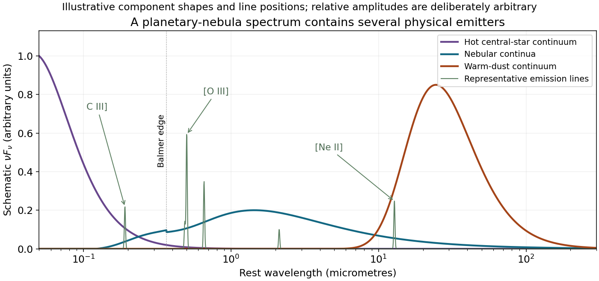

<h1 id="5/i/solution">Solution</h1>

↑ **Parent:** [I](../i.md)

A [planetary nebula](../../../../planetary-nebula.md) combines a hot post-asymptotic-giant-branch stellar core, its ionized expelled envelope, neutral/molecular material and [interstellar dust](../../../../interstellar-dust.md). Its ultraviolet-to-infrared [spectral energy distribution](../../../../spectral-energy-distribution.md) is therefore not a single-temperature blackbody. The principal components are:

- **Central-star continuum.** A hot stellar photosphere emits strongly in the ultraviolet, especially the ionizing extreme ultraviolet, with its longer-wavelength tail extending through the optical and near infrared. Stellar-atmosphere absorption features and wind lines can be superposed. A companion can add a distinct cool stellar continuum.
- **Nebular continuum.** Thermal [bremsstrahlung](../../../../bremsstrahlung.md), [nebular free-bound continuum](../../../../nebular-free-bound-continuum.md) emission and hydrogen two-photon emission produce a broad continuum. Free-bound edges, especially the Balmer discontinuity at 364.6 nm and the Paschen discontinuity near 820 nm, can be apparent. Hydrogen two-photon decay redistributes the Ly-alpha transition [energy](../../../../energy-split.md) into a continuum of pairs rather than one 121.6-nm [photon](../../../../photon.md).
- **Gas emission lines.** Hydrogen and helium [recombination lines](../../../../recombination-line.md) include H-alpha, H-beta and He II 468.6 nm. Collisionally excited lines of metal ions can dominate individual bands: examples include optical \[O III\] 495.9/500.7 nm and \[N II\] 654.8/658.3 nm, ultraviolet C III\] near 190.9 nm, and infrared fine-structure transitions such as \[Ne II\] 12.8 micrometres. A broad-band photometric peak may therefore be a line rather than continuum.
- **Dust emission and solid-state structure.** Grains absorb stellar/nebular radiation and reradiate it as a broad infrared continuum, often from a distribution of [temperatures](../../../../temperature-split.md) of order tens to hundreds of kelvin; compact hot dust can add near-infrared emission. Carbon-rich material may show aromatic bands around 3.3, 6.2, 7.7, 8.6 and 11.3 micrometres, while oxygen-rich material may show silicate features near 9.7 and 18 micrometres. These are compositional alternatives, not mandatory features of every nebula.
- **Neutral and molecular emission.** Surviving molecular material in dense clumps or a photodissociation region can contribute infrared rotational/rovibrational lines, notably molecular-hydrogen emission such as the 2.12-micrometre line. Shocks as well as ultraviolet pumping can excite it. Colder dust continues into the far infrared, and low-lying CO rotational lines extend the overall spectrum into the submillimetre/millimetre range.

**[Figure 3](#5/i/image-schematic-stellar-nebular-and-dust-components-of-a-planetary-nebula-spectrum-arbitrary-relative-normalizations). Schematic stellar, nebular and dust components of a planetary-nebula spectrum; arbitrary relative normalizations**.

The observed mixture also contains attenuation by internal and foreground [interstellar extinction](../../../../interstellar-extinction.md). A spectrum containing all these components need not spatially coincide: stellar light, ionized gas, dusty clumps and the molecular envelope sample different regions.

## ↑ Ancestors (12)

1. [I](../i.md)
2. [5](../../5.md)
3. [2015](../../../2015-split.md)
4. [Past exam of the astrophysics course of the University of Oxford](../../../split.md)
5. [Astrophysics course of the University of Oxford](../../../../astrophysics-course-of-the-university-of-oxford.md)
6. [Year 4 of the physics course of the University of Oxford](../../../../year-4-of-the-physics-course-of-the-university-of-oxford.md)
7. [Physics course of the University of Oxford](../../../../physics-course-of-the-university-of-oxford.md)
8. [Undergraduate course of the University of Oxford](../../../../undergraduate-course-of-the-university-of-oxford.md)
9. [Course of the University of Oxford](../../../../course-of-the-university-of-oxford.md)
10. [University of Oxford](../../../../university-of-oxford-split.md)
11. [List of universities](../../../../list-of-universities.md)
12. [Codex Wiki](../../../../split.md)
