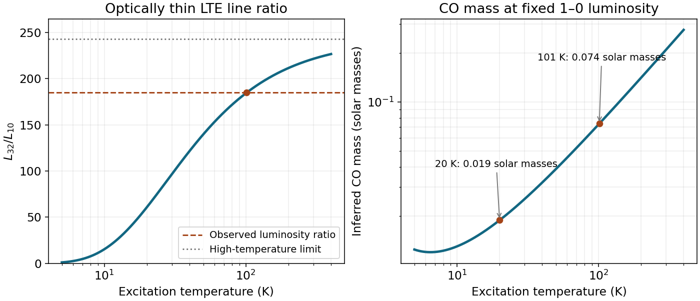

<h1 id="6/d/solution">Solution</h1>

↑ **Parent:** [D](../d.md)

Raising the [temperature](../../../../temperature-split.md) populates higher rotational states and reduces the fraction in $J=1$. At $T\simeq101$ K, the [rotational partition function](../../../../rotational-partition-function.md) gives $f_1\simeq0.0768$, so the same low-$J$ [luminosity](../../../../luminosity.md) requires

$$
\boxed{M_{\rm CO}\simeq7.36\times10^{-2}M_\odot},
$$

about $3.9$ times the 20-K estimate. Applying the independently computed $J=3$ fraction to the measured high-$J$ line gives the same [mass](../../../../mass.md) within the model, providing a consistency check rather than an independent proof of its assumptions.

Optical depth, density-dependent excitation, multiple [temperature](../../../../temperature-split.md) components, beam dilution, aperture mismatch, line blending and flux calibration all need investigation. For one optically thick isothermal source with equal emitting area and velocity width, the Rayleigh-Jeans limit instead gives line-energy [luminosity](../../../../luminosity.md) approximately proportional to $\nu^3$, so the 3–2/1–0 ratio is of order 27, far below 185. That illustrates why optical-depth and emitting-area assumptions cannot be ignored; different source areas or excitation structures can change this simple comparison. Optically thick clumps can hide [mass](../../../../mass.md), and a high-temperature component may dominate the 3–2 line while colder material contributes much of the 1–0 emission.

Additional rotational lines, especially the available 2–1 transition and higher-$J$ lines, test a one-temperature excitation diagram. Less abundant isotopologues help constrain [opacity](../../../../opacity.md); resolved imaging and line profiles constrain emitting volume and homologous expansion, using the remnant age. Density information permits non-LTE statistical-equilibrium/radiative-transfer modelling. Dust emission can provide a complementary [mass](../../../../mass.md) constraint with its own [opacity](../../../../opacity.md) and dust-to-gas uncertainties. A total gas [mass](../../../../mass.md) additionally needs a justified CO abundance, accounting for molecular formation, destruction and unobserved material.

**[Figure 4](#6/d/image-temperature-dependent-co-line-ratio-and-mass-inferred-from-the-fixed-j-1-to-0-luminosity-under-optically-thin-lte). Temperature-dependent CO line ratio and mass inferred from the fixed J=1 to 0 luminosity under optically thin LTE**.

## ↑ Ancestors (12)

1. [D](../d.md)
2. [6](../../6.md)
3. [2015](../../../2015-split.md)
4. [Past exam of the astrophysics course of the University of Oxford](../../../split.md)
5. [Astrophysics course of the University of Oxford](../../../../astrophysics-course-of-the-university-of-oxford.md)
6. [Year 4 of the physics course of the University of Oxford](../../../../year-4-of-the-physics-course-of-the-university-of-oxford.md)
7. [Physics course of the University of Oxford](../../../../physics-course-of-the-university-of-oxford.md)
8. [Undergraduate course of the University of Oxford](../../../../undergraduate-course-of-the-university-of-oxford.md)
9. [Course of the University of Oxford](../../../../course-of-the-university-of-oxford.md)
10. [University of Oxford](../../../../university-of-oxford-split.md)
11. [List of universities](../../../../list-of-universities.md)
12. [Codex Wiki](../../../../split.md)
