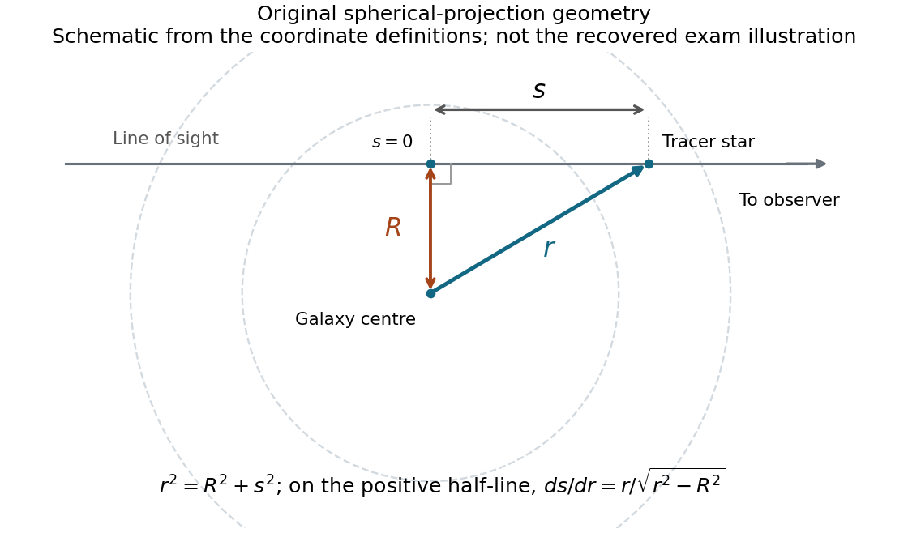

<h1 id="7/c/solution">Solution</h1>

↑ **Parent:** [C](../c.md)

**TODO: the original line-of-sight geometry figure on source page 8 is unavailable.** The PDF calls an unembedded image and the documented archive parent has the same gap. Its exact drawn layout cannot be checked or reproduced. The surviving coordinate definitions suffice for the following standard spherical-projection derivation; no missing plotted values or drawn dimensions are supplied here.

The [spherical density projection](../../../../spherical-density-projection.md) schematic below is original geometry constructed from these definitions, not a recovered examination figure.

**[Figure 5](#7/c/image-original-line-of-sight-geometry-from-the-surviving-coordinate-definitions-not-the-recovered-examination-figure). Original line-of-sight geometry from the surviving coordinate definitions; not the recovered examination figure**.

Let $s=0$ be closest approach on a line of sight at projected radius $R$. Euclidean spherical geometry gives $r^2=R^2+s^2$. On either half-line, $|ds/dr|=r/\sqrt{r^2-R^2}$, and the two halves contribute equally. With identical stellar [luminosity](../../../../luminosity.md) $L$, $\mathcal L=L\nu$, so

$$
\boxed{I(R)=2L\int_R^\infty\frac{\nu(r)r\,dr}{\sqrt{r^2-R^2}}}.
$$

For an isotropic velocity distribution, the variance of any unit-direction projection equals $\sigma_r^2(r)$. Explicitly, the line-of-sight contributions have weights $s^2/r^2$ from the radial component and $R^2/r^2$ from a tangential component; equality of their variances makes the sum $\sigma_r^2$. Consequently

$$
\boxed{I(R)\sigma_{\rm los}^2(R)=2L\int_R^\infty\frac{\nu(r)\sigma_r^2(r)r\,dr}{\sqrt{r^2-R^2}}}.
$$

Without isotropy the integrand instead has the factor $1-\beta(r)R^2/r^2$. Thus the projection assumption is substantive, rather than something that can be inferred from spherical [surface brightness](../../../../surface-brightness.md) alone. The missing illustration does not prevent recovering these algebraic expressions from the prose.

## ↑ Ancestors (12)

1. [C](../c.md)
2. [7](../../7.md)
3. [2015](../../../2015-split.md)
4. [Past exam of the astrophysics course of the University of Oxford](../../../split.md)
5. [Astrophysics course of the University of Oxford](../../../../astrophysics-course-of-the-university-of-oxford.md)
6. [Year 4 of the physics course of the University of Oxford](../../../../year-4-of-the-physics-course-of-the-university-of-oxford.md)
7. [Physics course of the University of Oxford](../../../../physics-course-of-the-university-of-oxford.md)
8. [Undergraduate course of the University of Oxford](../../../../undergraduate-course-of-the-university-of-oxford.md)
9. [Course of the University of Oxford](../../../../course-of-the-university-of-oxford.md)
10. [University of Oxford](../../../../university-of-oxford-split.md)
11. [List of universities](../../../../list-of-universities.md)
12. [Codex Wiki](../../../../split.md)

## ← Incoming links (1)

- [2015](../../../2015-split.md)
