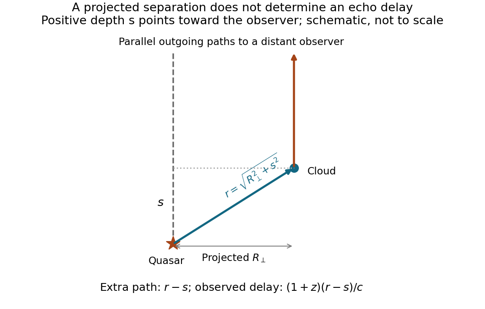

<h1 id="8/d/solution">Solution</h1>

↑ **Parent:** [D](../d.md)

For a [bound-cloud light echo](../../../../bound-cloud-light-echo.md), the relevant observed delay is the _excess_ source–cloud–observer path over the direct source–observer path, with the interval dilated by cosmological expansion. For a cloud displaced by $s$ toward us,

$$
\boxed{\Delta t_{\rm obs}=(1+z)\frac{\sqrt{R_\perp^2+s^2}-s}{c}}.
$$

The formula assumes source and cloud separation is small compared with their cosmological distance, so their distant observer directions are effectively parallel. For the transverse configuration $s=0$,

$$
\boxed{\Delta t_{\rm obs}=3\frac{87.6\ \mathrm{kpc}}c\simeq8.57\times10^5\ \mathrm{yr}}.
$$

The local quasar-to-cloud travel time is about $2.86\times10^5$ yr; the factor three is needed for the interval measured by us. A foreground cloud shortens the echo delay and a background cloud lengthens it. A unique value beyond this transverse estimate needs the otherwise unspecified depth, even if the cloud's intrinsic response is instantaneous.

**[Figure 6](#8/d/image-projected-separation-and-unknown-cloud-depth-determine-the-excess-path-and-observed-echo-delay). Projected separation and unknown cloud depth determine the excess path and observed echo delay**.

## ↑ Ancestors (12)

1. [D](../d.md)
2. [8](../../8.md)
3. [2015](../../../2015-split.md)
4. [Past exam of the astrophysics course of the University of Oxford](../../../split.md)
5. [Astrophysics course of the University of Oxford](../../../../astrophysics-course-of-the-university-of-oxford.md)
6. [Year 4 of the physics course of the University of Oxford](../../../../year-4-of-the-physics-course-of-the-university-of-oxford.md)
7. [Physics course of the University of Oxford](../../../../physics-course-of-the-university-of-oxford.md)
8. [Undergraduate course of the University of Oxford](../../../../undergraduate-course-of-the-university-of-oxford.md)
9. [Course of the University of Oxford](../../../../course-of-the-university-of-oxford.md)
10. [University of Oxford](../../../../university-of-oxford-split.md)
11. [List of universities](../../../../list-of-universities.md)
12. [Codex Wiki](../../../../split.md)
