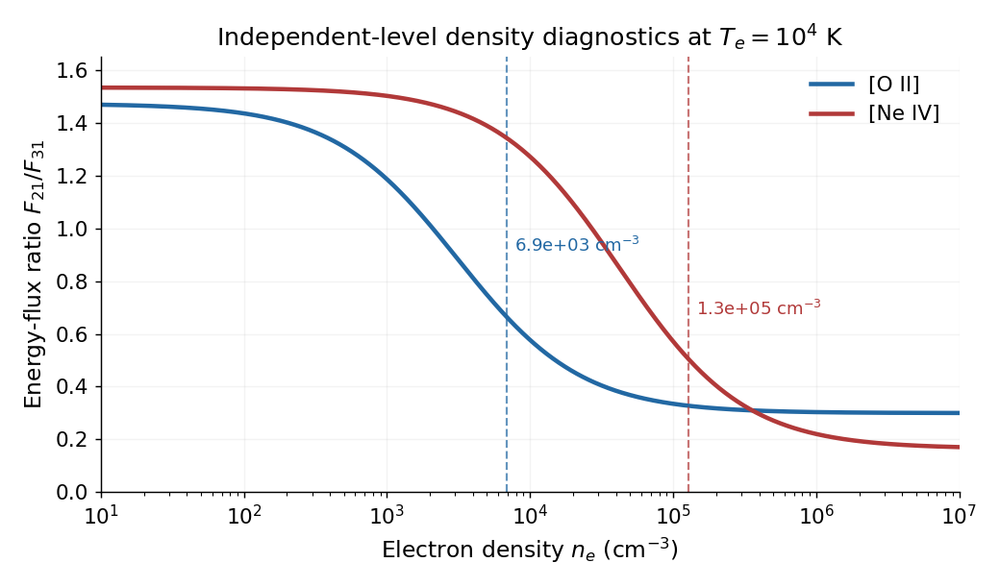

<h1 id="2/solution">Solution</h1>

↑ **Parent:** [2](../2.md)

For an optically thin collisionally excited line, the volume [emissivity](../../../emissivity.md) is approximately $j_{ul}=n_en(X^i)q_{lu}(T_e)h\nu_{ul}$ below the transition's [critical density](../../../critical-density.md). The excitation coefficient includes a factor $T_e^{-1/2}\exp[-\Delta E/(k_BT_e)]$, so [temperature](../../../temperature-split.md) is needed to convert [luminosity](../../../luminosity.md) into an ionic abundance. Density is needed both to assess [collisional quenching of a metastable line](../../../collisional-quenching-of-a-metastable-line.md) and to convert an emission measure into a gas [mass](../../../mass.md). For a uniform recombining ion, for example, $M_i=m_iL_{\rm line}/[n_e\alpha_{\rm eff}h\nu]$. [Temperature](../../../temperature-split.md) structure, density clumping, extinction and unobserved ionization stages introduce further corrections.

A useful density doublet has closely spaced upper [energies](../../../energy-split.md) but different spontaneous decay rates and hence different [critical densities](../../../critical-density.md). Nearly equal excitation [energies](../../../energy-split.md) reduce [temperature](../../../temperature-split.md) dependence of the ratio; similar wavelengths reduce differential extinction and relative calibration errors. Metastable upper levels have sufficiently small [Einstein coefficients](../../../einstein-coefficients.md) for collisional de-excitation to compete at nebular densities.

Use statistical weights $g_2=6$, $g_3=4$. The source's O II ground-state term has a typographical error: it is $2s^22p^3\,{}^4S_{3/2}^{\rm o}$, not ${}^2S_{3/2}$. A ${}^2S$ term has $J=1/2$, so the printed term is internally inconsistent. The tabulated $J$ values, wavelengths and rates can still be used.[O II energy-level table: ground state at zero and the two metastable D levels near 26810.55 and 26830.57 inverse centimetres](../../../handbook-of-basic-atomic-spectroscopic-data-by-jean-e-sansonetti-and-william-c-martin.md)

At high density, collisions establish a [Boltzmann distribution](../../../boltzmann-distribution.md) between the upper states. Their [energy](../../../energy-split.md) splitting is small compared with $k_BT_e$, so $n_2/n_3\simeq g_2/g_3$. If both lines escape without absorption,

$$
\frac{F_{21}}{F_{31}}=\frac{n_2A_{21}h\nu_{21}}{n_3A_{31}h\nu_{31}}
\simeq\frac{\lambda_{31}A_{21}g_2}{\lambda_{21}A_{31}g_3}
=\boxed{0.300.}
$$

The exact ratio includes $\exp[-(E_2-E_3)/(k_BT_e)]$, an approximately $0.2\%$ correction at $10^4\,\mathrm K$.

At low density, assume excitation from the common ground state and radiative decay back to it dominate, with no substantial collisional transfer between upper states. Statistical equilibrium gives $n_jA_{j1}=n_1n_eq_{1j}$. Detailed balance relates excitation to the supplied de-excitation coefficient, yielding

$$
q_{1j}=\frac{8.6\times10^{-12}\Omega_{1j}}{g_1\sqrt{T_e}}\exp\left(-\frac{E_j-E_1}{k_BT_e}\right).
$$

Each excitation then produces one line [photon](../../../photon.md), so the spontaneous rate cancels:

$$
\boxed{\left(\frac{F_{21}}{F_{31}}\right)_{\rm low}
=\frac{\Omega_{12}\lambda_{31}}{\Omega_{13}\lambda_{21}}\exp\left[-\frac{E_2-E_3}{k_BT_e}\right]
\simeq\frac{0.81}{0.55}\frac{0.3727}{0.3729}=1.47.}
$$

At high density the upper populations are collisionally thermalized and the ratio retains the radiative lifetimes; at low density radiative escape is nearly certain and the ratio is set by the excitation probabilities instead.

At $T_e=10^4\,\mathrm K$, the two de-excitation coefficients are $C_{21}=1.161\times10^{-14}$ and $C_{31}=1.1825\times10^{-14}\,\mathrm{m^3\,s^{-1}}$. Thus

$$
n_{c,2}=\frac{A_{21}}{C_{21}}=3.10\times10^9\,\mathrm{m^{-3}},\qquad
n_{c,3}=\frac{A_{31}}{C_{31}}=1.52\times10^{10}\,\mathrm{m^{-3}}.
$$

The useful density range lies between and around these scales. In the independent-upper-level approximation,

$$
R(n_e)=R_{\rm low}\frac{1+n_e/n_{c,3}}{1+n_e/n_{c,2}}.
$$

The [density sensitivity of a metastable doublet](../../../density-sensitivity-of-a-metastable-doublet.md) depends on the error measure. The fractional response $|d\ln R/d\ln n_e|$ is maximal at

$$
\boxed{n_e=\sqrt{n_{c,2}n_{c,3}}=6.87\times10^9\,\mathrm{m^{-3}}=6.87\times10^3\,\mathrm{cm^{-3}}.}
$$

If absolute ratio errors are constant, maximizing $|dR/d\ln n_e|$ instead gives $n_e=n_{c,2}$. An unspecified experimental noise model therefore does not define a unique sharper optimum than this transition-density range.

For Ne IV, the same calculation gives critical densities $4.23\times10^{10}$ and $3.93\times10^{11}\,\mathrm{m^{-3}}$, with fractional sensitivity peaking near $1.29\times10^{11}\,\mathrm{m^{-3}}$. This is a useful higher-density diagnostic when O II is saturated. However, Ne$^{3+}$ and O$^+$ need not occupy the same ionization zone, so their inferred densities need not describe the same gas. The ultraviolet Ne IV pair also needs suitable observations and extinction correction. The proposal is useful with these qualifications, not a guaranteed replacement for the density of the O II emitting zone.

**[Figure 1](#2/image-metastable-doublets-probe-different-density-ranges). Metastable doublets probe different density ranges**. Original optically thin independent-upper-level calculation from the supplied rates. Dashed vertical lines mark the density of maximum fractional sensitivity; temperature is fixed at $10^4$ kelvin.

## ↑ Ancestors (11)

1. [2](../2.md)
2. [2016](../../2016-split.md)
3. [Past exam of the astrophysics course of the University of Oxford](../../split.md)
4. [Astrophysics course of the University of Oxford](../../../astrophysics-course-of-the-university-of-oxford.md)
5. [Year 4 of the physics course of the University of Oxford](../../../year-4-of-the-physics-course-of-the-university-of-oxford.md)
6. [Physics course of the University of Oxford](../../../physics-course-of-the-university-of-oxford.md)
7. [Undergraduate course of the University of Oxford](../../../undergraduate-course-of-the-university-of-oxford.md)
8. [Course of the University of Oxford](../../../course-of-the-university-of-oxford.md)
9. [University of Oxford](../../../university-of-oxford-split.md)
10. [List of universities](../../../list-of-universities.md)
11. [Codex Wiki](../../../split.md)
