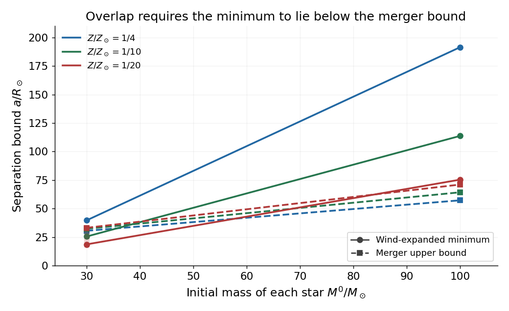

<h1 id="3/solution">Solution</h1>

↑ **Parent:** [3](../3.md)

A [gravitational wave](../../../gravitational-wave-split.md) is a propagating tidal perturbation of spacetime. In the weak-field limit its transverse polarizations alternately stretch and compress the separation of freely falling test bodies. A laser [interferometer](../../../interferometer.md) such as [LIGO](../../../ligo.md) measures the differential optical phase of orthogonal arms. The mirrors approximate free test [masses](../../../mass.md) over the detection band; arm cavities enhance the phase response, while suspension, seismic isolation and optical control reduce instrumental disturbances. A strain $h$ produces relative arm-length changes of order $hL$. Coincidence and waveform consistency between detectors distinguish candidate astrophysical signals from local noise.

Potential sources include black-hole and neutron-star binary inspirals and mergers, asymmetric [core-collapse supernovae](../../../core-collapse-supernova.md), nonaxisymmetric spinning [neutron stars](../../../neutron-star.md), and a stochastic background from many unresolved sources or early-Universe processes. Their detectability depends on frequency, strain, duration and detector noise; a source producing gravitational radiation need not be observable in a terrestrial interferometer's band.

For slowly varying approximately isotropic [stellar wind](../../../stellar-wind.md) loss, decreasing the binding [mass](../../../mass.md) widens the orbit. The prescribed [Jeans-mode mass loss](../../../jeans-mode-mass-loss.md) equation gives

$$
\frac{da}{a}=-\frac{dM}{M},\qquad \boxed{aM=\mathrm{constant}.}
$$

Hot massive stars have metal-line-driven winds. Higher [metallicity](../../../metallicity.md) generally strengthens the radiative coupling and [mass](../../../mass.md) loss, increasing orbital expansion and leaving less massive [black holes](../../../black-hole-split.md). The supplied initial-contact formula also assigns larger zero-age radii and initial minimum separations at higher [metallicity](../../../metallicity.md).

The initial total [mass](../../../mass.md) is $2M^0$, while the final total [mass](../../../mass.md) is $2M_{\rm BH}$. Neglecting supernova [mass](../../../mass.md) loss as requested, their ratio has no additional factor of two. The [wind-limited black-hole binary merger window](../../../wind-limited-black-hole-binary-merger-window.md) therefore has lower boundary

$$
\boxed{a_{\min}^{V}=a_{\min}^0\frac{M^0}{M_{\rm BH}}
=2R_\odot\left(\frac Z{Z_\odot}\right)^{0.4}\frac{(M^0/M_\odot)^2}{M_{\rm BH}/M_\odot}.}
$$

A nonempty allowed initial-separation interval requires $a_{\min}^{V}<a_{\max}^{\rm merger}$. Substituting the supplied final [masses](../../../mass.md) gives the following separation bounds, all in units of $R_\odot$:

$$
\begin{array}{c|rr|rr}
Z/Z_\odot&a_{\min}^{V}(30)&a_{\max}(30)&a_{\min}^{V}(100)&a_{\max}(100)\\\hline
1/4&39.76&30.62&191.45&57.33\\
1/10&25.59&32.37&113.74&64.35\\
1/20&18.73&33.23&75.43&71.13
\end{array}
$$

The arguments 30 and 100 indicate the initial [mass](../../../mass.md) of each star in solar units.

**[Figure 2](#3/image-wind-expanded-minimum-separations-compared-with-merger-upper-bounds). Wind-expanded minimum separations compared with merger upper bounds**. Original calculation at the six supplied initial-mass and metallicity combinations. Joining segments are visual guides between tabulated points, not a predicted interpolation of final black-hole mass.

Under these particular approximate formulae, only the $30M_\odot$ initial systems at $Z_\odot/10$ and $Z_\odot/20$ have overlapping bounds. The $100M_\odot$, $Z_\odot/20$ system is a near miss, not formally allowed: $75.43>71.13$. Given approximate evolutionary scalings, that small mismatch should not be treated as a precise astrophysical exclusion.

Lower [metallicity](../../../metallicity.md) favors merging remnants here through weaker winds, smaller initial stellar radii and larger final black-hole [masses](../../../mass.md). More massive binaries can also produce stronger detectable signals over a suitable frequency range, although the detection volume and band limitations must be considered. The observed rate further depends on formation efficiency, [metallicity](../../../metallicity.md) history, delay times and binary survival. Common-envelope evolution, stellar rotation, supernova [mass](../../../mass.md) loss and natal kicks could alter this simplified channel; the wind-only inequalities do not establish that such mergers are impossible through other channels.

## ↑ Ancestors (11)

1. [3](../3.md)
2. [2016](../../2016-split.md)
3. [Past exam of the astrophysics course of the University of Oxford](../../split.md)
4. [Astrophysics course of the University of Oxford](../../../astrophysics-course-of-the-university-of-oxford.md)
5. [Year 4 of the physics course of the University of Oxford](../../../year-4-of-the-physics-course-of-the-university-of-oxford.md)
6. [Physics course of the University of Oxford](../../../physics-course-of-the-university-of-oxford.md)
7. [Undergraduate course of the University of Oxford](../../../undergraduate-course-of-the-university-of-oxford.md)
8. [Course of the University of Oxford](../../../course-of-the-university-of-oxford.md)
9. [University of Oxford](../../../university-of-oxford-split.md)
10. [List of universities](../../../list-of-universities.md)
11. [Codex Wiki](../../../split.md)
