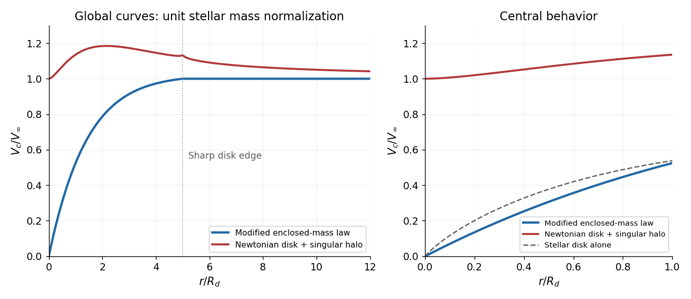

<h1 id="6/solution">Solution</h1>

↑ **Parent:** [6](../6.md)

Put $x=r/R_d$, $f(x)=1-(1+x)e^{-x}$ and $f_t=f(5)=1-6e^{-5}$. Direct integration of the exponential surface density gives

$$
M_d(<r)=2\pi\Sigma_0R_d^2f(x),\quad 0\le x\le5,
\qquad M_\star=2\pi\Sigma_0R_d^2f_t.
$$

Beyond the disk, $M_d(<r)=M_\star$.

**A razor-thin disk is not a spherical [mass](../../../mass.md) distribution.** Its exact exterior force does not become the point-[mass](../../../mass.md) force immediately at $r=R_t$. For all $r>R_t$, an exact expression is

$$
V_d^2(r)=Gr\int_0^{R_t}s\Sigma(s)\,ds\int_0^{2\pi}
\frac{r-s\cos\varphi}{(r^2+s^2-2rs\cos\varphi)^{3/2}}\,d\varphi.
$$

This follows by differentiating the Newtonian potential of each [mass](../../../mass.md) element. At distant radii its leading behavior is Keplerian:

$$
\boxed{V_d(r)\simeq\sqrt{\frac{GM_\star}{r}},\qquad r\gg R_t.}
$$

The first disk-shape correction from the [Legendre expansion of thin-disk gravity](../../../legendre-expansion-of-thin-disk-gravity.md) is $V_d^2=(GM_\star/r)[1+3\langle s^2\rangle/(4r^2)+\cdots]$, with positive [mass](../../../mass.md)-weighted $\langle s^2\rangle$. This supplies a concrete counterexample to treating $GM_\star/r$ as exact for a flattened disk merely because the observation point is outside its edge.

If the outer dark matter is approximately spherical, an exactly flat speed requires

$$
\boxed{M_{\rm DM}(<r)=\frac rG\left[V_\infty^2-V_d^2(r)\right]
\simeq\frac{V_\infty^2r}{G}-M_\star,\qquad r\gg R_t.}
$$

In the halo-dominated leading approximation, this is $M_h(<r)\simeq V_\infty^2r/G$ and $\rho_h\simeq V_\infty^2/(4\pi Gr^2)$. Such a flat curve cannot continue to arbitrarily large radius without giving infinite total [mass](../../../mass.md).

Interpret the new force as attractive. With outward position vector $\mathbf r$, this requires a minus sign in front of the source's printed expression; the literal positive sign and positive $a_0$ would repel a test particle. The radial force magnitude is $GM_d(r)m/(a_0r^{\alpha-1})$, so circular balance gives $V_c^2=GM_d(r)r^{2-\alpha}/a_0$. Constant exterior $M_d$ therefore requires

$$
\boxed{\alpha=2,\qquad [a_0]=\mathrm{length},\qquad V_c^2(r)=\frac{GM_d(<r)}{a_0}.}
$$

This $a_0$ is not an acceleration parameter. Matching the outer speed sets $a_0=GM_\star/V_\infty^2$. The entire rotation curve defined by this enclosed-[mass](../../../mass.md) toy law is

$$
\boxed{\frac{V_{\rm mod}(r)}{V_\infty}=
\begin{cases}\sqrt{f(x)/f_t},&0\le x\le5,\\1,&x\ge5.\end{cases}}
$$

Since $f(x)=x^2/2+O(x^3)$, it rises linearly from zero at small radius and flattens outside. The enclosed-[mass](../../../mass.md) prescription defines this modified model; it is not a derivation of a general modified field equation for arbitrary flattened matter.

The [central obstruction to an outer halo mass offset](../../../central-obstruction-to-an-outer-halo-mass-offset.md) requires an explicit distinction. Extending the full distant-outer expression $V_\infty^2r/G-M_\star$ to zero gives $M_{\rm DM}(0)=-M_\star$. It becomes negative for $r<GM_\star/V_\infty^2$ and cannot be a physical halo. Its formal total squared speed, $V_d^2+V_\infty^2-GM_\star/r$, even becomes negative near the centre. Thus there is no physical entire rotation curve under that literal extrapolation.

If instead one extends only the positive halo-dominated leading term, $M_h=V_\infty^2r/G$, the entire Newtonian model is

$$
\boxed{V_{\rm N}^2(r)=V_\infty^2+V_d^2(r).}
$$

For a full calculation of the disk contribution, the [elliptic-integral circular-speed kernel of a thin disk](../../../elliptic-integral-circular-speed-kernel-of-a-thin-disk.md) gives

$$
V_d^2(r)=2G\,\operatorname{PV}\int_0^{R_t}s\Sigma(s)
\left[\frac{K(k)}{r+s}+\frac{E(k)}{r-s}\right]ds,
\qquad k=\frac{2\sqrt{rs}}{r+s},
$$

where $K$ is the [complete elliptic integral of the first kind](../../../complete-elliptic-integral-of-the-first-kind.md) and $E$ the [complete elliptic integral of the second kind](../../../complete-elliptic-integral-of-the-second-kind.md). The principal value is needed inside the disk; outside it the integral is ordinary. The disk term vanishes at the centre, so this halo extrapolation has $V_{\rm N}(0^+)=V_\infty$, develops a stellar contribution at intermediate radii and approaches $V_\infty$ from above. A discontinuous, exactly zero-thickness truncation has an artificial logarithmic force singularity right at the edge; a smooth edge or finite thickness removes it. The figure omits the single singular edge point.

**[Figure 3](#6/image-central-behavior-distinguishes-the-enclosed-mass-toy-law-from-a-singular-isothermal-halo). Central behavior distinguishes the enclosed-mass toy law from a singular isothermal halo**. Original curves for the supplied disk shape, with illustrative normalization $GM_\star/(R_dV_\infty^2)=1$. The Newtonian disk force is evaluated with its elliptic-integral kernel, not a spherical enclosed-mass approximation. The offset outer halo profile is not extrapolated through negative masses.

Observed [galaxy](../../../galaxy-split.md) rotation curves generally rise from the central region rather than beginning with a nonzero constant. The modified toy curve therefore captures that qualitative behavior better than this particular singular isothermal halo extrapolation, without establishing that its force law is correct. If dark matter is the explanation, the inner halo cannot universally retain $M_h\propto r$, $\rho_h\propto r^{-2}$ down to zero. For a spherical density $\rho_h\propto r^{-\gamma_h}$, $V_h\propto r^{1-\gamma_h/2}$ tends to zero when $\gamma_h<2$; a constant-density core gives a linear rise. A shallower cusp can also tend to zero. Stellar [mass](../../../mass.md)-to-light ratio, baryonic structure and disk–halo degeneracy prevent this qualitative argument alone from proving that every halo has a constant-density core.

## ↑ Ancestors (11)

1. [6](../6.md)
2. [2016](../../2016-split.md)
3. [Past exam of the astrophysics course of the University of Oxford](../../split.md)
4. [Astrophysics course of the University of Oxford](../../../astrophysics-course-of-the-university-of-oxford.md)
5. [Year 4 of the physics course of the University of Oxford](../../../year-4-of-the-physics-course-of-the-university-of-oxford.md)
6. [Physics course of the University of Oxford](../../../physics-course-of-the-university-of-oxford.md)
7. [Undergraduate course of the University of Oxford](../../../undergraduate-course-of-the-university-of-oxford.md)
8. [Course of the University of Oxford](../../../course-of-the-university-of-oxford.md)
9. [University of Oxford](../../../university-of-oxford-split.md)
10. [List of universities](../../../list-of-universities.md)
11. [Codex Wiki](../../../split.md)
