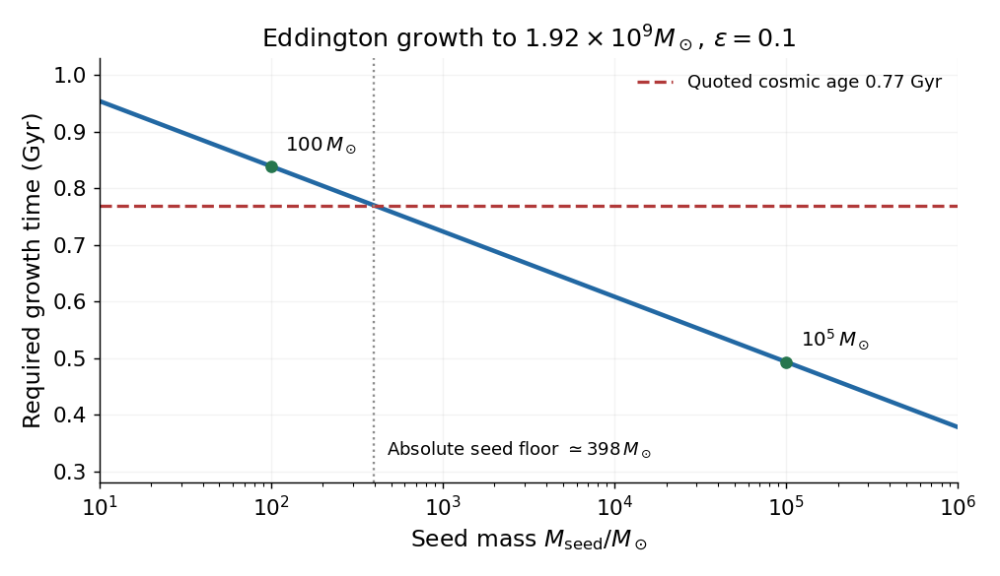

<h1 id="7/solution">Solution</h1>

↑ **Parent:** [7](../7.md)

The main evidence combines a large [luminosity](../../../luminosity.md) with a compact source and a massive central gravitating object. Rapid continuum variability bounds the emitting size by a light-crossing scale, while broad [emission lines](../../../emission-line.md) and reverberation delays constrain the gas orbital speeds and characteristic radii. Their virial [masses](../../../mass.md), together with stellar and gas dynamics in galactic nuclei, imply compact central [masses](../../../mass.md) far larger than ordinary stars. Thermal optical/ultraviolet disk emission, a high-[energy](../../../energy-split.md) coronal component, jets and relativistically broadened inner-disk features are naturally associated with an accretion flow. No one signature alone is a unique proof, but the combined compactness, [mass](../../../mass.md) and [energy](../../../energy-split.md) requirements strongly favor accretion onto supermassive [black holes](../../../black-hole-split.md). Gravitational accretion releases a much larger fraction of rest [energy](../../../energy-split.md) than ordinary stellar burning, without requiring the [luminosity](../../../luminosity.md) to come from the black-hole interior.

For a fully ionized pure-hydrogen plasma, each [electron](../../../electron.md) receiving Thomson radiation force is coupled electrostatically to a proton carrying almost all the [mass](../../../mass.md). With spherical isotropic [luminosity](../../../luminosity.md) $L$, the outward force per [electron](../../../electron.md) is $\sigma_TL/(4\pi r^2c)$, while gravity per [electron](../../../electron.md)–proton pair is approximately $GMm_p/r^2$. Equality defines the [Eddington luminosity](../../../eddington-luminosity.md):

$$
\boxed{L_{\rm Edd}=\frac{4\pi Gm_pcM}{\sigma_T}.}
$$

Here $G$ is the gravitational constant, $m_p$ the proton [mass](../../../mass.md), $c$ the speed of light, $M$ the central [mass](../../../mass.md) and $\sigma_T$ the Thomson cross-section. The estimate assumes [electron](../../../electron.md)-scattering opacity, tight [electron](../../../electron.md)–ion coupling and no other dominant force. Geometry, beaming, other opacities and [photon](../../../photon.md) trapping can change the relevant [luminosity](../../../luminosity.md) limit.

If $\dot M_0$ is the supplied rest-[mass](../../../mass.md) rate and a fraction $\epsilon$ of its rest [energy](../../../energy-split.md) is radiated, $L=\epsilon\dot M_0c^2$. The associated [Eddington accretion rate](../../../eddington-accretion-rate.md) is consequently

$$
\boxed{\dot M_{0,\rm Edd}=\frac{4\pi Gm_pM}{\epsilon c\sigma_T}.}
$$

This is a supply rate. The black-hole growth rate is $\dot M_{\rm BH}=(1-\epsilon)\dot M_0$ if the remaining supplied [energy](../../../energy-split.md) increases the hole's [mass](../../../mass.md). Confusing these rates loses a factor relevant to the growth-time calculation.

The order-of-magnitude efficiency $\epsilon\sim0.1$ is motivated by orbital binding [energy](../../../energy-split.md) released near the innermost stable orbit. A Newtonian orbit at $6GM/c^2$ has binding [energy](../../../energy-split.md) per unit [mass](../../../mass.md) $c^2/12\simeq0.083c^2$; the exact nonspinning thin-disk value is $1-\sqrt{8/9}\simeq0.057$. Black-hole spin changes the innermost stable orbit and can raise or lower the efficiency. Thus $0.1$ is a useful radiatively efficient accretion estimate, not a universal constant; an advective or jet-dominated flow can have a different radiative efficiency.

Using the stipulated [luminosity](../../../luminosity.md) and $\sigma_T=6.65\times10^{-29}\,\mathrm{m^2}$,

$$
\frac{L_{\rm Edd}}{M/M_\odot}\simeq1.26\times10^{31}\,\mathrm W\simeq3.29\times10^4L_\odot,
\qquad
\boxed{M\simeq\frac{6.3\times10^{13}}{3.29\times10^4}M_\odot\simeq1.92\times10^9M_\odot.}
$$

The source's redshift and age are treated as its supplied data; its record wording is historical, not a present-day claim about the most distant known quasar.

At continuous Eddington [luminosity](../../../luminosity.md) and fixed efficiency, growth is exponential:

$$
M(t)=M_{\rm seed}e^{\Delta t/t_S},\qquad
\boxed{t_S=\frac{\epsilon}{1-\epsilon}\frac{\sigma_Tc}{4\pi Gm_p}\simeq5.00\times10^7\,\mathrm{yr}\quad(\epsilon=0.1).}
$$

This is the [Salpeter time](../../../salpeter-time.md), including retained-[mass](../../../mass.md) efficiency. Even granting all $0.77\,\mathrm{Gyr}$ since the big bang permits only about 15.4 e-folds, requiring a seed of at least roughly $400M_\odot$. A $100M_\odot$ seed would take about $0.84\,\mathrm{Gyr}$ under these assumptions, before allowing any formation delay; a $10^5M_\odot$ seed takes about $0.49\,\mathrm{Gyr}$. These numbers motivate early massive seeds, sustained high duty-cycle accretion, lower radiative efficiencies, super-Eddington phases or contributions from mergers. They do not prove a unique seed channel, since the [luminosity](../../../luminosity.md)-to-[mass](../../../mass.md) conversion and accretion history are model-dependent.

**[Figure 4](#7/image-time-needed-to-build-the-inferred-quasar-mass-at-the-eddington-limit). Time needed to build the inferred quasar mass at the Eddington limit**. Original constant-efficiency growth calculation with efficiency 0.1 and the retained-mass factor included. The age line grants the full quoted cosmic age; actual seed formation leaves less time.

## ↑ Ancestors (11)

1. [7](../7.md)
2. [2016](../../2016-split.md)
3. [Past exam of the astrophysics course of the University of Oxford](../../split.md)
4. [Astrophysics course of the University of Oxford](../../../astrophysics-course-of-the-university-of-oxford.md)
5. [Year 4 of the physics course of the University of Oxford](../../../year-4-of-the-physics-course-of-the-university-of-oxford.md)
6. [Physics course of the University of Oxford](../../../physics-course-of-the-university-of-oxford.md)
7. [Undergraduate course of the University of Oxford](../../../undergraduate-course-of-the-university-of-oxford.md)
8. [Course of the University of Oxford](../../../course-of-the-university-of-oxford.md)
9. [University of Oxford](../../../university-of-oxford-split.md)
10. [List of universities](../../../list-of-universities.md)
11. [Codex Wiki](../../../split.md)
