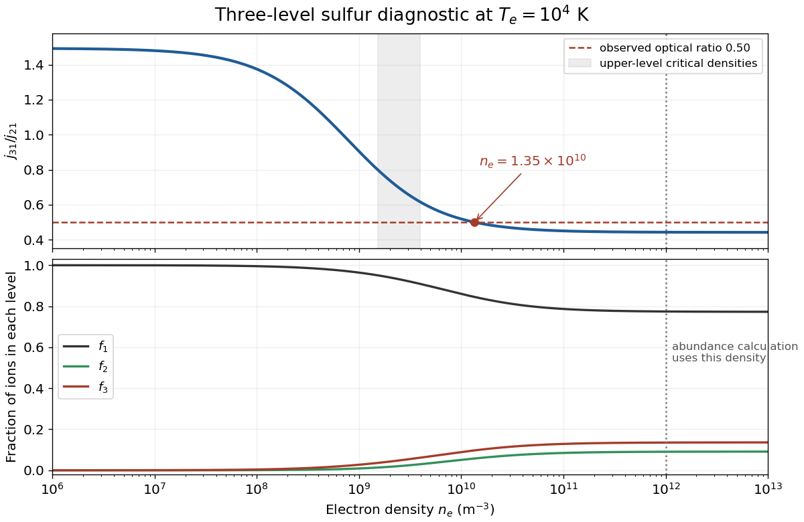
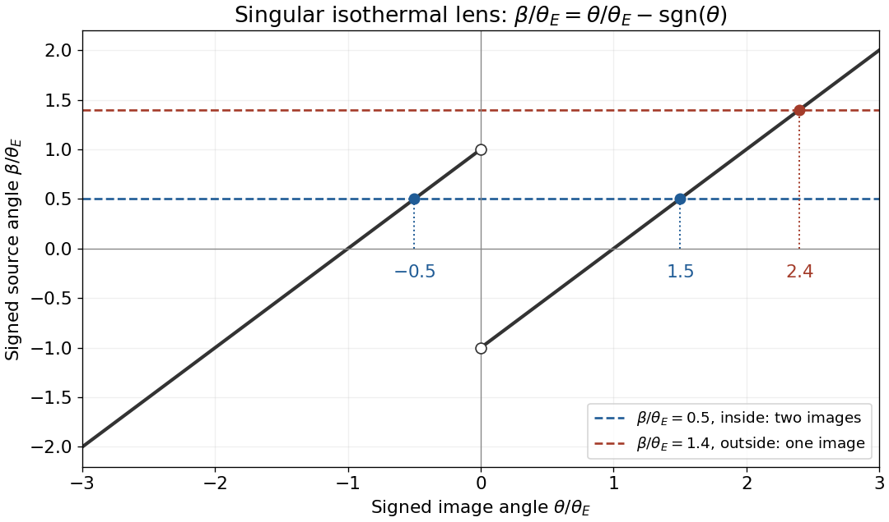
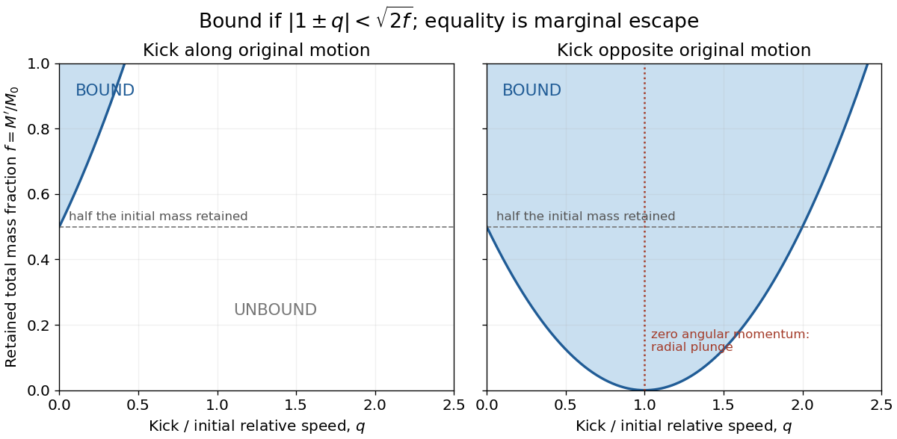

# 2018

↑ **Parent:** [Past exam of the astrophysics course of the University of Oxford](../past-exam-of-the-astrophysics-course-of-the-university-of-oxford.md)

Source paper: [Oxford public bundle, pages 22–28](https://www.whatdotheyknow.com/request/oxford_physics_past_papers_2/response/2340696/attach/6/Physics%20Papers%202017.pdf?cookie_passthrough=1). The bundle filename says 2017, but the held C1 cover is dated 11 June 2018. All six options are solved. The numerical request in [c](#1/c) retains a source-data TODO because the stellar radius and mean particle mass are not specified.

**Table of contents**

- [1](#1)
  - [a](#1/a)
    - [Solution](#1/a/solution)
  - [b](#1/b)
    - [Solution](#1/b/solution)
  - [c](#1/c)
    - [Solution](#1/c/solution)
- [2](#2)
  - [a](#2/a)
    - [Solution](#2/a/solution)
  - [b](#2/b)
    - [Solution](#2/b/solution)
  - [c](#2/c)
    - [Solution](#2/c/solution)
  - [d](#2/d)
    - [Solution](#2/d/solution)
- [3](#3)
  - [a](#3/a)
    - [i](#3/a/i)
      - [Solution](#3/a/i/solution)
    - [ii](#3/a/ii)
      - [Solution](#3/a/ii/solution)
    - [iii](#3/a/iii)
      - [Solution](#3/a/iii/solution)
  - [b](#3/b)
    - [Solution](#3/b/solution)
  - [c](#3/c)
    - [Solution](#3/c/solution)
  - [d](#3/d)
    - [Solution](#3/d/solution)
- [4](#4)
  - [a](#4/a)
    - [Solution](#4/a/solution)
  - [b](#4/b)
    - [Solution](#4/b/solution)
  - [c](#4/c)
    - [Solution](#4/c/solution)
- [5](#5)
  - [a](#5/a)
    - [Solution](#5/a/solution)
  - [b](#5/b)
    - [Solution](#5/b/solution)
  - [c](#5/c)
    - [Solution](#5/c/solution)
    - [i](#5/c/i)
      - [Solution](#5/c/i/solution)
    - [ii](#5/c/ii)
      - [Solution](#5/c/ii/solution)
  - [d](#5/d)
    - [Solution](#5/d/solution)
- [6](#6)
  - [a](#6/a)
    - [Solution](#6/a/solution)
  - [b](#6/b)
    - [Solution](#6/b/solution)
  - [c](#6/c)
    - [Solution](#6/c/solution)
  - [d](#6/d)
    - [Solution](#6/d/solution)

## 1

↑ **Parent:** [2018](2018.md)

<h3 id="1/a">a</h3>

↑ **Parent:** [1](#1)

<h4 id="1/a/solution">Solution</h4>

↑ **Parent:** [A](#1/a)

A [shock wave](../transport-equation.md#shock-wave) is a thin, irreversible compression layer across which fluid [density](../fluid-mechanics.md#density), [pressure](../pressure.md), [temperature](../temperature.md) and [velocity](../classical-mechanics.md#velocity) change rapidly, while conserved fluxes satisfy the [Rankine-Hugoniot conditions](../transport-equation.md#rankine-hugoniot-conditions). In the [shock frame](../compressible-flow.md#shock-frame), a compressive hydrodynamic [shock](../transport-equation.md#shock-wave) converts ordered upstream [kinetic energy](../energy.md#kinetic-energy) into downstream thermal [energy](../energy.md) and increases [entropy](../entropy.md). The upstream normal flow is supersonic; the downstream normal flow is subsonic for an ordinary gas-dynamic compression [shock](../transport-equation.md#shock-wave).

In an accreting [binary star](../stellar-astrophysics.md#binary-star), a supersonic [stellar wind](../stellar-astrophysics.md#stellar-wind) can be captured by a compact companion and shocked. An [accretion stream](../astrophysical-disk.md#accretion-stream) striking an [accretion disk](../astrophysical-disk.md#accretion-disk), an [accretion-disk boundary layer](../astrophysical-disk.md#accretion-disk-boundary-layer), and a magnetically guided [accretion column](../astrophysical-disk.md#accretion-column) provide other sites where infall [energy](../energy.md) is dissipated and high-energy radiation is generated. [Shocks](../transport-equation.md#shock-wave) heat and decelerate material; a disk also needs transport of [angular momentum](../momentum.md#angular-momentum) before its material can reach the compact star.

In [diffusive shock acceleration](../galaxy.md#diffusive-shock-acceleration), charged particles scatter from magnetic irregularities on both sides of a [shock](../transport-equation.md#shock-wave) and repeatedly cross the converging flows. The average [energy](../energy.md) gain is first order in the [velocity](../classical-mechanics.md#velocity) jump divided by the particle speed. Escape competes with acceleration, producing a nonthermal distribution rather than a single downstream [temperature](../temperature.md). [Supernova remnants](../galaxy.md#supernova-remnant) are important candidate sources of Galactic [cosmic rays](../galaxy.md#cosmic-ray); [shocks](../transport-equation.md#shock-wave) associated with [active galactic nuclei](../astrophysical-black-hole.md#active-galactic-nucleus), their jets and lobes, and [gamma-ray bursts](../astrophysics.md#gamma-ray-burst) are candidate extragalactic accelerators. Ultrarelativistic energies require sufficient size, [magnetic field](../magnetic-field.md) and lifetime, and losses must not outpace acceleration. In particular a relativistic particle's [Larmor radius](../relativistic-electromagnetism.md#gyroradius) must fit within the accelerator; the existence of a strong [shock](../transport-equation.md#shock-wave) alone does not guarantee unlimited particle [energy](../energy.md).

<h3 id="1/b">b</h3>

↑ **Parent:** [1](#1)

<h4 id="1/b/solution">Solution</h4>

↑ **Parent:** [B](#1/b)

Use a steady, plane, nonradiative [normal shock wave](../compressible-flow.md#normal-shock-wave) in a [perfect gas](../ideal-gas.md), and measure the normal speeds $v_{\mathrm u},v_{\mathrm d}>0$ in the [shock frame](../compressible-flow.md#shock-frame). The labels denote upstream and downstream. Conservation of mass, normal [momentum](../momentum.md) and total [energy](../energy.md) gives

$$
\rho_{\mathrm u}v_{\mathrm u}=\rho_{\mathrm d}v_{\mathrm d},\qquad
p_{\mathrm u}+\rho_{\mathrm u}v_{\mathrm u}^2=p_{\mathrm d}+\rho_{\mathrm d}v_{\mathrm d}^2,
$$

and

$$
\frac12v_{\mathrm u}^2+\frac{\gamma}{\gamma-1}\frac{p_{\mathrm u}}{\rho_{\mathrm u}}
=\frac12v_{\mathrm d}^2+\frac{\gamma}{\gamma-1}\frac{p_{\mathrm d}}{\rho_{\mathrm d}}.
$$

The enthalpy term includes the [pressure](../pressure.md) work. For very large upstream [Mach number](../compressible-flow.md#mach-number), neglect $p_{\mathrm u}$ compared with $\rho_{\mathrm u}v_{\mathrm u}^2$. If $r=\rho_{\mathrm d}/\rho_{\mathrm u}$ is the [shock compression ratio](../compressible-flow.md#shock-compression-ratio), the first two equations imply

$$
v_{\mathrm d}=\frac{v_{\mathrm u}}r,\qquad
p_{\mathrm d}=\rho_{\mathrm u}v_{\mathrm u}^2\left(1-\frac1r\right).
$$

Substitution into the [energy](../energy.md) equation gives

$$
1=\frac1{r^2}+\frac{2\gamma}{\gamma-1}\frac{r-1}{r^2},\qquad
(r-1)\left(r-\frac{\gamma+1}{\gamma-1}\right)=0.
$$

Discard the no-shock solution $r=1$. For a nonrelativistic monatomic gas, $\gamma=5/3$, so the [Strong-shock Rankine-Hugoniot conditions](../compressible-flow.md#strong-shock-rankine-hugoniot-conditions) become

$$
\boxed{\frac{\rho_{\mathrm d}}{\rho_{\mathrm u}}=\frac{v_{\mathrm u}}{v_{\mathrm d}}=4,\qquad
p_{\mathrm d}=\frac34\rho_{\mathrm u}v_{\mathrm u}^2.}
$$

The factor four requires this [adiabatic index](../ideal-gas.md#heat-capacity-ratio) and negligible radiative, magnetic and escaping-particle contributions to the flux budget. For example, the same strong, nonradiative calculation with $\gamma=4/3$ gives compression seven, not four.

<h3 id="1/c">c</h3>

↑ **Parent:** [1](#1)

<h4 id="1/c/solution">Solution</h4>

↑ **Parent:** [C](#1/c)

A massive main-sequence donor loses material in a [stellar wind](../stellar-astrophysics.md#stellar-wind). Gravitational capture by the [neutron star](../stellar-astrophysics.md#neutron-star) can produce a nearly radial, supersonic infall when the captured material has little specific [angular momentum](../momentum.md#angular-momentum). A [magnetic field](../magnetic-field.md) may channel the final infall toward polar [accretion columns](../astrophysical-disk.md#accretion-column), where a standing [shock](../transport-equation.md#shock-wave) decelerates the flow. Large [angular momentum](../momentum.md#angular-momentum) instead favours an [accretion disk](../astrophysical-disk.md#accretion-disk); strictly radial accretion is an idealization.

For [mean particle mass](../ideal-gas.md#mean-particle-mass) $\mu$, the [ideal gas law](../ideal-gas.md#ideal-gas-law) is $p_{\mathrm d}=\rho_{\mathrm d}k_{\mathrm B}T_{\mathrm d}/\mu$. Combining it with [b](#1/b) gives

$$
\boxed{k_{\mathrm B}T_{\mathrm d}=\frac{\mu p_{\mathrm d}}{\rho_{\mathrm d}}
=\frac3{16}\mu v_{\mathrm u}^2.}
$$

For Newtonian [free fall](../newton-s-law-of-universal-gravitation.md#free-fall) from a distance large compared with the stellar radius $R_*$, $v_{\mathrm u}^2\simeq2GM_*/R_*$. Therefore

$$
\boxed{T_{\mathrm d}\simeq\frac{3\mu GM_*}{8k_{\mathrm B}R_*},\qquad
k_{\mathrm B}T_{\mathrm d}\simeq\frac{3\mu GM_*}{8R_*}.}
$$

**TODO: a unique numerical [temperature](../temperature.md) and characteristic photon band require source data not supplied here.** The held question gives $M_*=1.4M_\odot$ but gives neither $R_*$ nor a composition fixing $\mu$. The mass alone does not fix the free-fall speed or the [temperature](../temperature.md). For example, doubling $R_*$ at the same mass and composition halves both quantities in the last box.

A normalization, rather than an additional claimed datum, makes the scale explicit:

$$
T_{\mathrm d}=8.44\times10^{11}\,\mathrm K
\left(\frac{\mu}{m_p}\right)
\left(\frac{M_*}{1.4M_\odot}\right)
\left(\frac{10\,\mathrm{km}}{R_*}\right),
$$

$$
\boxed{k_{\mathrm B}T_{\mathrm d}=7.27\times10^7\,\mathrm{eV}
\left(\frac{\mu}{m_p}\right)
\left(\frac{M_*}{1.4M_\odot}\right)
\left(\frac{10\,\mathrm{km}}{R_*}\right).}
$$

Here $k_{\mathrm B}T$ is the characteristic particle [energy](../energy.md); the mean translational [energy](../energy.md) of a nonrelativistic thermal particle is $3k_{\mathrm B}T/2$. If one additionally chose $R_*=10\,\mathrm{km}$ and $\mu=m_p$, this ideal one-temperature estimate would correspond to gamma-ray-scale thermal photon energies. Those are conditional choices, not information recovered from the source. Real accreting [neutron stars](../stellar-astrophysics.md#neutron-star) commonly emit [X-rays](../electromagnetic-radiation.md#x-ray): electron-ion disequilibrium, [radiative cooling](../heat.md#radiative-cooling), [radiation pressure](../pressure.md#radiation-pressure), reprocessing and relativistic infall invalidate a direct identification of this ideal ion-heating estimate with the escaping photon spectrum.

## 2

↑ **Parent:** [2018](2018.md)

<h3 id="2/a">a</h3>

↑ **Parent:** [2](#2)

<h4 id="2/a/solution">Solution</h4>

↑ **Parent:** [A](#2/a)

Expand the [density contrast](../linear-cosmological-density-perturbation.md#density-contrast) in spatial [Fourier modes](../fourier-analysis.md#fourier-mode) using fixed [comoving coordinates](../cosmology.md#comoving-coordinate):

$$
\delta(\mathbf x,t)=\int\frac{d^3k}{(2\pi)^3}\,\delta_{\mathbf k}(t)e^{i\mathbf k\cdot\mathbf x}.
$$

The spatial [Laplacian](../multivariable-calculus.md#laplacian) multiplies a mode by $-k^2$, while its comoving [wavenumber](../wave-equation.md#wavenumber) $k=|\mathbf k|$ is time-independent. Writing $H=\dot a/a$, the [linear cosmological density perturbation](../linear-cosmological-density-perturbation.md) equation becomes

$$
\ddot\delta_{\mathbf k}+2H\dot\delta_{\mathbf k}
+\left(\frac{c_s^2k^2}{a^2}-4\pi G\bar\rho\right)\delta_{\mathbf k}=0.
$$

The proper [wavenumber](../wave-equation.md#wavenumber) is $k^{(p)}=k/a$, since the proper [wavelength](../wave-equation.md#wavelength) is $2\pi a/k$. The proper [Jeans wavenumber](../linear-cosmological-density-perturbation.md#jeans-wavenumber) balances the [pressure](../pressure.md) and gravity terms:

$$
\boxed{k_J^{(p)}=\frac{\sqrt{4\pi G\bar\rho}}{c_s},\qquad
\ddot\delta_{\mathbf k}+2H\dot\delta_{\mathbf k}
+c_s^2\left[(k^{(p)})^2-(k_J^{(p)})^2\right]\delta_{\mathbf k}=0.}
$$

<h3 id="2/b">b</h3>

↑ **Parent:** [2](#2)

<h4 id="2/b/solution">Solution</h4>

↑ **Parent:** [B](#2/b)

For $k^{(p)}\ll k_J^{(p)}$, neglect [pressure](../pressure.md) support. The growing and decaying [Jeans instability](../linear-cosmological-density-perturbation.md#jeans-instability) modes obey

$$
\ddot\delta_{\mathbf k}+2H\dot\delta_{\mathbf k}-4\pi G\bar\rho\,\delta_{\mathbf k}=0.
$$

In an [Einstein-de Sitter universe](../large-scale-structure-of-the-universe.md#einstein-de-sitter-universe), $a\propto t^{2/3}$ gives $H=2/(3t)$, and the matter-density relation $8\pi G\bar\rho=3H^2$ gives $4\pi G\bar\rho=2/(3t^2)$. Thus

$$
\ddot\delta_{\mathbf k}+\frac4{3t}\dot\delta_{\mathbf k}-\frac2{3t^2}\delta_{\mathbf k}=0.
$$

Try a power law $\delta_{\mathbf k}\propto t^p$. Its [characteristic equation](../linear-ordinary-differential-equation.md#characteristic-equation-of-a-constant-coefficient-differential-equation) is

$$
p(p-1)+\frac43p-\frac23=0,
\qquad (p-2/3)(p+1)=0.
$$

Therefore the [Einstein-de Sitter density-growth modes](../linear-cosmological-density-perturbation.md#einstein-de-sitter-density-growth-modes) are

$$
\boxed{\delta_{\mathbf k}(t)=C_+t^{2/3}+C_-t^{-1}
=D_+a+D_-a^{-3/2}.}
$$

This is a linear result while $|\delta|\ll1$; a growing mode eventually leaves that regime.

<h3 id="2/c">c</h3>

↑ **Parent:** [2](#2)

<h4 id="2/c/solution">Solution</h4>

↑ **Parent:** [C](#2/c)

In the formal static-background limit, $H=0$ and $\bar\rho$ is constant. The gravity-dominated [linear cosmological density perturbation](../linear-cosmological-density-perturbation.md) equation reduces to

$$
\ddot\delta_{\mathbf k}-\omega_J^2\delta_{\mathbf k}=0,\qquad
\omega_J=\sqrt{4\pi G\bar\rho}.
$$

The [Static-universe Jeans modes](../linear-cosmological-density-perturbation.md#static-universe-jeans-modes) are

$$
\boxed{\delta_{\mathbf k}=A_+e^{t/t_J}+A_-e^{-t/t_J},\qquad
 t_J=(4\pi G\bar\rho)^{-1/2}.}
$$

The unstable perturbation grows exponentially rather than as $t^{2/3}$. In the expanding case, the $2H\dot\delta$ term resists peculiar motion and the falling background [density](../fluid-mechanics.md#density) also lengthens the gravitational growth timescale. A globally homogeneous static self-gravitating fluid is not obtained merely by turning off expansion; this calculation is the conventional local Jeans-background idealization, with the uniform background force removed or otherwise supported.

<h3 id="2/d">d</h3>

↑ **Parent:** [2](#2)

<h4 id="2/d/solution">Solution</h4>

↑ **Parent:** [D](#2/d)

When $k^{(p)}\gg k_J^{(p)}$, omit the gravitational term and define $\omega(t)=c_s(t)k/a(t)$. Then

$$
\boxed{\ddot\delta_{\mathbf k}+2H\dot\delta_{\mathbf k}+\omega^2\delta_{\mathbf k}=0.}
$$

This is an acoustic [damped harmonic oscillator](../analysis.md#damped-harmonic-oscillator) with time-dependent coefficients. Freezing the background locally at $t_0$, its amplitude damping rate is $H_0$, so

$$
\boxed{\tau_{\mathrm{amp}}=H_0^{-1},\qquad
T_{\mathrm{osc}}=\frac{2\pi}{\sqrt{\omega_0^2-H_0^2}}
\simeq\frac{2\pi a_0}{c_{s0}k}\quad(\omega_0\gg H_0).}
$$

The oscillation-averaged quadratic oscillator [energy](../energy.md) decays twice as fast in this frozen-frequency model, with time $1/(2H_0)$. Stating which quantity is damped avoids a factor-of-two convention error. Locally the solution is

$$
\delta_{\mathbf k}\simeq e^{-H_0(t-t_0)}
\left[C\cos\bigl(\omega_d(t-t_0)\bigr)+D\sin\bigl(\omega_d(t-t_0)\bigr)\right],
\quad\omega_d=\sqrt{\omega_0^2-H_0^2}.
$$

For evolution over many expansion times, retain the varying frequency. Put $\delta_{\mathbf k}=\chi/a$. Direct substitution gives

$$
\ddot\chi+\left(\omega^2-\frac{\ddot a}{a}\right)\chi=0.
$$

When $\omega\gg H$ and $|\dot\omega|\ll\omega^2$, the [WKB approximation](../analysis.md#wkb-approximation) yields

$$
\boxed{\delta_{\mathbf k}(t)\simeq
\frac{1}{a(t)\sqrt{\omega(t)}}
\left[C\cos\!\left(\int^t\omega(s)\,ds\right)+
D\sin\!\left(\int^t\omega(s)\,ds\right)\right].}
$$

These are rapidly oscillating [sound waves](../fluid-mechanics.md#acoustic-wave) in comoving [density](../fluid-mechanics.md#density), diluted by the expanding background. For constant $c_s$ their envelope scales as $a^{-1/2}$, not universally as $a^{-1}$, because $\omega\propto a^{-1}$. In the [Einstein-de Sitter universe](../large-scale-structure-of-the-universe.md#einstein-de-sitter-universe), introducing [conformal time](../cosmology.md#conformal-time) $d\eta=dt/a$ gives the exact constant-$c_s$ pressure-only solution $\delta_{\mathbf k}=[C\sin(kc_s\eta)+D\cos(kc_s\eta)]/\eta$, consistent with $a\propto\eta^2$. For that background the frozen-coefficient damping time is $3t/2$, while the slowly varying envelope has instantaneous decay time $2/H$.

## 3

↑ **Parent:** [2018](2018.md)

<h3 id="3/a">a</h3>

↑ **Parent:** [3](#3)

<h4 id="3/a/i">i</h4>

↑ **Parent:** [A](#3/a)

<h5 id="3/a/i/solution">Solution</h5>

↑ **Parent:** [I](#3/a/i)

[GW170817](../stellar-astrophysics.md#gw170817) supplied the first direct [gravitational wave](../gravitational-wave.md) observation of a binary [neutron star](../stellar-astrophysics.md#neutron-star) inspiral. The chirping waveform tests compact-binary [general relativity](../general-relativity.md), constrains masses and tidal effects, and links a class of known compact binaries to observable sources of [gravitational waves](../gravitational-wave.md). The electromagnetic counterpart identifies the host and distance, enabling complementary source and cosmological inference. This is distinct from the earlier binary-black-hole detections; it established a system involving matter that could also be observed electromagnetically.[Abstract and source-inference discussion: first binary-neutron-star inspiral, mass range and electromagnetic association](../physics-bibliography.md#gw170817-observation-of-gravitational-waves-from-a-binary-neutron-star-inspiral-by-ligo-scientific-collaboration-and-virgo-collaboration)

<h4 id="3/a/ii">ii</h4>

↑ **Parent:** [A](#3/a)

<h5 id="3/a/ii/solution">Solution</h5>

↑ **Parent:** [Ii](#3/a/ii)

The short [gamma-ray burst](../astrophysics.md#gamma-ray-burst) GRB 170817A followed the merger signal by about $1.7\,\mathrm s$, providing direct evidence that at least some short [gamma-ray bursts](../astrophysics.md#gamma-ray-burst) arise from [neutron star mergers](../stellar-astrophysics.md#neutron-star-merger). The association connects their high-energy emission and relativistic outflows to compact-binary coalescence. It does not establish that every short burst has this progenitor, nor that the observed gamma-ray luminosity is independent of viewing angle.[Abstract and multiwavelength counterpart discussion: GRB 170817A delay and association](../physics-bibliography.md#multi-messenger-observations-of-a-binary-neutron-star-merger-by-ligo-scientific-collaboration-and-others)

<h4 id="3/a/iii">iii</h4>

↑ **Parent:** [A](#3/a)

<h5 id="3/a/iii/solution">Solution</h5>

↑ **Parent:** [Iii](#3/a/iii)

The evolving optical and infrared [kilonova](../stellar-astrophysics.md#kilonova) was consistent with radioactive heating of neutron-rich merger ejecta. Rapid neutron capture, the [r-process](../physics.md#r-process), can synthesize nuclei heavier than iron; decay of the newly formed unstable nuclei powers the transient. Its redward evolution and large inferred opacity supported production of heavy-element-rich ejecta. Thus mergers are a demonstrated important site for heavy-element production, while the fractions of individual elements and their total cosmic contribution remain model-dependent. The transient was not a direct identification of every very heavy element.[Kilonova interpretation and conclusions: optical/infrared evolution and radioactive r-process heating](../physics-bibliography.md#multi-messenger-observations-of-a-binary-neutron-star-merger-by-ligo-scientific-collaboration-and-others)

<h3 id="3/b">b</h3>

↑ **Parent:** [3](#3)

<h4 id="3/b/solution">Solution</h4>

↑ **Parent:** [B](#3/b)

Treat the stated $120\,\mathrm{Mpc}$ as the radius of a complete, volume-limited search, with uniform galaxy [density](../fluid-mechanics.md#density) $n_g$. Its surveyed volume and number of galaxies are

$$
V=\frac{4\pi}{3}(120\,\mathrm{Mpc})^3=7.24\times10^6\,\mathrm{Mpc^3},\qquad
N_g=n_gV=7.24\times10^4.
$$

The observing time is $\Delta t=117/365.25=0.3203\,\mathrm{yr}$. One detection estimates

$$
\boxed{\nu_{\mathrm{BNS}}\simeq\frac1{N_g\Delta t}
=4.31\times10^{-5}\,\mathrm{yr^{-1}\,galaxy^{-1}},}
$$

or one merger per approximately $2.3\times10^4$ years per Milky-Way-type galaxy. The equivalent volume rate is about $431\,\mathrm{Gpc^{-3}\,yr^{-1}}$. The event's actual $40\,\mathrm{Mpc}$ distance is not the survey radius and must not replace $120\,\mathrm{Mpc}$ in the exposure.

A representative Galactic [core-collapse supernova](../stellar-astrophysics.md#core-collapse-supernova) rate is about two per century, roughly $4.6\times10^2$ times larger than this merger-rate estimate. The historical $^{26}\mathrm{Al}$ estimate was $1.9\pm1.1$ per century.[Abstract: Galactic core-collapse rate inferred from radioactive aluminium](../physics-bibliography.md#radioactive-26al-and-massive-stars-in-the-galaxy-by-roland-diehl-and-others) The one-event [Poisson](../discrete-probability-distribution.md#poisson-distribution) uncertainty is large. Detector orientation, duty cycle, completeness and whether the quoted radius is an optimal horizon or an effective range also change the exposure; the boxed value is the specified simple-volume estimate.

<h3 id="3/c">c</h3>

↑ **Parent:** [3](#3)

<h4 id="3/c/solution">Solution</h4>

↑ **Parent:** [C](#3/c)

Keep both component masses constant during a circular, gravitational-radiation-driven inspiral. Since $J=\mu\sqrt{GMA}$, differentiation gives $\dot J/J=\dot A/(2A)$. Combining this with the supplied angular-momentum loss yields

$$
\boxed{\dot A=-\frac{64}{5}\frac{G^3\mu M^2}{c^5A^3}\equiv-\frac K{A^3}.}
$$

The expression $A/\dot A$ printed in the source is negative during inspiral. A positive characteristic shrinking timescale is

$$
\boxed{\tau_A=\frac{A}{|\dot A|}=\frac{A^4}{K}
=\frac5{64}\frac{c^5A^4}{G^3\mu M^2}\propto A^4.}
$$

The actual remaining coalescence time follows by integrating $A^3\,dA=-K\,dt$:

$$
\boxed{t_{\mathrm{coal}}=\frac{A_0^4}{4K}=\frac{\tau_A(A_0)}4.}
$$

This constant factor does not change the requested separation scaling.

For an old, approximately coeval population, let $dN/dA_0=C$ over the relevant separation interval, and write the positive delay as $t_m=BA_0^4$. Conservation of event counts under this change of variable gives

$$
\nu_m(t_m)=\frac{dN}{dA_0}\left|\frac{dA_0}{dt_m}\right|
=\frac{C}{4B^{1/4}}t_m^{-3/4}.
$$

Therefore

$$
\boxed{\nu_m\propto t_m^{-3/4}.}
$$

The scaling applies between the minimum and maximum delays of the assumed separation distribution. It is a rate per delay interval, not the number per logarithmic delay interval.

<h3 id="3/d">d</h3>

↑ **Parent:** [3](#3)

<h4 id="3/d/solution">Solution</h4>

↑ **Parent:** [D](#3/d)

For the [Double-degenerate Type Ia supernova scenario](../stellar-astrophysics.md#double-degenerate-type-ia-supernova-scenario), measure the [Type Ia supernova](../stellar-astrophysics.md#type-ia-supernova) rate per formed stellar mass in old galaxies, grouped by the time since their main star-formation episode. Correct the event counts for observing time and detection efficiency. In an ideal burst population, the normalized rate measures the [delay-time distribution](../stellar-astrophysics.md#delay-time-distribution) directly. If [gravitational waves](../gravitational-wave.md) inspiral dominates the delay and the initial white-dwarf separations are uniformly distributed in separation, [c](#3/c) predicts a slope $-3/4$.

More generally, if $dN/dA\propto A^\beta$ and $t_m\propto A^4$, the predicted rate scales as $t_m^{(\beta-3)/4}$. A distribution uniform in $\log A$ has $\beta=-1$ and gives $t_m^{-1}$. Thus a slope differing from $-3/4$ does not alone rule out mergers: the separation distribution must also be tested.

An extended [star formation history](../galaxy.md#star-formation-history) gives a convolution, $R(t)=\int d\tau\,\mathrm{SFR}(t-\tau)\Psi(\tau)$, rather than the single-burst expression. The time since [star formation](../stellar-astrophysics.md#star-formation) stopped need not equal each progenitor's age. Stellar lifetimes before formation of the second [white dwarf](../stellar-astrophysics.md#white-dwarf), common-envelope evolution, masses and mass ratios, metallicity, delay-dependent explosion efficiencies, galaxy-age estimates and survey selection all affect the comparison. Some CO-white-dwarf mergers need not make [Type Ia supernovae](../stellar-astrophysics.md#type-ia-supernova), and other channels can contribute to the observed rate. Agreement in slope and normalization therefore supports the hypothesis under stated assumptions but is not a unique identification of the channel.

## 4

↑ **Parent:** [2018](2018.md)

<h3 id="4/a">a</h3>

↑ **Parent:** [4](#4)

<h4 id="4/a/solution">Solution</h4>

↑ **Parent:** [A](#4/a)

A [spontaneous emission](../atomic-physics.md#spontaneous-emission) transition has probability per unit time $A_{ji}$ and emits a photon of [energy](../energy.md) $h\nu_{ji}$. For an optically thin gas, its angle-integrated [emissivity](../heat.md#emissivity) is $j_{ji}=n_jA_{ji}h\nu_{ji}$. Electron collisions populate excited levels at rates $n_en_iq_{ij}$; they also remove excitation collisionally at rates $n_en_jq_{ji}$, returning the [energy](../energy.md) to the gas rather than producing the line photon. A collisionally excited line is usually emitted by a subsequent spontaneous radiative decay; [collisional de-excitation](../atomic-physics.md#collisional-de-excitation) instead quenches it.

The [critical density of an atomic transition](../atomic-physics.md#critical-density-of-an-atomic-transition) compares radiative loss from an upper level with its collisional loss. For a two-level model, $n_{\mathrm{crit}}=A_{ji}/q_{ji}$; for several lower or connected levels use the relevant sums. Below this [density](../fluid-mechanics.md#density), excitation is commonly followed by a photon and the line cools the gas. Above it, collisions increasingly suppress radiative emission per excitation and drive the level populations toward Boltzmann ratios.

Optical [forbidden emission lines](../stellar-astrophysics.md#forbidden-emission-line) have small $A$ because an electric-dipole transition is forbidden by a selection rule. Metastable levels survive long enough to radiate in dilute ionized nebulae, although collisions quench them in dense gas. Ratios from closely spaced levels with different critical densities are electron-density diagnostics; ratios involving different excitation energies probe the [electron temperature](../temperature.md#electron-temperature) through Boltzmann factors. Combining line emissivities with [electron density](../chemistry.md#electron-density), [temperature](../temperature.md) and an [ionization](../atomic-physics.md#ionization) model estimates ionic abundances.

Infrared [fine-structure emission lines](../atomic-physics.md#fine-structure-emission-line) connect closely spaced sublevels. Their small excitation energies make them useful over [temperature](../temperature.md) ranges where optical excitation is exponentially suppressed, and dust extinction is usually weaker in the far infrared. They are important coolants and [density](../fluid-mechanics.md#density) diagnostics in ionized gas, with the choice of ion specifying the [ionization](../atomic-physics.md#ionization) zone. Neither an optical nor an infrared ionic abundance automatically equals the total elemental abundance; unobserved [ionization](../atomic-physics.md#ionization) stages require an [ionization](../atomic-physics.md#ionization) correction.

<h3 id="4/b">b</h3>

↑ **Parent:** [4](#4)

<h4 id="4/b/solution">Solution</h4>

↑ **Parent:** [B](#4/b)

Use the complete supplied three-level model, including collisions between levels 2 and 3. Put $g_1=4$, $g_2=4$, $g_3=6$, and denote a collisional rate coefficient by $q_{ij}$. [Detailed balance](../markov-chain.md#detailed-balance) gives

$$
q_{ij}=\frac{g_j}{g_i}e^{-(E_j-E_i)/(k_{\mathrm B}T_e)}q_{ji}\quad(E_j>E_i).
$$

At $T_e=10^4\,\mathrm K$, the supplied [collision strengths](../atomic-physics.md#collision-strength) give, in $\mathrm{m^3\,s^{-1}}$,

$$
\begin{array}{c|ccc}
& q_{21}&q_{31}&q_{32}\\\hline
&5.999\times10^{-14}&6.006\times10^{-14}&1.089\times10^{-13}
\end{array},
$$

$$
q_{12}=7.075\times10^{-15},\qquad
q_{13}=1.057\times10^{-14},\qquad
q_{23}=1.626\times10^{-13}.
$$

The rounded optical wavelengths set the excitation energies; treating the fine splitting as very small compared with $k_{\mathrm B}T_e$ changes none of the main conclusions.

Let $D_2=A_{21}+n_e(q_{21}+q_{23})$, $D_3=A_{31}+A_{32}+n_e(q_{31}+q_{32})$, and $R_{32}=A_{32}+n_eq_{32}$. [Statistical equilibrium](../atomic-physics.md#statistical-equilibrium-of-atomic-level-populations) for the upper levels is

$$
n_2D_2-n_3R_{32}=n_1n_eq_{12},\qquad
n_3D_3-n_2n_eq_{23}=n_1n_eq_{13}.
$$

Eliminating $n_1$ yields the line-ratio formula

$$
\boxed{\frac{j_{31}}{j_{21}}=
\frac{A_{31}\nu_{31}}{A_{21}\nu_{21}}
\frac{q_{13}D_2+n_eq_{23}q_{12}}
{q_{12}D_3+q_{13}(A_{32}+n_eq_{32})}.}
$$

The same ratio holds for integrated intensities when the two lines sample the same optically thin volume and differential extinction is negligible. Inserting the data gives the particularly simple numerical form

$$
\boxed{\mathcal R(n_e)=\frac{1.49325+0.442056\,x}{1+x},\qquad
x=\frac{n_e}{7.8607\times10^8\,\mathrm{m^{-3}}}.}
$$

The low- and high-density limits are approximately $1.49$ and $0.442$. The collisional loss channels give

$$
n_{\mathrm{crit},3}=\frac{A_{31}+A_{32}}{q_{31}+q_{32}}=1.54\times10^9\,\mathrm{m^{-3}},\qquad
n_{\mathrm{crit},2}=\frac{A_{21}}{q_{21}+q_{23}}=3.95\times10^9\,\mathrm{m^{-3}}.
$$

Thus the useful [density](../fluid-mechanics.md#density) range is around $10^9$–$10^{10}\,\mathrm{m^{-3}}$. Maximizing $|d\log\mathcal R/d\log n_e|$ for the rational expression gives its strongest fractional sensitivity at $n_e=7.8607\times10^8\sqrt{1.49325/0.442056}=1.44\times10^9\,\mathrm{m^{-3}}$. Omitting the supplied 3–2 collisions would change the critical densities and inferred [density](../fluid-mechanics.md#density) appreciably.

For the observed ratio $0.50$, inversion gives $n_e=1.35\times10^{10}\,\mathrm{m^{-3}}$. This is on the high-density side of the transition, but is not the infinite-density limit. Solving the statistical-equilibrium equations and imposing $f_1+f_2+f_3=1$ gives the level fractions

$$
\boxed{(f_1,f_2,f_3)\simeq(0.8453,\ 0.05754,\ 0.09716).}
$$

A rough high-density estimate would instead use $f_i\propto g_i e^{-E_i/(k_{\mathrm B}T_e)}$; it is useful as a limiting check, not an exact solution for $\mathcal R=0.50$.

For the separate abundance calculation, use the expressly prescribed $n_e=10^{12}\,\mathrm{m^{-3}}$. The same model now gives $(f_1,f_2,f_3)=(0.77426,0.09045,0.13528)$, nearly the collisional Boltzmann limit. The measured angle-integrated volume emissivity gives

$$
n_3=\frac{j_{31}}{A_{31}hc/\lambda_{31}}=1.300\times10^6\,\mathrm{m^{-3}},\qquad
n(\mathrm S^+)=\frac{n_3}{f_3}=9.61\times10^6\,\mathrm{m^{-3}}.
$$

Therefore

$$
\boxed{\frac{n(\mathrm S^+)}{n_e}=9.61\times10^{-6}.}
$$

This is an abundance per free electron; it is approximately $n(\mathrm S^+)/n(\mathrm H^+)$ for predominantly ionized hydrogen with $n_e\simeq n(\mathrm H^+)$. No $4\pi$ factor is inserted because the supplied emissivity is power per volume, not power per volume per steradian. The imposed $10^{12}\,\mathrm{m^{-3}}$ predicts a ratio about $0.443$, rather than exactly $0.50$; the two numerical instructions cannot both describe one uniform zone exactly within this model.

The source's $2p^3$ configuration label is a typographical error for the sulfur valence configuration $3s^23p^3$. This does not alter the stated $J$ values or the calculation above.[Ground 4S and low 2D levels: 3s2 3p3 configuration, J values and energy ordering](../physics-bibliography.md#energy-levels-of-singly-ionized-sulfur-by-national-institute-of-standards-and-technology)

**[Figure 1](#4/b/image-three-level-sulfur-line-ratio-and-level-populations-versus-electron-density). Three-level sulfur line ratio and level populations versus electron density**. The model includes all three supplied collision strengths and radiative decays at $T_e=10^4\,\mathrm K$. The observed optical ratio $0.50$ selects a different [density](../fluid-mechanics.md#density) from the separately prescribed abundance-calculation [density](../fluid-mechanics.md#density) $10^{12}\,\mathrm{m^{-3}}$.

<h3 id="4/c">c</h3>

↑ **Parent:** [4](#4)

<h4 id="4/c/solution">Solution</h4>

↑ **Parent:** [C](#4/c)

The infrared and optical transitions share the same upper level 3. Using the supplied infrared photon [energy](../energy.md) gives

$$
n_3=\frac{1.5\times10^{-21}}{(3.3\times10^{-7})hc/(314\times10^{-6})}
=7.185\times10^6\,\mathrm{m^{-3}}.
$$

With the same $T_e,n_e$ and three-level fraction $f_3$ used in the abundance calculation of [b](#4/b),

$$
\boxed{n(\mathrm S^+)=5.31\times10^7\,\mathrm{m^{-3}},\qquad
\frac{n(\mathrm S^+)}{n_e}=5.31\times10^{-5}.}
$$

This exceeds the optical abundance by a factor $5.53$. Because the upper level is common, its population cancels in the intrinsic emissivity ratio:

$$
\frac{j_{32}}{j_{31}}=\frac{A_{32}\nu_{32}}{A_{31}\nu_{31}}
=2.715\times10^{-6}.
$$

The observed ratio is $1.5\times10^{-5}$. Thus changing only the [electron temperature](../temperature.md#electron-temperature) or a common level-population correction cannot reconcile these two lines from the same gas. Dust extinction suppressing the optical line is a natural explanation. If the far-infrared attenuation is negligible, the required optical attenuation is

$$
\boxed{A_{671.6}=2.5\log_{10}(5.53)\simeq1.86\ \mathrm{mag}.}
$$

Different apertures, filling factors, optical-depth assumptions or emissivity calibrations could also cause a discrepancy. A total sulfur abundance would still need an [ionization](../atomic-physics.md#ionization) correction beyond this ionic comparison.

## 5

↑ **Parent:** [2018](2018.md)

<h3 id="5/a">a</h3>

↑ **Parent:** [5](#5)

<h4 id="5/a/solution">Solution</h4>

↑ **Parent:** [A](#5/a)

Interpret $\sigma_{\mathrm{DM}}$ as a constant one-dimensional, isotropic [velocity dispersion](../galaxy.md#velocity-dispersion). The effective [pressure](../pressure.md) is $p=\rho\sigma_{\mathrm{DM}}^2$, corresponding to the stated gas-temperature analogy. For $\rho=A/r^2$, the spherical enclosed mass is

$$
M_{\mathrm{sph}}(r)=4\pi\int_0^r s^2\rho(s)\,ds=4\pi Ar.
$$

The two sides of the [hydrostatic equilibrium](../statistical-physics.md#hydrostatic-equilibrium) equation are then

$$
\frac1\rho\frac{dp}{dr}=-\frac{2\sigma_{\mathrm{DM}}^2}{r},\qquad
-\frac{GM_{\mathrm{sph}}(r)}{r^2}=-\frac{4\pi GA}{r}.
$$

Equating them fixes the [singular isothermal sphere](../galaxy.md#singular-isothermal-sphere):

$$
\boxed{A=\frac{\sigma_{\mathrm{DM}}^2}{2\pi G},\qquad
\rho(r)=\frac{\sigma_{\mathrm{DM}}^2}{2\pi Gr^2}.}
$$

For collisionless [dark matter](../cosmology.md#dark-matter) this is an isotropic Jeans-equation construction, not a claim that the particles thermalize by gas collisions. The central singularity and infinite total mass show that the untruncated profile is an idealization.

<h3 id="5/b">b</h3>

↑ **Parent:** [5](#5)

<h4 id="5/b/solution">Solution</h4>

↑ **Parent:** [B](#5/b)

Use $R$ for the physical projected radius, or impact parameter, in the lens plane. Although the source calls it angular, a physical length is required in the mass and deflection equations; its relation to an angle is $R=D_L|\theta|$. Integrate along physical line-of-sight coordinate $z$:

$$
\Sigma(R)=\int_{-\infty}^{\infty}\frac{A\,dz}{R^2+z^2}
=\frac{\pi A}{R}.
$$

Consequently the projected cylindrical mass inside the image radius is

$$
M_{\mathrm{2D}}(<R)=2\pi\int_0^R R'\Sigma(R')\,dR'=2\pi^2AR.
$$

Substituting [a](#5/a) gives

$$
\boxed{\Sigma(R)=\frac{\sigma_{\mathrm{DM}}^2}{2GR},\qquad
M_{\mathrm{2D}}(<R)=\frac{\pi\sigma_{\mathrm{DM}}^2}{G}R.}
$$

If an angular radius $\vartheta$ is used instead, write $\Sigma(D_L\vartheta)=\sigma_{\mathrm{DM}}^2/(2GD_L\vartheta)$ and $M_{\mathrm{2D}}(<\vartheta)=\pi\sigma_{\mathrm{DM}}^2D_L\vartheta/G$. The projected mass differs from the spherical mass $2\sigma_{\mathrm{DM}}^2R/G$; material at three-dimensional radii larger than $R$ still projects into the cylinder.

<h3 id="5/c">c</h3>

↑ **Parent:** [5](#5)

<h4 id="5/c/solution">Solution</h4>

↑ **Parent:** [C](#5/c)

In the weak-field thin-lens limit, circular symmetry makes the physical deflection depend on the projected enclosed mass. With the mass calculated in [b](#5/b),

$$
\boxed{\xi=\frac{4GM_{\mathrm{2D}}(<R)}{c^2R}
=4\pi\left(\frac{\sigma_{\mathrm{DM}}}{c}\right)^2.}
$$

For $\sigma_{\mathrm{DM}}=155\,\mathrm{km\,s^{-1}}$, this is $3.36\times10^{-6}\,\mathrm{rad}$, or

$$
\boxed{\xi\simeq0.693\ \mathrm{arcsec}.}
$$

It is independent of impact radius in this ideal profile.

**Enclosed-mass qualification.** The source's appeal to Birkhoff's theorem must not be read as permission to use the mass of a three-dimensional sphere of radius $R$ here. Deflection accumulates along the light path. A concrete counterexample is a thin spherical shell of radius $r_s>R$: its spherical enclosed mass at $R$ is zero, but its projected mass is $M[1-\sqrt{1-R^2/r_s^2}]>0$, and it produces a nonzero deflection. The formula above is the axisymmetric projected-mass lens result; it is consistent with [b](#5/b) and is not that incorrect spherical-mass interpretation.

<h4 id="5/c/i">i</h4>

↑ **Parent:** [C](#5/c)

<h5 id="5/c/i/solution">Solution</h5>

↑ **Parent:** [I](#5/c/i)

Let $\alpha$ be the reduced, observed angular displacement between source and image. In the small-angle lens geometry, the physical bending angle is weighted by the lens-to-source and observer-to-source [angular diameter distances](../cosmology.md#angular-diameter-distance):

$$
\boxed{\alpha=\frac{D_{LS}}{D_S}\,\xi.}
$$

In a Euclidean diagram this follows because the transverse displacement at the source plane is $D_{LS}\xi$, whose observed angle is that displacement divided by $D_S$. In cosmology the same thin-lens expression uses the corresponding [angular diameter distances](../cosmology.md#angular-diameter-distance). For a signed one-dimensional coordinate, the direction is supplied by the image's side of the lens.

<h4 id="5/c/ii">ii</h4>

↑ **Parent:** [C](#5/c)

<h5 id="5/c/ii/solution">Solution</h5>

↑ **Parent:** [Ii](#5/c/ii)

The general [thin gravitational lens equation](../gravitational-lensing.md#thin-gravitational-lens-equation) is a two-component angular relation,

$$
\boldsymbol\beta=\boldsymbol\theta-\boldsymbol\alpha(\boldsymbol\theta),\qquad
\boldsymbol\alpha=\frac{D_{LS}}{D_S}\boldsymbol\xi.
$$

For a spherical lens, image, source and lens centre lie in one plane containing the line of sight. Choose its sky direction as a signed axis. Then $\alpha,\theta,\beta$ can be signed scalars and

$$
\boxed{\beta=\theta-\frac{D_{LS}}{D_S}\,\xi\,\operatorname{sgn}\theta.}
$$

They are not fundamentally scalar quantities for a general lens; the reduction uses this symmetry and axis choice. An exactly aligned source requires the full ring geometry, not a unique preferred sky axis.

In general, $D_S\ne D_L+D_{LS}$. For example, in a spatially flat expanding cosmology, comoving radial distances $\chi_L,\chi_S$ give

$$
D_L=\frac{\chi_L}{1+z_L},\qquad
D_S=\frac{\chi_S}{1+z_S},\qquad
D_{LS}=\frac{\chi_S-\chi_L}{1+z_S}.
$$

Thus $D_S-D_{LS}=\chi_L/(1+z_S)$ differs from $D_L$ when the redshifts differ. Ordinary Euclidean addition applies only when the same static physical-distance convention is appropriate.

<h3 id="5/d">d</h3>

↑ **Parent:** [5](#5)

<h4 id="5/d/solution">Solution</h4>

↑ **Parent:** [D](#5/d)

The [Einstein angular radius](../gravitational-lensing.md#einstein-angular-radius) is the image-ring radius of an exactly aligned source. For the [singular isothermal sphere lens](../galaxy.md#singular-isothermal-sphere-lens), set $\beta=0$ in [ii](#5/c/ii):

$$
\boxed{\theta_E=4\pi\left(\frac{\sigma_{\mathrm{DM}}}{c}\right)^2\frac{D_{LS}}{D_S},\qquad
\beta=\theta-\theta_E\operatorname{sgn}\theta.}
$$

Choose $\beta>0$ without loss of generality. The positive branch always gives $\theta_+=\beta+\theta_E$. A negative-side image would have $\theta_-=\beta-\theta_E$; this branch is admissible only when its result is negative. Therefore

$$
\boxed{\begin{array}{c|l}
0<\beta<\theta_E&\theta_+=\beta+\theta_E,\quad\theta_-=\beta-\theta_E\quad\text{two images},\\
\beta>\theta_E&\theta_+=\beta+\theta_E\quad\text{one image}.
\end{array}}
$$

At $\beta=0$, symmetry produces an [Einstein ring](../gravitational-lensing.md#einstein-ring) of angular radius $\theta_E$. At $\beta=\theta_E$, the negative branch reaches the singular origin and is not an ordinary additional finite image; the one finite image is at $2\theta_E$. Reversing the source sign reverses the signed image coordinates, so the multiplicity criterion uses $|\beta|$. These features rely on the singular isothermal profile; a smooth finite-density core changes the central-image behaviour.

**[Figure 2](#5/d/image-two-branches-of-the-singular-isothermal-lens-equation). Two branches of the singular isothermal lens equation**. The normalized map is $\beta/\theta_E=\theta/\theta_E-\operatorname{sgn}\theta$. Horizontal source lines show two images inside the Einstein radius and one outside. The open endpoints exclude the singular lens centre.

## 6

↑ **Parent:** [2018](2018.md)

<h3 id="6/a">a</h3>

↑ **Parent:** [6](#6)

<h4 id="6/a/solution">Solution</h4>

↑ **Parent:** [A](#6/a)

In a massive star undergoing [core-collapse supernova](../stellar-astrophysics.md#core-collapse-supernova) formation, an iron-rich core cannot gain further support from exothermic fusion. [Electron captures](../physics.md#electron-capture) and nuclear [photodisintegration](../physics.md#nuclear-photodisintegration) promote collapse. The inner core stiffens near nuclear [density](../fluid-mechanics.md#density) and bounces, launching a [shock](../transport-equation.md#shock-wave) into the infalling outer core. Dissociation and [neutrino](../standard-model.md#neutrino) losses drain its [energy](../energy.md), so the prompt [shock](../transport-equation.md#shock-wave) generally stalls while matter continues to accrete. [Neutrino](../standard-model.md#neutrino) absorption behind the [shock](../transport-equation.md#shock-wave), aided by multidimensional flow, can revive it and eject the envelope; sufficiently rapid rotation and strong magnetic fields offer additional possibilities. The remnant may be a [neutron star](../stellar-astrophysics.md#neutron-star) or [black hole](../black-hole.md). Major uncertainties include progenitor structure, nuclear [equation of state](../pressure.md#equation-of-state), [neutrino](../standard-model.md#neutrino) transport and interactions, turbulent flow, rotation and magnetic fields.

The [standing accretion shock instability](../stellar-astrophysics.md#standing-accretion-shock-instability) is a nonradial instability of this stalled [shock](../transport-equation.md#shock-wave) and accretion flow. Feedback between advected disturbances and acoustic response can amplify large-scale sloshing or spiral motions, producing an asymmetric [shock](../transport-equation.md#shock-wave) even without an initially unstable convective gradient.[Abstract and nonradial simulations: growth of turbulence from a distorted standing shock](../physics-bibliography.md#stability-of-standing-accretion-shocks-with-an-eye-toward-core-collapse-supernovae-by-john-m-blondin-and-others)

An asymmetric explosion can impart an opposite recoil to the remnant by [momentum conservation](../momentum.md#momentum-conservation). In neutrino-driven calculations, long-lasting gravitational attraction by asymmetric, slower inner ejecta can dominate the acceleration: the gravitational tug-boat mechanism. [SASI](../stellar-astrophysics.md#standing-accretion-shock-instability) and convection can seed the asymmetries, but the kick is not necessarily an instantaneous hydrodynamic push or uniquely attributable to [SASI](../stellar-astrophysics.md#standing-accretion-shock-instability).[Abstract and mechanism discussion: anisotropic ejecta, gravitational acceleration and subdominant hydrodynamic forces](../physics-bibliography.md#neutron-star-kicks-by-the-gravitational-tug-boat-mechanism-in-asymmetric-supernova-explosions-by-hans-thomas-janka)

<h3 id="6/b">b</h3>

↑ **Parent:** [6](#6)

<h4 id="6/b/solution">Solution</h4>

↑ **Parent:** [B](#6/b)

Let $M_0=M_1+M_2$, $M'=M_{\mathrm{NS}}+M_2=M_0-\Delta M$, and let the initial circular separation be $A$. The initial relative speed is $v_0=v_1+v_2$, with $v_0^2=GM_0/A$. Instantaneous symmetric mass loss changes neither the separation nor either surviving star's [velocity](../classical-mechanics.md#velocity) at that instant. In the new [centre-of-mass frame](../special-relativity.md#center-of-momentum-frame), use the [reduced mass](../classical-mechanics.md#reduced-mass) $\mu'=M_{\mathrm{NS}}M_2/M'$; the [orbital energy](../celestial-mechanics.md#orbital-energy) is

$$
E'=\mu'\left(\frac12v_0^2-\frac{GM'}A\right)
=\frac{G\mu'}{2A}(2\Delta M-M_0).
$$

Consequently

$$
\boxed{\Delta M>\frac{M_0}{2}\ \Longrightarrow\ E'>0\quad\text{and disruption}.}
$$

Less than half the total initial binary mass lost gives a bound orbit, not necessarily a circular one. Exactly half gives zero [orbital energy](../celestial-mechanics.md#orbital-energy) and the marginal parabolic escape case. The threshold concerns the total mass of both stars, not just the exploding star. Using the old centre-of-mass [kinetic energy](../energy.md#kinetic-energy) without subtracting the new systemic motion would give the wrong binding criterion; the relative-velocity form performs that subtraction automatically.

<h3 id="6/c">c</h3>

↑ **Parent:** [6](#6)

<h4 id="6/c/solution">Solution</h4>

↑ **Parent:** [C](#6/c)

For a kick parallel or antiparallel to star 1's original [velocity](../classical-mechanics.md#velocity), the immediate post-explosion relative speed is $|v_0\pm v^\pm|$. Thus

$$
E'=\frac12\mu'v_0^2
\left[\left(1\pm\frac{v^\pm}{v_0}\right)^2-2\frac{M'}{M_0}\right].
$$

A positive-energy, hyperbolically escaping pair therefore satisfies precisely

$$
\boxed{\left|1\pm\frac{v^\pm}{v_1+v_2}\right|>
\sqrt{2\frac{M_{\mathrm{NS}}+M_2}{M_1+M_2}}.}
$$

The absolute value is essential when a sufficiently large opposite kick reverses the relative tangential [velocity](../classical-mechanics.md#velocity).

**Marginal case.** Strictly speaking, a pair is gravitationally bound only for $E'<0$. If unbound includes marginal escape, replace the printed strict inequality by $\geq$. For a concrete counterexample to an unrestricted “if and only if” with $>$, take no kick and $\Delta M=M_0/2$. Both sides equal one and the [energy](../energy.md) is zero: this is not a bound ellipse, although the printed strict inequality is false.

<h3 id="6/d">d</h3>

↑ **Parent:** [6](#6)

<h4 id="6/d/solution">Solution</h4>

↑ **Parent:** [D](#6/d)

Write $f=M'/M_0$ for the retained fraction and $q=v^-/v_0$ for an opposite kick. With more than half the mass lost, $0<f<1/2$. A same-direction kick cannot bind the pair, because $1+v^+/v_0\geq1>\sqrt{2f}$. An opposite kick can reduce the relative speed enough to leave negative [energy](../energy.md):

$$
\boxed{1-\sqrt{2f}<q<1+\sqrt{2f}.}
$$

Both endpoints are marginal zero-energy cases. Kicks somewhat larger than $v_0$ can still satisfy this interval, but then the direction of the relative orbital motion is reversed.

At $v^-=v_0=v_1+v_2$, the two surviving stars have identical instantaneous velocities, so their relative [velocity](../classical-mechanics.md#velocity) and orbital [angular momentum](../momentum.md#angular-momentum) vanish. Their [energy](../energy.md) is nevertheless negative,

$$
E'=-\frac{GM_{\mathrm{NS}}M_2}{A}.
$$

They fall radially toward each other from rest in their new [centre-of-mass frame](../special-relativity.md#center-of-momentum-frame). In the point-mass idealization the collision orbit has [semimajor axis](../celestial-mechanics.md#semi-major-axis) $A/2$ and zero pericentre; real finite-size stars collide or interact before reaching zero separation. It is not a stable circular binary. Zero relative [angular momentum](../momentum.md#angular-momentum), rather than the negative [energy](../energy.md) alone, determines this plunge outcome.

**[Figure 3](#6/d/image-binding-after-instantaneous-mass-loss-for-parallel-and-opposite-natal-kicks). Binding after instantaneous mass loss for parallel and opposite natal kicks**. The retained mass fraction is $f=M'/M_0$ and the kick magnitude is normalized to the original relative speed. Blue regions have negative [orbital energy](../celestial-mechanics.md#orbital-energy). The curves mark marginal escape. At an opposite normalized kick of one, the relative [angular momentum](../momentum.md#angular-momentum) vanishes and the survivors plunge together.

## ↑ Ancestors (9)

1. [Past exam of the astrophysics course of the University of Oxford](../past-exam-of-the-astrophysics-course-of-the-university-of-oxford.md)
2. [Astrophysics course of the University of Oxford](../university-of-oxford.md#astrophysics-course-of-the-university-of-oxford)
3. [Year 4 of the physics course of the University of Oxford](../university-of-oxford.md#year-4-of-the-physics-course-of-the-university-of-oxford)
4. [Physics course of the University of Oxford](../university-of-oxford.md#physics-course-of-the-university-of-oxford)
5. [Undergraduate course of the University of Oxford](../university-of-oxford.md#undergraduate-course-of-the-university-of-oxford)
6. [Course of the University of Oxford](../university-of-oxford.md#course-of-the-university-of-oxford)
7. [University of Oxford](../university-of-oxford.md)
8. [List of universities](../README.md#list-of-universities)
9. [Codex Wiki](../README.md)
