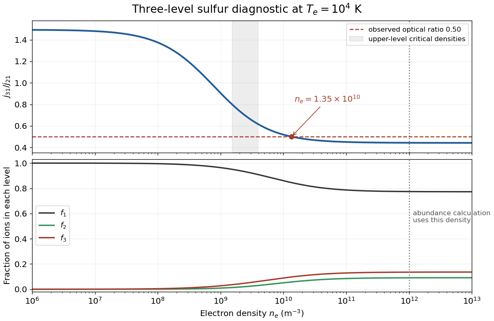

<h1 id="4/b/solution">Solution</h1>

↑ **Parent:** [B](../b.md)

Use the complete supplied three-level model, including collisions between levels 2 and 3. Put $g_1=4$, $g_2=4$, $g_3=6$, and denote a collisional rate coefficient by $q_{ij}$. [Detailed balance](../../../../detailed-balance.md) gives

$$
q_{ij}=\frac{g_j}{g_i}e^{-(E_j-E_i)/(k_{\mathrm B}T_e)}q_{ji}\quad(E_j>E_i).
$$

At $T_e=10^4\,\mathrm K$, the supplied [collision strengths](../../../../collision-strength.md) give, in $\mathrm{m^3\,s^{-1}}$,

$$
\begin{array}{c|ccc}
& q_{21}&q_{31}&q_{32}\\\hline
&5.999\times10^{-14}&6.006\times10^{-14}&1.089\times10^{-13}
\end{array},
$$

$$
q_{12}=7.075\times10^{-15},\qquad
q_{13}=1.057\times10^{-14},\qquad
q_{23}=1.626\times10^{-13}.
$$

The rounded optical wavelengths set the excitation energies; treating the fine splitting as very small compared with $k_{\mathrm B}T_e$ changes none of the main conclusions.

Let $D_2=A_{21}+n_e(q_{21}+q_{23})$, $D_3=A_{31}+A_{32}+n_e(q_{31}+q_{32})$, and $R_{32}=A_{32}+n_eq_{32}$. [Statistical equilibrium](../../../../statistical-equilibrium-of-atomic-level-populations.md) for the upper levels is

$$
n_2D_2-n_3R_{32}=n_1n_eq_{12},\qquad
n_3D_3-n_2n_eq_{23}=n_1n_eq_{13}.
$$

Eliminating $n_1$ yields the line-ratio formula

$$
\boxed{\frac{j_{31}}{j_{21}}=
\frac{A_{31}\nu_{31}}{A_{21}\nu_{21}}
\frac{q_{13}D_2+n_eq_{23}q_{12}}
{q_{12}D_3+q_{13}(A_{32}+n_eq_{32})}.}
$$

The same ratio holds for integrated intensities when the two lines sample the same optically thin volume and differential extinction is negligible. Inserting the data gives the particularly simple numerical form

$$
\boxed{\mathcal R(n_e)=\frac{1.49325+0.442056\,x}{1+x},\qquad
x=\frac{n_e}{7.8607\times10^8\,\mathrm{m^{-3}}}.}
$$

The low- and high-density limits are approximately $1.49$ and $0.442$. The collisional loss channels give

$$
n_{\mathrm{crit},3}=\frac{A_{31}+A_{32}}{q_{31}+q_{32}}=1.54\times10^9\,\mathrm{m^{-3}},\qquad
n_{\mathrm{crit},2}=\frac{A_{21}}{q_{21}+q_{23}}=3.95\times10^9\,\mathrm{m^{-3}}.
$$

Thus the useful [density](../../../../density.md) range is around $10^9$–$10^{10}\,\mathrm{m^{-3}}$. Maximizing $|d\log\mathcal R/d\log n_e|$ for the rational expression gives its strongest fractional sensitivity at $n_e=7.8607\times10^8\sqrt{1.49325/0.442056}=1.44\times10^9\,\mathrm{m^{-3}}$. Omitting the supplied 3–2 collisions would change the critical densities and inferred [density](../../../../density.md) appreciably.

For the observed ratio $0.50$, inversion gives $n_e=1.35\times10^{10}\,\mathrm{m^{-3}}$. This is on the high-density side of the transition, but is not the infinite-density limit. Solving the statistical-equilibrium equations and imposing $f_1+f_2+f_3=1$ gives the level fractions

$$
\boxed{(f_1,f_2,f_3)\simeq(0.8453,\ 0.05754,\ 0.09716).}
$$

A rough high-density estimate would instead use $f_i\propto g_i e^{-E_i/(k_{\mathrm B}T_e)}$; it is useful as a limiting check, not an exact solution for $\mathcal R=0.50$.

For the separate abundance calculation, use the expressly prescribed $n_e=10^{12}\,\mathrm{m^{-3}}$. The same model now gives $(f_1,f_2,f_3)=(0.77426,0.09045,0.13528)$, nearly the collisional Boltzmann limit. The measured angle-integrated volume emissivity gives

$$
n_3=\frac{j_{31}}{A_{31}hc/\lambda_{31}}=1.300\times10^6\,\mathrm{m^{-3}},\qquad
n(\mathrm S^+)=\frac{n_3}{f_3}=9.61\times10^6\,\mathrm{m^{-3}}.
$$

Therefore

$$
\boxed{\frac{n(\mathrm S^+)}{n_e}=9.61\times10^{-6}.}
$$

This is an abundance per free electron; it is approximately $n(\mathrm S^+)/n(\mathrm H^+)$ for predominantly ionized hydrogen with $n_e\simeq n(\mathrm H^+)$. No $4\pi$ factor is inserted because the supplied emissivity is power per volume, not power per volume per steradian. The imposed $10^{12}\,\mathrm{m^{-3}}$ predicts a ratio about $0.443$, rather than exactly $0.50$; the two numerical instructions cannot both describe one uniform zone exactly within this model.

The source's $2p^3$ configuration label is a typographical error for the sulfur valence configuration $3s^23p^3$. This does not alter the stated $J$ values or the calculation above.[Ground 4S and low 2D levels: 3s2 3p3 configuration, J values and energy ordering](../../../../energy-levels-of-singly-ionized-sulfur-by-national-institute-of-standards-and-technology.md)

**[Figure 1](#4/b/image-three-level-sulfur-line-ratio-and-level-populations-versus-electron-density). Three-level sulfur line ratio and level populations versus electron density**. The model includes all three supplied collision strengths and radiative decays at $T_e=10^4\,\mathrm K$. The observed optical ratio $0.50$ selects a different [density](../../../../density.md) from the separately prescribed abundance-calculation [density](../../../../density.md) $10^{12}\,\mathrm{m^{-3}}$.

## ↑ Ancestors (12)

1. [B](../b.md)
2. [4](../../4.md)
3. [2018](../../../2018-split.md)
4. [Past exam of the astrophysics course of the University of Oxford](../../../split.md)
5. [Astrophysics course of the University of Oxford](../../../../astrophysics-course-of-the-university-of-oxford.md)
6. [Year 4 of the physics course of the University of Oxford](../../../../year-4-of-the-physics-course-of-the-university-of-oxford.md)
7. [Physics course of the University of Oxford](../../../../physics-course-of-the-university-of-oxford.md)
8. [Undergraduate course of the University of Oxford](../../../../undergraduate-course-of-the-university-of-oxford.md)
9. [Course of the University of Oxford](../../../../course-of-the-university-of-oxford.md)
10. [University of Oxford](../../../../university-of-oxford-split.md)
11. [List of universities](../../../../list-of-universities.md)
12. [Codex Wiki](../../../../split.md)
