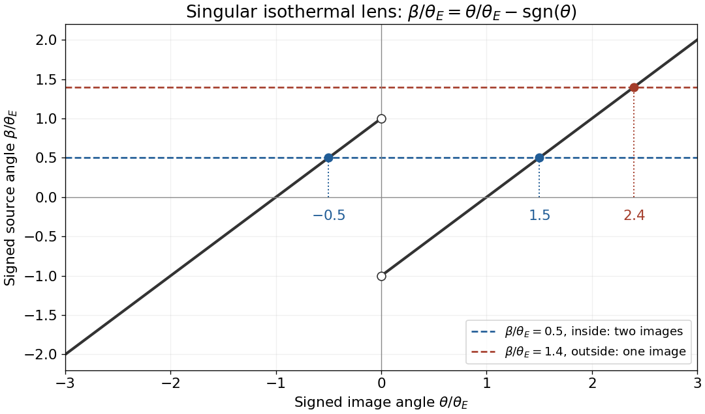

<h1 id="5/d/solution">Solution</h1>

↑ **Parent:** [D](../d.md)

The [Einstein angular radius](../../../../einstein-angular-radius.md) is the image-ring radius of an exactly aligned source. For the [singular isothermal sphere lens](../../../../singular-isothermal-sphere-lens.md), set $\beta=0$ in [ii](../c/ii.md):

$$
\boxed{\theta_E=4\pi\left(\frac{\sigma_{\mathrm{DM}}}{c}\right)^2\frac{D_{LS}}{D_S},\qquad
\beta=\theta-\theta_E\operatorname{sgn}\theta.}
$$

Choose $\beta>0$ without loss of generality. The positive branch always gives $\theta_+=\beta+\theta_E$. A negative-side image would have $\theta_-=\beta-\theta_E$; this branch is admissible only when its result is negative. Therefore

$$
\boxed{\begin{array}{c|l}
0<\beta<\theta_E&\theta_+=\beta+\theta_E,\quad\theta_-=\beta-\theta_E\quad\text{two images},\\
\beta>\theta_E&\theta_+=\beta+\theta_E\quad\text{one image}.
\end{array}}
$$

At $\beta=0$, symmetry produces an [Einstein ring](../../../../einstein-ring.md) of angular radius $\theta_E$. At $\beta=\theta_E$, the negative branch reaches the singular origin and is not an ordinary additional finite image; the one finite image is at $2\theta_E$. Reversing the source sign reverses the signed image coordinates, so the multiplicity criterion uses $|\beta|$. These features rely on the singular isothermal profile; a smooth finite-density core changes the central-image behaviour.

**[Figure 2](#5/d/image-two-branches-of-the-singular-isothermal-lens-equation). Two branches of the singular isothermal lens equation**. The normalized map is $\beta/\theta_E=\theta/\theta_E-\operatorname{sgn}\theta$. Horizontal source lines show two images inside the Einstein radius and one outside. The open endpoints exclude the singular lens centre.

## ↑ Ancestors (12)

1. [D](../d.md)
2. [5](../../5.md)
3. [2018](../../../2018-split.md)
4. [Past exam of the astrophysics course of the University of Oxford](../../../split.md)
5. [Astrophysics course of the University of Oxford](../../../../astrophysics-course-of-the-university-of-oxford.md)
6. [Year 4 of the physics course of the University of Oxford](../../../../year-4-of-the-physics-course-of-the-university-of-oxford.md)
7. [Physics course of the University of Oxford](../../../../physics-course-of-the-university-of-oxford.md)
8. [Undergraduate course of the University of Oxford](../../../../undergraduate-course-of-the-university-of-oxford.md)
9. [Course of the University of Oxford](../../../../course-of-the-university-of-oxford.md)
10. [University of Oxford](../../../../university-of-oxford-split.md)
11. [List of universities](../../../../list-of-universities.md)
12. [Codex Wiki](../../../../split.md)
