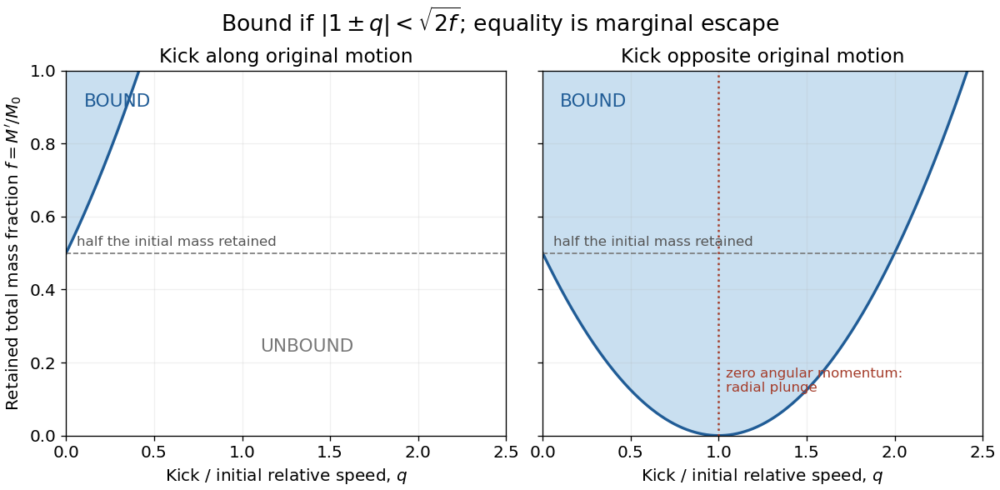

<h1 id="6/d/solution">Solution</h1>

↑ **Parent:** [D](../d.md)

Write $f=M'/M_0$ for the retained fraction and $q=v^-/v_0$ for an opposite kick. With more than half the mass lost, $0<f<1/2$. A same-direction kick cannot bind the pair, because $1+v^+/v_0\geq1>\sqrt{2f}$. An opposite kick can reduce the relative speed enough to leave negative [energy](../../../../energy-split.md):

$$
\boxed{1-\sqrt{2f}<q<1+\sqrt{2f}.}
$$

Both endpoints are marginal zero-energy cases. Kicks somewhat larger than $v_0$ can still satisfy this interval, but then the direction of the relative orbital motion is reversed.

At $v^-=v_0=v_1+v_2$, the two surviving stars have identical instantaneous velocities, so their relative [velocity](../../../../velocity.md) and orbital [angular momentum](../../../../angular-momentum.md) vanish. Their [energy](../../../../energy-split.md) is nevertheless negative,

$$
E'=-\frac{GM_{\mathrm{NS}}M_2}{A}.
$$

They fall radially toward each other from rest in their new [centre-of-mass frame](../../../../center-of-momentum-frame.md). In the point-mass idealization the collision orbit has [semimajor axis](../../../../semi-major-axis.md) $A/2$ and zero pericentre; real finite-size stars collide or interact before reaching zero separation. It is not a stable circular binary. Zero relative [angular momentum](../../../../angular-momentum.md), rather than the negative [energy](../../../../energy-split.md) alone, determines this plunge outcome.

**[Figure 3](#6/d/image-binding-after-instantaneous-mass-loss-for-parallel-and-opposite-natal-kicks). Binding after instantaneous mass loss for parallel and opposite natal kicks**. The retained mass fraction is $f=M'/M_0$ and the kick magnitude is normalized to the original relative speed. Blue regions have negative [orbital energy](../../../../orbital-energy.md). The curves mark marginal escape. At an opposite normalized kick of one, the relative [angular momentum](../../../../angular-momentum.md) vanishes and the survivors plunge together.

## ↑ Ancestors (12)

1. [D](../d.md)
2. [6](../../6.md)
3. [2018](../../../2018-split.md)
4. [Past exam of the astrophysics course of the University of Oxford](../../../split.md)
5. [Astrophysics course of the University of Oxford](../../../../astrophysics-course-of-the-university-of-oxford.md)
6. [Year 4 of the physics course of the University of Oxford](../../../../year-4-of-the-physics-course-of-the-university-of-oxford.md)
7. [Physics course of the University of Oxford](../../../../physics-course-of-the-university-of-oxford.md)
8. [Undergraduate course of the University of Oxford](../../../../undergraduate-course-of-the-university-of-oxford.md)
9. [Course of the University of Oxford](../../../../course-of-the-university-of-oxford.md)
10. [University of Oxford](../../../../university-of-oxford-split.md)
11. [List of universities](../../../../list-of-universities.md)
12. [Codex Wiki](../../../../split.md)
