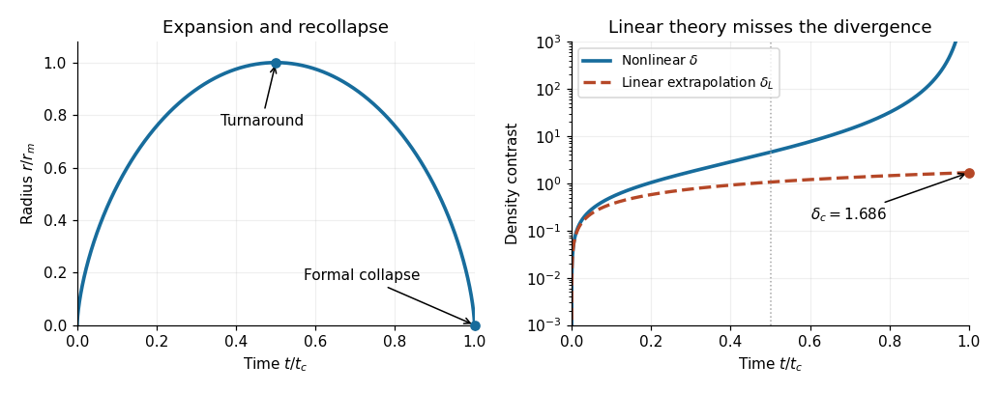

# 2021

↑ **Parent:** [Past exam of the astrophysics course of the University of Oxford](../past-exam-of-the-astrophysics-course-of-the-university-of-oxford.md)

Source: [https://www.whatdotheyknow.com/request/oxford_physics_past_papers_2/response/2340696/attach/9/Physics%20Papers%202020.pdf?cookie_passthrough=1](https://www.whatdotheyknow.com/request/oxford_physics_past_papers_2/response/2340696/attach/9/Physics%20Papers%202020.pdf?cookie_passthrough=1)

The cover identifies the 2021 examination; the source bundle's filename uses 2020. This paper occupies bundle pages 21–27. TODO: recover the damaged source plots for question 5(a)–(c). The solutions below distinguish results derivable from the surviving material from measurements that require an intact figure. Units are SI unless specified.

**Table of contents**

- [1](#1)
  - [a](#1/a)
    - [Solution](#1/a/solution)
  - [b](#1/b)
    - [Solution](#1/b/solution)
  - [c](#1/c)
    - [Solution](#1/c/solution)
  - [d](#1/d)
    - [Solution](#1/d/solution)
  - [e](#1/e)
    - [Solution](#1/e/solution)
- [2](#2)
  - [a](#2/a)
    - [Solution](#2/a/solution)
  - [b](#2/b)
    - [Solution](#2/b/solution)
  - [c](#2/c)
    - [Solution](#2/c/solution)
  - [d](#2/d)
    - [Solution](#2/d/solution)
- [3](#3)
  - [a](#3/a)
    - [Solution](#3/a/solution)
  - [b](#3/b)
    - [Solution](#3/b/solution)
  - [c](#3/c)
    - [Solution](#3/c/solution)
  - [d](#3/d)
    - [Solution](#3/d/solution)
  - [e](#3/e)
    - [Solution](#3/e/solution)
- [4](#4)
  - [a](#4/a)
    - [Solution](#4/a/solution)
  - [b](#4/b)
    - [Solution](#4/b/solution)
  - [c](#4/c)
    - [Solution](#4/c/solution)
- [5](#5)
  - [a](#5/a)
    - [Solution](#5/a/solution)
  - [b](#5/b)
    - [Solution](#5/b/solution)
  - [c](#5/c)
    - [Solution](#5/c/solution)
  - [d](#5/d)
    - [Solution](#5/d/solution)
  - [e](#5/e)
    - [Solution](#5/e/solution)
- [6](#6)
  - [a](#6/a)
    - [Solution](#6/a/solution)
  - [b](#6/b)
    - [Solution](#6/b/solution)
  - [c](#6/c)
    - [Solution](#6/c/solution)
  - [d](#6/d)
    - [Solution](#6/d/solution)

## 1

↑ **Parent:** [2021](2021.md)

<h3 id="1/a">a</h3>

↑ **Parent:** [1](#1)

<h4 id="1/a/solution">Solution</h4>

↑ **Parent:** [A](#1/a)

A hydrogen [recombination line](../atomic-physics.md#recombination-line) is a discrete [spectral line](../stellar-astrophysics.md#spectral-line) produced when [radiative recombination](../atomic-physics.md#radiative-recombination) captures an [electron](../physics.md#electron) into an excited bound level and a subsequent [radiative cascade](../atomic-physics.md#radiative-cascade) emits [photons](../quantum-mechanics.md#photon). The free-to-bound capture itself produces a continuum; the later bound-to-bound transitions produce the [recombination lines](../atomic-physics.md#recombination-line). For example, [H-alpha](../mathematical-physics.md#h-alpha) is the $n=3\to2$ transition in the [Balmer series](../mathematical-physics.md#balmer-series).

For the neutral hydrogen absorbing an ionizing stellar continuum, the principal bound-free transition is [photoionization](../atomic-physics.md#photoionization) from the $1s$ [ground state](../quantum-mechanics.md#ground-state) into the continuum. Most neutral hydrogen is in its [ground state](../quantum-mechanics.md#ground-state), and the [photoionization](../atomic-physics.md#photoionization) [cross section](../physics.md#cross-section-physics) is largest near its $13.6\ \mathrm{eV}$ threshold, falling approximately as $\nu^{-3}$ above it. Dominance of the _population-weighted opacity_ is intended here; this does not mean that every excited-state microscopic [cross section](../physics.md#cross-section-physics) is smaller at every [frequency](../wave.md#frequency).

In an ionization-bounded, optically thick nebula, direct [radiative recombination](../atomic-physics.md#radiative-recombination) into $1s$ emits an ionizing [photon](../quantum-mechanics.md#photon) that promptly photoionizes another hydrogen atom. One ion disappears and another is created: there is no net removal of an ion from the global budget. [Case B recombination](../galaxy.md#case-b-recombination) therefore uses $\alpha_B=\sum_{n\geq2}\alpha_n$, with local recycling of ground-state recombination [photons](../quantum-mechanics.md#photon). This is the on-the-spot approximation, rather than an unconditional property of [radiative recombination](../atomic-physics.md#radiative-recombination): if those [photons](../quantum-mechanics.md#photon) escape, direct capture does produce net neutralization and a Case A treatment is appropriate.

<h3 id="1/b">b</h3>

↑ **Parent:** [1](#1)

<h4 id="1/b/solution">Solution</h4>

↑ **Parent:** [B](#1/b)

Write $Q=\dot N_\gamma$ for the [hydrogen-ionizing photon production rate](../galaxy.md#hydrogen-ionizing-photon-production-rate), counting only [photons](../quantum-mechanics.md#photon) above the hydrogen [ionization energy](../mathematical-physics.md#ionization-energy), not all stellar [photons](../quantum-mechanics.md#photon). In steady [photoionization equilibrium](../galaxy.md#photoionization-equilibrium), the external supply balances the volume integral of net [Case B recombination](../galaxy.md#case-b-recombination):

$$
Q=\int_{r_{\rm in}}^{r_S}\alpha_rn_en_p\,4\pi r^2dr.
$$

For uniform, almost completely ionized pure hydrogen, $n_e=n_p=n_H$. Hence

$$
Q=\frac{4\pi}{3}\alpha_rn_H^2(r_S^3-r_{\rm in}^3),\qquad
\boxed{r_S=\left(r_{\rm in}^3+\frac{3Q}{4\pi\alpha_rn_H^2}\right)^{1/3}
\simeq\left(\frac{3Q}{4\pi\alpha_rn_H^2}\right)^{1/3}.}
$$

The final approximation requires $r_{\rm in}\ll r_S$. The [Strömgren sphere](../galaxy.md#stromgren-sphere) also assumes spherical symmetry, a sharp [ionization front](../galaxy.md#ionization-front), a steady source older than the [recombination time](../galaxy.md#recombination-time), uniform [number density](../statistical-physics.md#number-density) and [temperature](../temperature.md) so that $\alpha_r$ is constant, negligible dust absorption of ionizing [photons](../quantum-mechanics.md#photon), negligible leakage, and no important helium correction or [collisional ionization](../atomic-physics.md#collisional-ionization). Clumping would replace $n_H^2$ by a volume average of $n_en_p$.

<h3 id="1/c">c</h3>

↑ **Parent:** [1](#1)

<h4 id="1/c/solution">Solution</h4>

↑ **Parent:** [C](#1/c)

An additional atomic input is needed: the total [Case B recombination](../galaxy.md#case-b-recombination) coefficient does not specify the number of [H-alpha](../mathematical-physics.md#h-alpha) [photons](../quantum-mechanics.md#photon) per net [radiative recombination](../atomic-physics.md#radiative-recombination). Let $y_\alpha=\alpha_{\rm H\alpha}^{\rm eff}/\alpha_r$, where $\alpha_{\rm H\alpha}^{\rm eff}$ is the [effective recombination coefficient](../atomic-physics.md#effective-recombination-coefficient). At the approximately $10^4\ \mathrm K$ [temperature](../temperature.md) implicit in the supplied $\alpha_r$, take $y_\alpha\simeq0.45$. The coefficient 2.2 used later in the paper corresponds to $y_\alpha=1/2.2\simeq0.455$, which we use consistently here.

For an unextinguished, fully filled [Strömgren sphere](../galaxy.md#stromgren-sphere) with negligible central cavity, the [H-alpha](../mathematical-physics.md#h-alpha) [luminosity](../astrophysics.md#luminosity) and [observed radiative flux](../astrophysics.md#observed-radiative-flux) satisfy

$$
4\pi D^2F_{\rm H\alpha}=y_\alpha\frac{hc}{\lambda_{\rm H\alpha}}\alpha_rn_e^2\frac{4\pi r_S^3}{3},\qquad
r_S=\frac{\theta D}{2}.
$$

Substitution eliminates $r_S$ and gives

$$
\boxed{D=\frac{24F_{\rm H\alpha}\lambda_{\rm H\alpha}}
{y_\alpha hc\alpha_rn_e^2\theta^3}.}
$$

Convert the angular diameter to [radians](../geometry-and-topology.md#radian): $\theta=56\times10^{-3}/206265=2.7150\times10^{-7}$. Also $hc/\lambda_{\rm H\alpha}=3.0268\times10^{-19}\ \mathrm J$. Thus

$$
\boxed{D=1.5422\times10^{19}\ \mathrm m\simeq500\ \mathrm{pc},\qquad
r_S\simeq2.09\times10^{12}\ \mathrm m\simeq14.0\ \mathrm{au}.}
$$

The implied [hydrogen-ionizing photon production rate](../galaxy.md#hydrogen-ionizing-photon-production-rate) is $Q\simeq1.00\times10^{39}\ \mathrm{s^{-1}}$. Using $y_\alpha=0.45$ instead gives $D\simeq505\ \mathrm{pc}$. These values use the printed milliarcseconds and integrated line [observed radiative flux](../astrophysics.md#observed-radiative-flux). Assuming one [H-alpha](../mathematical-physics.md#h-alpha) [photon](../quantum-mechanics.md#photon) per recombination would give a different, unjustified distance. An appreciable cavity or a nonunit filling factor must also enter the emitting volume.

The [Brackett series](../mathematical-physics.md#brackett-series) consists of transitions ending at $n=4$, at infrared [wavelengths](../wave-equation.md#wavelength). They suffer much less [interstellar extinction](../galaxy.md#interstellar-extinction) than [H-alpha](../mathematical-physics.md#h-alpha), so their corrected [observed radiative fluxes](../astrophysics.md#observed-radiative-flux) can give a more reliable version of the same inference. At fixed measured angular size and [number density](../statistical-physics.md#number-density), the formula has $D\propto F$: uncorrected [interstellar extinction](../galaxy.md#interstellar-extinction) therefore makes this particular distance estimate too small. Infrared lines are weaker and need their own [effective recombination coefficients](../atomic-physics.md#effective-recombination-coefficient); their advantage is reduced sensitivity to dust.

<h3 id="1/d">d</h3>

↑ **Parent:** [1](#1)

<h4 id="1/d/solution">Solution</h4>

↑ **Parent:** [D](#1/d)

Let $q_{\rm in}$ be the [photoionization rate](../atomic-physics.md#photoionization-rate) per neutral hydrogen atom just outside the empty cavity. With an isotropic central source and no attenuation inside that cavity,

$$
q_{\rm in}=\int_0^\infty\frac{\sigma_\nu L_\nu^*}{4\pi r_{\rm in}^2h\nu}\,d\nu
=\frac{\langle\sigma\rangle Q}{4\pi r_{\rm in}^2}.
$$

The [cross section](../physics.md#cross-section-physics) is zero below threshold; this permits the lower integration limit zero. Pure hydrogen with [hydrogen ionization fraction](../cosmology.md#hydrogen-ionization-fraction) $\zeta$ has $n_{\rm HI}=n_H(1-\zeta)$ and $n_e=n_p=n_H\zeta$. Local [photoionization equilibrium](../galaxy.md#photoionization-equilibrium) is therefore

$$
n_H(1-\zeta_{\rm in})q_{\rm in}=\alpha_rn_H^2\zeta_{\rm in}^2.
$$

Define the dimensionless quantity $\Theta_{\rm phys}=\alpha_rn_H/q_{\rm in}$. Solving the resulting [quadratic equation](../polynomial.md#quadratic-equation), $\Theta_{\rm phys}\zeta_{\rm in}^2+\zeta_{\rm in}-1=0$, gives the physical root

$$
\boxed{\zeta_{\rm in}=\frac{\sqrt{1+4\Theta_{\rm phys}}-1}{2\Theta_{\rm phys}}
=\frac{2}{1+\sqrt{1+4\Theta_{\rm phys}}}.}
$$

The rationalized form avoids numerical cancellation for small $\Theta_{\rm phys}$. Strong illumination gives $\zeta_{\rm in}\simeq1-\Theta_{\rm phys}$; weak illumination gives $\zeta_{\rm in}\simeq\Theta_{\rm phys}^{-1/2}$.

Eliminating $Q$ with the [H-alpha](../mathematical-physics.md#h-alpha) [luminosity](../astrophysics.md#luminosity), $Q=2.2(4\pi D^2F_{\rm H\alpha})\lambda_{\rm H\alpha}/(hc)$, yields

$$
\boxed{\Theta_{\rm phys}=\frac{n_H\alpha_rhc}{2.2\langle\sigma\rangle F_{\rm H\alpha}\lambda_{\rm H\alpha}}
\left(\frac{r_{\rm in}}D\right)^2.}
$$

**The printed definition of $\Theta$ is inconsistent with the defined radii.** The source calls $r_*$ a physical stellar radius, but its factor $(2\pi r_*D)^2$ gives $\Theta$ units of length to the fourth power, rather than a dimensionless value. It also omits the physically necessary cavity radius $r_{\rm in}$. For a concrete counterexample, double $r_{\rm in}$ while holding the source, $D$, and $n_H$ fixed: the incident [photoionization rate](../atomic-physics.md#photoionization-rate) falls by four, so $\Theta_{\rm phys}$ rises by four; the printed expression does not change. The root has the requested form with the corrected $\Theta_{\rm phys}$ above. There is no supplied relation allowing $r_{\rm in}$ to be replaced by $r_*$.

<h3 id="1/e">e</h3>

↑ **Parent:** [1](#1)

<h4 id="1/e/solution">Solution</h4>

↑ **Parent:** [E](#1/e)

Retain the consistent $\Theta_{\rm phys}$ of [d](#1/d). Across a sufficiently thin layer, the neutral hydrogen [column density](../statistical-physics.md#column-density) is $N_{\rm HI}=n_H(1-\zeta_{\rm in})\Delta r+O(\Delta r^2)$. The direct stellar continuum acquires [optical depth](../astrophysics.md#optical-depth) $\tau_\nu=N_{\rm HI}\sigma_\nu$. Define the photon-weighted second moment

$$
\langle\sigma^2\rangle=\frac1Q\int_0^\infty\sigma_\nu^2\frac{L_\nu^*}{h\nu}\,d\nu.
$$

Expanding the attenuating exponential in the [photoionization rate](../atomic-physics.md#photoionization-rate) gives

$$
\begin{aligned}
\frac{q(r_{\rm in}+\Delta r)}{q_{\rm in}}
&=\left(\frac{r_{\rm in}}{r_{\rm in}+\Delta r}\right)^2
\frac{\int\sigma_\nu L_\nu^*e^{-N_{\rm HI}\sigma_\nu}/(h\nu)\,d\nu}{Q\langle\sigma\rangle}\\
&=1-\frac{2\Delta r}{r_{\rm in}}-n_H(1-\zeta_{\rm in})\Delta r
\frac{\langle\sigma^2\rangle}{\langle\sigma\rangle}+O(\Delta r^2).
\end{aligned}
$$

The second [cross section](../physics.md#cross-section-physics) moment appears because the radiation both undergoes absorption and is weighted by the [photoionization](../atomic-physics.md#photoionization) [cross section](../physics.md#cross-section-physics) in computing the rate.

In a local plane-parallel approximation that suppresses geometrical dilution, set

$$
\Gamma=1-n_H(1-\zeta_{\rm in})\Delta r\frac{\langle\sigma^2\rangle}{\langle\sigma\rangle}.
$$

Then local [photoionization equilibrium](../galaxy.md#photoionization-equilibrium) becomes $\Theta_{\rm phys}\zeta^2=\Gamma(1-\zeta)$, so

$$
\boxed{\zeta=\frac{-\Gamma+\sqrt{\Gamma^2+4\Theta_{\rm phys}\Gamma}}{2\Theta_{\rm phys}}.}
$$

This gives the requested algebraic dependence, with the corrected definition of $\Theta$. Besides $\Delta r\ll r_{\rm in}$, linear attenuation requires $N_{\rm HI}\sigma_\nu\ll1$ over the [frequencies](../wave.md#frequency) contributing appreciably to the rate. In particular $\Gamma$ must remain positive.

The source's $\Gamma$ neglects $-2\Delta r/r_{\rm in}$, which is also first order in layer thickness. A consistent spherical first-order answer uses $\Gamma_{\rm sph}=\Gamma-2\Delta r/r_{\rm in}$ in the same root. Neglecting dilution relative to absorption additionally requires $n_H(1-\zeta_{\rm in})\langle\sigma^2\rangle/\langle\sigma\rangle\gg2/r_{\rm in}$. As a concrete limiting test, with negligible absorption the source's $\Gamma=1$ predicts no change, while inverse-square dilution still decreases $q$ and thus $\zeta$.

## 2

↑ **Parent:** [2021](2021.md)

<h3 id="2/a">a</h3>

↑ **Parent:** [2](#2)

<h4 id="2/a/solution">Solution</h4>

↑ **Parent:** [A](#2/a)

Take the initially expanding branch $\dot r_i=H_ir_i$; the printed squared [velocity](../classical-mechanics.md#velocity) alone also permits an initially contracting branch, which would not reach a future maximum radius. Multiply the [equation of motion](../classical-mechanics.md#equation-of-motion) by $\dot r$ and integrate. The conserved outer-shell [specific orbital energy](../celestial-mechanics.md#specific-orbital-energy) is

$$
\epsilon=\frac12\dot r^2-\frac{GM}{r}.
$$

The initial [mass](../classical-mechanics.md#mass) follows from the background [critical density](../cosmology.md#critical-density):

$$
M=\frac{4\pi}{3}r_i^3\rho_{m,i}(1+\delta_i)
=\frac{H_i^2r_i^3}{2G}(1+\delta_i).
$$

Consequently

$$
\boxed{\epsilon=-\frac12H_i^2r_i^2\delta_i<0.}
$$

If $E$ means the [energy](../energy.md) of a test shell of [mass](../classical-mechanics.md#mass) $m$, $E=m\epsilon$. If it means the total [energy](../energy.md) of the entire uniform, homologously moving perturbation, direct integration instead gives $K=3M\dot r^2/10$, $U=-3GM^2/(5r)$ and

$$
\boxed{E_{\rm sphere}=\frac35M\epsilon=-\frac3{10}MH_i^2r_i^2\delta_i.}
$$

The common convention of writing the first integral as $E$ is therefore an [energy](../energy.md) _per unit shell mass_, not the total [energy](../energy.md) of the sphere.

At [spherical-collapse turnaround](../large-scale-structure-of-the-universe.md#turnaround-of-spherical-collapse), $\dot r=0$, so $\epsilon=-GM/r_m$. Hence

$$
\boxed{r_m=\frac{GM}{|\epsilon|}=r_i\frac{1+\delta_i}{\delta_i}.}
$$

Any positive initial [density contrast](../linear-cosmological-density-perturbation.md#density-contrast) binds this pressureless perturbation in the stated [Einstein-de Sitter universe](../large-scale-structure-of-the-universe.md#einstein-de-sitter-universe).

<h3 id="2/b">b</h3>

↑ **Parent:** [2](#2)

<h4 id="2/b/solution">Solution</h4>

↑ **Parent:** [B](#2/b)

For $r=A(1-\cos\theta)$ and $t+T=B(\theta-\sin\theta)$, differentiation gives

$$
\dot r=\frac AB\frac{\sin\theta}{1-\cos\theta},\qquad
\ddot r=-\frac A{B^2(1-\cos\theta)^2}.
$$

Comparison with $-GM/[A^2(1-\cos\theta)^2]$ proves $A^3=GMB^2$. Substitution into the conserved [specific orbital energy](../celestial-mechanics.md#specific-orbital-energy) gives $\epsilon=-GM/(2A)$. Therefore

$$
\boxed{A=\frac{r_i(1+\delta_i)}{2\delta_i},\qquad
B=\frac{1+\delta_i}{2H_i\delta_i^{3/2}}.}
$$

These constants exactly reproduce both the initial radius and expanding [velocity](../classical-mechanics.md#velocity). The initial parameter obeys

$$
\cos\theta_i=\frac{1-\delta_i}{1+\delta_i},\qquad
\theta_i=2\arctan\sqrt{\delta_i}.
$$

In an [Einstein-de Sitter universe](../large-scale-structure-of-the-universe.md#einstein-de-sitter-universe) whose background big bang is $t=0$, $t_i=2/(3H_i)$. Thus the exact required offset is

$$
\boxed{T=B(\theta_i-\sin\theta_i)-t_i.}
$$

Expanding $\theta_i-\sin\theta_i=\frac43\delta_i^{3/2}-\frac85\delta_i^{5/2}+O(\delta_i^{7/2})$ gives

$$
T=-\frac15t_i\delta_i+O(t_i\delta_i^2).
$$

**One cannot set $T=0$ exactly at finite $\delta_i$ while retaining the stated initial Hubble velocity and background time origin.** For example $\delta_i=0.01$, $t_i=1$ gives $T=-0.00199148$. Shifting to $t'=t+T$ removes the offset from the local orbit, but the background then scales as $a\propto(t'-T)^{2/3}$, not $t'^{2/3}$. Setting $T\simeq0$ is justified in the early-initial-time limit for subsequent evolution; the following standard growing-mode formulae use that approximation.

<h3 id="2/c">c</h3>

↑ **Parent:** [2](#2)

<h4 id="2/c/solution">Solution</h4>

↑ **Parent:** [C](#2/c)

First retain the exact initial normalization. The [scale factor](../cosmology.md#scale-factor-cosmology) obeys $a/a_i=(t/t_i)^{2/3}$, so the [cosmological redshift](../cosmology.md#cosmological-redshift) is

$$
1+z=(1+z_i)\left[\frac{t_i}{B(\theta-\sin\theta)-T}\right]^{2/3}.
$$

Also $\rho=3M/(4\pi r^3)$ and $\rho_m=1/(6\pi Gt^2)$. Using $A^3=GMB^2$ gives

$$
1+\delta=\frac92\frac{[\theta-\sin\theta-T/B]^2}{(1-\cos\theta)^3}.
$$

These equations exactly accommodate the finite-time initial conditions in [b](#2/b).

Now neglect $T$ and retain leading order in $\delta_i\ll1$. Since $t_i/B=4\delta_i^{3/2}/[3(1+\delta_i)]$, the [cosmological redshift](../cosmology.md#cosmological-redshift) relation reduces to

$$
1+z\simeq\left(\frac43\right)^{2/3}\frac{\delta_i(1+z_i)}{(\theta-\sin\theta)^{2/3}}.
$$

Define $\delta_0=\frac35\delta_i(1+z_i)$. Then

$$
\boxed{1+z\simeq\frac53\left(\frac43\right)^{2/3}
\frac{\delta_0}{(\theta-\sin\theta)^{2/3}},\qquad
\delta\simeq\frac92\frac{(\theta-\sin\theta)^2}{(1-\cos\theta)^3}-1.}
$$

The second equality is exact for the ideal common-bang growing-mode [spherical-collapse model](../large-scale-structure-of-the-universe.md#spherical-collapse-model); it is approximate for the paper's finite-time initial Hubble-velocity data.

The factor $3/5$ has a physical origin. Linear mass conservation gives $\dot\delta_i=0$ when the initial local expansion equals the background [Hubble flow](../cosmology.md#hubble-flow). The general linear dust solution is $\delta_L=C_g(t/t_i)^{2/3}+C_d(t/t_i)^{-1}$. Imposing $\delta_L(t_i)=\delta_i$ and $\dot\delta_L(t_i)=0$ yields

$$
\delta_L(t)=\frac35\delta_i\left(\frac t{t_i}\right)^{2/3}
+\frac25\delta_i\left(\frac t{t_i}\right)^{-1}.
$$

Thus $\delta_0$ is the present extrapolation of the _growing component_, after neglecting the decaying transient. It is not the exact present value of the full linear solution for finite $t_i$.

<h3 id="2/d">d</h3>

↑ **Parent:** [2](#2)

<h4 id="2/d/solution">Solution</h4>

↑ **Parent:** [D](#2/d)

In the growing-mode [spherical-collapse model](../large-scale-structure-of-the-universe.md#spherical-collapse-model), use $\theta-\sin\theta=\theta^3/6-\theta^5/120+\cdots$ and $1-\cos\theta=\theta^2/2-\theta^4/24+\cdots$. Their ratio in [c](#2/c) gives $\delta=3\theta^2/20+O(\theta^4)$. Meanwhile $t\propto\theta-\sin\theta$, and the linear growing [density contrast](../linear-cosmological-density-perturbation.md#density-contrast) scales as $t^{2/3}$. Matching at small $\theta$ therefore fixes

$$
\boxed{\delta_L=\frac35\left[\frac34(\theta-\sin\theta)\right]^{2/3}.}
$$

This is a linearly extrapolated growing-mode amplitude at any epoch, including epochs where the actual [density contrast](../linear-cosmological-density-perturbation.md#density-contrast) is nonlinear. It carries the initial-condition qualification in [c](#2/c).

Numerical comparison is

$$
\begin{array}{c|rrr}
\theta&\delta&\delta_L&1-\delta_L/\delta\\\hline
1/4&0.00942684&0.00935549&0.00757\\
\pi/2&0.466138&0.340810&0.2689\\
2\pi/3&1.01186&0.568083&0.4386\\
\pi&4.55165&1.06241&0.7666
\end{array}
$$

The last column measures the fractional underestimate of the actual [density contrast](../linear-cosmological-density-perturbation.md#density-contrast). Linear theory is accurate at $\delta\ll1$, but substantially underpredicts it by the time $\delta$ approaches unity. At $\theta=\pi$, the shell reaches [spherical-collapse turnaround](../large-scale-structure-of-the-universe.md#turnaround-of-spherical-collapse); $1+\delta=9\pi^2/16\simeq5.55$.

At $\theta=2\pi$, $r=0$ and the ideal pressureless [density](../fluid-mechanics.md#density) diverges at finite time $t_c=2\pi B$. Yet the extrapolated linear value remains finite:

$$
\boxed{\delta_c=\frac35\left(\frac{3\pi}{2}\right)^{2/3}=1.68647.}
$$

This is the [linear spherical-collapse threshold](../large-scale-structure-of-the-universe.md#linear-spherical-collapse-threshold), not the true [density contrast](../linear-cosmological-density-perturbation.md#density-contrast) at collapse. Actual nonspherical collisionless systems undergo [shell crossing](../large-scale-structure-of-the-universe.md#shell-crossing) and [virialization](../classical-mechanics.md#virialization) rather than becoming uniform point singularities. The ideal [virial theorem](../classical-mechanics.md#virial-theorem) and [conservation of energy](../mathematical-physics.md#conservation-of-energy) estimate a final radius $r_m/2$ if the structural form is preserved.

**[Figure 1](#2/d/image-parametric-spherical-collapse-and-the-failure-of-the-extrapolated-linear-density-contrast). Parametric spherical collapse and the failure of the extrapolated linear density contrast**.

## 3

↑ **Parent:** [2021](2021.md)

<h3 id="3/a">a</h3>

↑ **Parent:** [3](#3)

<h4 id="3/a/solution">Solution</h4>

↑ **Parent:** [A](#3/a)

Work in the source rest frame and neglect the source's small [cosmological redshift](../cosmology.md#cosmological-redshift). Over an emission interval $\Delta t$, a ballistic [relativistic jet](../astrophysics.md#relativistic-jet) feature travels $\beta c\Delta t$, advancing $\beta c\Delta t\cos\theta$ toward the observer and $\beta c\Delta t\sin\theta$ across the sky. The second [photon](../quantum-mechanics.md#photon) has a shorter journey, so its arrival is delayed by only

$$
\Delta t_{\rm obs}=\Delta t(1-\beta\cos\theta).
$$

Dividing the projected displacement by this arrival interval gives

$$
\boxed{\beta_{\rm app}=\frac{\beta\sin\theta}{1-\beta\cos\theta}.}
$$

[Apparent superluminal motion](../astrophysics.md#apparent-superluminal-motion) is a combination of projection and light-travel delay. The feature's local [speed](../classical-mechanics.md#speed) remains $\beta c<c$; its inferred transverse displacement divided by the observer's arrival interval is not a local signal [velocity](../classical-mechanics.md#velocity).

<h3 id="3/b">b</h3>

↑ **Parent:** [3](#3)

<h4 id="3/b/solution">Solution</h4>

↑ **Parent:** [B](#3/b)

For fixed $\beta$, differentiate the apparent [speed](../classical-mechanics.md#speed) with respect to angle:

$$
\frac{d\beta_{\rm app}}{d\theta}=\frac{\beta(\cos\theta-\beta)}{(1-\beta\cos\theta)^2}.
$$

The maximum lies at $\cos\theta=\beta$ and has value $\beta_{\rm app,max}=\beta/\sqrt{1-\beta^2}=\gamma\beta$. Hence strict [apparent superluminal motion](../astrophysics.md#apparent-superluminal-motion) requires

$$
\boxed{\beta>\frac1{\sqrt2}\simeq0.7071.}
$$

The threshold is an infimum: equality yields exactly $\beta_{\rm app}=1$ at $\theta=\pi/4=45^\circ$, rather than a strictly superluminal value. For a chosen larger $\beta$, the optimal inclination is $\theta=\arccos\beta$, and the full superluminal interval satisfies $\sin\theta+\cos\theta>1/\beta$.

<h3 id="3/c">c</h3>

↑ **Parent:** [3](#3)

<h4 id="3/c/solution">Solution</h4>

↑ **Parent:** [C](#3/c)

For intrinsically symmetric oppositely directed [relativistic jets](../astrophysics.md#relativistic-jet), their [proper motions](../astronomy.md#proper-motion) are

$$
\mu_{\rm app}=\frac{\beta c\sin\theta}{D(1-\beta\cos\theta)},\qquad
\mu_{\rm rec}=\frac{\beta c\sin\theta}{D(1+\beta\cos\theta)}.
$$

The ratio removes $D$ and yields

$$
x\equiv\beta\cos\theta=\frac{\mu_{\rm app}-\mu_{\rm rec}}{\mu_{\rm app}+\mu_{\rm rec}}=0.4.
$$

Taking the product instead gives

$$
\mu_{\rm app}\mu_{\rm rec}=\frac{c^2}{D^2}\frac{\beta^2-x^2}{1-x^2}.
$$

[Causality](../special-relativity.md#causality) requires $\beta\leq1$, so the limiting distance and inclination are

$$
\boxed{D_{\max}=\frac{c}{\sqrt{\mu_{\rm app}\mu_{\rm rec}}},\qquad
\theta_{\max}=\arccos x.}
$$

Here and in [e](#3/e), “maximum” denotes the limiting $\beta\to1$ bound; massive ejecta obey strict inequalities. The conversion is $1\ \mathrm{mas\,day^{-1}}=5.6113\times10^{-14}\ \mathrm{rad\,s^{-1}}$, hence

$$
\boxed{D_{\max}=3.435\ \mathrm{kpc},\qquad\theta_{\max}=66.42^\circ.}
$$

Both bounds occur together in the light-speed limit. At any specified smaller distance, $\beta^2=x^2+(1-x^2)(D/D_{\max})^2$ determines the intrinsic [speed](../classical-mechanics.md#speed).

<h3 id="3/d">d</h3>

↑ **Parent:** [3](#3)

<h4 id="3/d/solution">Solution</h4>

↑ **Parent:** [D](#3/d)

The [Doppler factors](../special-relativity.md#doppler-factor) for the two discrete blobs are $\mathcal D_\pm=[\gamma(1\mp\beta\cos\theta)]^{-1}$. Their ratio is $(1+x)/(1-x)=77/33=7/3$. [Lorentz-invariant specific intensity](../special-relativity.md#lorentz-invariant-specific-intensity) means $I_\nu/\nu^3$ is unchanged; with $\nu=\mathcal D\nu'$ and the same rest-frame [power-law spectrum](../electromagnetic-radiation.md#power-law-spectrum),

$$
I_\nu(\nu)=\mathcal D^3I'_{\nu'}(\nu/\mathcal D)
\propto\mathcal D^{3+\alpha}\nu^{-\alpha}.
$$

The brightness ratio at the common observed [frequency](../wave.md#frequency) therefore gives

$$
24=\left(\frac73\right)^{3+\alpha},\qquad
\boxed{\alpha=\frac{\ln24}{\ln(7/3)}-3=0.75081.}
$$

The stated identical intrinsic [specific intensities](../radiometry.md#spectral-radiance) must refer to comparable intrinsic states. If the blobs fade with their proper ages, equal observer times sample different ages and need that correction. A steady continuous [jet](../standard-model.md#jet-particle-physics) has a different boosting exponent, $2+\alpha$; the discrete ejecta and the specified [specific intensity](../radiometry.md#spectral-radiance) transformation justify $3+\alpha$ here.

For [optically thin](../astrophysics.md#optically-thin-medium) [synchrotron radiation](../electromagnetic-radiation.md#synchrotron-radiation) from an isotropic [electron](../physics.md#electron) distribution $dN/dE\propto E^{-p}$, the characteristic emitted [frequency](../wave.md#frequency) scales as $BE^2$ and the total single-particle [power](../energy.md#power) as $B^2E^2$. Thus $j_\nu\propto E^{-p}E^2/(d\nu/dE)\propto\nu^{-(p-1)/2}$; integration over the full single-particle spectrum preserves this exponent. Hence

$$
\boxed{p=2\alpha+1\simeq2.50.}
$$

The test-particle strong nonrelativistic [diffusive shock acceleration](../galaxy.md#diffusive-shock-acceleration) prediction is $p=(r+2)/(r-1)=2$ for compression ratio $r=4$, giving $\alpha=0.5$. The inferred spectrum is steeper. If interpreted literally within that uncooled formula, $p=2.50$ would correspond to $r\simeq3$, but cooling, escape, and other acceleration conditions can also steepen it.

The observed Galactic [cosmic ray](../galaxy.md#cosmic-ray) differential [energy](../energy.md) spectrum below the knee is approximately $E^{-2.7}$, steeper still; its formal [synchrotron radiation](../electromagnetic-radiation.md#synchrotron-radiation) equivalent would be $\alpha\simeq0.85$. Thus $p\simeq2.50$ lies between the simplest source prediction and the propagated [cosmic ray](../galaxy.md#cosmic-ray) slope. The comparison is qualitative: most measured [cosmic rays](../galaxy.md#cosmic-ray) are nuclei, whereas the radio slope here probes [electrons](../physics.md#electron), and propagation and radiative losses alter the spectra differently.

<h3 id="3/e">e</h3>

↑ **Parent:** [3](#3)

<h4 id="3/e/solution">Solution</h4>

↑ **Parent:** [E](#3/e)

Apply the same symmetric-ejection and [causality](../special-relativity.md#causality) argument to the launch [proper motions](../astronomy.md#proper-motion), when the proposed ejecta are fastest. One obtains

$$
x_0=\frac{101-59}{101+59}=0.2625,
$$

and

$$
\boxed{\theta_{\max}=\arccos(0.2625)=74.78^\circ,\qquad
D_{\max}=\frac{c}{\sqrt{101\times59}\ \mathrm{mas\,day^{-1}}}=2.243\ \mathrm{kpc}.}
$$

The fitted angular decelerations describe subsequent evolution; they do not relax the bound already imposed at launch. They are observer-time phenomenological coefficients, not directly identical physical decelerations in the source frame.

The [stellar parallax](../astrophysics.md#stellar-parallax) distance $2.96\pm0.33\ \mathrm{kpc}$ is compatible with the constant-[velocity](../classical-mechanics.md#velocity) bound $3.435\ \mathrm{kpc}$, but its central value exceeds the decelerating-launch bound by $0.717\ \mathrm{kpc}$, or about $2.17$ quoted standard deviations if the uncertainty is treated as symmetric Gaussian. Even its one-standard-deviation lower endpoint, $2.63\ \mathrm{kpc}$, exceeds $2.243\ \mathrm{kpc}$. At $D=2.96\ \mathrm{kpc}$ the respective inferred intrinsic [speeds](../classical-mechanics.md#speed) are $\beta=0.885$ and $\beta=1.300$. The latter is a concrete violation of [causality](../special-relativity.md#causality) under the symmetric model assumptions.

Thus the supplied distance favours the constant-[velocity](../classical-mechanics.md#velocity) fit. This is a consistency comparison, not a full statistical model selection: uncertainties in the fitted [proper motions](../astronomy.md#proper-motion), their correlations, intrinsic asymmetry and the distance likelihood would be required for that.

## 4

↑ **Parent:** [2021](2021.md)

<h3 id="4/a">a</h3>

↑ **Parent:** [4](#4)

<h4 id="4/a/solution">Solution</h4>

↑ **Parent:** [A](#4/a)

The [Einstein-de Sitter universe](../large-scale-structure-of-the-universe.md#einstein-de-sitter-universe) has $a\propto t^{2/3}$ and $H=\dot a/a\propto a^{-3/2}$. Normalizing $a_0=1$ therefore gives $H(z)=H_0(1+z)^{3/2}$. Differentiating $1+z=1/a$ gives

$$
\frac{dt}{dz}=-\frac1{(1+z)H(z)}=-\frac1{H_0(1+z)^{5/2}}.
$$

In the local comoving rest frame, a [photon](../quantum-mechanics.md#photon) crosses proper path length $d\ell=c|dt|$. Galaxies with proper [number density](../statistical-physics.md#number-density) $n(z)$ and geometric [cross section](../physics.md#cross-section-physics) $\sigma_G=\pi r_G^2$ contribute the mean number of intersections $d\tau=n(z)\sigma_Gd\ell$. The infinitesimal probability of an intersection is the same to first order, giving

$$
\boxed{dP=d\tau=\frac{c\pi r_G^2n(z)}{H_0(1+z)^{5/2}}\,dz.}
$$

The radius is a physical radius, and $n(z)$ is a proper [number density](../statistical-physics.md#number-density) evaluated at epoch $z$, rather than a density already multiplied by $dz$. For a finite path with overlaps, the integrated mean count $\tau$ need not itself be the probability of at least one intersection.

<h3 id="4/b">b</h3>

↑ **Parent:** [4](#4)

<h4 id="4/b/solution">Solution</h4>

↑ **Parent:** [B](#4/b)

Conservation of the comoving galaxy population gives $n(z)=n_0a^{-3}=n_0(1+z)^3$. Holding the proper galaxy radius fixed, integrate [a](#4/a):

$$
\tau(z_s)=\frac{c\pi r_G^2n_0}{H_0}\int_0^{z_s}(1+z)^{1/2}dz
=\boxed{\frac{2c\pi r_G^2n_0}{3H_0}\left[(1+z_s)^{3/2}-1\right].}
$$

With $r_G=0.015\ \mathrm{Mpc}$, $n_0=0.01\ \mathrm{Mpc^{-3}}$, and $c/H_0=4282.75\ \mathrm{Mpc}$, set $C=c\pi r_G^2n_0/H_0=0.030273$. Consequently

$$
\boxed{\tau(1)=0.0369013.}
$$

For random uncorrelated intersections, the zero-intersection probability is $e^{-\tau}$ from the [Poisson distribution](../discrete-probability-distribution.md#poisson-distribution), so the fraction of the sky covered by foreground galaxies _out to_ $z=1$ is

$$
\boxed{f=1-e^{-\tau(1)}=0.03623\simeq3.6\%.}
$$

Ignoring overlaps gives $f\simeq\tau\simeq3.7\%$. A literal shell of zero thickness exactly at $z=1$ has zero coverage; the integrated foreground interpretation is needed. Clustering changes the exact overlap probability, although the mean [optical depth](../astrophysics.md#optical-depth) above still follows from the mean [number density](../statistical-physics.md#number-density).

Finally,

$$
\boxed{\tau=1\quad\Longrightarrow\quad z_s=\left(1+\frac3{2C}\right)^{2/3}-1=12.67.}
$$

At this [optical depth](../astrophysics.md#optical-depth), the Poisson sky coverage is $1-e^{-1}\simeq63\%$, not $100\%$. The large inferred [cosmological redshift](../cosmology.md#cosmological-redshift) extrapolates conserved galaxy counts and fixed radii far beyond their plausible physical range; it is the answer within the prescribed toy model.

<h3 id="4/c">c</h3>

↑ **Parent:** [4](#4)

<h4 id="4/c/solution">Solution</h4>

↑ **Parent:** [C](#4/c)

Use the dimensionally correct flat [Friedmann-Lemaître-Robertson-Walker metric](../cosmology.md#friedmann-lemaitre-robertson-walker-metric)

$$
ds^2=-c^2dt^2+a^2(t)\left[d\chi^2+\chi^2(d\vartheta^2+\sin^2\vartheta\,d\varphi^2)\right].
$$

The source's $-c\,dt^2$ is missing a factor $c$, and its angular term must mean the unit-sphere line element $d\Omega^2$, not the [solid angle](../euclidean-geometry.md#solid-angle) element $d\Omega=\sin\vartheta\,d\vartheta\,d\varphi$. For example, $c\,dt^2$ has dimensions length times time, while $ds^2$ has dimensions length squared. The corrected convention above removes both ambiguities.

A radial light ray has $ds^2=0$ and $|d\chi|=c|dt|/a$. Thus

$$
\frac{d\chi}{dz}=\frac c{H(z)},\qquad
\chi(z)=\frac c{H_0}\int_0^z\frac{du}{(1+u)^{3/2}}
=\frac{2c}{H_0}\left(1-\frac1{\sqrt{1+z}}\right).
$$

A proper shell volume at emission is $dV_{\rm proper}=a^3\chi^2d\chi\,d\Omega$. Multiplying by $n(z)=n_0a^{-3}$ cancels the expansion factors, equivalently using the comoving volume element directly. Hence

$$
\frac{d^2N}{d\Omega\,dz}=n_0\chi^2\frac{d\chi}{dz}
=\boxed{\frac{4c^3n_0(\sqrt{1+z}-1)^2}{H_0^3(1+z)^{5/2}}.}
$$

This counts every galaxy in the shell per [solid angle](../euclidean-geometry.md#solid-angle), rather than intersections weighted by individual galaxy areas. Near $z=0$ it reduces to $n_0(c/H_0)^3z^2$, as expected for a Euclidean volume shell.

## 5

↑ **Parent:** [2021](2021.md)

<h3 id="5/a">a</h3>

↑ **Parent:** [5](#5)

<h4 id="5/a/solution">Solution</h4>

↑ **Parent:** [A](#5/a)

TODO: identify the actual plotted branches from an intact source figure. The descriptions below explain how to do so.

In an old [globular cluster](../galaxy.md#globular-cluster)'s [colour-magnitude diagram](../stellar-astrophysics.md#colour-magnitude-diagram), the expected principal sequences are the [main sequence](../stellar-astrophysics.md#main-sequence) below the [main-sequence turnoff](../stellar-astrophysics.md#main-sequence-turnoff), the [subgiant](../stellar-astrophysics.md#subgiant) branch leading to the [red giant branch](../stellar-astrophysics.md#red-giant-branch), the [horizontal branch](../stellar-astrophysics.md#horizontal-branch) above the [main-sequence turnoff](../stellar-astrophysics.md#main-sequence-turnoff) and extending across colour, and an [Asymptotic giant branch](../stellar-astrophysics.md#asymptotic-giant-branch) above the [horizontal branch](../stellar-astrophysics.md#horizontal-branch), generally near and somewhat blueward of the [red giant branch](../stellar-astrophysics.md#red-giant-branch). A sufficiently deep diagram can also show a faint blue [white dwarf](../stellar-astrophysics.md#white-dwarf) cooling sequence; [blue stragglers](../stellar-astrophysics.md#blue-straggler) may lie above and blueward of the old [main-sequence turnoff](../stellar-astrophysics.md#main-sequence-turnoff).

The two panels use the [colour index](../astrophysics.md#color-index) $B-V$, increasing toward cooler, redder [stars](../stellar-astrophysics.md#star). On a conventional apparent-[astronomical magnitude](../astrophysics.md#astronomical-magnitude) vertical axis, brighter [stars](../stellar-astrophysics.md#star) are higher. These coordinate conventions locate the branches just described.

**The supplied PDF does not permit a complete identification of the plotted branches.** Its upper image data are corrupt and render as a grey rectangle, covering the [main-sequence turnoffs](../stellar-astrophysics.md#main-sequence-turnoff) and evolved populations; only lower fragments and $B-V$ axes survive. Thus the list above identifies the relevant [stellar evolution](../stellar-astrophysics.md#stellar-evolution) phases and how to recognize them on an intact plot, rather than claiming that every listed sequence is visibly present in this damaged source. In particular, neither a plotted [white dwarf](../stellar-astrophysics.md#white-dwarf) sequence nor individual [blue stragglers](../stellar-astrophysics.md#blue-straggler) can be confirmed from it.

<h3 id="5/b">b</h3>

↑ **Parent:** [5](#5)

<h4 id="5/b/solution">Solution</h4>

↑ **Parent:** [B](#5/b)

TODO: measure the relative-distance offset from an intact source figure or its numerical photometry.

For corresponding populations whose intrinsic [absolute magnitudes](../astrophysics.md#absolute-magnitude) are calibrated to match, the [distance modulus](../astrophysics.md#distance-modulus) in the same filter is

$$
m-M=5\log_{10}\frac D{10\ \mathrm{pc}}+A,
$$

where $A$ is [interstellar extinction](../galaxy.md#interstellar-extinction) in that filter. Subtracting the two equations yields

$$
\boxed{\frac{D_2}{D_1}=10^{[\Delta m-\Delta M-\Delta A]/5}.}
$$

Here $\Delta m=m_2-m_1$, $\Delta M=M_2-M_1$, and $\Delta A=A_2-A_1$. For a matched [horizontal branch](../stellar-astrophysics.md#horizontal-branch) after a [metallicity](../stellar-astrophysics.md#metallicity) correction, or matched unevolved [main sequences](../stellar-astrophysics.md#main-sequence) after correcting colour and composition, $\Delta M\simeq0$. Neglecting differential [interstellar extinction](../galaxy.md#interstellar-extinction) then gives $D_2/D_1\simeq10^{\Delta m/5}$. A one-[astronomical magnitude](../astrophysics.md#astronomical-magnitude) shift would mean a factor $1.585$ in distance, illustrating the calibration rather than measuring these panels.

**A defensible numerical ratio cannot be extracted from the surviving figure.** The corresponding sequences and most of the vertical scales are hidden by the corrupted image. Different bottom-axis labels or limiting [astronomical magnitudes](../astrophysics.md#astronomical-magnitude) do not establish a common-population vertical offset: exposure depth and intrinsic population differences can also change them. An intact figure or numerical [photometry](../optics.md#photometry-optics) is needed to measure $\Delta m$, then correct $\Delta M$ and $\Delta A$. The equation above is the quantitative inference supported by the available source; inventing an offset would not solve the missing-data problem.

<h3 id="5/c">c</h3>

↑ **Parent:** [5](#5)

<h4 id="5/c/solution">Solution</h4>

↑ **Parent:** [C](#5/c)

TODO: assign the physical differences to the actual two panels once the missing evolved-star sequences are recovered.

The main intrinsic parameters for old [globular clusters](../galaxy.md#globular-cluster) are age, [metallicity](../stellar-astrophysics.md#metallicity), helium abundance and the distribution of envelope [masses](../classical-mechanics.md#mass) after [red giant branch](../stellar-astrophysics.md#red-giant-branch) mass loss. Distance and foreground [interstellar extinction](../galaxy.md#interstellar-extinction) alter the appearance and must first be removed before assigning intrinsic differences.

Age controls the [main-sequence turnoff](../stellar-astrophysics.md#main-sequence-turnoff): a more massive [star](../stellar-astrophysics.md#star) has a shorter [main-sequence lifetime](../stellar-astrophysics.md#main-sequence-lifetime), approximately fuel divided by [luminosity](../astrophysics.md#luminosity). An older coeval population therefore has a smaller turnoff [mass](../classical-mechanics.md#mass) and a fainter, generally redder [main-sequence turnoff](../stellar-astrophysics.md#main-sequence-turnoff). The separation in [astronomical magnitude](../astrophysics.md#astronomical-magnitude) between the [main-sequence turnoff](../stellar-astrophysics.md#main-sequence-turnoff) and [horizontal branch](../stellar-astrophysics.md#horizontal-branch) is useful because a common [distance modulus](../astrophysics.md#distance-modulus) cancels.

At comparable age, larger [metallicity](../stellar-astrophysics.md#metallicity) increases stellar-envelope [opacity](../stellar-structure.md#opacity) and atmospheric line blanketing. This generally makes the [red giant branch](../stellar-astrophysics.md#red-giant-branch) and [main sequence](../stellar-astrophysics.md#main-sequence) redder; metal-poor populations tend to have hotter, bluer [red giant branches](../stellar-astrophysics.md#red-giant-branch). [Metallicity](../stellar-astrophysics.md#metallicity) also affects [hydrogen burning](../stellar-astrophysics.md#hydrogen-burning) through the [CNO cycle](../stellar-astrophysics.md#cno-cycle), so a quantitative age inference needs composition-dependent stellar models.

The [horizontal branch](../stellar-astrophysics.md#horizontal-branch) is especially sensitive to envelope [mass](../classical-mechanics.md#mass): at similar helium-core [mass](../classical-mechanics.md#mass), a thinner hydrogen envelope gives a higher [effective temperature](../stellar-structure.md#effective-temperature) and hence a bluer location. [Red giant branch](../stellar-astrophysics.md#red-giant-branch) mass loss, age and helium abundance all influence that envelope and produce the familiar “second parameter” complexity. Enhanced helium also changes mean molecular weight, [luminosity](../astrophysics.md#luminosity) and evolutionary lifetime, and can shift [main sequences](../stellar-astrophysics.md#main-sequence) and [horizontal branches](../stellar-astrophysics.md#horizontal-branch).

[Interstellar extinction](../galaxy.md#interstellar-extinction) dims the diagram, while wavelength-dependent [interstellar extinction](../galaxy.md#interstellar-extinction) reddens $B-V$; distance primarily supplies a vertical [distance modulus](../astrophysics.md#distance-modulus) shift. A systematic bend or different [horizontal branch](../stellar-astrophysics.md#horizontal-branch) colour distribution cannot be explained by distance alone. Because the source hides the evolved branches, it is not possible to assign “older”, “more metal rich”, or “bluer horizontal branch” to a particular panel reliably. The preceding mechanisms give the warranted physical interpretation without inventing the lost observational differences.

<h3 id="5/d">d</h3>

↑ **Parent:** [5](#5)

<h4 id="5/d/solution">Solution</h4>

↑ **Parent:** [D](#5/d)

On the [main sequence](../stellar-astrophysics.md#main-sequence), central [hydrogen burning](../stellar-astrophysics.md#hydrogen-burning) converts four protons into helium, positrons, [neutrinos](../standard-model.md#neutrino) and released [energy](../energy.md). The net reaction is $4p\to{}^4\mathrm{He}+2e^++2\nu_e$, with positron annihilation contributing to the total roughly $26.7\ \mathrm{MeV}$ release before subtracting escaping [neutrino](../standard-model.md#neutrino) [energy](../energy.md). In the low-[mass](../classical-mechanics.md#mass) [main-sequence stars](../stellar-astrophysics.md#main-sequence-star) of an old [globular cluster](../galaxy.md#globular-cluster), the [proton–proton chain](../stellar-astrophysics.md#proton-proton-chain) generally dominates. The [CNO cycle](../stellar-astrophysics.md#cno-cycle) makes the same net conversion and becomes important in hotter burning regions.

After central hydrogen exhaustion, a [subgiant](../stellar-astrophysics.md#subgiant) contracts its helium core and establishes a [hydrogen-burning shell](../stellar-astrophysics.md#hydrogen-burning-shell). On the [red giant branch](../stellar-astrophysics.md#red-giant-branch), that shell supplies most of the [luminosity](../astrophysics.md#luminosity), commonly through the temperature-sensitive [CNO cycle](../stellar-astrophysics.md#cno-cycle), while the inert helium core grows and becomes supported mainly by [electron degeneracy pressure](../quantum-ideal-gas-statistics.md#electron-degeneracy-pressure). The envelope expands and its surface cools. The helium core is not yet powered by helium [nuclear fusion](../physics.md#nuclear-fusion).

Helium ignition in a sufficiently low-[mass](../classical-mechanics.md#mass) degenerate core produces the [helium flash](../stellar-astrophysics.md#helium-flash), removing the strong [electron degeneracy pressure](../quantum-ideal-gas-statistics.md#electron-degeneracy-pressure) dominance. A [horizontal-branch star](../stellar-astrophysics.md#horizontal-branch) subsequently burns helium in its core through the [Triple-alpha process](../stellar-astrophysics.md#triple-alpha-process), $3\,{}^4\mathrm{He}\to{}^{12}\mathrm C+\gamma$, and through ${}^{12}\mathrm C(\alpha,\gamma){}^{16}\mathrm O$. A surrounding [hydrogen-burning shell](../stellar-astrophysics.md#hydrogen-burning-shell) can continue simultaneously.

After central helium exhaustion, the [Asymptotic giant branch](../stellar-astrophysics.md#asymptotic-giant-branch) has an inert carbon-oxygen core with a [helium-burning shell](../stellar-astrophysics.md#helium-burning-shell) and an outer [hydrogen-burning shell](../stellar-astrophysics.md#hydrogen-burning-shell). Alternation between quiescent burning and helium-shell thermal pulses drives mixing and substantial mass loss. Subsequent [post-asymptotic giant branch evolution](../stellar-astrophysics.md#post-asymptotic-giant-branch-evolution) exposes a hot core that may ionize its expelled envelope as a [planetary nebula](../stellar-astrophysics.md#planetary-nebula). Finally a [white dwarf](../stellar-astrophysics.md#white-dwarf) cools mainly by loss of stored thermal [energy](../energy.md), rather than sustained central [nuclear fusion](../physics.md#nuclear-fusion).

<h3 id="5/e">e</h3>

↑ **Parent:** [5](#5)

<h4 id="5/e/solution">Solution</h4>

↑ **Parent:** [E](#5/e)

For ordinary single [stars](../stellar-astrophysics.md#star) in these old [globular clusters](../galaxy.md#globular-cluster), **no current [core-collapse supernovae](../stellar-astrophysics.md#core-collapse-supernova) are expected, and no new [black holes](../black-hole.md) are expected from the normal plotted population**. Their [main-sequence turnoff](../stellar-astrophysics.md#main-sequence-turnoff) [masses](../classical-mechanics.md#mass) are typically around $0.8M_\odot$, far below the roughly $8M_\odot$ initial-[mass](../classical-mechanics.md#mass) scale for advanced burning and core collapse. More massive original [stars](../stellar-astrophysics.md#star) exhausted their much shorter [main-sequence lifetimes](../stellar-astrophysics.md#main-sequence-lifetime) long ago. The precise transition [mass](../classical-mechanics.md#mass) depends on composition and mass loss, but this large separation makes the conclusion robust.

The low-[mass](../classical-mechanics.md#mass) [stars](../stellar-astrophysics.md#star) now leaving the [main sequence](../stellar-astrophysics.md#main-sequence) evolve through the [red giant branch](../stellar-astrophysics.md#red-giant-branch), helium ignition, [horizontal branch](../stellar-astrophysics.md#horizontal-branch) and [Asymptotic giant branch](../stellar-astrophysics.md#asymptotic-giant-branch). They lose their envelopes and leave mainly carbon-oxygen [white dwarfs](../stellar-astrophysics.md#white-dwarf), typically around $0.5$–$0.6M_\odot$ for current old-cluster progenitors, supported by [electron degeneracy pressure](../quantum-ideal-gas-statistics.md#electron-degeneracy-pressure). A visible [planetary nebula](../stellar-astrophysics.md#planetary-nebula) is possible if the exposed core heats before the ejecta disperse; it is not guaranteed for every low-[mass](../classical-mechanics.md#mass) remnant. Lower-[mass](../classical-mechanics.md#mass) [main-sequence stars](../stellar-astrophysics.md#main-sequence-star) repeat this evolution only much later, and the very lowest-[mass](../classical-mechanics.md#mass) isolated [stars](../stellar-astrophysics.md#star) can ultimately leave helium-rich degenerate remnants without igniting helium.

The clusters may already contain [neutron stars](../stellar-astrophysics.md#neutron-star) and [black holes](../black-hole.md) made by their original massive [stars](../stellar-astrophysics.md#star); these remnants need not appear on an optical [colour-magnitude diagram](../stellar-astrophysics.md#colour-magnitude-diagram). Binary interactions can instead produce stripped helium [white dwarfs](../stellar-astrophysics.md#white-dwarf), mergers or a possible [Type Ia supernova](../stellar-astrophysics.md#type-ia-supernova); such exceptions are distinct from normal single-[star](../stellar-astrophysics.md#star) core collapse. No such special progenitor can be established from the damaged plots. In particular, a luminous [red giant](../stellar-astrophysics.md#red-giant) is not by itself evidence for a massive [core-collapse supernova](../stellar-astrophysics.md#core-collapse-supernova) progenitor.

## 6

↑ **Parent:** [2021](2021.md)

<h3 id="6/a">a</h3>

↑ **Parent:** [6](#6)

<h4 id="6/a/solution">Solution</h4>

↑ **Parent:** [A](#6/a)

For a spherical [mass](../classical-mechanics.md#mass) distribution, the [shell theorem](../mathematical-physics.md#spherical-shell-theorem) says the circular gravitational acceleration is $GM(<R)/R^2$. Balancing it against the centripetal acceleration $V_c^2/R$ gives

$$
M(<R)=\frac{RV_c^2(R)}G.
$$

At $R=16\ \mathrm{kpc}=4r_0$, the [galaxy rotation curve](../galaxy.md#galaxy-rotation-curve) gives $V_c=200(1-e^{-4})=196.337\ \mathrm{km\,s^{-1}}$. With $R=4.93708\times10^{20}\ \mathrm m$,

$$
\boxed{M(<16\ \mathrm{kpc})=2.8515\times10^{41}\ \mathrm{kg}=1.4340\times10^{11}M_\odot.}
$$

This is the total dynamically inferred enclosed [mass](../classical-mechanics.md#mass), including any [dark matter](../cosmology.md#dark-matter); the [galaxy rotation curve](../galaxy.md#galaxy-rotation-curve) alone does not separate its components.

<h3 id="6/b">b</h3>

↑ **Parent:** [6](#6)

<h4 id="6/b/solution">Solution</h4>

↑ **Parent:** [B](#6/b)

Put $V_0=200\ \mathrm{km\,s^{-1}}$. A [Taylor expansion](../calculus.md#taylor-expansion) near the centre gives

$$
V_c(r)=V_0\left[\frac r{r_0}-\frac12\left(\frac r{r_0}\right)^2+O\left(\frac{r^3}{r_0^3}\right)\right].
$$

Therefore the circular [angular frequency](../lagrangian-mechanics.md#angular-frequency) is

$$
\boxed{\Omega(r)=\frac{V_c(r)}r=\frac{V_0}{r_0}\left[1-\frac r{2r_0}+O\left(\frac{r^2}{r_0^2}\right)\right]\longrightarrow\frac{V_0}{r_0}.}
$$

Thus the central motion approaches solid-body rotation. Numerically $\Omega_0=1.6204\times10^{-15}\ \mathrm{s^{-1}}$, and the central orbital period tends to

$$
\boxed{P_0=\frac{2\pi}{\Omega_0}=\frac{2\pi r_0}{V_0}=3.8776\times10^{15}\ \mathrm s\simeq1.229\times10^8\ \mathrm{yr}.}
$$

The finite limit of $\Omega$ accompanies $V_c\to0$ at $r\to0$; it does not imply a finite central linear [speed](../classical-mechanics.md#speed).

<h3 id="6/c">c</h3>

↑ **Parent:** [6](#6)

<h4 id="6/c/solution">Solution</h4>

↑ **Parent:** [C](#6/c)

At large radius $V_c\to V_0$, so the spherical enclosed [mass](../classical-mechanics.md#mass) is $M(<r)\simeq V_0^2r/G$. A spherical [mass density](../fluid-mechanics.md#density) satisfies $dM/dr=4\pi r^2\rho(r)$, and hence

$$
\boxed{\rho(r)\simeq\frac{V_0^2}{4\pi Gr^2}\propto r^{-2}.}
$$

Equivalently, a local power law $\rho\propto r^{-p}$ with enclosed [mass](../classical-mechanics.md#mass) dominated by that extended profile has $M\propto r^{3-p}$ and $V_c^2\propto r^{2-p}$. A flat [galaxy rotation curve](../galaxy.md#galaxy-rotation-curve) requires $p=2$.

Differentiating the exact [mass](../classical-mechanics.md#mass) profile verifies the limit and the finite central [density](../fluid-mechanics.md#density):

$$
\rho(r)=\frac{V_0^2}{4\pi Gr^2}\left[(1-e^{-x})^2+2x(1-e^{-x})e^{-x}\right],\qquad x=r/r_0.
$$

As $x\to0$, the bracket is $3x^2+O(x^3)$, so $\rho(0)=3V_0^2/(4\pi Gr_0^2)$. As $x\to\infty$, it tends to one, recovering the $r^{-2}$ tail. Extending the flat [galaxy rotation curve](../galaxy.md#galaxy-rotation-curve) to infinity makes total [mass](../classical-mechanics.md#mass) diverge linearly; a real finite halo must eventually depart from this idealization.

<h3 id="6/d">d</h3>

↑ **Parent:** [6](#6)

<h4 id="6/d/solution">Solution</h4>

↑ **Parent:** [D](#6/d)

Let the uniform thin [galactic disk](../galaxy.md#galactic-disk) have outer radius $R_d$ and [surface mass density](../fluid-mechanics.md#projected-surface-mass-density) $\Sigma=M/(\pi R_d^2)$, where $M$ is the [mass](../classical-mechanics.md#mass) calculated in [a](#6/a). If the redistribution retains the stated outer radius, set $R_d=16\ \mathrm{kpc}$; otherwise $M$ alone does not determine both $R_d$ and $\Sigma$.

A ring of radius $s$ and width $ds$ has [mass](../classical-mechanics.md#mass) $dM=2\pi\Sigma s\,ds$. By axial symmetry its transverse gravitational force components cancel. At signed height $z$, its vertical force on a [star](../stellar-astrophysics.md#star) of [mass](../classical-mechanics.md#mass) $m$ is

$$
dF_z=-\frac{Gm\,z\,dM}{(s^2+z^2)^{3/2}}.
$$

Integrating the rings gives, for $z\ne0$,

$$
\begin{aligned}
F_z&=-2\pi Gm\Sigma z\int_0^{R_d}\frac{s\,ds}{(s^2+z^2)^{3/2}}\\
&=-2\pi Gm\Sigma z\left(\frac1{|z|}-\frac1{\sqrt{z^2+R_d^2}}\right).
\end{aligned}
$$

Thus

$$
\boxed{\mathbf F(z)=-2\pi Gm\Sigma\left[\operatorname{sgn}z-\frac z{\sqrt{z^2+R_d^2}}\right]\hat{\mathbf z}.}
$$

For a positive distance above the plane, this is $\mathbf F=-2\pi Gm\Sigma[1-z/\sqrt{z^2+R_d^2}]\hat{\mathbf z}$, directed toward the disk. With $R_d=16\ \mathrm{kpc}$, the inferred $\Sigma\simeq178.3M_\odot\,\mathrm{pc^{-2}}$ sets its normalization.

The far-field expansion gives $F_z\simeq-GMm\operatorname{sgn}(z)/z^2$, as required for a point-like total [mass](../classical-mechanics.md#mass). Close to either face, $F_z\to\mp2\pi Gm\Sigma$, the infinite-sheet limit. The ideal zero-thickness model has a jump in gravitational field at $z=0$; the formula is understood through its one-sided limits. Its symmetric mean is zero on the plane, and a disk of finite thickness resolves the discontinuity.

## ↑ Ancestors (9)

1. [Past exam of the astrophysics course of the University of Oxford](../past-exam-of-the-astrophysics-course-of-the-university-of-oxford.md)
2. [Astrophysics course of the University of Oxford](../university-of-oxford.md#astrophysics-course-of-the-university-of-oxford)
3. [Year 4 of the physics course of the University of Oxford](../university-of-oxford.md#year-4-of-the-physics-course-of-the-university-of-oxford)
4. [Physics course of the University of Oxford](../university-of-oxford.md#physics-course-of-the-university-of-oxford)
5. [Undergraduate course of the University of Oxford](../university-of-oxford.md#undergraduate-course-of-the-university-of-oxford)
6. [Course of the University of Oxford](../university-of-oxford.md#course-of-the-university-of-oxford)
7. [University of Oxford](../university-of-oxford.md)
8. [List of universities](../README.md#list-of-universities)
9. [Codex Wiki](../README.md)
