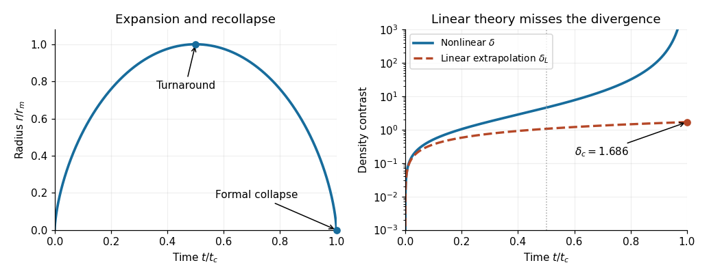

<h1 id="2/d/solution">Solution</h1>

↑ **Parent:** [D](../d.md)

In the growing-mode [spherical-collapse model](../../../../spherical-collapse-model.md), use $\theta-\sin\theta=\theta^3/6-\theta^5/120+\cdots$ and $1-\cos\theta=\theta^2/2-\theta^4/24+\cdots$. Their ratio in [c](../c.md) gives $\delta=3\theta^2/20+O(\theta^4)$. Meanwhile $t\propto\theta-\sin\theta$, and the linear growing [density contrast](../../../../density-contrast.md) scales as $t^{2/3}$. Matching at small $\theta$ therefore fixes

$$
\boxed{\delta_L=\frac35\left[\frac34(\theta-\sin\theta)\right]^{2/3}.}
$$

This is a linearly extrapolated growing-mode amplitude at any epoch, including epochs where the actual [density contrast](../../../../density-contrast.md) is nonlinear. It carries the initial-condition qualification in [c](../c.md).

Numerical comparison is

$$
\begin{array}{c|rrr}
\theta&\delta&\delta_L&1-\delta_L/\delta\\\hline
1/4&0.00942684&0.00935549&0.00757\\
\pi/2&0.466138&0.340810&0.2689\\
2\pi/3&1.01186&0.568083&0.4386\\
\pi&4.55165&1.06241&0.7666
\end{array}
$$

The last column measures the fractional underestimate of the actual [density contrast](../../../../density-contrast.md). Linear theory is accurate at $\delta\ll1$, but substantially underpredicts it by the time $\delta$ approaches unity. At $\theta=\pi$, the shell reaches [spherical-collapse turnaround](../../../../turnaround-of-spherical-collapse.md); $1+\delta=9\pi^2/16\simeq5.55$.

At $\theta=2\pi$, $r=0$ and the ideal pressureless [density](../../../../density.md) diverges at finite time $t_c=2\pi B$. Yet the extrapolated linear value remains finite:

$$
\boxed{\delta_c=\frac35\left(\frac{3\pi}{2}\right)^{2/3}=1.68647.}
$$

This is the [linear spherical-collapse threshold](../../../../linear-spherical-collapse-threshold.md), not the true [density contrast](../../../../density-contrast.md) at collapse. Actual nonspherical collisionless systems undergo [shell crossing](../../../../shell-crossing.md) and [virialization](../../../../virialization.md) rather than becoming uniform point singularities. The ideal [virial theorem](../../../../virial-theorem.md) and [conservation of energy](../../../../conservation-of-energy.md) estimate a final radius $r_m/2$ if the structural form is preserved.

**[Figure 1](#2/d/image-parametric-spherical-collapse-and-the-failure-of-the-extrapolated-linear-density-contrast). Parametric spherical collapse and the failure of the extrapolated linear density contrast**.

## ↑ Ancestors (12)

1. [D](../d.md)
2. [2](../../2.md)
3. [2021](../../../2021-split.md)
4. [Past exam of the astrophysics course of the University of Oxford](../../../split.md)
5. [Astrophysics course of the University of Oxford](../../../../astrophysics-course-of-the-university-of-oxford.md)
6. [Year 4 of the physics course of the University of Oxford](../../../../year-4-of-the-physics-course-of-the-university-of-oxford.md)
7. [Physics course of the University of Oxford](../../../../physics-course-of-the-university-of-oxford.md)
8. [Undergraduate course of the University of Oxford](../../../../undergraduate-course-of-the-university-of-oxford.md)
9. [Course of the University of Oxford](../../../../course-of-the-university-of-oxford.md)
10. [University of Oxford](../../../../university-of-oxford-split.md)
11. [List of universities](../../../../list-of-universities.md)
12. [Codex Wiki](../../../../split.md)
