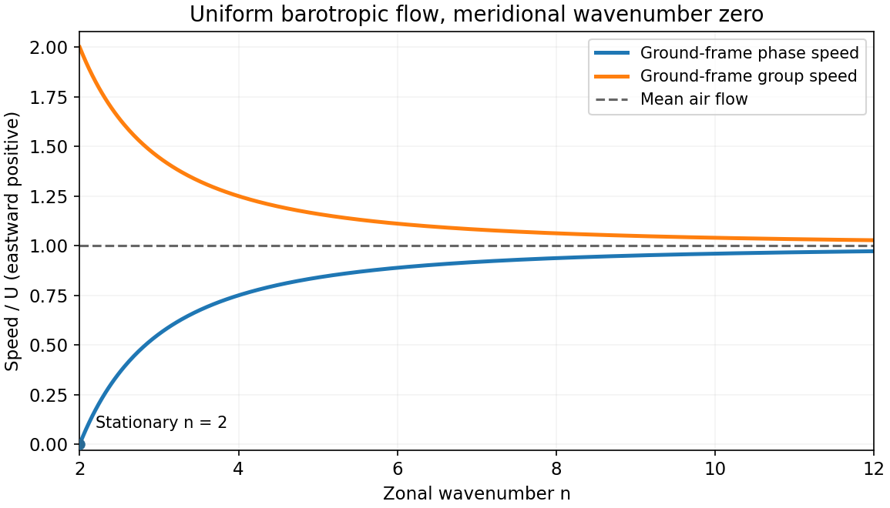

# Paper 1

↑ **Parent:** [2012](../2012.md)

[Original examination PDF, physical pages465–467](https://www.whatdotheyknow.com/request/natural_science_tripos_physics_e_2/response/2340776/attach/2/FOI%202023%20399%20Zahid%20materials.pdf?cookie_passthrough=1#page=465)

**Table of contents**

- [1](#1)
  - [a](#1/a)
    - [Solution](#1/a/solution)
  - [b](#1/b)
    - [Solution](#1/b/solution)
  - [c](#1/c)
    - [Solution](#1/c/solution)
  - [d](#1/d)
    - [Solution](#1/d/solution)
- [2](#2)
  - [a](#2/a)
    - [Solution](#2/a/solution)
  - [b](#2/b)
    - [Solution](#2/b/solution)
  - [c](#2/c)
    - [Solution](#2/c/solution)
  - [d](#2/d)
    - [Solution](#2/d/solution)
- [3](#3)
  - [a](#3/a)
    - [Solution](#3/a/solution)
  - [b](#3/b)
    - [Solution](#3/b/solution)
  - [c](#3/c)
    - [Solution](#3/c/solution)
  - [d](#3/d)
    - [Solution](#3/d/solution)

## 1

↑ **Parent:** [Paper 1](paper-1.md)

<h3 id="1/a">a</h3>

↑ **Parent:** [1](#1)

<h4 id="1/a/solution">Solution</h4>

↑ **Parent:** [A](#1/a)

A [blackbody](../../astrophysics.md#blackbody) absorbs all incident radiation and, in thermal equilibrium, emits the [Planck law](../../statistical-physics.md#planck-s-law) spectrum with integrated flux $\sigma T^4$. Earth reflects some incoming sunlight, while its surface and atmosphere absorb and emit selectively with wavelength. With solar irradiance $S_0$ and [Bond albedo](../../exoplanet.md#bond-albedo) A, the equilibrium [planetary effective radiating temperature](../../exoplanet.md#planetary-effective-radiating-temperature) is

$$
\boxed{\sigma T_{\rm eff}^4=\frac{(1-A)S_0}{4}.}
$$

Reflection lowers this temperature relative to the zero-albedo value. The [greenhouse effect](../../exoplanet.md#greenhouse-effect) makes the surface warmer than the effective emitting temperature: in a simple diagnostic $\mathrm{OLR}=\epsilon_{\rm eff}\sigma T_s^4$, $T_{\rm eff}=\epsilon_{\rm eff}^{1/4}T_s$. This effective emissivity summarizes atmospheric transfer, not a universal material constant. At fixed absorbed sunlight, greenhouse warming does not require a different equilibrium outgoing flux. [Absorbed/reflected sunlight and effective radiating versus surface temperature](../../physics-bibliography.md#climate-and-earth-s-energy-budget-by-nasa-earth-observatory)

The stated **$0.9\,\mathrm{W\,m^{-2}}$ is positive net energy uptake**, not necessarily the imposed [radiative forcing](../../geophysics.md#radiative-forcing) itself. A linear [climate forcing-response energy balance](../../geophysics.md#climate-forcing-response-energy-balance) is

$$
\boxed{N=F-\lambda\Delta T=C\frac{d\Delta T}{dt},\qquad \lambda>0.}
$$

Here F is the perturbing forcing, $\lambda\Delta T$ is the net stabilizing radiative response and C is an effective areal heat capacity. The residual heats the Earth system, mainly through ocean heat uptake, with additional storage and melting. Finite heat capacity and ocean exchange delay equilibration. The imbalance alone determines neither F, the warming rate without C, nor the eventual equilibrium warming $F/\lambda$. Feedbacks change the response coefficient. The given number is treated as the examination's premise, not a present-day observational estimate. [§7.4.1 andBox7.1, forcing–response budget; sign convention here uses positive damping lambda](../../chemistry.md#the-earth-s-energy-budget-climate-feedbacks-and-climate-sensitivity-by-piers-forster-and-others)

<h3 id="1/b">b</h3>

↑ **Parent:** [1](#1)

<h4 id="1/b/solution">Solution</h4>

↑ **Parent:** [B](#1/b)

The [entropy form of dry potential temperature](../../geophysics.md#entropy-form-of-dry-potential-temperature) follows from its parcel definition. The [potential temperature](../../geophysics.md#potential-temperature) is the temperature a parcel would reach if brought reversibly and adiabatically to a reference pressure $p_0$. For dry air of fixed composition, treated as an [ideal gas](../../ideal-gas.md) with constant [specific heat capacity](../../heat.md#specific-heat-capacity),

$$
\boxed{\theta=T\left(\frac{p_0}{p}\right)^\kappa,\qquad \kappa=R_d/c_p.}
$$

Per unit mass, the [first law of thermodynamics](../../first-law-of-thermodynamics.md), together with $\alpha=R_dT/p$ for [specific volume](../../thermodynamics.md#specific-volume), gives $\delta q=c_p\,dT-\alpha\,dp$. The reversible form of the [Second law of thermodynamics](../../second-law-of-thermodynamics.md) then gives

$$
 ds=\frac{\delta q_{\rm rev}}T=c_p\,d\ln T-R_d\,d\ln p
 =c_p\,d\ln\theta.
$$

Hence **dry reversible adiabatic motion has $D\theta/Dt=0$**. Pressure changes cause expansion cooling or compression warming, while the pressure factor in theta compensates exactly. Adiabaticity alone is insufficient if irreversible mixing or viscous dissipation produces [entropy](../../entropy.md). Condensation or freezing supplies latent heating, so ordinary dry potential temperature need not be conserved in a moist adiabatically moving parcel.

<h3 id="1/c">c</h3>

↑ **Parent:** [1](#1)

<h4 id="1/c/solution">Solution</h4>

↑ **Parent:** [C](#1/c)

The [radiative-convective structure of the terrestrial atmosphere](../../planetary-science.md#radiative-convective-structure-of-the-terrestrial-atmosphere) reflects several processes. In the [troposphere](../../planetary-science.md#troposphere), absorbed sunlight heats the surface, which transfers energy upward by sensible heat and evaporation. Convection and large-scale ascent cool air by expansion; condensation releases [latent heat](../../thermodynamic-potential.md#latent-heat) and reduces the cooling rate of saturated ascent. Radiative cooling of the atmosphere balances part of this upward transport. The dry adiabatic lapse rate is $g/c_p$; moist convection generally gives a smaller lapse rate. The observed mean profile is a radiative–convective balance, not one universal dry adiabat.

In the [stratosphere](../../planetary-science.md#stratosphere), ultraviolet absorption by ozone heats the layer and produces the mean temperature inversion, suppressing deep convection. Higher in the [mesosphere](../../planetary-science.md#mesosphere), weaker ozone heating and radiative cooling allow temperature to decrease again. In the [thermosphere](../../planetary-science.md#thermosphere), absorption of energetic solar radiation by the tenuous gas raises its kinetic temperature. Its low density means that a high kinetic temperature does not imply a large heat content.

Tropopause and other transition heights vary with latitude and season. Near-surface inversions and clouds further modify local profiles. [Jetstream, troposphere through thermosphere and their heating mechanisms](../../physics-bibliography.md#layers-of-the-atmosphere-by-national-oceanic-and-atmospheric-administration)

**[Figure 1](#1/c/image-atmospheric-temperature-profile). Atmospheric temperature profile**. [Source](paper-1-ap2012-temperature-profile.py).

<h3 id="1/d">d</h3>

↑ **Parent:** [1](#1)

<h4 id="1/d/solution">Solution</h4>

↑ **Parent:** [D](#1/d)

Clouds reflect shortwave sunlight, usually cooling the planet, and absorb and emit thermal infrared radiation, usually warming the surface relative to clear sky. Their net effect depends on altitude, temperature, optical depth, phase and the underlying surface: thick low clouds often have strong shortwave cooling, while cold high clouds can have a comparatively strong longwave warming effect. Surface and top-of-atmosphere budgets must be distinguished; absorbing radiation within a cloud can heat the atmospheric layer while shading the ground.

Condensation and freezing release [latent heat](../../thermodynamic-potential.md#latent-heat); evaporation and melting absorb it. These processes change buoyancy, stability and convective transport. Entrainment of dry air can evaporate droplets and cool the cloud edge, while precipitation removes condensate and water.

Microphysics controls the radiative properties. For liquid droplets with a fixed [liquid-water path](../../geophysics.md#liquid-water-path) W, the [cloud optical depth at fixed liquid-water path](../../geophysics.md#cloud-optical-depth-at-fixed-liquid-water-path) is approximately

$$
\boxed{\tau_{\rm cld}\simeq\frac{3W}{2\rho_w r_{\rm eff}}.}
$$

Thus more numerous smaller droplets at fixed W give a brighter, optically thicker cloud: the [Twomey effect](../../chemistry.md#twomey-effect). Ice habit, phase and particle-size distribution also alter scattering, absorption and precipitation. Cloud-water and lifetime adjustments need not preserve W, so a microphysical perturbation has no universal net radiative sign. [§7.3.3, aerosol–cloud interactions, liquid-water and cloud adjustments](../../chemistry.md#the-earth-s-energy-budget-climate-feedbacks-and-climate-sensitivity-by-piers-forster-and-others)

## 2

↑ **Parent:** [Paper 1](paper-1.md)

<h3 id="2/a">a</h3>

↑ **Parent:** [2](#2)

<h4 id="2/a/solution">Solution</h4>

↑ **Parent:** [A](#2/a)

A convex liquid surface has additional surface free energy. The resulting [Kelvin equation](../../thermodynamic-potential.md#kelvin-equation) for a pure spherical water droplet is

$$
\boxed{\frac{e_s(r)}{e_s(\infty)}=\exp\left(\frac{2\gamma M_w}{\rho_wRTr}\right)>1.}
$$

Here gamma is [surface tension](../../surface-tension.md) and $M_w$ is molar mass. Smaller droplets therefore need a higher environmental vapour pressure to avoid evaporating; forming pure-water embryos by homogeneous condensation has a large nucleation barrier.

An atmospheric droplet normally forms on a [cloud condensation nucleus](../../chemistry.md#cloud-condensation-nucleus). Dissolved salt reduces [water activity](../../chemical-potential.md#water-activity) and hence equilibrium vapour pressure, opposing the curvature effect. [Köhler theory](../../chemistry.md#kohler-theory) combines them:

$$
\frac{e_{\rm eq}}{e_s(\infty)}=a_w e^{A/r},\qquad
\ln\frac{e_{\rm eq}}{e_s(\infty)}\simeq\frac Ar-\frac B{r^3},\quad A=\frac{2\gamma M_w}{\rho_wRT},\quad B>0.
$$

Using the radius form, with [radius and diameter conventions in Köhler activation](../../chemistry.md#radius-and-diameter-conventions-in-kohler-activation) kept distinct, the [Köhler activation radius](../../chemistry.md#kohler-activation-radius) is $r_c=\sqrt{3B/A}$, with $\ln S_c=2A/(3r_c)$. Supersaturation above this maximum activates a wet aerosol into a growing cloud droplet. Solubility, particle size and wettability determine the threshold; not every particle activates. Cooling by ascent commonly supplies the necessary modest supersaturation. [2007, curvature/solute competition and critical activation; radius convention explicitly used here](../../chemistry.md#a-single-parameter-representation-of-hygroscopic-growth-and-cloud-condensation-nucleus-activity-by-m-d-petters-and-s-m-kreidenweis)

**[Figure 2](#2/a/image-kohler-activation). Köhler activation**. [Source](paper-1-ap2012-kohler-activation.py).

<h3 id="2/b">b</h3>

↑ **Parent:** [2](#2)

<h4 id="2/b/solution">Solution</h4>

↑ **Parent:** [B](#2/b)

**Warm-rain growth:** condensation first creates cloud droplets, but its approximate $r^2\propto t$ growth narrows relative size differences and becomes inefficient at making large raindrops quickly. A broadened size spectrum lets larger, faster-falling drops collect smaller ones by [collision-coalescence](../../geophysics.md#collision-coalescence). The [cloud-droplet collision kernel](../../geophysics.md#cloud-droplet-collision-kernel) combines collection efficiency and differential settling. Turbulence, sufficient cloud depth and liquid-water content determine whether collector drops grow rapidly enough. Collisions must actually lead to merging rather than bypass, bounce or breakup.

**Ice-phase growth:** in a mixed-phase cloud, equilibrium vapour pressure over ice is lower than over supercooled liquid. Ice can grow by deposition while droplets evaporate: the [Wegener-Bergeron-Findeisen process](../../geophysics.md#wegener-bergeron-findeisen-process). Ice particles then grow further by [riming](../../geophysics.md#riming) of supercooled droplets and by [ice-crystal aggregation](../../geophysics.md#ice-crystal-aggregation). They may fall as snow or melt into rain. Deposition, riming and aggregation are distinct processes; depositing vapour alone need not complete precipitation growth.

[Precipitation efficiency](../../geophysics.md#precipitation-efficiency) depends on the supply of suitable collector drops or ice, residence time, updraft speed, supersaturation and collection/sticking efficiencies. Competition among too many small particles can inhibit growth, and evaporation or sublimation below the cloud can prevent condensate from reaching the surface. Both pathways require growth and fall-out to compete successfully with these losses. [Glossary: accretion, aggregation, coalescence; snow as single or aggregated ice crystals](../../physics-bibliography.md#international-cloud-atlas-by-world-meteorological-organization)

<h3 id="2/c">c</h3>

↑ **Parent:** [2](#2)

<h4 id="2/c/solution">Solution</h4>

↑ **Parent:** [C](#2/c)

A droplet can remain liquid below its equilibrium melting temperature through [supercooling](../../critical-phenomenon.md#supercooling): a microscopic ice embryo must first pay an interfacial free-energy cost. The [nucleation barrier](../../thermodynamic-potential.md#nucleation-barrier) can therefore delay freezing even when bulk ice is thermodynamically favoured. Solutes, available surfaces, temperature, droplet volume and exposure time affect the probability; zero degrees Celsius is not an automatic freezing threshold for every atmospheric droplet.

At least four physical routes are relevant:

- [Homogeneous ice nucleation](../../critical-phenomenon.md#homogeneous-ice-nucleation): an ice embryo forms within deeply supercooled liquid without a foreign surface.
- [Immersion freezing](../../critical-phenomenon.md#immersion-freezing): a suitable particle already inside a liquid droplet catalyses an ice embryo.
- [Contact freezing](../../critical-phenomenon.md#contact-freezing): a suitable particle contacting the droplet surface triggers heterogeneous freezing.
- [Deposition nucleation](../../critical-phenomenon.md#deposition-nucleation): ice appears from vapour on a suitable solid surface under ice-supersaturated conditions; pore condensation or a thin liquid film can participate, so the observed mode need not imply a single direct molecular pathway.

Mineral particles provide nonbiological examples of heterogeneous nuclei. A particle's presence alone does not guarantee activity at a given temperature. The [cloud ice nucleation versus ice growth](../../geophysics.md#cloud-ice-nucleation-versus-ice-growth) distinction matters: the processes listed concern the formation of new ice; subsequent depositional growth, riming and aggregation are separate from initiating that first crystal.

<h3 id="2/d">d</h3>

↑ **Parent:** [2](#2)

<h4 id="2/d/solution">Solution</h4>

↑ **Parent:** [D](#2/d)

There are several distinct radiative pathways:

- **Direct scattering:** predominantly nonabsorbing particles, such as many sulfate or sea-salt aerosols, redirect sunlight and commonly increase reflected shortwave radiation over a dark surface. Hygroscopic growth increases their wet size and can increase scattering.
- **Direct absorption:** absorbing particles, such as soot or some mineral dust, heat the layer containing them while reducing sunlight at the surface. The top-of-atmosphere sign depends on particle optics, altitude, clouds and surface albedo; atmospheric heating is not the same as surface warming.
- **Cloud activation:** a soluble, hygroscopic particle can act as a [cloud condensation nucleus](../../chemistry.md#cloud-condensation-nucleus). At fixed liquid-water path, more activated droplets lower the effective radius and increase cloud albedo through the [Twomey effect](../../chemistry.md#twomey-effect). Precipitation and water-content adjustments can modify that response. Insoluble particles may still activate when sufficiently wettable or coated, and some serve as ice nuclei, changing cloud phase.
- **Cloud adjustment to aerosol heating:** absorbing particles alter temperature, relative humidity and stability. This [semi-direct aerosol effect](../../chemistry.md#semi-direct-aerosol-effect) can evaporate cloud or, in other configurations, help sustain it; its sign is not universal.

Solubility and optical absorption are independent properties: insoluble does not mean absorbing, and soluble does not mean nonabsorbing. Coarse particles can also affect terrestrial infrared radiation, while dark-particle deposition on snow can lower surface albedo. These effects should not be folded into a single universal aerosol cooling rule. [§7.3.3, aerosol–radiation and aerosol–cloud interactions and adjustments](../../chemistry.md#the-earth-s-energy-budget-climate-feedbacks-and-climate-sensitivity-by-piers-forster-and-others)

## 3

↑ **Parent:** [Paper 1](paper-1.md)

<h3 id="3/a">a</h3>

↑ **Parent:** [3](#3)

<h4 id="3/a/solution">Solution</h4>

↑ **Parent:** [A](#3/a)

For a hydrostatic, stably stratified atmosphere, define isentropic mass density $\sigma_\theta=-(1/g)\partial p/\partial\theta>0$ and relative vertical vorticity evaluated on an isentrope, $\zeta_\theta$. Then [isentropic potential vorticity](../../geophysical-fluid-dynamics.md#isentropic-potential-vorticity) is

$$
\boxed{q_\theta=\frac{f+\zeta_\theta}{\sigma_\theta}=-g(f+\zeta_\theta)\frac{\partial\theta}{\partial p},\qquad f=2\Omega\sin\phi.}
$$

It is the hydrostatic isentropic form of dry [Ertel potential vorticity](../../geophysical-fluid-dynamics.md#ertel-potential-vorticity), $q_E=\boldsymbol\omega_a\cdot\nabla\theta/\rho$. For inviscid, adiabatic motion with fixed composition and conservative body forces, $Dq_E/Dt=0$, so parcels carry their PV along isentropes. Stable stratification makes the coordinate transformation well defined.

Heating and friction spoil simple material conservation. More explicitly, with $\dot\theta=D\theta/Dt$ and nonconservative force per mass $\mathbf F$,

$$
\frac{Dq_E}{Dt}=\frac{\boldsymbol\omega_a\cdot\nabla\dot\theta+(\nabla\times\mathbf F)\cdot\nabla\theta}{\rho}.
$$

Thus the distribution is especially useful away from strongly diabatic clouds and frictional boundary layers. Explaining a velocity field by [potential-vorticity inversion](../../geophysical-fluid-dynamics.md#potential-vorticity-inversion) additionally requires an appropriate balanced-flow approximation and boundary information; a PV value alone does not specify the entire flow. [PartII§12, Ertel conservation, isentropic form and qualified invertibility](../../physics-bibliography.md#fundamentals-of-atmosphere-ocean-dynamics-by-michael-edgeworth-mcintyre)

<h3 id="3/b">b</h3>

↑ **Parent:** [3](#3)

<h4 id="3/b/solution">Solution</h4>

↑ **Parent:** [B](#3/b)

In an idealized crossing flow, take a layer between a mountain and an approximately fixed upper boundary. If its upstream depth is H and the terrain height is $h_m$, climbing reduces its depth to $H-h_m$. Conservation of [shallow-water potential vorticity](../../geophysical-fluid-dynamics.md#shallow-water-potential-vorticity) gives

$$
\boxed{\frac{f+\zeta}{H-h_m}=\frac{f_0+\zeta_0}{H},\qquad
\zeta=\frac{H-h_m}{H}(f_0+\zeta_0)-f.}
$$

At nearly fixed northern latitude, with negligible upstream relative vorticity, $\zeta\simeq-fh_m/H<0$: compression produces an **anticyclonic tendency**. For an eastward flow this corresponds to a rightward/equatorward turning tendency. On the descending side, re-expansion restores cyclonic vorticity relative to that compressed state. Meridional displacement also changes f and participates in the balance.

The corresponding [mountain-crossing isentropic PV balance](../../geophysical-fluid-dynamics.md#mountain-crossing-isentropic-pv-balance) uses $\sigma_\theta$ rather than geometric depth: reduced isentropic mass thickness requires reduced absolute vorticity, and increased thickness the reverse. The geometric cartoon assumes an upper boundary that does not simply rise with the terrain. A real mountain can displace isentropes, block low-level flow or generate a downstream Rossby-wave pattern; friction and latent heating can change PV. Thus the local compression sign is a model tendency, not a universal map of every orographic circulation.

**[Figure 3](#3/b/image-mountain-pv-compression). Mountain PV compression**. [Source](paper-1-ap2012-mountain-pv.py).

<h3 id="3/c">c</h3>

↑ **Parent:** [3](#3)

<h4 id="3/c/solution">Solution</h4>

↑ **Parent:** [C](#3/c)

In the usual lower-tropospheric [seasonal land-heating vorticity tendency](../../geophysical-fluid-dynamics.md#seasonal-land-heating-vorticity-tendency), summer land is warmer than the adjacent ocean: the heated layer deepens, favouring stretching and a cyclonic thermal-low tendency in the Northern Hemisphere. In winter, colder land favours a shallow stable layer and an anticyclonic thermal-high tendency. In a column model conserving $q=(f+\zeta)/h$ at fixed f,

$$
\boxed{\delta\zeta\simeq\frac{f+\zeta}{h}\,\delta h,}
$$

so deepening and shallowing give the stated signs.

This is a conditional layer picture, not an assertion that heating conserves dry isentropic PV. In the isentropic expression, replace h by $\sigma_\theta$; an isolated temperature contrast does not specify that mass thickness. Diabatic heating, changes in stratification and increased surface drag over land alter the PV budget. The [coastal vorticity tendency from variable surface drag](../../geophysical-fluid-dynamics.md#coastal-vorticity-tendency-from-variable-surface-drag) illustrates another complication: the curl of a horizontal drag $-r\mathbf u$ is $-r\zeta-(\nabla r\times\mathbf u)_z$, whose coastal contribution depends on wind and coastline orientation. Vorticity can also differ with height. Without those profiles one cannot assign a universal sign to the full circulation solely from the season; the summer-low/winter-high tendency is the standard idealization.

<h3 id="3/d">d</h3>

↑ **Parent:** [3](#3)

<h4 id="3/d/solution">Solution</h4>

↑ **Parent:** [D](#3/d)

Use a locally uniform eastward barotropic current on a beta plane. For horizontal wavevector $(k,l)$, the [Barotropic Rossby wave](../../geophysical-fluid-dynamics.md#barotropic-rossby-wave) dispersion relation is

$$
\omega=Uk-\frac{\beta k}{k^2+l^2},\qquad
\beta=\frac{2\Omega\cos\phi}{a},\qquad k_n=\frac{n}{a\cos\phi}.
$$

The [stationary zonal-wavenumber-two Rossby-wave condition](../../geophysical-fluid-dynamics.md#stationary-zonal-wavenumber-two-rossby-wave-condition) is therefore $U=\beta/(k_2^2+l^2)>0$. For the usual assumption $l=0$,

$$
\boxed{U=\frac{\beta}{k_2^2}=\frac{\Omega a\cos^3\phi}{2}\simeq82.5\,\mathrm{m\,s^{-1}},\quad\text{eastward}.}
$$

Here $a=6.4\times10^6\,\mathrm m$ is supplied; $\Omega=7.292115\times10^{-5}\,\mathrm{s^{-1}}$ is an explicitly identified external nominal rotation constant, not an invented historical handbook value. [Table1.2,printedp18/physicalPDFp19, nominal angular velocity](../../physics-bibliography.md#iers-conventions-2010-by-international-earth-rotation-and-reference-systems-service) The number assumes no meridional structure; a nonzero l or finite deformation radius changes the required speed. Zonal wavenumber alone does not fix those additional parameters.

For a shorter zonal disturbance with integer $n>2$ and $l=0$, the [shorter Rossby-wave propagation inside a stationary long wave](../../geophysical-fluid-dynamics.md#shorter-rossby-wave-propagation-inside-a-stationary-long-wave) has

$$
\boxed{c_{\rm phase}=U\left(1-\frac4{n^2}\right)>0,\qquad
c_{{\rm group},x}=U\left(1+\frac4{n^2}\right)>U.}
$$

Its intrinsic phase motion is westward relative to the air, but both the weather pattern and its packet move eastward relative to the ground. Packet energy propagates downstream faster than the phase, giving [Rossby-wave downstream development](../../geophysical-fluid-dynamics.md#rossby-wave-downstream-development): downstream systems can amplify as upstream systems decay. Disturbances also superpose and interfere. In the strictly linear uniform-flow model they do not directly scatter from one another; finite-amplitude eddies can exchange momentum and heat and modify the background. Their detailed nonlinear interaction requires amplitudes and geometry, not just a wavenumber. [Rossby-wave phase/group propagation and wave–mean-flow interaction](../../physics-bibliography.md#fundamentals-of-atmosphere-ocean-dynamics-by-michael-edgeworth-mcintyre)

**[Figure 4](#3/d/image-rossby-phase-and-packet-speeds). Rossby phase and packet speeds**. [Source](paper-1-ap2012-rossby-speeds.py).

## ↑ Ancestors (11)

1. [2012](../2012.md)
2. [Past exam of the atmospheric physics course of the University of Cambridge](../../past-exam-of-the-atmospheric-physics-course-of-the-university-of-cambridge.md)
3. [Atmospheric Physics course of the University of Cambridge](../../university-of-cambridge.md#atmospheric-physics-course-of-the-university-of-cambridge)
4. [Physics course of the year 4 of the natural sciences course of the University of Cambridge](../../university-of-cambridge.md#physics-course-of-the-year-4-of-the-natural-sciences-course-of-the-university-of-cambridge)
5. [Year 4 of the natural sciences course of the University of Cambridge](../../university-of-cambridge.md#year-4-of-the-natural-sciences-course-of-the-university-of-cambridge)
6. [Year of the natural sciences course of the University of Cambridge](../../university-of-cambridge.md#year-of-the-natural-sciences-course-of-the-university-of-cambridge)
7. [Natural sciences course of the University of Cambridge](../../university-of-cambridge.md#natural-sciences-course-of-the-university-of-cambridge)
8. [Course of the University of Cambridge](../../university-of-cambridge.md#course-of-the-university-of-cambridge)
9. [University of Cambridge](../../university-of-cambridge.md)
10. [List of universities](../../README.md#list-of-universities)
11. [Codex Wiki](../../README.md)
