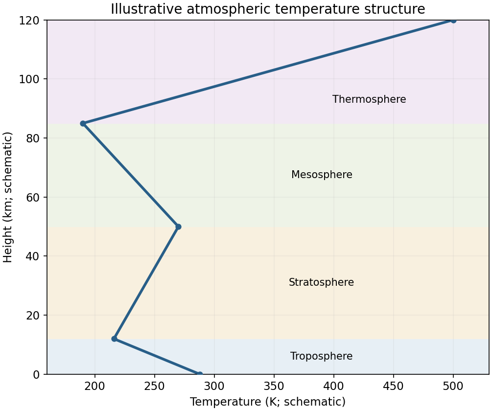

<h1 id="1/c/solution">Solution</h1>

↑ **Parent:** [C](../c.md)

The [radiative-convective structure of the terrestrial atmosphere](../../../../../radiative-convective-structure-of-the-terrestrial-atmosphere.md) reflects several processes. In the [troposphere](../../../../../troposphere.md), absorbed sunlight heats the surface, which transfers energy upward by sensible heat and evaporation. Convection and large-scale ascent cool air by expansion; condensation releases [latent heat](../../../../../latent-heat.md) and reduces the cooling rate of saturated ascent. Radiative cooling of the atmosphere balances part of this upward transport. The dry adiabatic lapse rate is $g/c_p$; moist convection generally gives a smaller lapse rate. The observed mean profile is a radiative–convective balance, not one universal dry adiabat.

In the [stratosphere](../../../../../stratosphere.md), ultraviolet absorption by ozone heats the layer and produces the mean temperature inversion, suppressing deep convection. Higher in the [mesosphere](../../../../../mesosphere.md), weaker ozone heating and radiative cooling allow temperature to decrease again. In the [thermosphere](../../../../../thermosphere.md), absorption of energetic solar radiation by the tenuous gas raises its kinetic temperature. Its low density means that a high kinetic temperature does not imply a large heat content.

Tropopause and other transition heights vary with latitude and season. Near-surface inversions and clouds further modify local profiles. [Jetstream, troposphere through thermosphere and their heating mechanisms](../../../../../layers-of-the-atmosphere-by-national-oceanic-and-atmospheric-administration.md)

**[Figure 1](#1/c/image-atmospheric-temperature-profile). Atmospheric temperature profile**. [Source](paper-1-ap2012-temperature-profile.py).

## ↑ Ancestors (14)

1. [C](../c.md)
2. [1](../../1.md)
3. [Paper 1](../../../paper-1-split.md)
4. [2012](../../../split.md)
5. [Past exam of the atmospheric physics course of the University of Cambridge](../../../../split.md)
6. [Atmospheric Physics course of the University of Cambridge](../../../../../atmospheric-physics-course-of-the-university-of-cambridge.md)
7. [Physics course of the year 4 of the natural sciences course of the University of Cambridge](../../../../../physics-course-of-the-year-4-of-the-natural-sciences-course-of-the-university-of-cambridge.md)
8. [Year 4 of the natural sciences course of the University of Cambridge](../../../../../year-4-of-the-natural-sciences-course-of-the-university-of-cambridge.md)
9. [Year of the natural sciences course of the University of Cambridge](../../../../../year-of-the-natural-sciences-course-of-the-university-of-cambridge.md)
10. [Natural sciences course of the University of Cambridge](../../../../../natural-sciences-course-of-the-university-of-cambridge.md)
11. [Course of the University of Cambridge](../../../../../course-of-the-university-of-cambridge.md)
12. [University of Cambridge](../../../../../university-of-cambridge-split.md)
13. [List of universities](../../../../../list-of-universities.md)
14. [Codex Wiki](../../../../../split.md)
