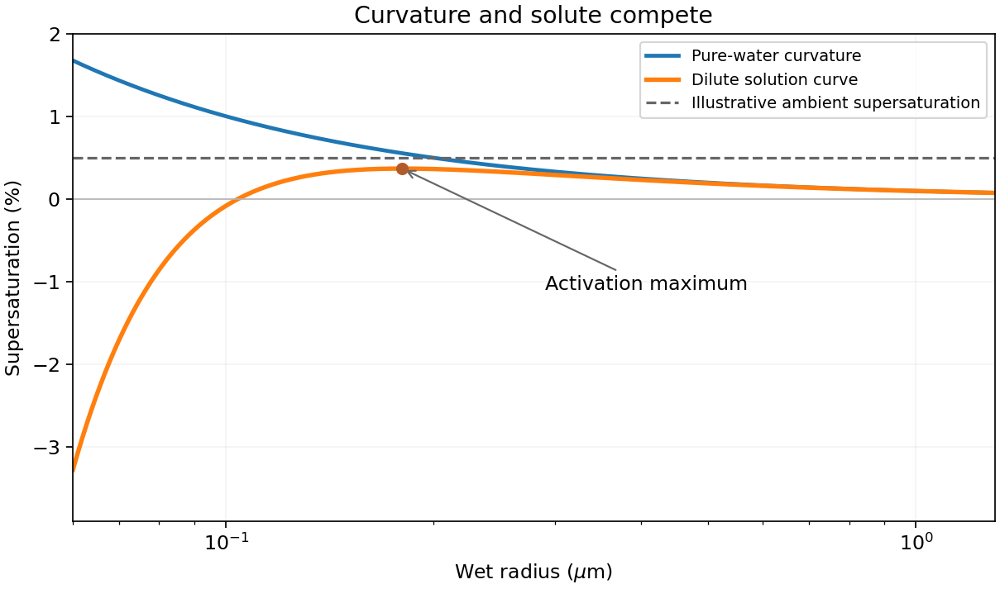

<h1 id="2/a/solution">Solution</h1>

↑ **Parent:** [A](../a.md)

A convex liquid surface has additional surface free energy. The resulting [Kelvin equation](../../../../../kelvin-equation.md) for a pure spherical water droplet is

$$
\boxed{\frac{e_s(r)}{e_s(\infty)}=\exp\left(\frac{2\gamma M_w}{\rho_wRTr}\right)>1.}
$$

Here gamma is [surface tension](../../../../../surface-tension-split.md) and $M_w$ is molar mass. Smaller droplets therefore need a higher environmental vapour pressure to avoid evaporating; forming pure-water embryos by homogeneous condensation has a large nucleation barrier.

An atmospheric droplet normally forms on a [cloud condensation nucleus](../../../../../cloud-condensation-nucleus.md). Dissolved salt reduces [water activity](../../../../../water-activity.md) and hence equilibrium vapour pressure, opposing the curvature effect. [Köhler theory](../../../../../kohler-theory.md) combines them:

$$
\frac{e_{\rm eq}}{e_s(\infty)}=a_w e^{A/r},\qquad
\ln\frac{e_{\rm eq}}{e_s(\infty)}\simeq\frac Ar-\frac B{r^3},\quad A=\frac{2\gamma M_w}{\rho_wRT},\quad B>0.
$$

Using the radius form, with [radius and diameter conventions in Köhler activation](../../../../../radius-and-diameter-conventions-in-kohler-activation.md) kept distinct, the [Köhler activation radius](../../../../../kohler-activation-radius.md) is $r_c=\sqrt{3B/A}$, with $\ln S_c=2A/(3r_c)$. Supersaturation above this maximum activates a wet aerosol into a growing cloud droplet. Solubility, particle size and wettability determine the threshold; not every particle activates. Cooling by ascent commonly supplies the necessary modest supersaturation. [2007, curvature/solute competition and critical activation; radius convention explicitly used here](../../../../../a-single-parameter-representation-of-hygroscopic-growth-and-cloud-condensation-nucleus-activity-by-m-d-petters-and-s-m-kreidenweis.md)

**[Figure 2](#2/a/image-kohler-activation). Köhler activation**. [Source](paper-1-ap2012-kohler-activation.py).

## ↑ Ancestors (14)

1. [A](../a.md)
2. [2](../../2.md)
3. [Paper 1](../../../paper-1-split.md)
4. [2012](../../../split.md)
5. [Past exam of the atmospheric physics course of the University of Cambridge](../../../../split.md)
6. [Atmospheric Physics course of the University of Cambridge](../../../../../atmospheric-physics-course-of-the-university-of-cambridge.md)
7. [Physics course of the year 4 of the natural sciences course of the University of Cambridge](../../../../../physics-course-of-the-year-4-of-the-natural-sciences-course-of-the-university-of-cambridge.md)
8. [Year 4 of the natural sciences course of the University of Cambridge](../../../../../year-4-of-the-natural-sciences-course-of-the-university-of-cambridge.md)
9. [Year of the natural sciences course of the University of Cambridge](../../../../../year-of-the-natural-sciences-course-of-the-university-of-cambridge.md)
10. [Natural sciences course of the University of Cambridge](../../../../../natural-sciences-course-of-the-university-of-cambridge.md)
11. [Course of the University of Cambridge](../../../../../course-of-the-university-of-cambridge.md)
12. [University of Cambridge](../../../../../university-of-cambridge-split.md)
13. [List of universities](../../../../../list-of-universities.md)
14. [Codex Wiki](../../../../../split.md)
