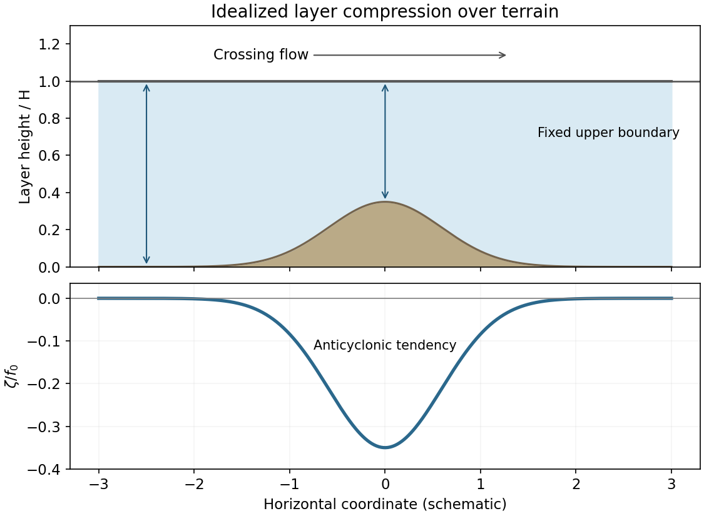

<h1 id="3/b/solution">Solution</h1>

↑ **Parent:** [B](../b.md)

In an idealized crossing flow, take a layer between a mountain and an approximately fixed upper boundary. If its upstream depth is H and the terrain height is $h_m$, climbing reduces its depth to $H-h_m$. Conservation of [shallow-water potential vorticity](../../../../../shallow-water-potential-vorticity.md) gives

$$
\boxed{\frac{f+\zeta}{H-h_m}=\frac{f_0+\zeta_0}{H},\qquad
\zeta=\frac{H-h_m}{H}(f_0+\zeta_0)-f.}
$$

At nearly fixed northern latitude, with negligible upstream relative vorticity, $\zeta\simeq-fh_m/H<0$: compression produces an **anticyclonic tendency**. For an eastward flow this corresponds to a rightward/equatorward turning tendency. On the descending side, re-expansion restores cyclonic vorticity relative to that compressed state. Meridional displacement also changes f and participates in the balance.

The corresponding [mountain-crossing isentropic PV balance](../../../../../mountain-crossing-isentropic-pv-balance.md) uses $\sigma_\theta$ rather than geometric depth: reduced isentropic mass thickness requires reduced absolute vorticity, and increased thickness the reverse. The geometric cartoon assumes an upper boundary that does not simply rise with the terrain. A real mountain can displace isentropes, block low-level flow or generate a downstream Rossby-wave pattern; friction and latent heating can change PV. Thus the local compression sign is a model tendency, not a universal map of every orographic circulation.

**[Figure 3](#3/b/image-mountain-pv-compression). Mountain PV compression**. [Source](paper-1-ap2012-mountain-pv.py).

## ↑ Ancestors (14)

1. [B](../b.md)
2. [3](../../3.md)
3. [Paper 1](../../../paper-1-split.md)
4. [2012](../../../split.md)
5. [Past exam of the atmospheric physics course of the University of Cambridge](../../../../split.md)
6. [Atmospheric Physics course of the University of Cambridge](../../../../../atmospheric-physics-course-of-the-university-of-cambridge.md)
7. [Physics course of the year 4 of the natural sciences course of the University of Cambridge](../../../../../physics-course-of-the-year-4-of-the-natural-sciences-course-of-the-university-of-cambridge.md)
8. [Year 4 of the natural sciences course of the University of Cambridge](../../../../../year-4-of-the-natural-sciences-course-of-the-university-of-cambridge.md)
9. [Year of the natural sciences course of the University of Cambridge](../../../../../year-of-the-natural-sciences-course-of-the-university-of-cambridge.md)
10. [Natural sciences course of the University of Cambridge](../../../../../natural-sciences-course-of-the-university-of-cambridge.md)
11. [Course of the University of Cambridge](../../../../../course-of-the-university-of-cambridge.md)
12. [University of Cambridge](../../../../../university-of-cambridge-split.md)
13. [List of universities](../../../../../list-of-universities.md)
14. [Codex Wiki](../../../../../split.md)
