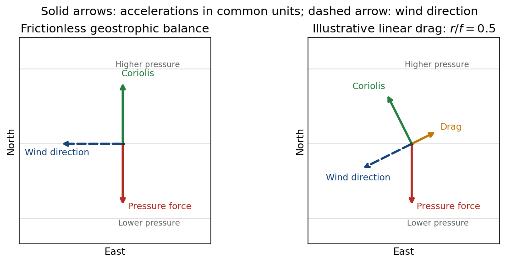

<h1 id="1/solution">Solution</h1>

↑ **Parent:** [1](../1.md)

In the rotating terrestrial frame, horizontal [pressure gradient force](../../../../pressure-gradient-force.md) and [Coriolis force](../../../../coriolis-force.md) balance in [geostrophic balance](../../../../geostrophic-balance.md). Gravity establishes the approximately vertical [hydrostatic equilibrium](../../../../hydrostatic-equilibrium.md); it is not an additional horizontal force in this balance. With eastward $x$, northward $y$, upward unit vector $\hat{\mathbf z}$ and [Coriolis parameter](../../../../coriolis-parameter.md) $f=2\Omega\sin\phi$,

$$
0=-\frac{\nabla_hp}{\rho}-f\hat{\mathbf z}\times\mathbf u_g,\qquad
\boxed{\mathbf u_g=\frac{\hat{\mathbf z}\times\nabla_hp}{\rho f},\quad
u_g=-\frac{p_y}{\rho f},\quad v_g=\frac{p_x}{\rho f}.}
$$

The [geostrophic wind](../../../../geostrophic-wind.md) runs along [atmospheric isobars](../../../../atmospheric-isobar.md), with lower pressure on its left in the Northern Hemisphere.

Interpreting the stated south-to-north gradient as $p_y>0$, $p_y=200\,\mathrm{Pa}/(2.00\times10^5\,\mathrm m)=10^{-3}\,\mathrm{Pa\,m^{-1}}$, while $p_x=0$. Using the external nominal [Earth's rotation](../../../../earth-s-rotation.md) rate $\Omega=7.292115\times10^{-5}\,\mathrm{s^{-1}}$ gives the [meridional-pressure-gradient geostrophic wind](../../../../meridional-pressure-gradient-geostrophic-wind.md)

$$
\boxed{u_g(30^\circ\mathrm N)=-11.4\,\mathrm{m\,s^{-1}},\qquad
u_g(60^\circ\mathrm N)=-6.60\,\mathrm{m\,s^{-1}},\qquad v_g=0.}
$$

Both zonal velocities are westward; their signs reverse if the supplied gradient is interpreted as a northward decrease. [Table1.2, physical PDF p.19: nominal mean angular velocity](../../../../iers-conventions-2010-by-international-earth-rotation-and-reference-systems-service.md)

The [validity criteria for geostrophic balance](../../../../validity-criteria-for-geostrophic-balance.md) require horizontal acceleration and friction to be small compared with the balancing forces: [Rossby number](../../../../rossby-number.md) $U/(|f|L)\ll1$ and slow evolution compared with $1/|f|$. The approximation fails near the equator, on sufficiently small or rapidly changing scales, in strongly curved flow needing appreciable centripetal acceleration, and in the frictional surface layer. Neglecting friction near the ground is the stated idealization.

For an illustrative [geostrophic wind with linear drag](../../../../geostrophic-wind-with-linear-drag.md), use acceleration $-r\mathbf u$ with $r>0$. The steady horizontal momentum equation gives

$$
\begin{pmatrix}r&-f\\ f&r\end{pmatrix}\binom uv=-\frac1\rho\binom{p_x}{p_y},\qquad
\boxed{u=-\frac{fp_y}{\rho(f^2+r^2)},\quad v=-\frac{rp_y}{\rho(f^2+r^2)}\quad(p_x=0).}
$$

Drag reduces the wind and hence its Coriolis acceleration; the wind crosses isobars toward lower pressure. Here it points southwest. The pressure-gradient acceleration points south, Coriolis northwest and drag northeast; the three forces sum to zero. The cross-isobar angle satisfies $\tan\alpha=r/f$ for $f>0$. A turbulent boundary layer has a vertically varying stress rather than necessarily this constant linear drag.

**[Figure 1](#1/image-for-northward-increasing-pressure-frictionless-westward-flow-becomes-a-slower-southwestward-flow-under-illustrative-linear-drag). For northward-increasing pressure, frictionless westward flow becomes a slower southwestward flow under illustrative linear drag**. [Source](paper-1-ap2013-geostrophic-force-vectors.py).

## ↑ Ancestors (13)

1. [1](../1.md)
2. [Paper 1](../../paper-1-split.md)
3. [2013](../../split.md)
4. [Past exam of the atmospheric physics course of the University of Cambridge](../../../split.md)
5. [Atmospheric Physics course of the University of Cambridge](../../../../atmospheric-physics-course-of-the-university-of-cambridge.md)
6. [Physics course of the year 4 of the natural sciences course of the University of Cambridge](../../../../physics-course-of-the-year-4-of-the-natural-sciences-course-of-the-university-of-cambridge.md)
7. [Year 4 of the natural sciences course of the University of Cambridge](../../../../year-4-of-the-natural-sciences-course-of-the-university-of-cambridge.md)
8. [Year of the natural sciences course of the University of Cambridge](../../../../year-of-the-natural-sciences-course-of-the-university-of-cambridge.md)
9. [Natural sciences course of the University of Cambridge](../../../../natural-sciences-course-of-the-university-of-cambridge.md)
10. [Course of the University of Cambridge](../../../../course-of-the-university-of-cambridge.md)
11. [University of Cambridge](../../../../university-of-cambridge-split.md)
12. [List of universities](../../../../list-of-universities.md)
13. [Codex Wiki](../../../../split.md)
