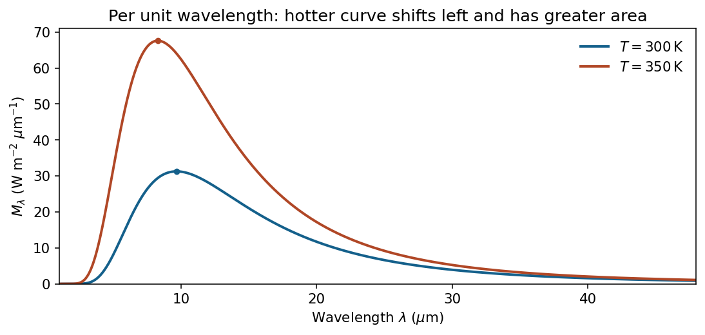
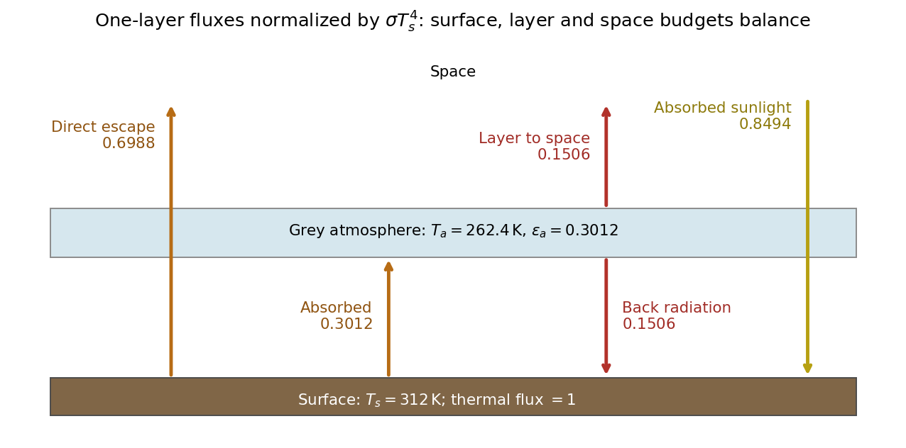

<h1 id="2/solution">Solution</h1>

↑ **Parent:** [2](../2.md)

Use spectral [radiant exitance](../../../../radiant-exitance.md) per unit wavelength. The [Planck law](../../../../planck-s-law.md) is

$$
M_\lambda(T)=\frac{2\pi hc^2}{\lambda^5}\frac1{e^{hc/(\lambda k_{\rm B}T)}-1}.
$$

A hotter [blackbody](../../../../blackbody.md) radiates more at every wavelength, its wavelength peak moves to shorter wavelengths according to [Wien's displacement law](../../../../wien-s-displacement-law.md), and its integrated flux rises as $\sigma T^4$ by the [Stefan–Boltzmann law](../../../../stefan-boltzmann-law.md). The wavelength convention matters: a spectrum plotted per unit frequency has a different peak transformation.

**[Figure 2](#2/image-illustrative-wavelength-spectra-a-hotter-blackbody-has-a-larger-total-flux-and-a-shorter-peak-wavelength). Illustrative wavelength spectra: a hotter blackbody has a larger total flux and a shorter peak wavelength**. [Source](paper-1-ap2013-blackbody-spectra.py).

For [planetary equilibrium temperature](../../../../planetary-equilibrium-temperature.md), assume an isotropic blackbody star, a circular orbit, negligible internal heating, unit surface thermal emissivity and efficient global heat redistribution so the surface has one temperature. The received stellar irradiance is $F_*=\sigma T_*^4(R_*/a)^2$. A planet of radius $R_p$ intercepts $\pi R_p^2F_*$ but radiates over $4\pi R_p^2$, giving the [projected-area factor in planetary energy balance](../../../../projected-area-factor-in-planetary-energy-balance.md)

$$
\boxed{T_0=T_*\sqrt{\frac{R_*}{2a}}=303.4\,\mathrm K.}
$$

Without the uniform-temperature assumption, this calculation gives $\langle T^4\rangle^{1/4}$, not a unique arithmetic mean of surface temperature.

With [Bond albedo](../../../../bond-albedo.md) $A=0.05$, the absorbed fraction is $1-A$. Hence

$$
\boxed{T_A=T_0(1-A)^{1/4}=299.5\,\mathrm K,}
$$

a decrease of approximately $3.87\,\mathrm K$. This albedo weights incident stellar light and does not imply thermal emissivity $0.95$.

Define the [planetary effective emissivity](../../../../planetary-effective-emissivity.md) by outgoing top-of-atmosphere flux $F_{\rm out}=\epsilon_{\rm eff}\sigma T_s^4$. Maintaining the same absorbed stellar power with $T_s=312\,\mathrm K$ gives

$$
\boxed{\epsilon_{\rm eff}=\left(\frac{T_A}{T_s}\right)^4=0.849.}
$$

The [greenhouse effect](../../../../greenhouse-effect.md) allows thermal radiation to escape from colder layers, so the outgoing flux is less than a black surface at $T_s$ would emit. Downward atmospheric emission contributes to the surface energy balance; this does not violate the top-of-atmosphere energy balance.[Thermal radiation, atmospheric absorption and effective radiating versus surface temperature](../../../../climate-and-earth-s-energy-budget-by-nasa-earth-observatory.md)

A [single-layer greenhouse model](../../../../single-layer-greenhouse-model.md) makes the distinction quantitative. Take a shortwave-transparent, isothermal layer with infrared absorptivity and emissivity $\epsilon_a$, above a surface black in the thermal infrared. Writing $Q=(1-A)F_*/4$, its surface and atmospheric balances are

$$
Q+\epsilon_a\sigma T_a^4=\sigma T_s^4,\qquad
\epsilon_a\sigma T_s^4=2\epsilon_a\sigma T_a^4.
$$

For $\epsilon_a>0$, $T_a^4=T_s^4/2$. Radiation escaping to space is $(1-\epsilon_a)\sigma T_s^4+\epsilon_a\sigma T_a^4$, so

$$
\boxed{\epsilon_{\rm eff}=1-\frac{\epsilon_a}{2},\qquad
\epsilon_a=0.301,\qquad T_a=262.4\,\mathrm K.}
$$

Thus **$0.849$ is the planet's effective emissivity; $0.301$ is the layer's infrared emissivity within this particular model.** They are not interchangeable. Real atmospheres require wavelength-dependent absorption, a vertical temperature profile and nonradiative heat transport; the measured temperatures alone do not uniquely retrieve an atmospheric optical profile.

**[Figure 3](#2/image-one-layer-radiative-equilibrium-distinguishes-planetary-effective-emissivity-from-the-infrared-emissivity-of-the-atmosphere). One-layer radiative equilibrium distinguishes planetary effective emissivity from the infrared emissivity of the atmosphere**. [Source](paper-1-ap2013-greenhouse-fluxes.py).

## ↑ Ancestors (13)

1. [2](../2.md)
2. [Paper 1](../../paper-1-split.md)
3. [2013](../../split.md)
4. [Past exam of the atmospheric physics course of the University of Cambridge](../../../split.md)
5. [Atmospheric Physics course of the University of Cambridge](../../../../atmospheric-physics-course-of-the-university-of-cambridge.md)
6. [Physics course of the year 4 of the natural sciences course of the University of Cambridge](../../../../physics-course-of-the-year-4-of-the-natural-sciences-course-of-the-university-of-cambridge.md)
7. [Year 4 of the natural sciences course of the University of Cambridge](../../../../year-4-of-the-natural-sciences-course-of-the-university-of-cambridge.md)
8. [Year of the natural sciences course of the University of Cambridge](../../../../year-of-the-natural-sciences-course-of-the-university-of-cambridge.md)
9. [Natural sciences course of the University of Cambridge](../../../../natural-sciences-course-of-the-university-of-cambridge.md)
10. [Course of the University of Cambridge](../../../../course-of-the-university-of-cambridge.md)
11. [University of Cambridge](../../../../university-of-cambridge-split.md)
12. [List of universities](../../../../list-of-universities.md)
13. [Codex Wiki](../../../../split.md)
