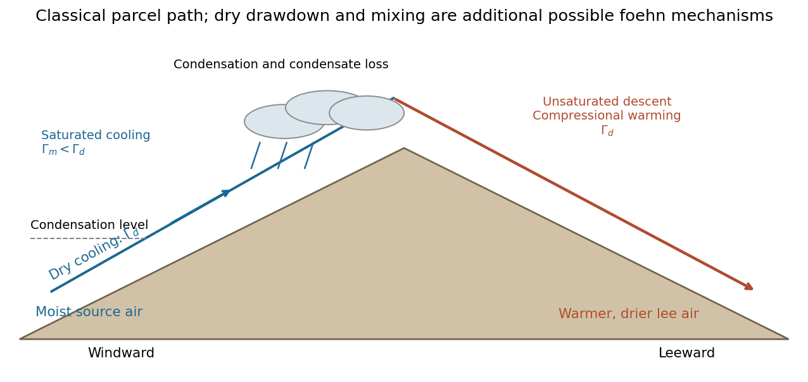

<h1 id="3/b/solution">Solution</h1>

↑ **Parent:** [B](../b.md)

A [foehn wind](../../../../../foehn-wind.md) is relatively warm, dry downslope air on a mountain's lee side. In the classical condensation pathway, ascending windward air expands and cools at the [dry adiabatic lapse rate](../../../../../dry-adiabatic-lapse-rate.md) until the [lifting condensation level](../../../../../lifting-condensation-level.md). Condensation then releases [latent heat](../../../../../latent-heat.md), reducing the cooling rate to the [moist adiabatic lapse rate](../../../../../moist-adiabatic-lapse-rate.md). [Atmospheric precipitation](../../../../../atmospheric-precipitation.md) removes condensate, and the descending parcel warms by compression at approximately the dry rate. Its [relative humidity](../../../../../relative-humidity.md) falls.

For equal starting and finishing heights, complete condensate removal and a constant moist lapse rate above condensation height $z_c$, the [precipitation-driven foehn warming](../../../../../precipitation-driven-foehn-warming.md) is

$$
\boxed{T_{\rm lee}-T_{\rm windward}\simeq(\Gamma_d-\Gamma_m)(H-z_c)>0.}
$$

Here $H>z_c$ is the parcel's maximum height and $\Gamma_d>\Gamma_m$. The warming is adiabatic compression during descent, not heating by friction. Without condensation or a difference in source air, a reversible dry parcel returning to its original height would regain its original temperature.

Precipitation is not essential to every foehn event. [Isentropic foehn drawdown](../../../../../isentropic-foehn-drawdown.md) can bring air of higher [potential temperature](../../../../../potential-temperature.md) from aloft down the lee slope; turbulent mixing and extra solar heating beneath clear skies can also contribute. The sketch shows the classical rainout pathway rather than asserting a unique mechanism.[How does the foehn effect work? Condensation/rainout, drawdown, mixing and radiative warming](../../../../../foehn-effect-by-met-office.md)

**[Figure 4](#3/b/image-classical-foehn-pathway-moist-ascent-and-condensate-loss-followed-by-dry-compressional-warming-on-the-lee-side). Classical foehn pathway: moist ascent and condensate loss followed by dry compressional warming on the lee side**. [Source](paper-1-ap2013-foehn-cross-section.py).

## ↑ Ancestors (14)

1. [B](../b.md)
2. [3](../../3.md)
3. [Paper 1](../../../paper-1-split.md)
4. [2013](../../../split.md)
5. [Past exam of the atmospheric physics course of the University of Cambridge](../../../../split.md)
6. [Atmospheric Physics course of the University of Cambridge](../../../../../atmospheric-physics-course-of-the-university-of-cambridge.md)
7. [Physics course of the year 4 of the natural sciences course of the University of Cambridge](../../../../../physics-course-of-the-year-4-of-the-natural-sciences-course-of-the-university-of-cambridge.md)
8. [Year 4 of the natural sciences course of the University of Cambridge](../../../../../year-4-of-the-natural-sciences-course-of-the-university-of-cambridge.md)
9. [Year of the natural sciences course of the University of Cambridge](../../../../../year-of-the-natural-sciences-course-of-the-university-of-cambridge.md)
10. [Natural sciences course of the University of Cambridge](../../../../../natural-sciences-course-of-the-university-of-cambridge.md)
11. [Course of the University of Cambridge](../../../../../course-of-the-university-of-cambridge.md)
12. [University of Cambridge](../../../../../university-of-cambridge-split.md)
13. [List of universities](../../../../../list-of-universities.md)
14. [Codex Wiki](../../../../../split.md)
