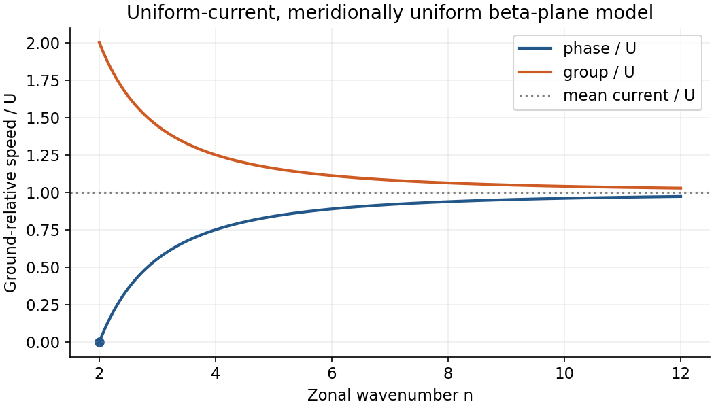

# Paper 1

↑ **Parent:** [2014](../2014.md)

[Original examination PDF, physical pages 661–663](https://www.whatdotheyknow.com/request/natural_science_tripos_physics_e_2/response/2340776/attach/2/FOI%202023%20399%20Zahid%20materials.pdf?cookie_passthrough=1#page=661)

**Table of contents**

- [1](#1)
  - [a](#1/a)
    - [Solution](#1/a/solution)
  - [b](#1/b)
    - [Solution](#1/b/solution)
  - [c](#1/c)
    - [Solution](#1/c/solution)
  - [d](#1/d)
    - [Solution](#1/d/solution)
- [2](#2)
  - [a](#2/a)
    - [Solution](#2/a/solution)
  - [b](#2/b)
    - [Solution](#2/b/solution)
  - [c](#2/c)
    - [Solution](#2/c/solution)
  - [d](#2/d)
    - [Solution](#2/d/solution)
- [3](#3)
  - [a](#3/a)
    - [Solution](#3/a/solution)
  - [b](#3/b)
    - [Solution](#3/b/solution)
  - [c](#3/c)
    - [Solution](#3/c/solution)
  - [d](#3/d)
    - [Solution](#3/d/solution)

## 1

↑ **Parent:** [Paper 1](paper-1.md)

<h3 id="1/a">a</h3>

↑ **Parent:** [1](#1)

<h4 id="1/a/solution">Solution</h4>

↑ **Parent:** [A](#1/a)

Treat the quoted solar spectrum as irradiance normal to the beam, approximately constant over the narrow band. The incident band irradiance is $F_\perp=19\,\mathrm{W\,m^{-2}}$ and the horizontal value is $F_0=F_\perp\sin30^\circ=9.5\,\mathrm{W\,m^{-2}}$. The cloud's vertical [optical depth](../../astrophysics.md#optical-depth) is $25(0.4)=10$; including the clear atmosphere gives $\tau_v=10.07$. The slant optical depth is $\tau_s=\tau_v/\sin30^\circ=20.14$. Thus the [Beer-Lambert law](../../physical-chemistry.md#beer-lambert-law) gives

$$
\boxed{t_{\rm dir}=e^{-20.14}=1.792\times10^{-9},\qquad F_{\rm surface,dir}=1.702\times10^{-8}\,\mathrm{W\,m^{-2}}.}
$$

The removed fraction is $1-t_{\rm dir}=0.9999999982$, almost the full incident horizontal $9.5\,\mathrm{W\,m^{-2}}$. Beam-normal surface irradiance is twice the horizontal value. These are **direct-beam** quantities, not the total diffuse-plus-direct surface flux. If the supplied irradiance were already horizontal, the projection factor would instead be omitted.

<h3 id="1/b">b</h3>

↑ **Parent:** [1](#1)

<h4 id="1/b/solution">Solution</h4>

↑ **Parent:** [B](#1/b)

The [Beer-Lambert law](../../physical-chemistry.md#beer-lambert-law) solves the source-free attenuation term $dI/ds=-\beta_{\rm ext}I$ of the [radiative transfer equation](../../astrophysics.md#radiative-transfer-equation). Extinction includes absorption and scattering **out of that ray**. Missing terms are thermal emission and scattering into the ray from other directions, including repeated scattering and surface reflection.

A cloud can remove nearly all direct sunlight while still supplying substantial diffuse downward radiation. Consequently the total surface solar flux can greatly exceed the direct-beam answer, although reflection sends some energy back to space and absorption can heat matter. At $550\,\mathrm{nm}$ ordinary atmospheric thermal emission is negligible. No unique total flux follows from extinction alone; the single-scattering albedo, angular redistribution and boundary conditions are needed.[Absorption, scattering and thermal-emission processes](../../physics-bibliography.md#radiative-transfer-in-the-atmosphere-by-met-office)

<h3 id="1/c">c</h3>

↑ **Parent:** [1](#1)

<h4 id="1/c/solution">Solution</h4>

↑ **Parent:** [C](#1/c)

**The cloud heating rate in this band is zero:** conservative scattering changes photon directions but transfers no net energy to the cloud matter. Let $F_c=9.5e^{-0.02/0.5}=9.1275\,\mathrm{W\,m^{-2}}$ enter its top and $t_c=e^{-20}$. In the stipulated single-scattering escape approximation, the downward and upward outgoing fractions are

$$
D=t_c+\left(0.75+\frac{0.25}{2}\right)(1-t_c),\qquad U=\frac{0.25}{2}(1-t_c),\qquad D+U=1.
$$

Their fluxes are approximately $7.9866$ and $1.1409\,\mathrm{W\,m^{-2}}$. With upward-positive net flux, both cloud boundaries have $F_{\rm net}=-DF_c$; hence

$$
\boxed{\overline{\dot T}=\frac{F_{\rm net}(z_b)-F_{\rm net}(z_t)}{\rho c_v\Delta z}=0\,\mathrm{K\,s^{-1}}.}
$$

The layer heat capacity is $\rho c_v\Delta z=3.30\times10^5\,\mathrm{J\,m^{-2}\,K^{-1}}$. Absorption outside the cloud heats those other layers. Dropping the upward flux would spuriously turn reflection into cloud heating. Neglecting multiple scattering is quantitatively poor at optical depth ten, but conservative multiple scattering still cannot create material heating in this band.

**[Figure 1](#1/c/image-conservative-single-scattering-redistribution-balances-incoming-and-outgoing-cloud-band-energy). Conservative single-scattering redistribution balances incoming and outgoing cloud-band energy**. [Source](paper-1-ap2014-conservative-cloud.py).

<h3 id="1/d">d</h3>

↑ **Parent:** [1](#1)

<h4 id="1/d/solution">Solution</h4>

↑ **Parent:** [D](#1/d)

Thick low clouds usually reflect much sunlight and emit infrared at temperatures close to the surface, so their daytime shortwave cooling is strong and their longwave greenhouse contrast relatively small. Cold high clouds can strongly reduce outgoing longwave radiation; thin high clouds reflect less sunlight. Thickness and particle properties matter as well as height.

At night there is no solar term. Warm low-cloud tops commonly cool radiatively, promoting condensation and cloud-driven turbulence that can sustain the layer. A cold, optically thin high cloud can instead absorb more infrared from below than it emits, warming and sublimating and thus shortening its lifetime. A gray-layer diagnostic is absorption minus emission, $\epsilon(F_\uparrow+F_\downarrow-2\sigma T_c^4)$. This is a tendency, **not a universal lifetime ranking**: thick cirrus can cool at its top, and ascent, entrainment, humidity and precipitation may dominate.

## 2

↑ **Parent:** [Paper 1](paper-1.md)

<h3 id="2/a">a</h3>

↑ **Parent:** [2](#2)

<h4 id="2/a/solution">Solution</h4>

↑ **Parent:** [A](#2/a)

A convex water surface has higher saturation vapour pressure than a flat one. Equality of chemical potentials with the Laplace pressure $2\sigma/r$ gives the [Kelvin equation](../../thermodynamic-potential.md#kelvin-equation)

$$
\boxed{e_s(r)=e_s(\infty)\exp\!\left(\frac{2\sigma M_w}{\rho_wRT r}\right).}
$$

Small pure droplets therefore need large supersaturation; many subcritical embryos evaporate, making homogeneous droplet formation inefficient under ordinary cloud conditions. [Cloud condensation nuclei](../../chemistry.md#cloud-condensation-nucleus) provide a surface and, when soluble, lower water activity. [Köhler theory](../../chemistry.md#kohler-theory) combines the curvature increase with this solute decrease, giving a critical supersaturation and size for activation.

<h3 id="2/b">b</h3>

↑ **Parent:** [2](#2)

<h4 id="2/b/solution">Solution</h4>

↑ **Parent:** [B](#2/b)

**Warm-rain pathway:** condensation first grows activated droplets, but its relative size growth slows. A sufficiently broad size spectrum creates different fall speeds; large drops collect smaller ones by [collision-coalescence](../../geophysics.md#collision-coalescence). Collection efficiency, turbulence, liquid-water supply and residence time control the bottleneck. Rain reaching the ground also requires survival against subcloud evaporation.

**Ice pathway:** below freezing, saturation vapour pressure over ice is lower than over supercooled liquid. In mixed-phase air, ice can grow by deposition while droplets evaporate: the [Wegener-Bergeron-Findeisen process](../../geophysics.md#wegener-bergeron-findeisen-process). Ice also collects droplets by [riming](../../geophysics.md#riming) and combines by aggregation. Adequate ice nuclei, sustained supersaturation and residence time are critical; particles must become heavy enough to fall, with snow sometimes melting to rain. Condensation or deposition alone is not generally sufficient for rapid precipitation.

<h3 id="2/c">c</h3>

↑ **Parent:** [2](#2)

<h4 id="2/c/solution">Solution</h4>

↑ **Parent:** [C](#2/c)

Droplets remain [supercooled](../../critical-phenomenon.md#supercooling) because creating an ice embryo costs interfacial free energy: freezing has a [nucleation barrier](../../thermodynamic-potential.md#nucleation-barrier) even below the equilibrium melting point. Small droplets also have a low probability of containing an effective ice-nucleating inclusion.

Three heterogeneous routes are **immersion freezing** around a particle already inside the droplet, **contact freezing** following a collision with a suitable mineral particle, and **deposition nucleation** from ice-supersaturated vapour onto a suitable surface. At sufficiently low temperature, **homogeneous ice nucleation** occurs without a foreign surface. Its onset depends on volume and observation time rather than being a universal exact temperature. No biological ice-nucleating agents are needed for these mechanisms.

<h3 id="2/d">d</h3>

↑ **Parent:** [2](#2)

<h4 id="2/d/solution">Solution</h4>

↑ **Parent:** [D](#2/d)

**Direct effect:** nonabsorbing aerosol scatters sunlight, usually increasing reflected shortwave flux over dark surfaces. Absorbing aerosol also heats its atmospheric layer while reducing surface sunlight; the top-of-atmosphere sign depends on its altitude, optical properties and underlying albedo.

**Cloud albedo effect:** soluble, hygroscopic aerosol readily takes up water and can activate as [cloud condensation nuclei](../../chemistry.md#cloud-condensation-nucleus). At fixed liquid-water path, more smaller droplets increase optical depth and cloud reflectivity: the [Twomey effect](../../chemistry.md#twomey-effect). Suppressed collision-coalescence can delay rain and change cloud amount or lifetime, though dynamical adjustments prevent a universal sign.

**Semi-direct effect:** absorption can alter stability and evaporate clouds, or change entrainment and cloud cover. Insoluble dust may be a poor soluble-droplet nucleus but still scatters/absorbs radiation or nucleates ice; coatings can alter its activation. Solubility, absorptivity and ice-nucleating ability are distinct properties, not mutually equivalent categories.[Fixed-water cloud albedo response](../../chemistry.md#the-influence-of-pollution-on-the-shortwave-albedo-of-clouds-by-s-twomey)

## 3

↑ **Parent:** [Paper 1](paper-1.md)

<h3 id="3/a">a</h3>

↑ **Parent:** [3](#3)

<h4 id="3/a/solution">Solution</h4>

↑ **Parent:** [A](#3/a)

The [isentropic potential vorticity](../../geophysical-fluid-dynamics.md#isentropic-potential-vorticity) is [Ertel potential vorticity](../../geophysical-fluid-dynamics.md#ertel-potential-vorticity) expressed on constant [potential temperature](../../geophysics.md#potential-temperature) surfaces:

$$
\boxed{q=\frac{\boldsymbol\omega_a\cdot\nabla\theta}{\rho}=\frac{\zeta_\theta+f}{\sigma_\theta},\qquad\sigma_\theta=-\frac1g\frac{\partial p}{\partial\theta}>0.}
$$

Here $\zeta_\theta$ is the vertical curl of horizontal velocity differentiated on an isentropic surface, and $\sigma_\theta$ is mass per unit area per unit potential-temperature interval. For smooth inviscid adiabatic motion, **$Dq/Dt=0$**. Conserved anomalies are advected and deformed, explaining much balanced large-scale weather variability. Diagnosing velocity from PV additionally needs balance, stratification and boundary information. Strong latent/radiative heating, friction and irreversible mixing generate or modify PV, limiting a purely conservative explanation.[Potential-vorticity conservation, balance and Rossby-wave dynamics](../../physics-bibliography.md#fundamentals-of-atmosphere-ocean-dynamics-by-michael-edgeworth-mcintyre)

<h3 id="3/b">b</h3>

↑ **Parent:** [3](#3)

<h4 id="3/b/solution">Solution</h4>

↑ **Parent:** [B](#3/b)

In a simple northern-hemisphere layer with a fixed upper boundary, climbing a mountain compresses the column. [Potential vorticity](../../geophysical-fluid-dynamics.md#potential-vorticity) conservation, $(\zeta+f)/h=\mathrm{constant}$, then reduces absolute vorticity: at nearly fixed latitude the flow acquires **anticyclonic** relative vorticity. Descending the lee side stretches the column and restores or increases cyclonic vorticity. For an eastward streamline the idealized turning tendency is clockwise in the compressed region and counterclockwise on re-expansion; the resulting disturbance can launch a stationary downstream [Rossby wave](../../geophysical-fluid-dynamics.md#rossby-wave) pattern.

This column argument is an idealization. Stratified air can move around the barrier, isentropic thickness changes need not equal the mountain height, and wave breaking or friction can change PV. Northern-hemisphere signs reverse if $f$ changes sign.

<h3 id="3/c">c</h3>

↑ **Parent:** [3](#3)

<h4 id="3/c/solution">Solution</h4>

↑ **Parent:** [C](#3/c)

For an approximately conserved [isentropic potential vorticity](../../geophysical-fluid-dynamics.md#isentropic-potential-vorticity), $\zeta_\theta+f=q\sigma_\theta$: increased isentropic layer mass implies more cyclonic vorticity, and decreased layer mass more anticyclonic vorticity at fixed latitude. Equivalently, in the thin-layer analogy, stretching increases and compression decreases absolute vorticity.

The usual summer land-heating picture has a deeper, less stably stratified lower atmosphere and favours a **cyclonic thermal low**; winter land cooling gives a shallow stable layer and favours an **anticyclonic thermal high**. These are conditional lower-tropospheric tendencies, not a season-only conservation law. Heating is diabatic and the rougher land surface introduces friction and convergence, so parcel PV need not remain fixed. The sign at every altitude cannot be deduced from “ocean to land” alone without the heating/stability profile and background wind.

<h3 id="3/d">d</h3>

↑ **Parent:** [3](#3)

<h4 id="3/d/solution">Solution</h4>

↑ **Parent:** [D](#3/d)

Use a uniform westerly [Barotropic Rossby wave](../../geophysical-fluid-dynamics.md#barotropic-rossby-wave) model on a local [beta plane](../../geophysical-fluid-dynamics.md#beta-plane). Its dispersion is $\omega=Uk-\beta k/(k^2+l^2)$. A zonal wavenumber-two pattern at latitude $\phi$ has $k_2=2/(a\cos\phi)$, so stationarity requires

$$
\boxed{U=\frac{\beta}{k_2^2+l^2},\qquad\beta=\frac{2\Omega\cos\phi}{a},\quad\phi=45^\circ.}
$$

For the zonally varying, meridionally uniform idealization $l=0$, this is $U=\Omega a\cos^3\phi/2$. Meridional structure, deformation radius, mean-flow shear and full spherical geometry change the condition; the latitude and zonal wavenumber alone do not fix a unique observed jet speed.

For a shorter zonal perturbation $n>2$ with the same $l=0$ assumptions,

$$
\boxed{c_n=U\left(1-\frac4{n^2}\right)>0,\qquad c_{g,n}=U\left(1+\frac4{n^2}\right).}
$$

Its phase travels eastward relative to the stationary long wave, but westward relative to the air at speed $4U/n^2$; its packet propagates downstream faster than the mean flow in this idealization. For example $n=6$ gives $c_n=8U/9$ and $c_g=10U/9$.

Within the meandering flow, poleward parcel motion lowers relative vorticity and equatorward motion raises it through $D\zeta/Dt\simeq-\beta v$. Synoptic anomalies can reinforce or oppose the background ridges/troughs according to phase, exchange momentum with it, and transfer energy downstream. Linear superposition alone does not cause mutual growth; stronger interactions require shear, baroclinicity or nonlinear PV advection. No unique amplification rate follows from the supplied information.

**[Figure 2](#3/d/image-in-the-stated-idealized-model-shorter-rossby-wave-phases-move-east-while-packets-propagate-faster-downstream). In the stated idealized model shorter Rossby-wave phases move east while packets propagate faster downstream**. [Source](paper-1-ap2014-rossby-speeds.py).

## ↑ Ancestors (11)

1. [2014](../2014.md)
2. [Past exam of the atmospheric physics course of the University of Cambridge](../../past-exam-of-the-atmospheric-physics-course-of-the-university-of-cambridge.md)
3. [Atmospheric Physics course of the University of Cambridge](../../university-of-cambridge.md#atmospheric-physics-course-of-the-university-of-cambridge)
4. [Physics course of the year 4 of the natural sciences course of the University of Cambridge](../../university-of-cambridge.md#physics-course-of-the-year-4-of-the-natural-sciences-course-of-the-university-of-cambridge)
5. [Year 4 of the natural sciences course of the University of Cambridge](../../university-of-cambridge.md#year-4-of-the-natural-sciences-course-of-the-university-of-cambridge)
6. [Year of the natural sciences course of the University of Cambridge](../../university-of-cambridge.md#year-of-the-natural-sciences-course-of-the-university-of-cambridge)
7. [Natural sciences course of the University of Cambridge](../../university-of-cambridge.md#natural-sciences-course-of-the-university-of-cambridge)
8. [Course of the University of Cambridge](../../university-of-cambridge.md#course-of-the-university-of-cambridge)
9. [University of Cambridge](../../university-of-cambridge.md)
10. [List of universities](../../README.md#list-of-universities)
11. [Codex Wiki](../../README.md)
