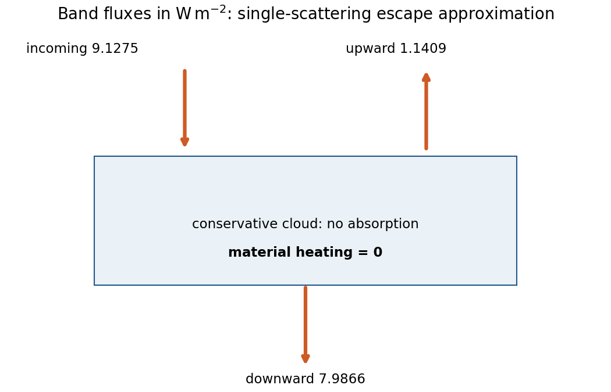

<h1 id="1/c/solution">Solution</h1>

↑ **Parent:** [C](../c.md)

**The cloud heating rate in this band is zero:** conservative scattering changes photon directions but transfers no net energy to the cloud matter. Let $F_c=9.5e^{-0.02/0.5}=9.1275\,\mathrm{W\,m^{-2}}$ enter its top and $t_c=e^{-20}$. In the stipulated single-scattering escape approximation, the downward and upward outgoing fractions are

$$
D=t_c+\left(0.75+\frac{0.25}{2}\right)(1-t_c),\qquad U=\frac{0.25}{2}(1-t_c),\qquad D+U=1.
$$

Their fluxes are approximately $7.9866$ and $1.1409\,\mathrm{W\,m^{-2}}$. With upward-positive net flux, both cloud boundaries have $F_{\rm net}=-DF_c$; hence

$$
\boxed{\overline{\dot T}=\frac{F_{\rm net}(z_b)-F_{\rm net}(z_t)}{\rho c_v\Delta z}=0\,\mathrm{K\,s^{-1}}.}
$$

The layer heat capacity is $\rho c_v\Delta z=3.30\times10^5\,\mathrm{J\,m^{-2}\,K^{-1}}$. Absorption outside the cloud heats those other layers. Dropping the upward flux would spuriously turn reflection into cloud heating. Neglecting multiple scattering is quantitatively poor at optical depth ten, but conservative multiple scattering still cannot create material heating in this band.

**[Figure 1](#1/c/image-conservative-single-scattering-redistribution-balances-incoming-and-outgoing-cloud-band-energy). Conservative single-scattering redistribution balances incoming and outgoing cloud-band energy**. [Source](paper-1-ap2014-conservative-cloud.py).

## ↑ Ancestors (14)

1. [C](../c.md)
2. [1](../../1.md)
3. [Paper 1](../../../paper-1-split.md)
4. [2014](../../../split.md)
5. [Past exam of the atmospheric physics course of the University of Cambridge](../../../../split.md)
6. [Atmospheric Physics course of the University of Cambridge](../../../../../atmospheric-physics-course-of-the-university-of-cambridge.md)
7. [Physics course of the year 4 of the natural sciences course of the University of Cambridge](../../../../../physics-course-of-the-year-4-of-the-natural-sciences-course-of-the-university-of-cambridge.md)
8. [Year 4 of the natural sciences course of the University of Cambridge](../../../../../year-4-of-the-natural-sciences-course-of-the-university-of-cambridge.md)
9. [Year of the natural sciences course of the University of Cambridge](../../../../../year-of-the-natural-sciences-course-of-the-university-of-cambridge.md)
10. [Natural sciences course of the University of Cambridge](../../../../../natural-sciences-course-of-the-university-of-cambridge.md)
11. [Course of the University of Cambridge](../../../../../course-of-the-university-of-cambridge.md)
12. [University of Cambridge](../../../../../university-of-cambridge-split.md)
13. [List of universities](../../../../../list-of-universities.md)
14. [Codex Wiki](../../../../../split.md)
