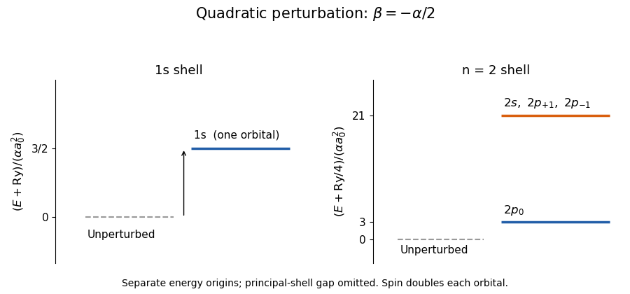

<h1 id="1/c/solution">Solution</h1>

↑ **Parent:** [C](../c.md)

Write $k=e^2/(4\pi\epsilon_0)$ and retain the nuclear [Coulomb potential](../../../../coulomb-potential-energy.md). In [spherical coordinates](../../../../spherical-coordinate-system.md), the total [potential energy](../../../../potential-energy.md) is

$$
V=-\frac{k}{r}+r^2[\alpha+(\beta-\alpha)\cos^2\theta]
=-\frac{k}{r}+\frac{\alpha r^2}{2}[1-2P_2(\cos\theta)]
$$

when $\beta=-\alpha/2$; $P_2(u)=(3u^2-1)/2$ is a [Legendre polynomial](../../../../legendre-polynomial.md). Treat the added term using [quadratic anisotropic perturbation of hydrogen](../../../../quadratic-anisotropic-perturbation-of-hydrogen.md) and [degenerate perturbation theory](../../../../degenerate-perturbation-theory.md) in the $n=2$ [hydrogen energy eigenbasis](../../../../hydrogen-energy-eigenbasis.md). It preserves [parity](../../../../parity.md) and $m$, so it cannot mix $2s$ with $2p$, or distinct $2p$ [magnetic sublevels](../../../../magnetic-sublevel.md).

For a [hydrogen atom](../../../../hydrogen-atom.md), the [hydrogen radial second moment](../../../../hydrogen-radial-second-moment.md) gives

$$
\langle r^2\rangle_{nl}=\frac{a_0^2n^2}{2}[5n^2+1-3l(l+1)],
\qquad
\langle r^2\rangle_{1s}=3a_0^2,\quad
\langle r^2\rangle_{2s}=42a_0^2,\quad
\langle r^2\rangle_{2p}=30a_0^2.
$$

The angular [expectation values](../../../../expectation-value.md) of $\cos^2\theta$ are $1/3$ for an $s$ [orbital](../../../../single-particle-orbital.md), $3/5$ for $p_0$, and $1/5$ for $p_{\pm1}$, obtained by integrating the squared [spherical harmonics](../../../../spherical-harmonic.md). Therefore the five lowest spatial [quantum states](../../../../quantum-state.md), counting [statistical weight](../../../../statistical-weight.md), have first-order [energy levels](../../../../energy-level.md)

$$
\boxed{\begin{array}{c|c|c}
\text{state}&E\text{ to first order}&\text{spatial multiplicity}\\\hline
1s&-\mathrm{Ry}+\tfrac32\alpha a_0^2&1\\
2p_0&-\mathrm{Ry}/4+3\alpha a_0^2&1\\
2s,\ 2p_{+1},\ 2p_{-1}&-\mathrm{Ry}/4+21\alpha a_0^2&3
\end{array}}
$$

Each spatial [quantum state](../../../../quantum-state.md) has two [electron spin](../../../../electron-spin.md) states when [spin-orbit coupling](../../../../spin-orbit-interaction.md) and the [magnetic field](../../../../magnetic-field-split.md) are omitted. Thus these are five spatial states but only three distinct first-order [energies](../../../../energy-split.md); five distinct [energies](../../../../energy-split.md) would be an incorrect reading. The accidental $2s,2p_{\pm1}$ equality can be lifted at higher order. Quantitatively the added shifts must also be small compared with neighboring principal-shell gaps; $\alpha\ll k/a_0^3$ is an asymptotic condition, not a guarantee for arbitrary large $n$.

**[Figure 1](#1/c/image-first-order-spatial-levels-of-locally-perturbed-hydrogen-the-gap-between-principal-shells-is-compressed). First-order spatial levels of locally perturbed hydrogen; the gap between principal shells is compressed**.

For general $\beta$, the $1s$ [expectation value](../../../../expectation-value.md) is

$$
\Delta E_{1s}^{(1)}=(2\alpha+\beta)a_0^2,\qquad
\boxed{\beta=-2\alpha\text{ cancels the first-order shift.}}
$$

It does **not** cancel every order. At $\beta=-2\alpha$, $V_{\rm ext}=-2\alpha r^2P_2(\cos\theta)$ couples $1s$ to $d$ [orbitals](../../../../single-particle-orbital.md). For example its angular [matrix element](../../../../matrix-element.md) with $Y_{20}$ is $1/\sqrt5$, and the $3d$ radial [matrix element](../../../../matrix-element.md) is nonzero. The [second-order nondegenerate perturbation theory](../../../../second-order-nondegenerate-perturbation-theory.md) sum has negative denominators, so this is a concrete nonzero higher-order contribution.

There is also a global limitation: for either negative $\beta$ above, $V(0,0,z)=-k/|z|+\beta z^2\to-\infty$. A localized wavepacket translated far along $z$ has fixed [kinetic energy](../../../../kinetic-energy.md) but arbitrarily negative [potential energy](../../../../potential-energy.md), proving there is no true lowest [energy level](../../../../energy-level.md). The results describe local perturbative [resonance poles](../../../../resonance-pole.md), or a potential completed to a confining form far from the [atomic nucleus](../../../../atomic-nucleus-split.md). No globally exact ground-state cancellation exists for the potential as printed.

## ↑ Ancestors (12)

1. [C](../c.md)
2. [1](../../1.md)
3. [2021](../../../2021-split.md)
4. [Past exam of the atomic and laser physics course of the University of Oxford](../../../split.md)
5. [Atomic and laser physics course of the University of Oxford](../../../../atomic-and-laser-physics-course-of-the-university-of-oxford.md)
6. [Year 3 of the physics course of the University of Oxford](../../../../year-3-of-the-physics-course-of-the-university-of-oxford.md)
7. [Physics course of the University of Oxford](../../../../physics-course-of-the-university-of-oxford.md)
8. [Undergraduate course of the University of Oxford](../../../../undergraduate-course-of-the-university-of-oxford.md)
9. [Course of the University of Oxford](../../../../course-of-the-university-of-oxford.md)
10. [University of Oxford](../../../../university-of-oxford-split.md)
11. [List of universities](../../../../list-of-universities.md)
12. [Codex Wiki](../../../../split.md)
