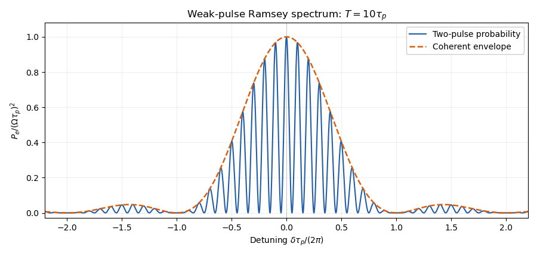

<h1 id="2/c/solution">Solution</h1>

↑ **Parent:** [C](../c.md)

The ground [electron configuration](../../../../electron-configuration.md) of [caesium](../../../../caesium.md) has a single $6s$ [electron](../../../../electron.md), with $J=1/2$. [Addition of angular momentum](../../../../addition-of-angular-momentum.md) giving $F=3,4$ fixes the [nuclear spin](../../../../nuclear-spin.md) to $I=7/2$. With dimensionless [angular momentum operators](../../../../angular-momentum-operator-split.md), write the [Fermi contact interaction](../../../../fermi-contact-interaction.md) as

$$
H_{\rm hf}=A\mathbf I\cdot\mathbf J,\qquad
E_F=\frac A2[F(F+1)-I(I+1)-J(J+1)].
$$

The two [hyperfine levels](../../../../hyperfine-level.md) therefore differ by $4A$. In the convention $\boldsymbol\mu_I=g_I\mu_B\mathbf I$ and $g_s\simeq2$,

$$
A=\frac{2\mu_0}{3}g_sg_I\mu_B^2|\psi_{6s}(0)|^2,\qquad
\boxed{\omega_0=\frac{4A}{\hbar}.}
$$

This exposes a missing ingredient in a prediction from the supplied data: $Z$ and $g_I$ alone do not specify the valence [electron](../../../../electron.md) contact density. [Screening effect](../../../../screening-effect.md) and penetration of the closed core strongly affect it. If $g_I$ instead denotes the total nuclear moment in units of $\mu_B$, it must first be divided by $I$ in the displayed convention.

An explicitly crude unscreened [hydrogen-like ion](../../../../hydrogen-like-ion.md) model uses $|\psi_{6s}(0)|^2=Z^3/(\pi6^3a_0^3)$ and gives $\nu_0\simeq5.76\times10^{11}\,\mathrm{Hz}$, or $\omega_0\simeq3.62\times10^{12}\,\mathrm{s^{-1}}$. It describes neither the shielding nor the radial function of neutral [caesium](../../../../caesium.md). Using a pure unit-charge $6s$ [hydrogen](../../../../hydrogen.md) [orbital](../../../../single-particle-orbital.md) instead gives only $3.46\,\mathrm{MHz}$, illustrating why a unique useful estimate cannot follow from an unspecified effective charge.

For physical neutral $^{133}\mathrm{Cs}$, the independently known zero-[magnetic field](../../../../magnetic-field-split.md) [clock transition](../../../../clock-transition.md) is

$$
\boxed{\nu_0=9\,192\,631\,770\,\mathrm{Hz},\qquad
\omega_0=2\pi\nu_0\simeq5.776\times10^{10}\,\mathrm{s^{-1}}.}
$$

This measured [frequency](../../../../frequency.md), used to define the [second](../../../../second.md), is supplementary physical information, not a consequence of $Z=55$ and the rounded $g_I$ alone.[Definition: the unperturbed ground-state hyperfine transition frequency of caesium-133 is exactly 9 192 631 770 Hz](../../../../si-base-unit-second-s-by-bureau-international-des-poids-et-mesures.md) The direct [electronic transition](../../../../electronic-transition.md) is in the microwave range and is a [magnetic dipole transition](../../../../magnetic-dipole-transition.md), rather than a direct optical [electric dipole transition](../../../../electric-dipole-transition.md). An optical implementation needs a two-field [Raman transition](../../../../raman-transition.md).

Using the corrected [weak-pulse Ramsey spectrum](../../../../weak-pulse-ramsey-spectrum.md) of part (b), the peak at $\delta=0$ has height $(\Omega\tau_p)^2$. The [quantum interference](../../../../quantum-interference.md) fringes have spacing $2\pi/T$ in [angular frequency](../../../../angular-frequency.md), with zeros at $(2k+1)\pi/T$, and the [sinc function](../../../../sinc-function.md) envelope has its first zeros at $\delta=\pm2\pi/\tau_p$. For $T\gg\tau_p$, the central peak has approximately [full width at half maximum](../../../../full-width-at-half-maximum.md) $\pi/T$ in [angular frequency](../../../../angular-frequency.md). The [clock transition](../../../../clock-transition.md) between the two $M_F=0$ states has no first-order [Zeeman energy](../../../../zeeman-energy.md), although a quadratic one remains.

**[Figure 2](#2/c/image-corrected-weak-pulse-ramsey-spectrum-for-a-pulse-start-separation-ten-times-the-pulse-duration). Corrected weak-pulse Ramsey spectrum for a pulse-start separation ten times the pulse duration**.

## ↑ Ancestors (12)

1. [C](../c.md)
2. [2](../../2.md)
3. [2021](../../../2021-split.md)
4. [Past exam of the atomic and laser physics course of the University of Oxford](../../../split.md)
5. [Atomic and laser physics course of the University of Oxford](../../../../atomic-and-laser-physics-course-of-the-university-of-oxford.md)
6. [Year 3 of the physics course of the University of Oxford](../../../../year-3-of-the-physics-course-of-the-university-of-oxford.md)
7. [Physics course of the University of Oxford](../../../../physics-course-of-the-university-of-oxford.md)
8. [Undergraduate course of the University of Oxford](../../../../undergraduate-course-of-the-university-of-oxford.md)
9. [Course of the University of Oxford](../../../../course-of-the-university-of-oxford.md)
10. [University of Oxford](../../../../university-of-oxford-split.md)
11. [List of universities](../../../../list-of-universities.md)
12. [Codex Wiki](../../../../split.md)
