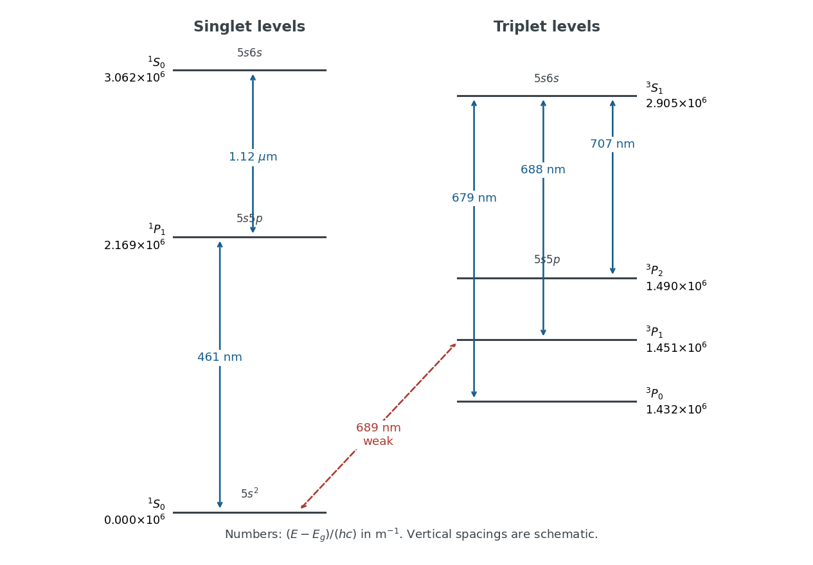

# 2022

↑ **Parent:** [Past exam of the atomic and laser physics course of the University of Oxford](../past-exam-of-the-atomic-and-laser-physics-course-of-the-university-of-oxford.md)

Source: [https://www.whatdotheyknow.com/request/oxford_physics_past_papers_2/response/2340696/attach/10/Physics%20Papers%202021.pdf?cookie_passthrough=1](https://www.whatdotheyknow.com/request/oxford_physics_past_papers_2/response/2340696/attach/10/Physics%20Papers%202021.pdf?cookie_passthrough=1)

Source bundle pages 129–133. The cover establishes 2022 despite the attachment filename. Solutions use the paper's rounded numerical data.

**Table of contents**

- [1](#1)
  - [a](#1/a)
    - [Solution](#1/a/solution)
  - [b](#1/b)
    - [Solution](#1/b/solution)
  - [c](#1/c)
    - [Solution](#1/c/solution)
  - [d](#1/d)
    - [Solution](#1/d/solution)
- [2](#2)
  - [a](#2/a)
    - [Solution](#2/a/solution)
  - [b](#2/b)
    - [Solution](#2/b/solution)
  - [c](#2/c)
    - [Solution](#2/c/solution)
  - [d](#2/d)
    - [Solution](#2/d/solution)
- [3](#3)
  - [a](#3/a)
    - [Solution](#3/a/solution)
  - [b](#3/b)
    - [Solution](#3/b/solution)
  - [c](#3/c)
    - [Solution](#3/c/solution)
  - [d](#3/d)
    - [Solution](#3/d/solution)
- [4](#4)
  - [a](#4/a)
    - [Solution](#4/a/solution)
  - [b](#4/b)
    - [Solution](#4/b/solution)
  - [c](#4/c)
    - [Solution](#4/c/solution)
  - [d](#4/d)
    - [Solution](#4/d/solution)

## 1

↑ **Parent:** [2022](2022.md)

<h3 id="1/a">a</h3>

↑ **Parent:** [1](#1)

<h4 id="1/a/solution">Solution</h4>

↑ **Parent:** [A](#1/a)

In [LS coupling](../angular-momentum-operator.md#ls-coupling), first add the individual [orbital angular momenta](../quantum-mechanics.md#orbital-angular-momentum) and [spins](../angular-momentum-operator.md#spin) separately, then add their totals:

$$
\mathbf L=\sum_i\mathbf l_i,\qquad \mathbf S=\sum_i\mathbf s_i,\qquad \mathbf J=\mathbf L+\mathbf S.
$$

The [Coulomb interaction](../electrostatics.md#coulomb-interaction) between [electrons](../physics.md#electron) must separate different [atomic terms](../atomic-physics.md#atomic-term) more strongly than the [spin-orbit interaction](../atomic-physics.md#spin-orbit-interaction) mixes them. Then $L,S,J,M_J$ are useful [quantum numbers](../quantum-system.md#quantum-number), with $J=|L-S|,\ldots,L+S$. This approximation is usually better for lighter [chemical atoms](../physics.md#atom-physics) and well-separated [atomic terms](../atomic-physics.md#atomic-term); strong [configuration interaction](../chemistry.md#configuration-interaction) or strong [spin-orbit coupling](../atomic-physics.md#spin-orbit-interaction) can spoil it. The [term symbol](../atomic-physics.md#term-symbol) is $^{2S+1}L_J$.

The general [electric-dipole selection rules](../quantum-mechanics.md#electric-dipole-selection-rule), for isolated [chemical atoms](../physics.md#atom-physics) with definite [parity](../quantum-mechanics.md#parity) and total electronic [angular momentum](../momentum.md#angular-momentum), are a change of [parity](../quantum-mechanics.md#parity), $\Delta J=0,\pm1$ excluding $J=0\leftrightarrow0$, and $\Delta M_J=0,\pm1$, with the accessible [magnetic sublevels](../quantum-mechanics.md#magnetic-sublevel) determined by the light's [polarization](../wave.md#polarization-waves). In pure [LS coupling](../angular-momentum-operator.md#ls-coupling), the additional [selection rules](../atomic-physics.md#selection-rule) are $\Delta S=0$ and $\Delta L=0,\pm1$, excluding $L=0\leftrightarrow0$. In a one-[electron](../physics.md#electron) description the [electric dipole operator](../quantum-mechanics.md#electric-dipole-operator) also requires $\Delta l=\pm1$ for the active [electron](../physics.md#electron). These latter statements can fail as exact labels when [atomic terms](../atomic-physics.md#atomic-term) mix; the general [parity](../quantum-mechanics.md#parity) and total-[angular momentum](../momentum.md#angular-momentum) restrictions still apply. Unresolved [hyperfine structure](../quantum-mechanics.md#hyperfine-structure) is neglected here.

For [strontium](../chemical-substance.md#strontium), the closed core contributes $L=S=0$. The [Pauli exclusion principle](../tensor-product-of-quantum-systems.md#pauli-exclusion-principle) makes the two equivalent $5s$ [electrons](../physics.md#electron) a [singlet state](../angular-momentum-operator.md#singlet-state). Different radial [orbitals](../wave-function.md#single-particle-orbital) permit both a [singlet state](../angular-momentum-operator.md#singlet-state) and a [triplet state](../angular-momentum-operator.md#spin-one-half-triplet-state). Thus the complete lists of [atomic fine-structure levels](../atomic-physics.md#atomic-fine-structure-level) are

$$
\boxed{\begin{array}{c|c|c}
\text{configuration}&\text{terms}&\text{levels}\\\hline
5s^2&{}^1S&{}^1S_0\\
5s5p&{}^1P,{}^3P&{}^1P_1,{}^3P_0,{}^3P_1,{}^3P_2\\
5s6s&{}^1S,{}^3S&{}^1S_0,{}^3S_1
\end{array}}
$$

The $5s5p$ [electron configuration](../chemistry.md#electron-configuration) has odd [parity](../quantum-mechanics.md#parity); the other two [electron configurations](../chemistry.md#electron-configuration) have even [parity](../quantum-mechanics.md#parity).

<h3 id="1/b">b</h3>

↑ **Parent:** [1](#1)

<h4 id="1/b/solution">Solution</h4>

↑ **Parent:** [B](#1/b)

Measure each [energy level](../quantum-mechanics.md#energy-level) by the [wavenumber](../wave-equation.md#wavenumber) $\widetilde E=(E-E_g)/(hc)$ in $\mathrm{m^{-1}}$. An upward [electronic transition](../atomic-physics.md#electronic-transition) of vacuum [wavelength](../wave-equation.md#wavelength) $\lambda$ adds $1/\lambda$. Treat the quoted [wavelengths](../wave-equation.md#wavelength) as vacuum values to their limited accuracy; air corrections would be smaller than the precision justified here.

The strong ground-state [absorption](../radiometry.md#absorption-electromagnetic-radiation) must be $5s^2\,{}^1S_0\to5s5p\,{}^1P_1$ at $461\,\mathrm{nm}$. The weak ground-state [electronic transition](../atomic-physics.md#electronic-transition) at $689\,\mathrm{nm}$ must reach $5s5p\,{}^3P_1$: the [electric-dipole selection rule](../quantum-mechanics.md#electric-dipole-selection-rule) on $J$ excludes the other two [triplet state](../angular-momentum-operator.md#spin-one-half-triplet-state) [energy levels](../quantum-mechanics.md#energy-level), while weak [spin-orbit coupling](../atomic-physics.md#spin-orbit-interaction) admixes [singlet state](../angular-momentum-operator.md#singlet-state) character and relaxes the approximate [spin selection rule](../atomic-physics.md#spin-selection-rule).

Assume the usual ordering $E({}^3P_0)<E({}^3P_1)<E({}^3P_2)$, as expected from a positive effective [spin-orbit coupling](../atomic-physics.md#spin-orbit-interaction) constant. The three nearby strong [spectral lines](../stellar-astrophysics.md#spectral-line) then join these [energy levels](../quantum-mechanics.md#energy-level) to a common $5s6s\,{}^3S_1$ [energy level](../quantum-mechanics.md#energy-level). Larger lower-state [energy](../energy.md) means a smaller gap and longer [wavelength](../wave-equation.md#wavelength), so $679,688,707\,\mathrm{nm}$ correspond to $J=0,1,2$ respectively. The remaining $1.12\,\mu\mathrm m$ [spectral line](../stellar-astrophysics.md#spectral-line) joins $5s5p\,{}^1P_1$ and $5s6s\,{}^1S_0$. Assume the latter is the upper [energy level](../quantum-mechanics.md#energy-level). These assignments and orderings agree with independently tabulated [strontium](../chemical-substance.md#strontium) [energy levels](../quantum-mechanics.md#energy-level).[Entries for 5s², 5s5p and 5s6s; the tabulated energies use cm⁻¹ rather than m⁻¹](../physics-bibliography.md#energy-levels-of-neutral-strontium-by-nist)

Starting with the two ground-state gaps, the construction is

$$
\begin{aligned}
\widetilde E({}^1P_1)&=(461\,\mathrm{nm})^{-1},\\
\widetilde E({}^3P_1)&=(689\,\mathrm{nm})^{-1},\\
\widetilde E({}^3S_1)&=\widetilde E({}^3P_1)+(688\,\mathrm{nm})^{-1},\\
\widetilde E({}^3P_0)&=\widetilde E({}^3S_1)-(679\,\mathrm{nm})^{-1},\\
\widetilde E({}^3P_2)&=\widetilde E({}^3S_1)-(707\,\mathrm{nm})^{-1},\\
\widetilde E(5s6s\,{}^1S_0)&=\widetilde E({}^1P_1)+(1.12\,\mu\mathrm m)^{-1}.
\end{aligned}
$$

The resulting [energy levels](../quantum-mechanics.md#energy-level), rounded to avoid suggesting spectroscopic precision, are

$$
\boxed{\begin{array}{c|r}
\text{level}&\widetilde E\ (\mathrm{m^{-1}})\\\hline
5s^2\,{}^1S_0&0\\
5s5p\,{}^3P_0&1.432\times10^6\\
5s5p\,{}^3P_1&1.451\times10^6\\
5s5p\,{}^3P_2&1.490\times10^6\\
5s5p\,{}^1P_1&2.169\times10^6\\
5s6s\,{}^3S_1&2.905\times10^6\\
5s6s\,{}^1S_0&3.062\times10^6
\end{array}}
$$

**[Figure 1](#1/b/image-strontium-level-assignments-inferred-from-the-supplied-wavelengths-vertical-spacings-are-schematic-and-numerical-energies-are-in-inverse-metres). Strontium level assignments inferred from the supplied wavelengths; vertical spacings are schematic and numerical energies are in inverse metres**.

**Both $461\,\mathrm{nm}$ and $1.12\,\mu\mathrm m$ exhibit the [normal Zeeman effect](../atomic-physics.md#normal-zeeman-effect).** Each connects two [singlet state](../angular-momentum-operator.md#singlet-state) [energy levels](../quantum-mechanics.md#energy-level), with [Landé g-factor](../atomic-physics.md#lande-g-factor) $g_J=1$ for the $J=1$ [energy level](../quantum-mechanics.md#energy-level) and no first-order shift for $J=0$. Their [frequency](../wave.md#frequency) shifts are $0,\pm\mu_BB/h$. The weak $689\,\mathrm{nm}$ [spectral line](../stellar-astrophysics.md#spectral-line) also has three components, but $g({}^3P_1)=3/2$ gives shifts $0,\pm3\mu_BB/(2h)$; a three-component pattern alone does not establish the [normal Zeeman effect](../atomic-physics.md#normal-zeeman-effect). The $679\,\mathrm{nm}$ [spectral line](../stellar-astrophysics.md#spectral-line) likewise has three components with $g({}^3S_1)=2$.

<h3 id="1/c">c</h3>

↑ **Parent:** [1](#1)

<h4 id="1/c/solution">Solution</h4>

↑ **Parent:** [C](#1/c)

For $5s5d$, [addition of angular momentum](../angular-momentum-operator.md#addition-of-angular-momentum) gives $L=2$ and $S=0,1$. The even-[parity](../quantum-mechanics.md#parity) [atomic terms](../atomic-physics.md#atomic-term) and [atomic fine-structure levels](../atomic-physics.md#atomic-fine-structure-level) are

$$
\boxed{{}^1D_2,\qquad{}^3D_1,{}^3D_2,{}^3D_3.}
$$

The [electric-dipole selection rules](../quantum-mechanics.md#electric-dipole-selection-rule) exclude all connections to the even-[parity](../quantum-mechanics.md#parity) $5s^2$ and $5s6s$ [electron configurations](../chemistry.md#electron-configuration). To the odd-[parity](../quantum-mechanics.md#parity) $5s5p$ [electron configuration](../chemistry.md#electron-configuration), all seven allowed connections in pure [LS coupling](../angular-momentum-operator.md#ls-coupling) are

$$
\boxed{\begin{aligned}
{}^1D_2&\leftrightarrow{}^1P_1,\\
{}^3D_1&\leftrightarrow{}^3P_0,{}^3P_1,{}^3P_2,\\
{}^3D_2&\leftrightarrow{}^3P_1,{}^3P_2,\\
{}^3D_3&\leftrightarrow{}^3P_2.
\end{aligned}}
$$

Here a connection is listed independently of whether the $5s5d$ [energy level](../quantum-mechanics.md#energy-level) is above or below its partner.

In a weak [magnetic field](../magnetic-field.md), use the [Landé g-factor](../atomic-physics.md#lande-g-factor)

$$
g_J=1+\frac{J(J+1)+S(S+1)-L(L+1)}{2J(J+1)}.
$$

For the three ${}^3D_J$ [energy levels](../quantum-mechanics.md#energy-level), this gives $1/2,7/6,4/3$; for ${}^3P_1,{}^3P_2$ it gives $3/2$. The six-component [spectral line](../stellar-astrophysics.md#spectral-line) is therefore

$$
\boxed{{}^3D_1\leftrightarrow{}^3P_1.}
$$

A component has [frequency](../wave.md#frequency) displacement $(\mu_BB/h)(m_D/2-3m_P/2)$. The [electric dipole transition](../quantum-mechanics.md#electric-dipole-transition) with $m_D=m_P=0$ has zero [matrix element](../vector-space.md#matrix-element), since the relevant $J=1\leftrightarrow1$ rank-one [Clebsch-Gordan coefficients](../representation-theory.md#clebsch-gordan-coefficients) vanish there. The remaining allowed pairs give

$$
\begin{array}{c|c|c}
\text{polarization}&m_D-m_P&h\Delta\nu/(\mu_BB)\\\hline
\pi&0&-1,+1\\
\sigma&+1&+1/2,+3/2\\
\sigma&-1&-3/2,-1/2
\end{array}
$$

Thus all six [frequency](../wave.md#frequency) positions $\pm1/2,\pm1,\pm3/2$ are distinct. Perpendicular to the [magnetic field](../magnetic-field.md), both the $\pi$ and $\sigma$ components are visible, with mutually perpendicular linear [polarizations](../wave.md#polarization-waves). Along the [magnetic field](../magnetic-field.md) the $\pi$ components disappear. This is the weak-field [Zeeman effect](../atomic-physics.md#zeeman-splitting), before the [Paschen-Back effect](../atomic-physics.md#paschen-back-effect) changes the coupling scheme.

<h3 id="1/d">d</h3>

↑ **Parent:** [1](#1)

<h4 id="1/d/solution">Solution</h4>

↑ **Parent:** [D](#1/d)

The closest components above differ by $\Delta\nu_{\min}=\mu_BB/(2h)\simeq7.0\,\mathrm{GHz\,T^{-1}}B$. At $B=0.1\,\mathrm T$, their separation is about $0.70\,\mathrm{GHz}$. A visible [spectral line](../stellar-astrophysics.md#spectral-line) near $500\,\mathrm{nm}$ would consequently require [spectral resolving power](../optical-instrument.md#spectral-resolving-power) of order $\nu/\Delta\nu_{\min}\simeq9\times10^5$. An ordinary low-resolution [spectrometer](../optical-instrument.md#spectrometer) would merge the components.

A suitable arrangement places an excited low-pressure [strontium](../chemical-substance.md#strontium) discharge or a transversely observed [atomic beam](../physics.md#atomic-beam) between wide electromagnet pole pieces. Collect the emission perpendicular to the [magnetic field](../magnetic-field.md), select the desired [spectral line](../stellar-astrophysics.md#spectral-line) with a prefilter or [monochromator](../optical-instrument.md#monochromator), and send it through a high-finesse scanning [Fabry–Pérot interferometer](../optical-instrument.md#fabry-perot-interferometer) to a detector. A rotatable linear [polarizer](../electromagnetic-wave.md#polarizer) separates the two $\pi$ components from the four $\sigma$ components. Calibrate both the interferometer's [free spectral range](../physical-optics.md#free-spectral-range) and the local [magnetic field](../magnetic-field.md); take zero-field and several field-strength scans, and fit component positions against $B$.

The [magnetic field](../magnetic-field.md) should be uniform across the viewed volume, with its associated [Zeeman splitting](../atomic-physics.md#zeeman-splitting) larger than the combined [natural linewidth](../atomic-physics.md#natural-linewidth), [Doppler broadening](../quantum-ideal-gas-statistics.md#doppler-broadening), [pressure broadening](../stellar-astrophysics.md#pressure-broadening) and instrumental width, but much smaller than the separations of the relevant [atomic fine-structure levels](../atomic-physics.md#atomic-fine-structure-level). A collimated transverse [atomic beam](../physics.md#atomic-beam), low collision rate and restricted collection angle reduce unwanted [spectral line broadening](../stellar-astrophysics.md#spectral-line-broadening). Avoid appreciable [power broadening](../atomic-physics.md#power-broadening), resolve or model [isotope](../chemical-substance.md#isotope) and [hyperfine structure](../quantum-mechanics.md#hyperfine-structure), and check for self-[absorption](../radiometry.md#absorption-electromagnetic-radiation). A zero-field scan and the predicted linear scaling help distinguish actual [Zeeman splitting](../atomic-physics.md#zeeman-splitting) components from neighbouring [spectral lines](../stellar-astrophysics.md#spectral-line).

## 2

↑ **Parent:** [2022](2022.md)

<h3 id="2/a">a</h3>

↑ **Parent:** [2](#2)

<h4 id="2/a/solution">Solution</h4>

↑ **Parent:** [A](#2/a)

Let the dimensionful [angular momentum operators](../angular-momentum-operator.md) obey $\mathbf F=\mathbf I+\mathbf J$ and take the interaction [Hamiltonian](../hamiltonian-mechanics.md#hamiltonian) as $H'=A\mathbf I\cdot\mathbf J$. Since

$$
\mathbf I\cdot\mathbf J=\tfrac12(\mathbf F^2-\mathbf I^2-\mathbf J^2),
$$

the [energy eigenvalues](../energy-eigenvalue.md) at fixed $I,J$ are

$$
E_F=\frac{a}{2}\{F(F+1)-I(I+1)-J(J+1)\},\qquad a=A\hbar^2,
$$

where $F=|I-J|,\ldots,I+J$. Subtraction gives the [Landé interval rule](../angular-momentum-operator.md#lande-interval-rule)

$$
\boxed{E_F-E_{F-1}=aF.}
$$

Many atomic conventions use dimensionless [angular momentum operators](../angular-momentum-operator.md) and call the energy-valued constant itself $A$; then the right-hand side is $AF$. Each [energy level](../quantum-mechanics.md#energy-level) has $2F+1$ [magnetic sublevels](../quantum-mechanics.md#magnetic-sublevel) with the same [energy](../energy.md) in zero field.

For [fine structure](../atomic-physics.md#fine-structure), the effective interaction is $a_{LS}\mathbf L\cdot\mathbf S$ with dimensionless [angular momentum operators](../angular-momentum-operator.md). It originates in the [spin-orbit interaction](../atomic-physics.md#spin-orbit-interaction), including the magnetic interaction of [electron spin](../angular-momentum-operator.md#electron-spin) with orbital motion and its relativistic correction. Within an isolated [LS coupling](../angular-momentum-operator.md#ls-coupling) [atomic term](../atomic-physics.md#atomic-term), the labels are the [electron configuration](../chemistry.md#electron-configuration), $L,S,J,M_J$, and the interval between adjacent $J$ [energy levels](../quantum-mechanics.md#energy-level) is $a_{LS}J$. This is smaller than the electrostatic separation of [atomic terms](../atomic-physics.md#atomic-term).

For magnetic-dipole [hyperfine structure](../quantum-mechanics.md#hyperfine-structure), the [nuclear magnetic dipole moment](../atomic-nucleus.md#nuclear-magnetic-dipole-moment) interacts with the magnetic field generated by the [electrons](../physics.md#electron). Contributions include the [Fermi contact interaction](../quantum-mechanics.md#fermi-contact-interaction) of penetrating $s$ [electrons](../physics.md#electron), orbital magnetic fields, and the dipolar field of [electron spin](../angular-momentum-operator.md#electron-spin). Projected onto one electronic $J$ [energy level](../quantum-mechanics.md#energy-level), their rotationally invariant magnetic-dipole part has the form $a_{IJ}\mathbf I\cdot\mathbf J$. The labels are $I,J,F,M_F$, together with the approximate electronic labels such as $L,S$. This splitting is generally smaller than [fine structure](../atomic-physics.md#fine-structure), reflecting the much smaller nuclear [magnetic dipole moment](../electromagnetism.md#magnetic-dipole-moment). An electric [nuclear quadrupole moment](../atomic-nucleus.md#nuclear-quadrupole-moment) can add a different interaction and violate the simple [Landé interval rule](../angular-momentum-operator.md#lande-interval-rule).

At the larger electrostatic [energy](../energy.md) scale, an effective two-[spin](../angular-momentum-operator.md#spin) exchange interaction can also be written $a_s\mathbf s_1\cdot\mathbf s_2$ within fixed [orbitals](../wave-function.md#single-particle-orbital). Its origin is the [Coulomb interaction](../electrostatics.md#coulomb-interaction) combined with the [Pauli exclusion principle](../tensor-product-of-quantum-systems.md#pauli-exclusion-principle), rather than a large direct magnetic interaction. It separates [singlet state](../angular-momentum-operator.md#singlet-state) and [triplet state](../angular-momentum-operator.md#spin-one-half-triplet-state) [atomic terms](../atomic-physics.md#atomic-term); before [spin-orbit coupling](../atomic-physics.md#spin-orbit-interaction), useful labels include the [electron configuration](../chemistry.md#electron-configuration), $L,M_L,S,M_S$. General electrostatic [atomic term](../atomic-physics.md#atomic-term) separations need not obey a single [Landé interval rule](../angular-momentum-operator.md#lande-interval-rule) as $L$ varies.

<h3 id="2/b">b</h3>

↑ **Parent:** [2](#2)

<h4 id="2/b/solution">Solution</h4>

↑ **Parent:** [B](#2/b)

The $4f^7$ shell carries a large [spin](../angular-momentum-operator.md#spin) (its ground [atomic term](../atomic-physics.md#atomic-term) under [Hund's rules](../chemistry.md#hund-s-rules) has $L=0,S=7/2$), and the $6s$ [electron](../physics.md#electron) penetrates the inner shells. Its nonzero [probability density](../wave-function.md#probability-density) at the [atomic nucleus](../atomic-nucleus.md) supplies a potentially large [Fermi contact interaction](../quantum-mechanics.md#fermi-contact-interaction) with the [nuclear magnetic dipole moment](../atomic-nucleus.md#nuclear-magnetic-dipole-moment). The $6s$ shell here is singly occupied, so the obligatory paired-$6s^2$ cancellation is absent. Both stable [europium](../chemical-substance.md#europium) [isotopes](../chemical-substance.md#isotope) have nonzero [nuclear spin](../atomic-nucleus.md#nuclear-spin), as the spectrum below also establishes.

The [term symbol](../atomic-physics.md#term-symbol) ${}^8D_{11/2}$ specifies $S=7/2$, $L=2$, $J=11/2$. Its large $J$, combined with appreciable [nuclear spin](../atomic-nucleus.md#nuclear-spin), permits a wide range of total [angular momentum](../momentum.md#angular-momentum) $F$ and hence a substantial total [hyperfine structure](../quantum-mechanics.md#hyperfine-structure) span. For $I=5/2$, $F=3,\ldots,8$ and the span is $30|a|$. The penetrating $6s$ contribution and the available range of $F$ explain the large [hyperfine structure](../quantum-mechanics.md#hyperfine-structure); the [term symbol](../atomic-physics.md#term-symbol) alone does not determine its constant, which also depends on electronic recoupling, radial [wavefunctions](../wave-function.md) and [configuration interaction](../chemistry.md#configuration-interaction).

<h3 id="2/c">c</h3>

↑ **Parent:** [2](#2)

<h4 id="2/c/solution">Solution</h4>

↑ **Parent:** [C](#2/c)

Write $a_\nu=a/h$, so the [Landé interval rule](../angular-momentum-operator.md#lande-interval-rule) for [hyperfine structure](../quantum-mechanics.md#hyperfine-structure) intervals in ordinary [frequency](../wave.md#frequency) is $\nu_F-\nu_{F-1}=a_\nu F$. For the first four selected positions, the successive positive differences are

$$
21.19-18.37=2.82,\quad18.37-14.84=3.53,\quad14.84-10.60=4.24\quad\mathrm{GHz}.
$$

Their ratios are approximately $4:5:6$, since

$$
\frac{2.82}{4}=0.7050,\qquad\frac{3.53}{5}=0.7060,\qquad\frac{4.24}{6}=0.7067\quad\mathrm{GHz}.
$$

The decreasing [frequencies](../wave.md#frequency) therefore correspond to increasing $F$, with $a_\nu\simeq-0.706\,\mathrm{GHz}$, if increasing printed position means increasing physical [frequency](../wave.md#frequency). Continuing the intervals predicts additional positions near $10.60-7(0.706)\simeq5.66$ and then $5.66-8(0.706)\simeq0.01\,\mathrm{GHz}$. They identify peaks $i$ and $l$ unambiguously. The full assignment for $^{151}\mathrm{Eu}$ is

$$
\boxed{\begin{array}{c|rrrrrr}
\text{peak}&a&b&c&e&i&l\\\hline
F&3&4&5&6&7&8\\
\nu\ (\mathrm{GHz})&21.19&18.37&14.84&10.60&5.63&0.00
\end{array}}
$$

With $J=11/2$, these endpoints require

$$
I+J=8,\qquad |J-I|=3,\qquad\boxed{I_{151}=5/2.}
$$

Equivalently, a complete set of six [hyperfine levels](../quantum-mechanics.md#hyperfine-level) gives $2I+1=6$ when $I<J$. This inference assumes that every upper [hyperfine level](../quantum-mechanics.md#hyperfine-level) contributes an observed position and the negligible lower [hyperfine structure](../quantum-mechanics.md#hyperfine-structure) lets coincident transitions be grouped by their upper [energy](../energy.md). A line count without these completeness assumptions would not alone fix [nuclear spin](../atomic-nucleus.md#nuclear-spin).

**The supplied positions obey the [Landé interval rule](../angular-momentum-operator.md#lande-interval-rule) only approximately.** For example, $\nu_e-\nu_i=4.97\,\mathrm{GHz}$, whereas $7(\nu_a-\nu_b)/4=4.935\,\mathrm{GHz}$. Even allowing each printed position a rounding error of $0.005\,\mathrm{GHz}$ does not fully reconcile these two relations. A least-squares dipole-only fit has a largest position residual of about $0.017\,\mathrm{GHz}$. Small additional [hyperfine interactions](../quantum-mechanics.md#hyperfine-interaction), measurement uncertainty beyond the displayed precision, or an error in the tabulated data could account for this; it is inappropriate to claim an exact identity. The grouping and [nuclear spin](../atomic-nucleus.md#nuclear-spin) are nevertheless robust. Reversing the convention for the printed [frequency](../wave.md#frequency) axis reverses the inferred signs of both constants, without changing the following ratio.

<h3 id="2/d">d</h3>

↑ **Parent:** [2](#2)

<h4 id="2/d/solution">Solution</h4>

↑ **Parent:** [D](#2/d)

The remaining six positions give the other [isotope](../chemical-substance.md#isotope)'s sequence

$$
\boxed{\begin{array}{c|rrrrrr}
\text{peak}&d&f&g&h&j&k\\\hline
F&3&4&5&6&7&8\\
\nu\ (\mathrm{GHz})&10.99&9.74&8.17&6.29&4.09&1.58
\end{array}}
$$

The adjacent differences divided by $4,5,6,7,8$ are $0.3125,0.3140,0.3133,0.3143,0.3138\,\mathrm{GHz}$, respectively. Thus $a_{\nu,153}\simeq-0.314\,\mathrm{GHz}$ and the same endpoint argument gives $\boxed{I_{153}=5/2}$.

For the same electronic [energy level](../quantum-mechanics.md#energy-level), the magnetic-dipole [hyperfine structure](../quantum-mechanics.md#hyperfine-structure) constant is proportional to $\mu_I/I$, to leading order in the small [isotope](../chemical-substance.md#isotope)-dependent change of the electronic [wavefunction](../wave-function.md). Since the two [nuclear spins](../atomic-nucleus.md#nuclear-spin) are equal,

$$
\frac{\mu_{151}}{\mu_{153}}\simeq\frac{a_{151}}{a_{153}}.
$$

Using the full spans averages over the approximate [Landé interval rule](../angular-momentum-operator.md#lande-interval-rule): $\sum_{F=4}^8F=30$, so

$$
|a_{\nu,151}|\simeq\frac{21.19}{30},\qquad
|a_{\nu,153}|\simeq\frac{10.99-1.58}{30}\quad\mathrm{GHz},
\qquad\boxed{\frac{\mu_{151}}{\mu_{153}}\simeq\frac{21.19}{9.41}\simeq2.25.}
$$

The constants have the same sign, so the [nuclear magnetic dipole moments](../atomic-nucleus.md#nuclear-magnetic-dipole-moment) have the same relative sign. Their absolute sign cannot be obtained from their ratio without the electronic field's sign. Finite nuclear-size corrections to the [hyperfine interaction](../quantum-mechanics.md#hyperfine-interaction), often called the [hyperfine anomaly](../quantum-mechanics.md#hyperfine-anomaly), and electric-quadrupole corrections are neglected at this accuracy.

## 3

↑ **Parent:** [2022](2022.md)

<h3 id="3/a">a</h3>

↑ **Parent:** [3](#3)

<h4 id="3/a/solution">Solution</h4>

↑ **Parent:** [A](#3/a)

Choose the relative phases of the two [energy eigenstates](../energy-eigenvalue.md#energy-eigenstate) so that $d=\langle\psi_2|\widehat D_0|\psi_1\rangle$ is real and nonnegative. Define the resonant [Rabi angular frequency](../quantum-system.md#rabi-angular-frequency) $\Omega=d/\hbar$, the [Rabi detuning](../quantum-system.md#rabi-detuning) $\delta=\omega_0-\omega$, and $\Sigma=\omega_0+\omega$. Substitution into the [Schrödinger equation](../mathematical-physics.md#schrodinger-equation), followed by projection onto the two [eigenstates](../energy-eigenvalue.md#eigenstate), gives the exact [interaction picture](../quantum-system.md#interaction-picture) equations

$$
i\dot c_1=\frac{\Omega}{2}(e^{-i\delta t}+e^{-i\Sigma t})c_2,\qquad
i\dot c_2=\frac{\Omega}{2}(e^{i\delta t}+e^{i\Sigma t})c_1.
$$

Keep both [probability amplitudes](../wave-function.md#probability-amplitude) dynamical: replacing $c_1$ by one would incorrectly impose weak excitation and miss complete population transfer.

For $|\delta|,\Omega\ll\omega_0$, apply the [rotating-wave approximation](../quantum-mechanics.md#rotating-wave-approximation) to discard the rapidly oscillating terms at $\Sigma$. Differentiating the second remaining equation and using the first gives

$$
\ddot c_2-i\delta\dot c_2+\frac{\Omega^2}{4}c_2=0.
$$

The [initial conditions](../differential-equation.md#initial-condition) are $c_2(0)=0$ and $\dot c_2(0)=-i\Omega/2$. With $\Omega_R=\sqrt{\Omega^2+\delta^2}$, their solution is

$$
c_2(t)=-i\frac{\Omega}{\Omega_R}e^{i\delta t/2}\sin\frac{\Omega_Rt}{2},\qquad
c_1(t)=e^{-i\delta t/2}\left(\cos\frac{\Omega_Rt}{2}+i\frac{\delta}{\Omega_R}\sin\frac{\Omega_Rt}{2}\right).
$$

Consequently,

$$
\boxed{|c_2(t)|^2=U\sin^2(\alpha t),\qquad
U=\frac{\Omega^2}{\Omega^2+\delta^2},\qquad
\alpha=\tfrac12\sqrt{\Omega^2+\delta^2}.}
$$

This result permits order-one excitation, including full population transfer on [resonance](../dynamical-systems.md#resonance), even though the drive is small compared with the optical [angular frequency](../lagrangian-mechanics.md#angular-frequency).

For an average from switch-on to time $\tau$, integrate the squared sine:

$$
\boxed{\overline P_2(\tau)=\frac1\tau\int_0^\tau|c_2(t)|^2dt
=\frac U2\left[1-\frac{\sin(\Omega_R\tau)}{\Omega_R\tau}\right],\qquad
\lim_{\tau\to\infty}\overline P_2=\frac U2.}
$$

On [resonance](../dynamical-systems.md#resonance) this limiting average is $1/2$, although the instantaneous [probability](../probability-theory.md#probability) repeatedly reaches one. The zero-coupling, zero-[Rabi detuning](../quantum-system.md#rabi-detuning) case is understood separately as $P_2=0$.

**Near [resonance](../dynamical-systems.md#resonance) alone does not make this an exact result for arbitrarily strong driving.** The stated sinusoidal [Hamiltonian](../hamiltonian-mechanics.md#hamiltonian) also needs the [rotating-wave approximation](../quantum-mechanics.md#rotating-wave-approximation). A concrete counterexample is $\omega=\omega_0$ and $\Omega=\omega_0$: the exact equations give $P_2(t)=\Omega^2t^2+O(t^4)$ at switch-on, while the claimed rotating-wave sinusoid gives $\Omega^2t^2/4+O(t^4)$. Thus “without assuming weak radiation” can mean without assuming small excitation, but cannot remove the drive-to-carrier scale separation. The infinite-time average above belongs to the rotating-wave model; omitted corrections can accumulate over sufficiently long times.

<h3 id="3/b">b</h3>

↑ **Parent:** [3](#3)

<h4 id="3/b/solution">Solution</h4>

↑ **Parent:** [B](#3/b)

[Rabi oscillations](../quantum-system.md#rabi-cycle) require a coherent drive with a stable phase over several population cycles and an isolated, appreciably coupled pair of [quantum states](../quantum-system.md#quantum-state). For large-amplitude oscillations, the [Rabi detuning](../quantum-system.md#rabi-detuning) must be comparable to or smaller than the [Rabi angular frequency](../quantum-system.md#rabi-angular-frequency). The population lifetime, [optical coherence time](../physical-optics.md#optical-coherence-time), transit time and drive coherence time should all exceed $2\pi/\Omega_R$ by enough to resolve the cycles. An ensemble also needs sufficiently uniform [Rabi frequencies](../quantum-system.md#rabi-frequency) and [Rabi detunings](../quantum-system.md#rabi-detuning) that phase averaging does not wash the oscillations out. The usual sinusoidal formula additionally assumes the [rotating-wave approximation](../quantum-mechanics.md#rotating-wave-approximation).

The [Einstein coefficients](../atomic-physics.md#einstein-coefficients) describe incoherent transition _rates_, rather than the evolving optical [probability amplitudes](../wave-function.md#probability-amplitude). Their simplest use is appropriate for broadband, randomly phased [radiation](../physics.md#radiation), with field correlation time short relative to population evolution, or for rapidly dephased [chemical atoms](../physics.md#atom-physics) whose optical coherences can be eliminated. The [radiation energy density](../statistical-physics.md#radiation-energy-density) per unit [frequency](../wave.md#frequency) must be smooth over the relevant [spectral line](../stellar-astrophysics.md#spectral-line). Stimulated upward and downward transitions and [spontaneous emission](../atomic-physics.md#spontaneous-emission) then enter [rate equations](../mathematical-biology.md#rate-equation), without predicting coherent population return. A short observation time can give a small excitation [probability](../probability-theory.md#probability) even for a coherent field; that condition alone does not justify an [Einstein coefficients](../atomic-physics.md#einstein-coefficients) rate description. Coherent [laser](../laser.md) irradiation can also admit steady [rate equations](../mathematical-biology.md#rate-equation) after optical coherence has relaxed, with the appropriate [saturation](../model-theory.md#homogeneity-plus-realization-of-empty-set-types-implies-saturation) response.

<h3 id="3/c">c</h3>

↑ **Parent:** [3](#3)

<h4 id="3/c/solution">Solution</h4>

↑ **Parent:** [C](#3/c)

Let the upper-state population lifetime be $T_1=1/\Gamma$, and take the lower [energy level](../quantum-mechanics.md#energy-level) to be stable. [Spontaneous emission](../atomic-physics.md#spontaneous-emission) gives survival [probability](../probability-theory.md#probability) $e^{-\Gamma t}$, hence a field or excited-state [probability amplitude](../wave-function.md#probability-amplitude) proportional to $e^{-\Gamma t/2}e^{-i\omega_0t}$ for $t\geq0$. Its [Fourier transform](../fourier-transform.md) at [angular frequency](../lagrangian-mechanics.md#angular-frequency) $\omega$ is proportional to

$$
\int_0^\infty e^{-\Gamma t/2}e^{i(\omega-\omega_0)t}\,dt
=\frac1{\Gamma/2-i(\omega-\omega_0)}.
$$

The squared modulus therefore has the [Lorentzian line shape](../stellar-astrophysics.md#lorentzian-line-shape)

$$
\boxed{L(\omega)=\frac1\pi\frac{\Gamma/2}{(\omega-\omega_0)^2+(\Gamma/2)^2},
\qquad\Delta\omega_{\rm FWHM}=\Gamma=\frac1{T_1}.}
$$

Here $L$ is normalized over the full mathematical [frequency](../wave.md#frequency) axis. The [full width at half maximum](../analysis.md#full-width-at-half-maximum) in ordinary [frequency](../wave.md#frequency) is $1/(2\pi T_1)$. If both [energy levels](../quantum-mechanics.md#energy-level) decay, their population decay rates add in the [natural linewidth](../atomic-physics.md#natural-linewidth); pure [dephasing](../quantum-information-theory.md#dephasing-channel) adds to the amplitude-decay rate instead.

Impact-regime [pressure broadening](../stellar-astrophysics.md#pressure-broadening) provides another example. Independent phase-randomizing collisions with rate $\gamma_c$ give optical correlation proportional to $e^{-\gamma_c|t|}$, whose [Fourier transform](../fourier-transform.md) is a [Lorentzian line shape](../stellar-astrophysics.md#lorentzian-line-shape) of [full width at half maximum](../analysis.md#full-width-at-half-maximum) $2\gamma_c$. This assumes short, uncorrelated impacts: a general static distribution of perturbing fields need not give a [Lorentzian line shape](../stellar-astrophysics.md#lorentzian-line-shape).

<h3 id="3/d">d</h3>

↑ **Parent:** [3](#3)

<h4 id="3/d/solution">Solution</h4>

↑ **Parent:** [D](#3/d)

Use first-order [time-dependent perturbation theory](../quantum-mechanics.md#time-dependent-perturbation-theory), setting $c_1=1$ in the equation for $c_2$ and retaining the generally complex [matrix element](../vector-space.md#matrix-element) $d=\langle\psi_2|\widehat D_0|\psi_1\rangle$. With $\delta=\omega_0-\omega$ and $\Sigma=\omega_0+\omega$, the [probability amplitude](../wave-function.md#probability-amplitude) is

$$
c_2(t)=-\frac{id}{2\hbar}\int_{-\infty}^t e^{-b|s|}\{e^{i\delta s}+e^{i\Sigma s}\}\,ds.
$$

For $t>0$, split the [integral](../integral.md) at the pulse maximum. For either $x=\delta$ or $x=\Sigma$,

$$
\begin{aligned}
F(x,t)&=\int_{-\infty}^0e^{(b+ix)s}ds+\int_0^te^{(-b+ix)s}ds\\
&=\frac1{b+ix}+\frac{1-e^{(-b+ix)t}}{b-ix}
=\frac{2b}{b^2+x^2}-\frac{e^{(-b+ix)t}}{b-ix}.
\end{aligned}
$$

Thus the full first-order answer, without discarding the counter-rotating contribution, is

$$
\boxed{c_2(t)=-\frac{id}{2\hbar}\{F(\delta,t)+F(\Sigma,t)\},\qquad t>0.}
$$

At long times it gives

$$
\boxed{P_2(\infty)=\frac{|d|^2b^2}{\hbar^2}
\left(\frac1{b^2+\delta^2}+\frac1{b^2+\Sigma^2}\right)^2.}
$$

This full expression is not exactly one squared [Lorentzian line shape](../stellar-astrophysics.md#lorentzian-line-shape). To obtain the intended near-[resonance](../dynamical-systems.md#resonance) [spectral line](../stellar-astrophysics.md#spectral-line) profile, additionally assume $b,|\delta|\ll\omega_0$, so the pulse has a narrow positive-[frequency](../wave.md#frequency) lobe and $F(\Sigma,t)$ is negligible. Then

$$
c_2(t)\simeq-\frac{id}{2\hbar}\left[\frac{2b}{b^2+\delta^2}-\frac{e^{(-b+i\delta)t}}{b-i\delta}\right],
\qquad
\boxed{P_2(\infty)\simeq\frac{|d|^2}{\hbar^2b^2}\frac1{[1+(\delta/b)^2]^2}.}
$$

The weak-excitation condition near [resonance](../dynamical-systems.md#resonance) is $|d|/(\hbar b)\ll1$. The squared [Lorentzian line shape](../stellar-astrophysics.md#lorentzian-line-shape) occurs because the symmetric exponential pulse has a [Lorentzian line shape](../stellar-astrophysics.md#lorentzian-line-shape) _amplitude_ [Fourier transform](../fourier-transform.md), which is then squared to obtain [probability](../probability-theory.md#probability).

At half the maximum, $[1+(\delta/b)^2]^2=2$, so

$$
\boxed{\Delta\omega_{\rm FWHM}=2b\sqrt{\sqrt2-1}\simeq1.2872b,
\qquad\Delta\nu_{\rm FWHM}=\frac b\pi\sqrt{\sqrt2-1}.}
$$

The [full width at half maximum](../analysis.md#full-width-at-half-maximum) refers to varying the drive [frequency](../wave.md#frequency) through the positive-[frequency](../wave.md#frequency) [resonance](../dynamical-systems.md#resonance). For a concrete failure of the unqualified squared-[Lorentzian line shape](../stellar-astrophysics.md#lorentzian-line-shape) claim, set $b=\omega=\omega_0$ while keeping $|d|/(\hbar b)\ll1$. The full first-order resonant [probability](../probability-theory.md#probability) is $36/25$ times the one-lobe prediction. Weak radiation alone therefore does not justify dropping the second [Fourier transform](../fourier-transform.md) lobe.

## 4

↑ **Parent:** [2022](2022.md)

<h3 id="4/a">a</h3>

↑ **Parent:** [4](#4)

<h4 id="4/a/solution">Solution</h4>

↑ **Parent:** [A](#4/a)

Define $r=g_2/g_1$ and let $\sigma=\sigma_{21}(\omega)$ be the stimulated-[emission cross section](../laser.md#emission-cross-section), averaged over upper [magnetic sublevels](../quantum-mechanics.md#magnetic-sublevel). The [Einstein coefficients](../atomic-physics.md#einstein-coefficients) relation $g_1B_{12}=g_2B_{21}$ gives the [absorption cross section](../quantum-mechanics.md#absorption-cross-section) $\sigma_{12}=r\sigma$. Assume equally populated [magnetic sublevels](../quantum-mechanics.md#magnetic-sublevel) within each [energy level](../quantum-mechanics.md#energy-level), a steady pump, and a monochromatic beam. The photon flux is $I/(\hbar\omega)$; define $W=\sigma I/(\hbar\omega)$ and the effective [population inversion](../laser.md#population-inversion) $D=N_2-rN_1$. Then the [rate equations](../mathematical-biology.md#rate-equation) are

$$
\boxed{\dot N_2=R_2-A_{21}N_2-WD,\qquad
\dot N_1=A_{21}N_2+WD-\frac{N_1}{\tau_1}.}
$$

The $WD$ term includes both [stimulated emission](../laser.md#stimulated-emission) and [absorption](../radiometry.md#absorption-electromagnetic-radiation). In steady state, adding the two [rate equations](../mathematical-biology.md#rate-equation) gives $N_1=R_2\tau_1$. The first equation then yields

$$
N_2=\frac{R_2+WrR_2\tau_1}{A_{21}+W},\qquad
D=\frac{R_2(1-rA_{21}\tau_1)}{A_{21}+W}.
$$

The directed beam gains [energy](../energy.md) at rate $\hbar\omega WD$ per volume, giving $dI/dz=\sigma DI$ and the [optical gain](../laser.md#optical-gain) coefficient $\alpha=\sigma D$. At line centre, write $\sigma_0=\sigma_{21}(\omega_{21})$. Therefore

$$
\boxed{\alpha=\frac{\alpha_0}{1+I/I_s},\qquad
\alpha_0=\sigma_0R_2\left(\frac1{A_{21}}-r\tau_1\right),\qquad
I_s=\frac{\hbar\omega_{21}A_{21}}{\sigma_0}.}
$$

Here $\alpha_0$ is the small-signal [optical gain](../laser.md#optical-gain) coefficient and $I_s$ is the [saturation intensity](../canonical-ensemble.md#saturation-intensity), at which the local [optical gain](../laser.md#optical-gain) is half its small-signal value. Positive [optical gain](../laser.md#optical-gain) requires $rA_{21}\tau_1<1$: the lower [energy level](../quantum-mechanics.md#energy-level) must empty sufficiently quickly.

The cancellation of $\tau_1$ from $I_s$ is specific to this model's steady fixed pump and the fact that **every upper [spontaneous emission](../atomic-physics.md#spontaneous-emission) feeds the lower [energy level](../quantum-mechanics.md#energy-level)**. Adding an extra lower-state accumulation factor to $I_s$ would contradict these [rate equations](../mathematical-biology.md#rate-equation). Alternative conventions using the [absorption cross section](../quantum-mechanics.md#absorption-cross-section) must replace $\sigma_0$ by $\sigma_{12}/r$ throughout. [Homogeneous spectral broadening](../stellar-astrophysics.md#homogeneous-spectral-broadening) permits the whole selected ensemble to share this local [saturation](../model-theory.md#homogeneity-plus-realization-of-empty-set-types-implies-saturation) response.

<h3 id="4/b">b</h3>

↑ **Parent:** [4](#4)

<h4 id="4/b/solution">Solution</h4>

↑ **Parent:** [B](#4/b)

In a uniform steady amplifier, with no extra propagation losses, the local [optical gain](../laser.md#optical-gain) law gives

$$
\frac{dI}{dz}=\frac{\alpha_0I}{1+I/I_s},\qquad
\left(\frac1I+\frac1{I_s}\right)dI=\alpha_0\,dz.
$$

Integrate between the two faces of length $L$ to obtain

$$
\boxed{\ln\frac{I_{\rm out}}{I_{\rm in}}+\frac{I_{\rm out}-I_{\rm in}}{I_s}=\alpha_0L.}
$$

For $I\ll I_s$, this reduces to exponential amplification. In deep [saturation](../model-theory.md#homogeneity-plus-realization-of-empty-set-types-implies-saturation), the [intensity](../wave.md#intensity-physics) increment approaches $\alpha_0I_sL$: finite pumping limits the extracted power.

<h3 id="4/c">c</h3>

↑ **Parent:** [4](#4)

<h4 id="4/c/solution">Solution</h4>

↑ **Parent:** [C](#4/c)

Let $x=I_0/I_s$ and $G=\alpha_0L$. Applying the integrated amplifier law to each section gives

$$
\ln70+69x=G,\qquad
\ln\frac{150}{70}+80x=G.
$$

Eliminating $G$ gives

$$
\boxed{\frac{I_0}{I_s}=\frac1{11}\ln\frac{70^2}{150}\simeq0.31694.}
$$

As a consistency check, both amplifiers have $G\simeq26.1175$. The second section receives a larger [intensity](../wave.md#intensity-physics) and adds $80I_0$, compared with $69I_0$ in the first, while its multiplicative [optical gain](../laser.md#optical-gain) is much smaller. This is the expected approach to constant extracted power in [saturation](../model-theory.md#homogeneity-plus-realization-of-empty-set-types-implies-saturation).

<h3 id="4/d">d</h3>

↑ **Parent:** [4](#4)

<h4 id="4/d/solution">Solution</h4>

↑ **Parent:** [D](#4/d)

For a closed absorbing [two-level system](../canonical-ensemble.md#two-level-system), write $N=N_1+N_2$, let $A=1/\tau$, and use $\sigma_a=\sigma_{12}$ for the [absorption cross section](../quantum-mechanics.md#absorption-cross-section). This differs from the stimulated-[emission cross section](../laser.md#emission-cross-section) convention in part (a). With $r=g_2/g_1$, the [rate equations](../mathematical-biology.md#rate-equation) are

$$
\boxed{\dot N_2=\frac{\sigma_a I}{\hbar\omega}\left(N_1-\frac{N_2}{r}\right)-AN_2,\qquad
\dot N_1=-\dot N_2.}
$$

At steady state, $N_2=W_aN/[A+(1+1/r)W_a]$ for $W_a=\sigma_aI/(\hbar\omega)$. Hence the positive [absorption coefficient](../astrophysics.md#absorption-coefficient) is

$$
\kappa=\sigma_a\left(N_1-\frac{N_2}{r}\right)
=\frac{N\sigma_a}{1+I/I_{s,a}},\qquad
I_{s,a}=\frac{\hbar\omega}{(1+1/r)\sigma_a\tau}.
$$

For the given [sodium](../chemical-substance.md#sodium) fine-structure transition, the [statistical weights](../quantum-mechanics.md#statistical-weight) are $g_1=2$, $g_2=4$, so $r=2$ and $1+1/r=3/2$. The small-signal transmission gives the [optical depth](../astrophysics.md#optical-depth)

$$
D_0=N\sigma_aL=-\ln0.90=0.1053605.
$$

To account for the finite decrease of [intensity](../wave.md#intensity-physics) through the sample, integrate $dI/dz=-\kappa I$ rather than treating the stronger beam as exactly uniform. If $T=I_{\rm out}/I_{\rm in}$, this gives

$$
\ln T+\frac{I_{\rm in}(T-1)}{I_{s,a}}=-D_0,\qquad
I_{s,a}=\frac{I_{\rm in}(1-T)}{D_0+\ln T}.
$$

Taking $270\,\mathrm{W\,m^{-2}}$ as the incident [intensity](../wave.md#intensity-physics) and $T=0.967$,

$$
I_{s,a}=\frac{270(0.033)}{0.1053605+\ln0.967}
\simeq124.09\,\mathrm{W\,m^{-2}}.
$$

Using the [photon energy](../quantum-mechanics.md#photon-energy) $hc/\lambda$ then gives

$$
\boxed{\sigma_a=\frac{hc}{(3/2)\lambda\tau I_{s,a}}
\simeq1.13\times10^{-13}\,\mathrm{m^2}.}
$$

Ignoring the small variation of the stronger [intensity](../wave.md#intensity-physics) would instead give about $1.11\times10^{-13}\,\mathrm{m^2}$; the integrated value uses the stated transmissions more consistently. The length is not needed to eliminate $N$, but gives the check $N\simeq9.3\times10^{14}\,\mathrm{m^{-3}}$.

The resonant [absorption cross section](../quantum-mechanics.md#absorption-cross-section) is of optical-[wavelength](../wave-equation.md#wavelength)-squared size, much larger than a typical atomic geometric collision area. [Pressure broadening](../stellar-astrophysics.md#pressure-broadening) [cross sections](../physics.md#cross-section-physics) involve phase-changing interatomic encounters and need not equal hard-sphere collision areas; their numerical value depends on collision partners and speed. No precise ratio follows from the supplied data. A useful distinction is that resonant [absorption](../radiometry.md#absorption-electromagnetic-radiation) involves coherent response on the optical scale, so its [cross section](../physics.md#cross-section-physics) need not resemble an [chemical atom](../physics.md#atom-physics)'s geometric area.

For [homogeneous spectral broadening](../stellar-astrophysics.md#homogeneous-spectral-broadening), all participating [chemical atoms](../physics.md#atom-physics) must share the same [resonance](../dynamical-systems.md#resonance) and single-atom response width. In a dilute sample dominated by [natural linewidth](../atomic-physics.md#natural-linewidth), the weak-beam requirement is

$$
\Delta\nu_D=\frac1\lambda\sqrt{\frac{8\ln2\,k_BT}{m_{\rm Na}}}
\ll\frac1{2\pi\tau}\simeq9.95\,\mathrm{MHz}.
$$

Using the [sodium](../chemical-substance.md#sodium) [atomic mass](../chemical-substance.md#atomic-mass), equality occurs near $T=0.017\,\mathrm K$, so $T\ll17\,\mathrm{mK}$ is a sufficient thermal condition. Spatial [Zeeman energy](../electromagnetism.md#zeeman-energy) shifts, light shifts and transit effects should also be small, the [laser](../laser.md) should address the same selected component, and the interaction should last long enough for steady populations. Uniform impact [pressure broadening](../stellar-astrophysics.md#pressure-broadening) can also be homogeneous, but would change the width and effective [cross section](../physics.md#cross-section-physics); it is not included in the lifetime-only numerical model.

Real [sodium](../chemical-substance.md#sodium) also has [hyperfine structure](../quantum-mechanics.md#hyperfine-structure) and [optical pumping](../atomic-physics.md#optical-pumping) among [magnetic sublevels](../quantum-mechanics.md#magnetic-sublevel). The inferred $\sigma_a$ is the effective cross section of the stated $g_J=2J+1$ [two-level system](../canonical-ensemble.md#two-level-system) model, assuming statistical sublevel populations and no loss into unaddressed states. A measurement on a resolved, polarized closed [hyperfine structure](../quantum-mechanics.md#hyperfine-structure) component requires its actual [transition dipole moment](../quantum-mechanics.md#electric-dipole-transition-moment) and [selection rules](../atomic-physics.md#selection-rule); a universal polarization-independent [sodium](../chemical-substance.md#sodium) cross section cannot be inferred from this simplified model. The dependence of resonant cross sections and [saturation intensities](../canonical-ensemble.md#saturation-intensity) on sublevel preparation is tabulated explicitly for the real [sodium](../chemical-substance.md#sodium) D lines.[Section on saturation intensity and resonant scattering cross section, and Table 7](../physics-bibliography.md#sodium-d-line-data-by-daniel-a-steck)

## ↑ Ancestors (9)

1. [Past exam of the atomic and laser physics course of the University of Oxford](../past-exam-of-the-atomic-and-laser-physics-course-of-the-university-of-oxford.md)
2. [Atomic and laser physics course of the University of Oxford](../university-of-oxford.md#atomic-and-laser-physics-course-of-the-university-of-oxford)
3. [Year 3 of the physics course of the University of Oxford](../university-of-oxford.md#year-3-of-the-physics-course-of-the-university-of-oxford)
4. [Physics course of the University of Oxford](../university-of-oxford.md#physics-course-of-the-university-of-oxford)
5. [Undergraduate course of the University of Oxford](../university-of-oxford.md#undergraduate-course-of-the-university-of-oxford)
6. [Course of the University of Oxford](../university-of-oxford.md#course-of-the-university-of-oxford)
7. [University of Oxford](../university-of-oxford.md)
8. [List of universities](../README.md#list-of-universities)
9. [Codex Wiki](../README.md)
