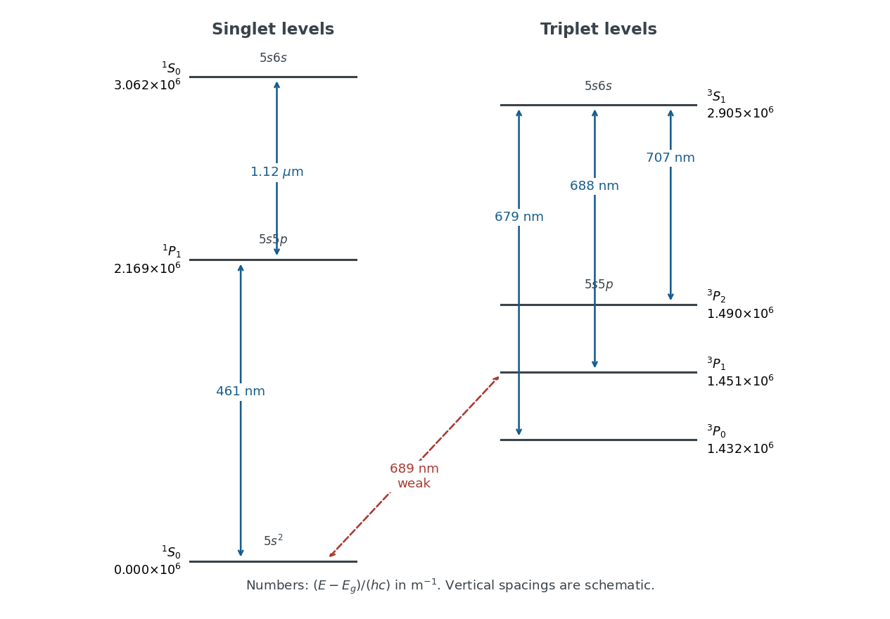

<h1 id="1/b/solution">Solution</h1>

↑ **Parent:** [B](../b.md)

Measure each [energy level](../../../../energy-level.md) by the [wavenumber](../../../../wavenumber.md) $\widetilde E=(E-E_g)/(hc)$ in $\mathrm{m^{-1}}$. An upward [electronic transition](../../../../electronic-transition.md) of vacuum [wavelength](../../../../wavelength.md) $\lambda$ adds $1/\lambda$. Treat the quoted [wavelengths](../../../../wavelength.md) as vacuum values to their limited accuracy; air corrections would be smaller than the precision justified here.

The strong ground-state [absorption](../../../../absorption-electromagnetic-radiation.md) must be $5s^2\,{}^1S_0\to5s5p\,{}^1P_1$ at $461\,\mathrm{nm}$. The weak ground-state [electronic transition](../../../../electronic-transition.md) at $689\,\mathrm{nm}$ must reach $5s5p\,{}^3P_1$: the [electric-dipole selection rule](../../../../electric-dipole-selection-rule.md) on $J$ excludes the other two [triplet state](../../../../spin-one-half-triplet-state.md) [energy levels](../../../../energy-level.md), while weak [spin-orbit coupling](../../../../spin-orbit-interaction.md) admixes [singlet state](../../../../singlet-state.md) character and relaxes the approximate [spin selection rule](../../../../spin-selection-rule.md).

Assume the usual ordering $E({}^3P_0)<E({}^3P_1)<E({}^3P_2)$, as expected from a positive effective [spin-orbit coupling](../../../../spin-orbit-interaction.md) constant. The three nearby strong [spectral lines](../../../../spectral-line.md) then join these [energy levels](../../../../energy-level.md) to a common $5s6s\,{}^3S_1$ [energy level](../../../../energy-level.md). Larger lower-state [energy](../../../../energy-split.md) means a smaller gap and longer [wavelength](../../../../wavelength.md), so $679,688,707\,\mathrm{nm}$ correspond to $J=0,1,2$ respectively. The remaining $1.12\,\mu\mathrm m$ [spectral line](../../../../spectral-line.md) joins $5s5p\,{}^1P_1$ and $5s6s\,{}^1S_0$. Assume the latter is the upper [energy level](../../../../energy-level.md). These assignments and orderings agree with independently tabulated [strontium](../../../../strontium.md) [energy levels](../../../../energy-level.md).[Entries for 5s², 5s5p and 5s6s; the tabulated energies use cm⁻¹ rather than m⁻¹](../../../../energy-levels-of-neutral-strontium-by-nist.md)

Starting with the two ground-state gaps, the construction is

$$
\begin{aligned}
\widetilde E({}^1P_1)&=(461\,\mathrm{nm})^{-1},\\
\widetilde E({}^3P_1)&=(689\,\mathrm{nm})^{-1},\\
\widetilde E({}^3S_1)&=\widetilde E({}^3P_1)+(688\,\mathrm{nm})^{-1},\\
\widetilde E({}^3P_0)&=\widetilde E({}^3S_1)-(679\,\mathrm{nm})^{-1},\\
\widetilde E({}^3P_2)&=\widetilde E({}^3S_1)-(707\,\mathrm{nm})^{-1},\\
\widetilde E(5s6s\,{}^1S_0)&=\widetilde E({}^1P_1)+(1.12\,\mu\mathrm m)^{-1}.
\end{aligned}
$$

The resulting [energy levels](../../../../energy-level.md), rounded to avoid suggesting spectroscopic precision, are

$$
\boxed{\begin{array}{c|r}
\text{level}&\widetilde E\ (\mathrm{m^{-1}})\\\hline
5s^2\,{}^1S_0&0\\
5s5p\,{}^3P_0&1.432\times10^6\\
5s5p\,{}^3P_1&1.451\times10^6\\
5s5p\,{}^3P_2&1.490\times10^6\\
5s5p\,{}^1P_1&2.169\times10^6\\
5s6s\,{}^3S_1&2.905\times10^6\\
5s6s\,{}^1S_0&3.062\times10^6
\end{array}}
$$

**[Figure 1](#1/b/image-strontium-level-assignments-inferred-from-the-supplied-wavelengths-vertical-spacings-are-schematic-and-numerical-energies-are-in-inverse-metres). Strontium level assignments inferred from the supplied wavelengths; vertical spacings are schematic and numerical energies are in inverse metres**.

**Both $461\,\mathrm{nm}$ and $1.12\,\mu\mathrm m$ exhibit the [normal Zeeman effect](../../../../normal-zeeman-effect.md).** Each connects two [singlet state](../../../../singlet-state.md) [energy levels](../../../../energy-level.md), with [Landé g-factor](../../../../lande-g-factor.md) $g_J=1$ for the $J=1$ [energy level](../../../../energy-level.md) and no first-order shift for $J=0$. Their [frequency](../../../../frequency.md) shifts are $0,\pm\mu_BB/h$. The weak $689\,\mathrm{nm}$ [spectral line](../../../../spectral-line.md) also has three components, but $g({}^3P_1)=3/2$ gives shifts $0,\pm3\mu_BB/(2h)$; a three-component pattern alone does not establish the [normal Zeeman effect](../../../../normal-zeeman-effect.md). The $679\,\mathrm{nm}$ [spectral line](../../../../spectral-line.md) likewise has three components with $g({}^3S_1)=2$.

## ↑ Ancestors (12)

1. [B](../b.md)
2. [1](../../1.md)
3. [2022](../../../2022-split.md)
4. [Past exam of the atomic and laser physics course of the University of Oxford](../../../split.md)
5. [Atomic and laser physics course of the University of Oxford](../../../../atomic-and-laser-physics-course-of-the-university-of-oxford.md)
6. [Year 3 of the physics course of the University of Oxford](../../../../year-3-of-the-physics-course-of-the-university-of-oxford.md)
7. [Physics course of the University of Oxford](../../../../physics-course-of-the-university-of-oxford.md)
8. [Undergraduate course of the University of Oxford](../../../../undergraduate-course-of-the-university-of-oxford.md)
9. [Course of the University of Oxford](../../../../course-of-the-university-of-oxford.md)
10. [University of Oxford](../../../../university-of-oxford-split.md)
11. [List of universities](../../../../list-of-universities.md)
12. [Codex Wiki](../../../../split.md)
