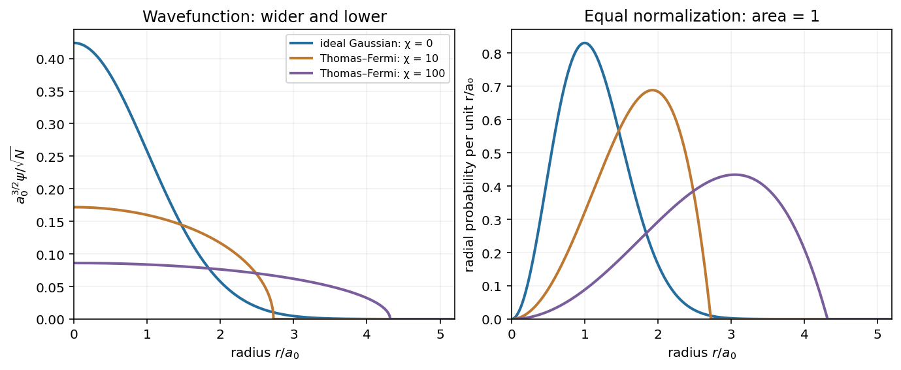
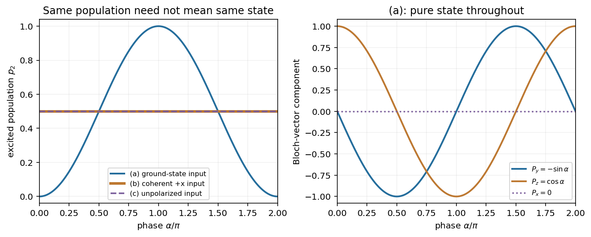

# Paper 1

↑ **Parent:** [2012](../2012.md)

Original examination: [Physical PDF pages 445–447; printed Paper 170, 18 January 2012](https://www.whatdotheyknow.com/request/natural_science_tripos_physics_e_2/response/2340776/attach/2/FOI%202023%20399%20Zahid%20materials.pdf?cookie_passthrough=1#page=445). All three optional questions and all three optional notes are treated below.

**Table of contents**

- [1](#1)
  - [Solution](#1/solution)
- [2](#2)
  - [Solution](#2/solution)
  - [a](#2/a)
    - [Solution](#2/a/solution)
  - [b](#2/b)
    - [Solution](#2/b/solution)
  - [c](#2/c)
    - [Solution](#2/c/solution)
- [3](#3)
  - [a](#3/a)
    - [Solution](#3/a/solution)
  - [b](#3/b)
    - [Solution](#3/b/solution)
  - [c](#3/c)
    - [Solution](#3/c/solution)

## 1

↑ **Parent:** [Paper 1](paper-1.md)

<h3 id="1/solution">Solution</h3>

↑ **Parent:** [1](#1)

Use the [condensate wavefunction](../../quantum-ideal-gas-statistics.md#condensate-wavefunction) convention $\int |\psi|^2\,d^3r=N$, so $n(\mathbf r)=|\psi(\mathbf r)|^2$ is the [number density](../../statistical-physics.md#number-density) and $\psi/\sqrt N$ is a normalized one-particle orbital. The [contact interaction](../../quantum-mechanics.md#contact-interaction-quantum-mechanics) strength is $U_0=4\pi\hbar^2a/m$ for dilute atoms with [s-wave scattering length](../../quantum-scattering.md#s-wave-scattering-length) $a$. The [chemical potential](../../chemical-potential.md) $\mu=\partial E/\partial N$ fixes the stationary time dependence $e^{-i\mu t/\hbar}$ and enforces normalization when minimizing the [energy](../../energy.md). The [Gross–Pitaevskii equation](../../quantum-ideal-gas-statistics.md#gross-pitaevskii-equation) follows from an [energy functional](../../calculus-of-variations.md#energy-functional) that contains the pair-counting factor $1/2$:

$$
E[\psi]=\int\left[\frac{\hbar^2}{2m}|\nabla\psi|^2+V|\psi|^2+\frac{U_0}{2}|\psi|^4\right]d^3r.
$$

Varying $E-\mu\int|\psi|^2d^3r$ gives the stationary [Gross–Pitaevskii equation](../../quantum-ideal-gas-statistics.md#gross-pitaevskii-equation); the interaction contribution to that equation is $U_0 n\psi$, without the factor $1/2$.

For the broadening discussed here assume **repulsive interactions**, $a>0$. The [Thomas–Fermi approximation for a condensate](../../quantum-ideal-gas-statistics.md#thomas-fermi-approximation-for-a-condensate) neglects the [gradient](../../multivariable-calculus.md#gradient) [kinetic energy](../../energy.md#kinetic-energy) compared with the trapping and interaction [energies](../../energy.md). At fixed spatial scale, increasing $N U_0$ increases the mean-field potential. Expansion then reduces the [kinetic energy](../../energy.md#kinetic-energy) further: for a cloud radius $R$, its scale per atom is $\hbar^2/(mR^2)$, whereas the trap [energy](../../energy.md) scale is $m\omega^2R^2$. Their ratio decreases as $(a_0/R)^4$. In the weak-interaction limit the [kinetic energy](../../energy.md#kinetic-energy) instead balances confinement, giving the [Gaussian wave packet](../../wave-function.md#gaussian-wave-packet) [ground state](../../quantum-mechanics.md#ground-state) of the [quantum harmonic oscillator](../../quantum-harmonic-oscillator.md).

The [spherical Thomas–Fermi condensate](../../quantum-ideal-gas-statistics.md#spherical-thomas-fermi-condensate) has

$$
 n_{\rm TF}(r)=\frac{\mu-\tfrac12m\omega^2r^2}{U_0}\quad(0\leq r\leq R),\qquad n_{\rm TF}(r)=0\quad(r>R),\qquad \mu=\tfrac12m\omega^2R^2.
$$

Integrating this [density](../../fluid-mechanics.md#density) gives $N=8\pi\mu R^3/(15U_0)$. Thus

$$
\boxed{R=a_0(15Na/a_0)^{1/5},\qquad \mu_{\rm TF}=\frac{\hbar\omega}{2}(15Na/a_0)^{2/5}.}
$$

At fixed $N$, stronger repulsion produces a wider, lower [wavefunction](../../wave-function.md): the [Gaussian wave packet](../../wave-function.md#gaussian-wave-packet) crosses over towards the [square root](../../algebra.md#square-root) of an inverted [parabola](../../euclidean-geometry.md#parabola), with an almost flat central region and a steeper outer drop. The _[density](../../fluid-mechanics.md#density)_ is the inverted [parabola](../../euclidean-geometry.md#parabola); the _[wavefunction](../../wave-function.md)_ is its [square root](../../algebra.md#square-root). The exact [wavefunction](../../wave-function.md) remains smooth and has a tail, since [kinetic energy](../../energy.md#kinetic-energy) cannot be neglected near the [Thomas–Fermi condensate edge rounding](../../quantum-ideal-gas-statistics.md#thomas-fermi-condensate-edge-rounding) region. The [healing length](../../quantum-ideal-gas-statistics.md#healing-length) must be small compared with the cloud size in the bulk. Attractive interactions would not follow this large-$N$ expansion argument.

The original plot compares the noninteracting endpoint with two normalized repulsive [spherical Thomas–Fermi condensate](../../quantum-ideal-gas-statistics.md#spherical-thomas-fermi-condensate) profiles. The latter are asymptotic shapes, rather than exact intermediate solutions of the [Gross–Pitaevskii equation](../../quantum-ideal-gas-statistics.md#gross-pitaevskii-equation). Each has the same integrated atom number; $\chi=Na/a_0$ labels the illustrative interaction strengths.

**[Figure 1](#1/image-condensate-broadening). Condensate broadening**.

Choose $A$ real and positive. The [Gaussian integral](../../integral.md#gaussian-integral) gives

$$
N=A^2\pi^{3/2}a_0^3,\qquad
\boxed{A=\frac{\sqrt N}{\pi^{3/4}a_0^{3/2}},\quad \mu_0=\frac32\hbar\omega,\quad E_0=\frac32N\hbar\omega.}
$$

The three [zero-point energies](../../quantum-harmonic-oscillator.md#zero-point-energy) add for each atom. The ideal-gas [chemical potential](../../chemical-potential.md) is a one-atom [energy](../../energy.md); the total [energy](../../energy.md) includes all $N$ atoms.

For weak interactions, the first-order correction in [perturbation theory](../../asymptotic-expansion.md#perturbation-theory) is the [energy functional](../../calculus-of-variations.md#energy-functional) of the [contact interaction](../../quantum-mechanics.md#contact-interaction-quantum-mechanics) evaluated on the unperturbed [Gaussian wave packet](../../wave-function.md#gaussian-wave-packet). The [integral](../../integral.md) needed is

$$
\int |\psi_0|^4d^3r=\frac{N^2}{\pi^3a_0^6}\left(\frac{\pi a_0^2}{2}\right)^{3/2}=\frac{N^2}{(2\pi)^{3/2}a_0^3}.
$$

Consequently the [Gaussian interaction energy of a trapped condensate](../../quantum-ideal-gas-statistics.md#gaussian-interaction-energy-of-a-trapped-condensate) is

$$
\boxed{E_I=\frac{N^2U_0}{2(2\pi)^{3/2}a_0^3},\qquad \frac{E_I}{\hbar\omega}=\frac{N^2a}{\sqrt{2\pi}\,a_0}.}
$$

Here $\hbar\omega=\hbar^2/(ma_0^2)$. These are the mean-field expressions consistent with the supplied equation and $\int|\psi|^2=N$. Exact first-order [perturbation theory](../../asymptotic-expansion.md#perturbation-theory) for precisely $N$ atoms in one orbital replaces $N^2$ by $N(N-1)$ through the number of distinct pairs; this distinction is negligible in the large-$N$ regime of the crossover estimate.

To judge the ideal-gas approximation, compare the interaction [energy](../../energy.md) with the _total_ ideal [energy](../../energy.md), or compare the interaction [energy](../../energy.md) per atom with $\hbar\omega$:

$$
\frac{E_I}{E_0}=\frac{2}{3\sqrt{2\pi}}\frac{Na}{a_0}.
$$

Thus the [crossover from Gaussian to Thomas–Fermi condensate](../../quantum-ideal-gas-statistics.md#crossover-from-gaussian-to-thomas-fermi-condensate) is governed by $\chi=Na/a_0$: [perturbation theory](../../asymptotic-expansion.md#perturbation-theory) is reliable for $\chi\ll1$, while the regime of the [Thomas–Fermi approximation for a condensate](../../quantum-ideal-gas-statistics.md#thomas-fermi-approximation-for-a-condensate) requires $\chi\gg1$. **The characteristic crossover number is $N_c\sim a_0/a$; there is no sharp critical atom number here.** If one specifically defines crossover by $E_I=E_0$ using the weak-interaction expression, it gives $N_c=(3\sqrt{2\pi}/2)a_0/a$. That prefactor is a convention-dependent estimate extrapolated to the edge of [perturbation theory](../../asymptotic-expansion.md#perturbation-theory), not a phase transition. Comparing $E_I$ itself to a single $\hbar\omega$ would incorrectly omit a factor of $N$.

For the numerical estimate use $m\simeq87\times1.66054\times10^{-27}\,\mathrm{kg}$ and $\hbar\simeq1.05457\times10^{-34}\,\mathrm{J\,s}$. Then

$$
a_0=\sqrt{\frac{\hbar}{m(2\pi\times50\,\mathrm{s^{-1}})}}\simeq1.52\,\mathrm{\mu m},\qquad
\boxed{N_c\sim\frac{a_0}{a}\simeq3.0\times10^2\ \text{atoms}.}
$$

The particular equality $E_I=E_0$ would instead give about $1.15\times10^3$ atoms. These quantify different choices within a smooth crossover; a well-developed [spherical Thomas–Fermi condensate](../../quantum-ideal-gas-statistics.md#spherical-thomas-fermi-condensate) profile requires going substantially beyond the characteristic scale.

## 2

↑ **Parent:** [Paper 1](paper-1.md)

<h3 id="2/solution">Solution</h3>

↑ **Parent:** [2](#2)

Fix the [qubit polarization](../../density-matrix.md#qubit-polarization) convention by $\rho=(I+\vec P\cdot\vec\sigma)/2$, where the [Pauli matrices](../../algebra.md#pauli-matrices) are ordered in the basis $(|1\rangle,|2\rangle)$ and $\sigma_z=|1\rangle\langle1|-|2\rangle\langle2|$. Thus the [ground state](../../quantum-mechanics.md#ground-state) is the north pole of the [Bloch sphere](../../density-matrix.md#bloch-sphere). In a [rotating frame](../../mathematical-physics.md#rotating-reference-frame) and within the [rotating-wave approximation](../../quantum-mechanics.md#rotating-wave-approximation), choose the drive phase and detuning sign so that

$$
H_R=\frac\hbar2(\Omega\sigma_x+\Delta\sigma_z),\qquad
\dot{\vec P}=(\Omega,0,\Delta)\times\vec P.
$$

For example, with this ground-state convention one may take $\Delta=\omega_L-\omega_0$ and choose the transverse coupling positive. The [Bloch vector](../../density-matrix.md#bloch-vector) precesses around the effective field $(\Omega,0,\Delta)$ at [angular frequency](../../lagrangian-mechanics.md#angular-frequency) $\Omega_R=\sqrt{\Omega^2+\Delta^2}$, tracing a circle at fixed projection on that axis. Its length is conserved under coherent [unitary time evolution](../../quantum-system.md#unitary-time-evolution). On resonance the axis is transverse and the [Rabi oscillation](../../quantum-system.md#rabi-cycle) can fully invert an initially ground-state atom. Away from resonance the axis tilts, and

$$
P_{1\to2}(t)=\frac{\Omega^2}{\Omega^2+\Delta^2}\sin^2\!\left(\frac{\Omega_Rt}{2}\right).
$$

There is no relaxation towards an equilibrium [Bloch vector](../../density-matrix.md#bloch-vector) in this ideal model. An inhomogeneous ensemble can nevertheless lose its _averaged_ [qubit polarization](../../density-matrix.md#qubit-polarization) through [dephasing](../../quantum-information-theory.md#dephasing-channel) even without [spontaneous emission](../../atomic-physics.md#spontaneous-emission); the circle description assumes a common drive and detuning.

For $|a|^2+|b|^2=1$, the stated [quantum state](../../quantum-system.md#quantum-state) gives

$$
\rho=|\Psi\rangle\langle\Psi|=
\begin{pmatrix}|a|^2&ab^*\\a^*b&|b|^2\end{pmatrix},\qquad
\vec P=(2\operatorname{Re}(a^*b),\,2\operatorname{Im}(a^*b),\,|a|^2-|b|^2).
$$

The diagonal elements are the two state populations. The off-diagonal elements are [quantum coherences](../../density-matrix.md#quantum-coherence-in-a-specified-basis): they retain the [relative quantum phase](../../quantum-system.md#relative-quantum-phase) and determine [interference](../../physical-optics.md#interference-wave-propagation) under a subsequent pulse. **This is a [pure state](../../quantum-theory.md#pure-state)**, even if both populations are nonzero: $\rho^2=\rho$, $\operatorname{Tr}\rho^2=1$, and $|\vec P|=1$. A [mixed state](../../density-matrix.md#mixed-state) averages projectors over preparation [probabilities](../../probability-theory.md#probability) and generally has $\operatorname{Tr}\rho^2<1$. Equal populations alone do not distinguish an equal coherent [superposition](../../vector-space.md#superposition-principle) from an unpolarized mixture.

For use in all three cases, multiplication of the gates gives the [Hadamard-phase-Hadamard qubit rotation](../../quantum-theory.md#hadamard-phase-hadamard-qubit-rotation)

$$
U=HP_\alpha H=\frac12\begin{pmatrix}1+e^{i\alpha}&1-e^{i\alpha}\\1-e^{i\alpha}&1+e^{i\alpha}\end{pmatrix}
=e^{i\alpha/2}\exp(-i\alpha\sigma_x/2).
$$

The [global phase](../../quantum-system.md#global-phase) cancels in $\rho'=U\rho U^\dagger$. Thus the [Bloch vector](../../density-matrix.md#bloch-vector) map is

$$
\boxed{(P_x,P_y,P_z)\longmapsto(P_x,\,P_y\cos\alpha-P_z\sin\alpha,\,P_y\sin\alpha+P_z\cos\alpha).}
$$

The final unlabelled [Ramsey spectroscopy](../../quantum-system.md#ramsey-spectroscopy) comparison applies to the three cases as follows. In an [atomic clock](../../special-relativity.md#atomic-clock), an initial coherent pulse prepares a [superposition](../../vector-space.md#superposition-principle), a free interval $T$ accumulates a [relative quantum phase](../../quantum-system.md#relative-quantum-phase) proportional to detuning times $T$, and a final coherent pulse converts that phase to a population. Here $\alpha$ plays the role of that accumulated phase, with sign and fringe offset set by pulse conventions. In (a), the first [Hadamard gate](../../quantum-theory.md#hadamard-gate) creates the needed [superposition](../../vector-space.md#superposition-principle) and the final gate reveals full-contrast [Ramsey interferometry](../../quantum-system.md#ramsey-interferometry). In (b), the first [Hadamard gate](../../quantum-theory.md#hadamard-gate) instead puts the state in $|1\rangle$, so the intervening [phase gate](../../quantum-theory.md#phase-gate) has no [relative quantum phase](../../quantum-system.md#relative-quantum-phase) to imprint: the output is independent of $\alpha$. In (c), the unpolarized [density matrix](../../density-matrix.md) remains unchanged under every gate, so the ensemble has no [Ramsey interferometry](../../quantum-system.md#ramsey-interferometry) contrast. A coherent [unitary gate](../../quantum-circuit.md#quantum-logic-gate) alone cannot initialize a maximally mixed ensemble into a pure clock state.

The [Ramsey interferometry](../../quantum-system.md#ramsey-interferometry) analogy concerns preparation, phase accumulation, and readout; **a [Hadamard gate](../../quantum-theory.md#hadamard-gate) is not literally a transverse $\pi/2$ [rotation](../../riemannian-geometry.md#rotation-mathematics) on every input**. In this basis $H=R_y(\pi/2)\sigma_z$, and its [Bloch sphere](../../density-matrix.md#bloch-sphere) action is a $\pi$ [rotation](../../riemannian-geometry.md#rotation-mathematics) about $(\hat x+\hat z)/\sqrt2$, up to a [global phase](../../quantum-system.md#global-phase). The phase conventions of physical [Ramsey spectroscopy](../../quantum-system.md#ramsey-spectroscopy) pulses must be specified to compare their outputs for arbitrary initial states.

<h3 id="2/a">a</h3>

↑ **Parent:** [2](#2)

<h4 id="2/a/solution">Solution</h4>

↑ **Parent:** [A](#2/a)

Following the [pure state](../../quantum-theory.md#pure-state) through the first two gates gives $(|1\rangle+e^{i\alpha}|2\rangle)/\sqrt2$. After the last [Hadamard gate](../../quantum-theory.md#hadamard-gate) it is

$$
|\Psi_f\rangle=e^{i\alpha/2}\left[\cos(\alpha/2)|1\rangle-i\sin(\alpha/2)|2\rangle\right].
$$

Using the [qubit polarization](../../density-matrix.md#qubit-polarization) convention defined above,

$$
\boxed{\vec P_f=(0,-\sin\alpha,\cos\alpha),\qquad p_2=\sin^2(\alpha/2).}
$$

The output remains pure and has unit [Bloch vector](../../density-matrix.md#bloch-vector) length. The population oscillation is the [Ramsey interferometry](../../quantum-system.md#ramsey-interferometry) fringe: the first gate supplies [quantum coherence](../../density-matrix.md#quantum-coherence-in-a-specified-basis), and the last turns the acquired [relative quantum phase](../../quantum-system.md#relative-quantum-phase) into a measurable population difference.

<h3 id="2/b">b</h3>

↑ **Parent:** [2](#2)

<h4 id="2/b/solution">Solution</h4>

↑ **Parent:** [B](#2/b)

The first [Hadamard gate](../../quantum-theory.md#hadamard-gate) maps the prepared [superposition](../../vector-space.md#superposition-principle) $|+\rangle=(|1\rangle+|2\rangle)/\sqrt2$ to $|1\rangle$. The [phase gate](../../quantum-theory.md#phase-gate) leaves that state unchanged, and the last [Hadamard gate](../../quantum-theory.md#hadamard-gate) returns it to $|+\rangle$. Therefore

$$
\boxed{|\Psi_f\rangle=|+\rangle,\qquad \vec P_f=(1,0,0),\qquad p_2=\tfrac12.}
$$

This is a fully polarized [pure state](../../quantum-theory.md#pure-state), not an unpolarized ensemble. Its [Bloch vector](../../density-matrix.md#bloch-vector) lies along the [rotation](../../riemannian-geometry.md#rotation-mathematics) axis of the combined operation. There is **no [Ramsey interferometry](../../quantum-system.md#ramsey-interferometry) fringe as $\alpha$ varies**, because the state during phase accumulation occupies only one basis level. [Quantum coherence](../../density-matrix.md#quantum-coherence-in-a-specified-basis) in the _final_ state alone does not guarantee phase sensitivity to the specified sequence.

<h3 id="2/c">c</h3>

↑ **Parent:** [2](#2)

<h4 id="2/c/solution">Solution</h4>

↑ **Parent:** [C](#2/c)

For an unpolarized ensemble $\rho_i=I/2$. Every [unitary gate](../../quantum-circuit.md#quantum-logic-gate) satisfies $U(I/2)U^\dagger=I/2$, so

$$
\boxed{\rho_f=\tfrac12I,\qquad \vec P_f=(0,0,0),\qquad p_1=p_2=\tfrac12.}
$$

The [purity](../../density-matrix.md#purity-of-a-density-operator) remains $1/2$. Equal populations here come with zero [quantum coherence](../../density-matrix.md#quantum-coherence-in-a-specified-basis), unlike the state in (b). There is **no [Ramsey interferometry](../../quantum-system.md#ramsey-interferometry) fringe**: the two orthogonal components of any equal-weight ensemble decomposition give cancelling population responses. [Quantum state preparation](../../quantum-circuit.md#quantum-state-preparation) that reduces the ensemble [entropy](../../entropy.md) is needed for the usual polarized clock interrogation.

**[Figure 2](#2/c/image-gate-sequence-populations). Gate sequence populations**.

The original plot compares the three excited-state populations. The constant $1/2$ lines coincide despite the very different [purities](../../density-matrix.md#purity-of-a-density-operator) in (b) and (c).

## 3

↑ **Parent:** [Paper 1](paper-1.md)

<h3 id="3/a">a</h3>

↑ **Parent:** [3](#3)

<h4 id="3/a/solution">Solution</h4>

↑ **Parent:** [A](#3/a)

**[Laser cooling](../../atomic-physics.md#laser-cooling) removes atomic [kinetic energy](../../energy.md#kinetic-energy) through a velocity-dependent optical [force](../../force.md), with scattered [photons](../../quantum-mechanics.md#photon) carrying away [energy](../../energy.md) and [entropy](../../entropy.md).** For two counterpropagating beams detuned below resonance, motion towards one beam shifts that light closer to resonance, so the atom preferentially absorbs [momentum](../../momentum.md) opposite its [velocity](../../classical-mechanics.md#velocity). At small [velocity](../../classical-mechanics.md#velocity) the net [force](../../force.md) is $F\simeq-\gamma_v v$ with $\gamma_v>0$. Three orthogonal beam pairs form [optical molasses](../../atomic-physics.md#optical-molasses). [Spontaneous emission](../../atomic-physics.md#spontaneous-emission) has zero mean recoil in a symmetric distribution, but its [momentum](../../momentum.md) variance is nonzero: random absorption and emission cause heating. The cooling and heating balance sets a finite [temperature](../../temperature.md).

For a weakly saturated two-level transition, write $\delta=\omega_L-\omega_0<0$ and let $\Gamma$ be the excited-state population decay rate. A useful one-axis [Doppler cooling](../../atomic-physics.md#doppler-cooling) expression is

$$
k_BT(\delta)=\frac{\hbar\Gamma}{4}\frac{1+(2\delta/\Gamma)^2}{-2\delta/\Gamma},\qquad
\boxed{\delta_{\rm opt}=-\Gamma/2,\quad T_D=\frac{\hbar\Gamma}{2k_B}.}
$$

This limit belongs to the weak-intensity [Doppler cooling](../../atomic-physics.md#doppler-cooling) model, with [recoil energy](../../optics.md#recoil-energy) small compared with $\hbar\Gamma$. Experimentally, released sodium molasses clouds were probed by time of flight; the unusually small expansion demonstrated [temperatures](../../temperature.md) below that limit. This distinguishes an observed failure of a two-level cooling model from a failure of [conservation of energy](../../mathematical-physics.md#conservation-of-energy).[pp. 729–732, Doppler limit, optical molasses, and release/time-of-flight thermometry](../../physics-bibliography.md#nobel-lecture-laser-cooling-and-trapping-of-neutral-atoms-by-william-d-phillips)

Multilevel atoms permit [polarization-gradient cooling](../../atomic-physics.md#polarization-gradient-cooling): spatially varying light [polarization](../../wave.md#polarization-waves) produces different [light shifts](../../mathematical-physics.md#ac-stark-shift) of ground-state sublevels. In [Sisyphus cooling](../../atomic-physics.md#sisyphus-cooling), atoms climb a light-shift potential and are preferentially optically pumped near its top into a lower-energy sublevel, repeatedly losing [kinetic energy](../../energy.md#kinetic-energy). The [optical pumping](../../atomic-physics.md#optical-pumping) and emitted light supply dissipation. This can reach below the [Doppler cooling limit](../../atomic-physics.md#doppler-cooling-limit); the recoil scale

$$
E_R=\frac{(\hbar k)^2}{2m},\qquad T_R=E_R/k_B
$$

then becomes important. The definition of a recoil [temperature](../../temperature.md) sometimes differs by a factor of two, so the [energy](../../energy.md) definition is the unambiguous comparison. Recoil is not a universal lower bound for every cooling protocol: suitable dark-state or [resolved sideband cooling](../../atomic-physics.md#resolved-sideband-cooling) schemes can suppress scattering near the desired motional state. [Resolved sideband cooling](../../atomic-physics.md#resolved-sideband-cooling) preferentially excites a transition lowering the vibrational [quantum number](../../quantum-system.md#quantum-number), followed by decay that on average preserves it in the [Lamb-Dicke regime](../../atomic-physics.md#lamb-dicke-regime).[Section IV, cooling of quantized ion motion](../../physics-bibliography.md#nobel-lecture-superposition-entanglement-and-raising-schrodinger’s-cat-by-david-j-wineland)

[Optical molasses](../../atomic-physics.md#optical-molasses) supplies damping rather than a position-restoring [force](../../force.md). A [magneto-optical trap](../../atomic-physics.md#magneto-optical-trap) adds a magnetic-field [gradient](../../multivariable-calculus.md#gradient) and appropriately chosen circular [polarizations](../../wave.md#polarization-waves); the position-dependent [Zeeman splitting](../../atomic-physics.md#zeeman-splitting) gives a restoring [radiation pressure](../../pressure.md#radiation-pressure) imbalance as well as damping. In real alkali atoms, repumping light returns population that would otherwise accumulate in an uncoupled hyperfine level. Magnetic and [optical dipole traps](../../atomic-physics.md#optical-dipole-trap) can subsequently hold the cold sample without continuous resonant scattering.

**Applications include long-interrogation [atomic clocks](../../special-relativity.md#atomic-clock), precision [spectroscopy](../../physics.md#spectroscopy), [atom interferometry](../../atomic-physics.md#atom-interferometry), and preparation for [quantum simulation](../../quantum-information-theory.md#quantum-simulation) and [Bose-Einstein condensation](../../quantum-ideal-gas-statistics.md#bose-einstein-condensation).** Cooling reduces motion-induced [frequency](../../wave.md#frequency) shifts and allows longer coherent interrogation; deeper [quantum degeneracy](../../quantum-mechanics.md#degenerate-energy-levels) commonly needs subsequent [evaporative cooling of atoms](../../atomic-physics.md#evaporative-cooling-atomic-physics). Finite capture [velocity](../../classical-mechanics.md#velocity), available transitions, recoil heating, stray [magnetic fields](../../magnetic-field.md), and loss or heating from unwanted scattering constrain a real experiment.

<h3 id="3/b">b</h3>

↑ **Parent:** [3](#3)

<h4 id="3/b/solution">Solution</h4>

↑ **Parent:** [B](#3/b)

**A [quantum computing](../../computer-science.md#quantum-computing) apparatus needs a scalable [quantum register](../../quantum-circuit.md#quantum-register) of controllable [qubits](../../quantum-system.md#qubit), reproducible initialization, a [universal quantum gate set](../../quantum-circuit.md#universal-quantum-gate-set), sufficiently long [quantum coherence](../../density-matrix.md#quantum-coherence-in-a-specified-basis), and selective readout.** A [qubit](../../quantum-system.md#qubit) is a two-dimensional state space; several [qubits](../../quantum-system.md#qubit) occupy a [tensor product](../../multilinear-algebra.md#tensor-product) space and can develop [entanglement](../../bell-state.md#entangled-state). [Quantum state preparation](../../quantum-circuit.md#quantum-state-preparation) must establish a known low-entropy input and supply fresh [ancillas](../../quantum-information-theory.md#quantum-ancilla) during [quantum error correction](../../quantum-error-correction.md). A [universal quantum gate set](../../quantum-circuit.md#universal-quantum-gate-set) may use arbitrary single-qubit [rotations](../../riemannian-geometry.md#rotation-mathematics) with an entangling two-qubit gate such as [controlled-NOT gate](../../quantum-theory.md#controlled-not-gate). [Quantum coherence](../../density-matrix.md#quantum-coherence-in-a-specified-basis) and control fidelity must suffice for the intended circuit, and measurement must recover chosen output [probabilities](../../probability-theory.md#probability) without uncontrolled disturbance of other [qubits](../../quantum-system.md#qubit). These are the five [DiVincenzo criteria](../../computer-science.md#divincenzo-criteria).[Section III, requirements 1–5](../../physics-bibliography.md#the-physical-implementation-of-quantum-computation-by-david-p-divincenzo)

An atomic implementation can encode [qubits](../../quantum-system.md#qubit) in two long-lived internal levels, initialize them by [optical pumping](../../atomic-physics.md#optical-pumping), drive coherent transitions with [laser](../../laser.md) or microwave pulses, couple selected [qubits](../../quantum-system.md#qubit) through a shared interaction, and distinguish states by state-dependent fluorescence. For trapped ions, a shared vibrational mode can mediate entangling gates, so motional control and cooling are part of the computational apparatus. The motion is a resource only while uncontrolled heating does not erase the required [quantum coherence](../../density-matrix.md#quantum-coherence-in-a-specified-basis).

The computational resource is coherent control of amplitudes and [entanglement](../../bell-state.md#entangled-state), with [interference](../../physical-optics.md#interference-wave-propagation) making useful outcomes likely. An $n$-qubit [pure state](../../quantum-theory.md#pure-state) has $2^n$ basis amplitudes, but a single measurement does **not** reveal those amplitudes or all possible answers. Algorithms exploit structure rather than simply reading out parallel classical computations. The [Shor algorithm](../../quantum-theory.md#shor-s-algorithm) gives factoring with polynomial resource scaling in the input bit length, compared with the best known classical algorithms' superpolynomial scaling; an exponential classical lower bound has not been proved.[Abstract, polynomial running time in the number of input digits](../../physics-bibliography.md#polynomial-time-algorithms-for-prime-factorization-and-discrete-logarithms-on-a-quantum-computer-by-peter-w-shor) [Grover's algorithm](../../quantum-theory.md#grover-s-algorithm) uses order $\sqrt M$ oracle queries for unstructured search among $M$ possibilities, a quadratic query improvement.[Abstract and algorithmic query scaling](../../physics-bibliography.md#a-fast-quantum-mechanical-algorithm-for-database-search-by-lov-grover) [Quantum simulation](../../quantum-information-theory.md#quantum-simulation) is a further motivation because interacting quantum systems can require exponentially many classical amplitudes for a direct generic representation.

The main challenges are [quantum decoherence](../../quantum-theory.md#quantum-decoherence), fluctuating control fields, imperfect gates, leakage out of the [qubit](../../quantum-system.md#qubit) subspace, readout errors, crosstalk, and the difficulty of scaling connectivity and calibration. Faster control can introduce extra errors, while stronger isolation can make preparation and readout harder. [Quantum error correction](../../quantum-error-correction.md) encodes logical information redundantly in several physical [qubits](../../quantum-system.md#qubit) and extracts error syndromes without measuring the unknown logical state itself. [Fault-tolerant quantum computation](../../quantum-error-correction.md#fault-tolerant-quantum-computation) prevents the correction apparatus and gates from spreading a few faults into uncorrectable logical errors. It requires error rates below an architecture- and noise-dependent threshold and substantial resources; there is no universal numerical threshold for all implementations. **Advantages are task-dependent, while reliable scaling requires both coherent hardware and error control.**

<h3 id="3/c">c</h3>

↑ **Parent:** [3](#3)

<h4 id="3/c/solution">Solution</h4>

↑ **Parent:** [C](#3/c)

**[Evaporative cooling of atoms](../../atomic-physics.md#evaporative-cooling-atomic-physics) selectively removes atoms with unusually high total [energy](../../energy.md), then [elastic collisions](../../classical-mechanics.md#elastic-collision) rethermalize those remaining.** Loss of particles alone is insufficient: the lost atoms must carry more than the mean [energy](../../energy.md) per particle if the [temperature](../../temperature.md) is to fall. The process is open and dissipative, so it can increase the [phase-space density of an atomic gas](../../quantum-ideal-gas-statistics.md#phase-space-density-of-an-atomic-gas) in the remaining sample while reducing its atom number. As the [temperature](../../temperature.md) falls, the cutoff must be lowered to keep replenishing a useful escaping tail; a fixed high cutoff eventually gives negligible evaporation.

An experimental sequence first loads laser-cooled atoms into a conservative trap and suppresses resonant-light heating. In a trap using [magnetic trapping of neutral atoms](../../tensor-product-of-quantum-systems.md#magnetic-trapping-of-neutral-atoms), a [radiofrequency evaporation knife](../../atomic-physics.md#radiofrequency-evaporation-knife) drives a [Zeeman splitting](../../atomic-physics.md#zeeman-splitting) transition from a trapped weak-field-seeking state to an untrapped state on a surface where the splitting matches the radiofrequency [photon](../../quantum-mechanics.md#photon) [energy](../../energy.md). Only atoms energetic enough to reach that surface escape. Lowering the radiofrequency cutoff progressively removes less energetic atoms. Alternatively, lowering an [optical dipole trap](../../atomic-physics.md#optical-dipole-trap)'s depth permits energetic atoms to spill out. This changes confinement as well as the escape cutoff, so it can reduce the collision rate. Radiofrequency-selective evaporation and the need for favourable elastic-collision and background-loss rates are documented in the original condensate experiments.[pp. 880–882, elastic/background collisions, magnetic confinement, and radiofrequency evaporation](../../physics-bibliography.md#nobel-lecture-bose-einstein-condensation-in-a-dilute-gas-the-first-70-years-and-some-recent-experiments-by-eric-a-cornell-and-carl-wieman)

The [elastic collision](../../classical-mechanics.md#elastic-collision) rate $\Gamma_{\rm el}\sim n\sigma_{\rm el}\bar v$ must be large enough for [elastic rethermalization of a trapped atomic gas](../../atomic-physics.md#elastic-rethermalization-of-a-trapped-atomic-gas) throughout evaporation, and much faster than unwanted loss and heating. A clean vacuum reduces background collisions; suitable trapping states suppress inelastic spin-changing loss, and [density](../../fluid-mechanics.md#density) must not make [three-body recombination](../../atomic-physics.md#three-body-recombination) dominant. The cutoff ramp should allow equilibration without taking so long that background losses dominate. A large [evaporation truncation parameter](../../atomic-physics.md#evaporation-truncation-parameter) $\eta=\epsilon_{\rm cut}/(k_BT)$ selects energetically valuable atoms, but an excessively large value suppresses their escape rate. A very small value discards too many useful low-energy atoms. If [elastic collisions](../../classical-mechanics.md#elastic-collision) become more frequent as evaporation proceeds, the resulting [runaway evaporative cooling](../../atomic-physics.md#runaway-evaporative-cooling) can improve efficiency; it is not automatic in a weakening optical trap.

The [energy selectivity for evaporation to increase phase-space density](../../atomic-physics.md#energy-selectivity-for-evaporation-to-increase-phase-space-density) can be made precise in a classical three-dimensional harmonic trap with _fixed [frequencies](../../wave.md#frequency)_. [Equipartition](../../canonical-ensemble.md#equipartition-theorem) gives $E=3Nk_BT$. If each escaping atom removes mean [energy](../../energy.md) $\epsilon_{\rm ev}$, [energy](../../energy.md) balance is $dE=\epsilon_{\rm ev}\,dN$ with $dN<0$, so

$$
\alpha_{\rm ev}\equiv\frac{d\ln T}{d\ln N}=\frac{\epsilon_{\rm ev}/(k_BT)-3}{3}.
$$

The peak [harmonic-trap phase-space density](../../quantum-ideal-gas-statistics.md#harmonic-trap-phase-space-density) is $\mathcal D=N(\hbar\bar\omega/(k_BT))^3$. Therefore

$$
\boxed{\frac{d\ln\mathcal D}{d\ln N}=4-\frac{\epsilon_{\rm ev}}{k_BT}.}
$$

Cooling requires $\epsilon_{\rm ev}>3k_BT$; increasing $\mathcal D$ despite atom loss requires the stronger condition $\epsilon_{\rm ev}>4k_BT$. These inequalities assume rapid thermalization and no work from changing trap [frequencies](../../wave.md#frequency). They distinguish lower [temperature](../../temperature.md) from genuinely improved [quantum degeneracy](../../quantum-mechanics.md#degenerate-energy-levels). Eventually [quantum statistics](../../quantum-ideal-gas-statistics.md) and inelastic processes require a refinement of this classical estimate. **Efficient evaporation combines energy-selective loss, rapid elastic redistribution, and low unwanted loss; it can bring a precooled gas to [Bose-Einstein condensation](../../quantum-ideal-gas-statistics.md#bose-einstein-condensation).**

## ↑ Ancestors (11)

1. [2012](../2012.md)
2. [Past exam of the atomic and Optical Physics course of the University of Cambridge](../../past-exam-of-the-atomic-and-optical-physics-course-of-the-university-of-cambridge.md)
3. [Atomic and Optical Physics course of the University of Cambridge](../../university-of-cambridge.md#atomic-and-optical-physics-course-of-the-university-of-cambridge)
4. [Physics course of the year 4 of the natural sciences course of the University of Cambridge](../../university-of-cambridge.md#physics-course-of-the-year-4-of-the-natural-sciences-course-of-the-university-of-cambridge)
5. [Year 4 of the natural sciences course of the University of Cambridge](../../university-of-cambridge.md#year-4-of-the-natural-sciences-course-of-the-university-of-cambridge)
6. [Year of the natural sciences course of the University of Cambridge](../../university-of-cambridge.md#year-of-the-natural-sciences-course-of-the-university-of-cambridge)
7. [Natural sciences course of the University of Cambridge](../../university-of-cambridge.md#natural-sciences-course-of-the-university-of-cambridge)
8. [Course of the University of Cambridge](../../university-of-cambridge.md#course-of-the-university-of-cambridge)
9. [University of Cambridge](../../university-of-cambridge.md)
10. [List of universities](../../README.md#list-of-universities)
11. [Codex Wiki](../../README.md)
