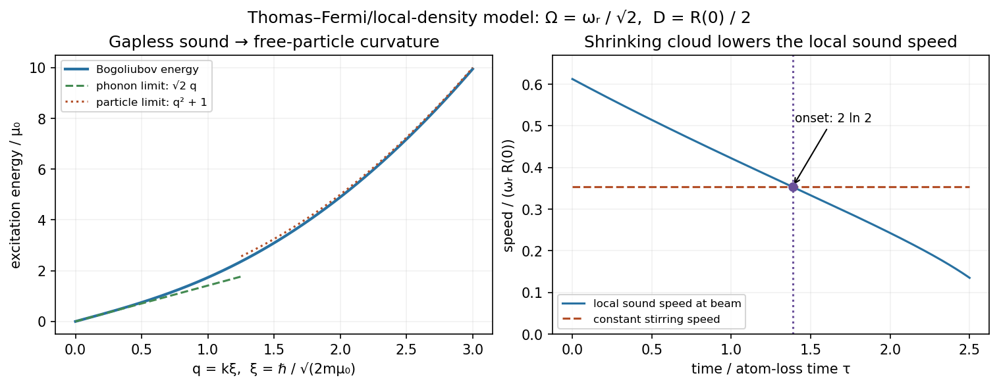

<h1 id="2/solution">Solution</h1>

↑ **Parent:** [2](../2.md)

For the [Bogoliubov spectrum](../../../../bogoliubov-quasiparticle-dispersion.md), define $\epsilon_k=\hbar^2k^2/(2m)$ and $E_k=\sqrt{\epsilon_k(\epsilon_k+2\mu_0)}$. For repulsive interactions and $\mu_0>0$,

$$
E_k\simeq\hbar c_sk\quad(k\to0),\qquad
c_s=\sqrt{\mu_0/m},\qquad
E_k\simeq\epsilon_k+\mu_0\quad(\epsilon_k\gg\mu_0).
$$

Thus the low-momentum excitations are gapless [phonons](../../../../phonon.md) and the high-momentum branch approaches free-particle curvature. The crossover occurs when kinetic and interaction [energy](../../../../energy-split.md) are comparable. The [Landau criterion](../../../../landau-criterion.md) follows because an obstacle moving at [velocity](../../../../velocity.md) $v$ can supply [energy](../../../../energy-split.md) $\mathbf v\cdot\mathbf p$ to an excitation. Here

$$
\frac{E_k}{\hbar k}=\sqrt{\frac{\mu_0}{m}+\frac{\hbar^2k^2}{4m^2}},\qquad
\boxed{v_c=\inf_{k>0}\frac{E_k}{\hbar k}=c_s.}
$$

This is the homogeneous [phonon](../../../../phonon.md) kinematic threshold, not a guarantee that every perturbation dissipates immediately above it.

**[Figure 1](#2/image-bogoliubov-phonon-to-particle-crossover-and-the-local-stirring-threshold-during-slow-atom-loss). Bogoliubov phonon-to-particle crossover and the local stirring threshold during slow atom loss**.

In two dimensions, $n=|\psi|^2$ has units of inverse [area](../../../../surface-area.md) and $\hbar^2/m$ has units of [energy](../../../../energy-split.md) times [area](../../../../surface-area.md). Therefore **$\tilde g$ is dimensionless**. Neglecting the kinetic term in the [Gross–Pitaevskii equation](../../../../gross-pitaevskii-equation.md), with positive coupling, gives

$$
\boxed{n_0=\frac{m\mu_0}{\hbar^2\tilde g},\qquad
R^2=\frac{2\mu_0}{m\omega_r^2},\qquad
n(r)=n_0(1-r^2/R^2)\quad(0\leq r\leq R),}
$$

with $n=0$ outside the radius in the [Thomas–Fermi approximation for a condensate](../../../../thomas-fermi-approximation-for-a-condensate.md). Multiplication gives

$$
\boxed{n_0R^2=\frac2{\tilde g}\left(\frac{\mu_0}{\hbar\omega_r}\right)^2.}
$$

The sharp edge is an approximation; the neglected gradient term rounds it over a [healing length](../../../../healing-length.md) scale.

Using the [local sound-speed criterion for circular condensate stirring](../../../../local-sound-speed-criterion-for-circular-condensate-stirring.md), the moving beam has [speed](../../../../speed.md) $v=\Omega D$. The local interaction [chemical potential](../../../../chemical-potential-split.md) is $\mu_0-V(D)=m\omega_r^2(R^2-D^2)/2$, so

$$
c(D)=\frac{\omega_r}{\sqrt2}\sqrt{R^2-D^2}.
$$

The onset equality is $\Omega D=c(D)$ and the permitted excitation condition is

$$
\boxed{\frac DR>\frac{\omega_r}{\sqrt{\omega_r^2+2\Omega^2}}.}
$$

This uses the beam [speed](../../../../speed.md) as the local relative-flow scale. A finite hole can distort the surrounding flow or nucleate [vortices](../../../../phase-vortex.md), so the result is the requested local [phonon](../../../../phonon.md) estimate, not a universal necessary condition for all experimental stirring.

For the [loss-driven onset of condensate stirring](../../../../loss-driven-onset-of-condensate-stirring.md), first integrate the density:

$$
N=2\pi n_0\int_0^Rr(1-r^2/R^2)\,dr
=\frac\pi2n_0R^2
=\frac\pi{\tilde g}\left(\frac{\mu_0}{\hbar\omega_r}\right)^2.
$$

At fixed coupling and trap [frequency](../../../../frequency.md), $\mu_0\propto N^{1/2}$ and $R\propto N^{1/4}$. Hence $R(t)=R(0)e^{-t/(4\tau)}$ while $D$ stays fixed. For $\Omega=\omega_r/\sqrt2$, threshold requires $D/R=1/\sqrt2$. Starting at $D/R(0)=1/2$,

$$
\frac12e^{t_c/(4\tau)}=\frac1{\sqrt2},\qquad
\boxed{t_c=2\tau\ln2\simeq1.386\tau.}
$$

At onset, $N=N_0/4$, $R=R(0)/\sqrt2$ and the beam is still inside the cloud. Excitations become kinematically allowed just beyond this equality, provided the stipulated adiabatic regime of the [Thomas–Fermi approximation for a condensate](../../../../thomas-fermi-approximation-for-a-condensate.md) remains valid.

## ↑ Ancestors (13)

1. [2](../2.md)
2. [Paper 1](../../paper-1-split.md)
3. [2013](../../split.md)
4. [Past exam of the atomic and Optical Physics course of the University of Cambridge](../../../split.md)
5. [Atomic and Optical Physics course of the University of Cambridge](../../../../atomic-and-optical-physics-course-of-the-university-of-cambridge.md)
6. [Physics course of the year 4 of the natural sciences course of the University of Cambridge](../../../../physics-course-of-the-year-4-of-the-natural-sciences-course-of-the-university-of-cambridge.md)
7. [Year 4 of the natural sciences course of the University of Cambridge](../../../../year-4-of-the-natural-sciences-course-of-the-university-of-cambridge.md)
8. [Year of the natural sciences course of the University of Cambridge](../../../../year-of-the-natural-sciences-course-of-the-university-of-cambridge.md)
9. [Natural sciences course of the University of Cambridge](../../../../natural-sciences-course-of-the-university-of-cambridge.md)
10. [Course of the University of Cambridge](../../../../course-of-the-university-of-cambridge.md)
11. [University of Cambridge](../../../../university-of-cambridge-split.md)
12. [List of universities](../../../../list-of-universities.md)
13. [Codex Wiki](../../../../split.md)
