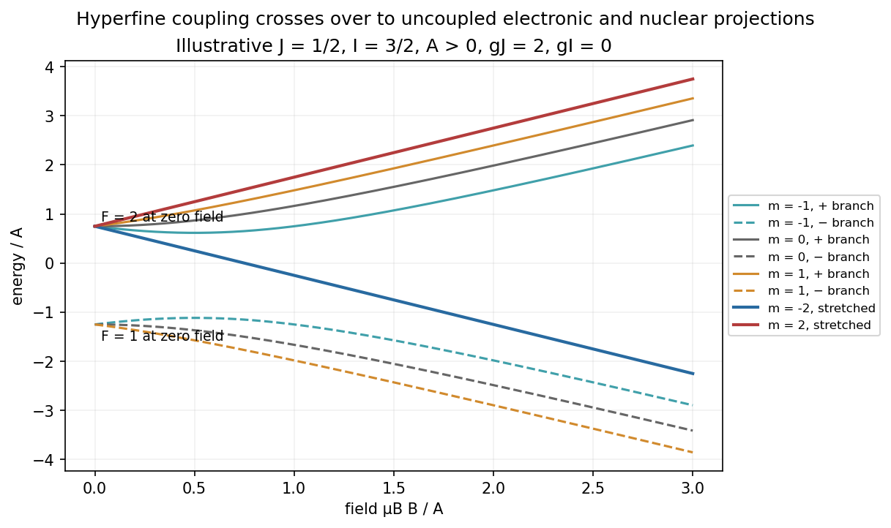

<h1 id="3/c/solution">Solution</h1>

↑ **Parent:** [C](../c.md)

For a nucleus of [spin](../../../../../spin.md) $I>0$ and electronic $J=1/2$, the magnetic-dipole [hyperfine interaction](../../../../../hyperfine-interaction.md) is $A\mathbf I\cdot\mathbf J$, using dimensionless angular-momentum operators. The electric-quadrupole hyperfine contribution vanishes for $J=1/2$. In zero field, $F=I\pm1/2$ labels the levels:

$$
\boxed{E_F=\frac A2[F(F+1)-I(I+1)-3/4],\quad
E_{I+1/2}=AI/2,\quad E_{I-1/2}=-A(I+1)/2.}
$$

Their signed separation is $\Delta=A(I+1/2)$. For $A>0$, the larger-$F$ multiplet lies higher; negative $A$ reverses this order. If $I=0$ there is no such hyperfine splitting.

Let the field define $z$ and write

$$
H=A\mathbf I\cdot\mathbf J+\mu_BB(g_JJ_z+g_I I_z).
$$

Here $g_I$ is the signed nuclear Zeeman coefficient expressed in Bohr-magneton units, including its nuclear-to-Bohr-magneton factor; it is not an unconverted nuclear $g$ factor. Total projection $m=m_I+m_J$ is conserved, while $F$ need not be. In the basis $|m-1/2,+1/2\rangle$, $|m+1/2,-1/2\rangle$, the two-state block is

$$
H_m=\left(-\frac A4+g_I\mu_BBm\right)\mathbf1+
\frac12\begin{pmatrix}
Am+(g_J-g_I)\mu_BB&A\sqrt{(I+1/2)^2-m^2}\\
A\sqrt{(I+1/2)^2-m^2}&-Am-(g_J-g_I)\mu_BB
\end{pmatrix}.
$$

For $A>0$, define $x=(g_J-g_I)\mu_BB/\Delta$. [Diagonalization](../../../../../diagonalization-of-a-matrix.md) gives the [Breit-Rabi formula](../../../../../breit-rabi-formula.md),

$$
\boxed{E_\pm(m)=-\frac A4+g_I\mu_BBm
\pm\frac\Delta2\sqrt{1+\frac{4m}{2I+1}x+x^2}.}
$$

For either sign of $A$, the block itself remains valid; its ordered [eigenvalues](../../../../../eigenvalue.md) are $-A/4+g_I\mu_BBm\pm\tfrac12\sqrt{\Delta^2+2Am(g_J-g_I)\mu_BB+(g_J-g_I)^2\mu_B^2B^2}$.

For a [stretched hyperfine Zeeman state](../../../../../stretched-hyperfine-zeeman-state.md) at projection $m=\pm(I+1/2)$ there is only one state each. Their energies are exactly

$$
\boxed{E_{\rm stretched}=AI/2\pm\mu_BB(g_J/2+g_I I).}
$$

Assigning two branches to each stretched projection would double-count states.

In weak fields the shift is $g_F\mu_BmB$, with $g_F=g_I\pm(g_J-g_I)/(2I+1)$ for $F=I\pm1/2>0$; an $F=0$ state has no first-order Zeeman shift. At strong hyperfine-decoupling fields the [eigenstates](../../../../../eigenstate.md) approach product states with

$$
E\simeq A m_Im_J+\mu_BB(g_Jm_J+g_Im_I).
$$

This is the hyperfine regime of the [Paschen-Back effect](../../../../../paschen-back-effect.md), still assuming the field is weak enough not to invalidate the electronic $J=1/2$ manifold. States of the same $m$ mix and avoid crossing when their off-diagonal coupling is nonzero; different-$m$ levels can cross.

**[Figure 2](#3/c/image-illustrative-j-1-2-hyperfine-to-zeeman-crossover-with-all-stretched-states-counted-once). Illustrative J=1/2 hyperfine-to-Zeeman crossover with all stretched states counted once**.

## ↑ Ancestors (14)

1. [C](../c.md)
2. [3](../../3.md)
3. [Paper 1](../../../paper-1-split.md)
4. [2013](../../../split.md)
5. [Past exam of the atomic and Optical Physics course of the University of Cambridge](../../../../split.md)
6. [Atomic and Optical Physics course of the University of Cambridge](../../../../../atomic-and-optical-physics-course-of-the-university-of-cambridge.md)
7. [Physics course of the year 4 of the natural sciences course of the University of Cambridge](../../../../../physics-course-of-the-year-4-of-the-natural-sciences-course-of-the-university-of-cambridge.md)
8. [Year 4 of the natural sciences course of the University of Cambridge](../../../../../year-4-of-the-natural-sciences-course-of-the-university-of-cambridge.md)
9. [Year of the natural sciences course of the University of Cambridge](../../../../../year-of-the-natural-sciences-course-of-the-university-of-cambridge.md)
10. [Natural sciences course of the University of Cambridge](../../../../../natural-sciences-course-of-the-university-of-cambridge.md)
11. [Course of the University of Cambridge](../../../../../course-of-the-university-of-cambridge.md)
12. [University of Cambridge](../../../../../university-of-cambridge-split.md)
13. [List of universities](../../../../../list-of-universities.md)
14. [Codex Wiki](../../../../../split.md)
