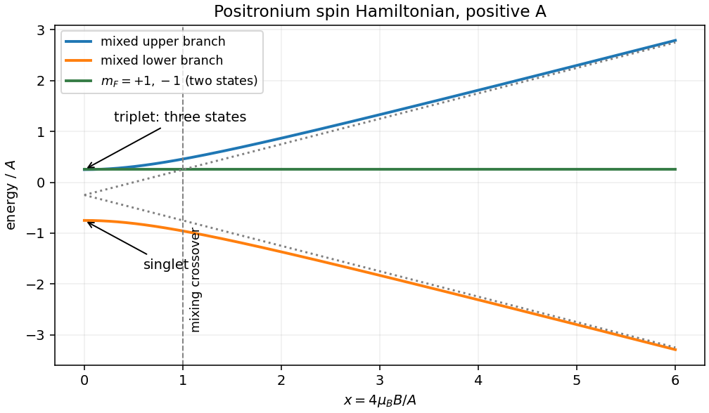
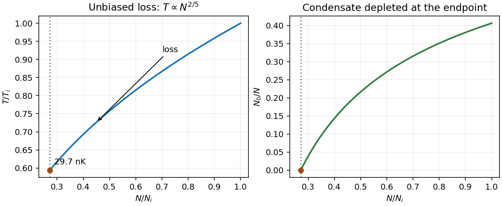

# Paper 1

↑ **Parent:** [2014](../2014.md)

[Original public PDF, physical pages 635–637; examination dated 15 January 2014](https://www.whatdotheyknow.com/request/natural_science_tripos_physics_e_2/response/2340776/attach/2/FOI%202023%20399%20Zahid%20materials.pdf?cookie_passthrough=1#page=635)

**Table of contents**

- [1](#1)
  - [Solution](#1/solution)
- [2](#2)
  - [Solution](#2/solution)
- [3](#3)
  - [a](#3/a)
    - [Solution](#3/a/solution)
  - [b](#3/b)
    - [Solution](#3/b/solution)
  - [c](#3/c)
    - [Solution](#3/c/solution)

## 1

↑ **Parent:** [Paper 1](paper-1.md)

<h3 id="1/solution">Solution</h3>

↑ **Parent:** [1](#1)

For hydrogen, the leading characteristic scales are

$$
\boxed{E_{\rm gross}\sim\alpha^2m_ec^2,\qquad
E_{\rm fine}\sim\alpha^4m_ec^2,\qquad
E_{\rm hf}\sim\alpha^4\frac{m_e^2}{m_p}c^2.}
$$

Order-one [spin](../../angular-momentum-operator.md#spin) and nuclear magnetic factors, and state-dependent factors, are suppressed here. [Gross atomic structure](../../atomic-physics.md#gross-atomic-structure) is Coulomb binding. [Fine structure](../../atomic-physics.md#fine-structure) includes relativistic kinetic and spin-orbit effects, with [Thomas precession](../../special-relativity.md#thomas-precession) affecting the spin-orbit coefficient. [Hyperfine structure](../../quantum-mechanics.md#hyperfine-structure) couples electronic motion and [spin](../../angular-momentum-operator.md#spin) to the [nuclear magnetic moment](../../electromagnetism.md#nuclear-magnetic-moment), whose inverse nuclear [mass](../../classical-mechanics.md#mass) makes it much weaker. The contact [spin](../../angular-momentum-operator.md#spin) interaction can remain in an s state where orbital spin-orbit coupling vanishes.

For [positronium](../../atomic-physics.md#positronium), the [reduced mass](../../classical-mechanics.md#reduced-mass) is $m_e/2$. Its gross levels and separation scale are

$$
\boxed{E_n=-\frac{\alpha^2m_ec^2}{4n^2}\simeq-\frac{6.80\,\mathrm{eV}}{n^2},
\qquad a_{\rm Ps}=2a_0.}
$$

Thus the mean ground-state [electron](../../physics.md#electron)–[Positron](../../physics.md#positron) separation is twice the infinite-proton-mass hydrogen value: both means have the same factor $3/2$ multiplying their respective Bohr radii. Retaining [proton](../../physics.md#proton) recoil makes the ratio $2m_p/(m_p+m_e)$, very slightly below two. Separation is not the distance of either [positronium](../../atomic-physics.md#positronium) constituent from its [centre of mass](../../classical-mechanics.md#center-of-mass).

Interpret the [spin](../../angular-momentum-operator.md#spin) operators in units of $\hbar$, as required by the printed Zeeman term, so $A$ has units of [energy](../../energy.md). Two [spin](../../angular-momentum-operator.md#spin) halves give **four eigenstates**. At zero field, total [spin](../../angular-momentum-operator.md#spin) $F=0,1$ and projection $m_F$ label the singlet and triplet. At high field relative to the hyperfine scale, the individual projections $m_{s,e},m_{s,p}=\pm1/2$ become approximately good [quantum numbers](../../quantum-system.md#quantum-number). Total projection remains exact at every field, but $F^2$ does not for the two mixed states.

Choose the quantization axis along $\mathbf B$. The aligned-spin states $|\uparrow\uparrow\rangle$ and $|\downarrow\downarrow\rangle$ both have $E=A/4$ because their Zeeman shifts cancel. In the other product-state sector,

$$
H_0=\begin{pmatrix}-A/4+2\mu_BB&A/2\\A/2&-A/4-2\mu_BB\end{pmatrix},
\qquad
\boxed{E_\pm=-\frac A4\pm\frac12\sqrt{A^2+16\mu_B^2B^2}.}
$$

For physical [positronium](../../atomic-physics.md#positronium) $A>0$. At $B=0$ there is a triplet at $A/4$ and a singlet at $-3A/4$. At large positive field the mixed states approach $|\uparrow\downarrow\rangle$ and $|\downarrow\uparrow\rangle$, with energies $-A/4+2\mu_BB$ and $-A/4-2\mu_BB$ respectively, while the aligned pair remains degenerate at $A/4$.

**[Figure 1](#1/image-four-positronium-spin-states-an-exactly-degenerate-aligned-pair-and-two-mixed-branches). Four positronium spin states: an exactly degenerate aligned pair and two mixed branches**.

The dimensionless mixing parameter is $x=4\mu_BB/A$. A crossover estimate is $x\sim1$, rather than a sharp transition. The scale $A\sim\alpha^4m_ec^2$ already gives a field of a few tesla. Using the physical hyperfine interval $A/h\simeq203.39\,\mathrm{GHz}$ gives

$$
\boxed{B_\times\sim\frac{A}{4\mu_B}\simeq3.63\,\mathrm T.}
$$

The numerical hyperfine interval is external physical input, not a number supplied by the symbolic [Hamiltonian](../../hamiltonian-mechanics.md#hamiltonian).[arXiv:1310.6923, abstract, measured interval approximately 203.39 GHz](../../physics-bibliography.md#new-precision-measurement-of-hyperfine-splitting-of-positronium-by-a-ishida-and-others) The high-field limit here still presumes that orbital distortion is negligible compared with Coulomb binding.

## 2

↑ **Parent:** [Paper 1](paper-1.md)

<h3 id="2/solution">Solution</h3>

↑ **Parent:** [2](#2)

Set the ground-state [energy](../../energy.md) to zero. Bose-Einstein occupation of an excited level is $[e^{(\epsilon-\mu)/(k_BT)}-1]^{-1}$, with $\mu\le0$. As particles are added, $\mu$ approaches zero and the excited-state population saturates. Separating the ground state from the density-of-states integral therefore gives

$$
\boxed{N_c(T)=\int_0^\infty\frac{g(\epsilon)\,d\epsilon}{e^{\epsilon/(k_BT)}-1},
\qquad\frac{N_0}{N}=1-\frac1\eta.}
$$

The excited-state integral must actually converge: $g\to0$ alone is not a sufficient condition in complete generality. A [power](../../energy.md#power) law $g\propto\epsilon^s$ with $s>0$ suffices at low [energy](../../energy.md), as in the stated three-dimensional box.

Let $\mathcal C=Vm^{3/2}/(\sqrt2\pi^2\hbar^3)$ denote the density-of-states prefactor, not a [heat capacity](../../heat.md#heat-capacity). Substitution $x=\epsilon/(k_BT)$ gives

$$
N_c=\mathcal C(k_BT)^{3/2}\Gamma(3/2)\zeta(3/2)
=\boxed{\zeta(3/2)\frac V{\lambda^3}}.
$$

The condensate has zero [energy](../../energy.md) on this reference, so a further factor of $\epsilon$ in the integral gives

$$
E=\mathcal C(k_BT)^{5/2}\Gamma(5/2)\zeta(5/2),
\qquad
\boxed{\frac EN=\frac32\frac{N_c}{N}
\frac{\zeta(5/2)}{\zeta(3/2)}k_BT.}
$$

Relative to the classical value, the ratio is $\zeta(5/2)/[\eta\zeta(3/2)]\simeq0.5134/\eta<0.5134$. Macroscopic occupation of the zero-energy state and the Bose distribution both lower the average [energy](../../energy.md).

At fixed volume the condensed gas has $E\propto T^{5/2}$. Unbiased random loss keeps average $E/N$ constant, hence

$$
\boxed{T\propto N^{2/5}.}
$$

Removing a condensate atom removes essentially no [energy](../../energy.md) and by itself leaves the excited cloud's [temperature](../../temperature.md) unchanged. Removing an excited atom removes its [energy](../../energy.md); during re-equilibration, some zero-energy condensate atoms join the excited population and share the remaining [energy](../../energy.md), lowering [temperature](../../temperature.md). Averaging over unbiased loss gives the stated constant [energy](../../energy.md) per particle, even though each individual type of loss need not preserve it separately.

Using $m\simeq87u$ and the supplied volume,

$$
\lambda_i\simeq0.837\,\mathrm{\mu m},\quad
N_c(T_i)\simeq1.78\times10^5,\quad
\boxed{\eta_i\simeq1.68.}
$$

There is only one occupied internal [spin](../../angular-momentum-operator.md#spin) state, so no factor $2F+1$ belongs in the [density of states](../../quantum-ideal-gas-statistics.md#density-of-states). During loss, $\eta\propto N/T^{3/2}\propto N^{2/5}$, hence $\eta/\eta_i=T/T_i$. Condensation disappears at $\eta_f=1$:

$$
\boxed{T_f=\frac{T_i}{\eta_i}\simeq29.7\,\mathrm{nK}.}
$$

As a consistency check, $N_f=N_i\eta_i^{-5/2}\simeq8.15\times10^4$ agrees with $N_c(T_f)$.

Both this process and [evaporative cooling of atoms](../../atomic-physics.md#evaporative-cooling-atomic-physics) require particle loss and re-equilibration. Ordinary evaporation preferentially removes energetic atoms, reducing $E/N$, and can cool an uncondensed classical gas. Here loss is [energy](../../energy.md) independent, $E/N$ stays constant, and cooling relies on the condensed gas's unusual [equation of state](../../pressure.md#equation-of-state); random loss of a classical [ideal gas](../../ideal-gas.md) would leave its [temperature](../../temperature.md) unchanged. Exact noninteraction would prevent collisional rethermalization: the imposed equilibrium assumption can be understood as weak thermalizing interactions whose equation-of-state corrections are neglected.

**[Figure 2](#2/image-temperature-and-condensate-fraction-during-unbiased-loss-ending-at-the-condensation-threshold). Temperature and condensate fraction during unbiased loss, ending at the condensation threshold**.

## 3

↑ **Parent:** [Paper 1](paper-1.md)

<h3 id="3/a">a</h3>

↑ **Parent:** [3](#3)

<h4 id="3/a/solution">Solution</h4>

↑ **Parent:** [A](#3/a)

An [electric dipole transition](../../quantum-mechanics.md#electric-dipole-transition) has amplitude proportional to $\langle f|\mathbf d\cdot\boldsymbol\epsilon|i\rangle$. The [electric dipole operator](../../quantum-mechanics.md#electric-dipole-operator) is odd under [parity](../../quantum-mechanics.md#parity), so the initial and final states must have **opposite [parity](../../quantum-mechanics.md#parity)**. As a rank-one spherical [tensor](../../multilinear-algebra.md#tensor) it also requires **$\Delta J=0,\pm1$, excluding $J=0\leftrightarrow0$, and $\Delta m_J=0,\pm1$**. These follow from angular-momentum addition and the [Wigner-Eckart theorem](../../representation-theory.md#wigner-eckart-theorem); vanishing [Clebsch-Gordan coefficients](../../representation-theory.md#clebsch-gordan-coefficients) can impose further restrictions. Relative to the quantization axis, $\pi$ [polarization](../../wave.md#polarization-waves) drives $\Delta m=0$, while $\sigma^\pm$ drive $\Delta m=\pm1$.

For a single active [electron](../../physics.md#electron), [parity](../../quantum-mechanics.md#parity) and the orbital triangle rule combine to give $\Delta l=\pm1$. In [LS coupling](../../angular-momentum-operator.md#ls-coupling), the spin-independent electric dipole operator gives $\Delta S=0$ and $\Delta L=0,\pm1$, excluding $L=0\leftrightarrow0$; total [parity](../../quantum-mechanics.md#parity) must still change. Spin-orbit mixing can weakly relax the approximate [spin](../../angular-momentum-operator.md#spin) rule. For resolved hyperfine states the corresponding triangle rule is $\Delta F=0,\pm1$, excluding $F=0\leftrightarrow0$, with $\Delta m_F=0,\pm1$. These labels require the appropriate coupling regime. There is no universal E1 rule demanding a particular change in [principal quantum number](../../mathematical-physics.md#principal-quantum-number). An E1-forbidden line may occur through another multipole or a multiphoton process.

<h3 id="3/b">b</h3>

↑ **Parent:** [3](#3)

<h4 id="3/b/solution">Solution</h4>

↑ **Parent:** [B](#3/b)

The two-level Doppler limit, $k_BT_D=\hbar\Gamma/2$, balances velocity-dependent scattering friction with [momentum](../../momentum.md) diffusion. Multilevel atoms have additional, slower internal dynamics. Counterpropagating beams with [orthogonal](../../inner-product.md#orthogonal-vectors) linear polarizations create a spatially varying [polarization](../../wave.md#polarization-waves), giving different position-dependent light shifts for ground-state magnetic sublevels. A moving atom climbs a light-shift hill, loses [kinetic energy](../../energy.md#kinetic-energy) and is optically pumped into a lower-energy sublevel: this repeated [Sisyphus cooling](../../atomic-physics.md#sisyphus-cooling) cycle dissipates motion through emitted light.

[Optical pumping](../../atomic-physics.md#optical-pumping) responds with a finite delay. Its rate, rather than only the excited-state linewidth, sets the low-velocity response scale. In the opposite-circular-polarization arrangement, motion instead produces unequal sublevel populations and unbalanced [radiation pressure](../../pressure.md#radiation-pressure). Both mechanisms can cool below the two-level Doppler [temperature](../../temperature.md); diffusion heating still balances the cooling, and recoil matters at the lowest temperatures.[1989, pages 2023–2025, two polarization-gradient mechanisms and pumping timescale](../../physics-bibliography.md#laser-cooling-below-the-doppler-limit-by-polarization-gradients-simple-theoretical-models-by-jean-dalibard-and-claude-cohen-tannoudji)

**Ground-state substructure, [optical pumping](../../atomic-physics.md#optical-pumping) and [polarization](../../wave.md#polarization-waves) gradients enable the extra cooling.** Magnetic fields that disturb the required sublevel dynamics can suppress it. [Optical molasses](../../atomic-physics.md#optical-molasses) damps [velocity](../../classical-mechanics.md#velocity) but does not by itself provide position-restoring confinement.

<h3 id="3/c">c</h3>

↑ **Parent:** [3](#3)

<h4 id="3/c/solution">Solution</h4>

↑ **Parent:** [C](#3/c)

**Sound propagation.** In the 1997 experiment, a focused laser beam abruptly modified the trapping potential of a dilute condensate, producing a local excitation. A rapid sequence of nondestructive [phase-contrast imaging](../../physical-optics.md#phase-contrast-imaging) measurements followed the resulting [density](../../fluid-mechanics.md#density) motion. Measuring propagation [speed](../../classical-mechanics.md#speed) at different densities tested the sound-like collective excitation spectrum, rather than individual free-particle flight.[1997, primary abstract and author publication record; Physical Review Letters 79, 549–552, with 1998 erratum](../../physics-bibliography.md#propagation-of-sound-in-a-bose-einstein-condensate-by-m-r-andrews-and-others) For a weakly interacting uniform condensate, the [Bogoliubov spectrum](../../quantum-ideal-gas-statistics.md#bogoliubov-quasiparticle-dispersion) is

$$
\epsilon(p)=\sqrt{\frac{p^2}{2m}\left(\frac{p^2}{2m}+2gn\right)},
\qquad c_s=\lim_{p\to0}\frac{\epsilon(p)}p=\sqrt{\frac{gn}{m}}.
$$

[Density](../../fluid-mechanics.md#density) dependence and trapped-geometry averaging matter when comparing a measured pulse [speed](../../classical-mechanics.md#speed) with this local uniform formula. A strictly [ideal gas](../../ideal-gas.md) would have no nonzero interaction-supported sound [speed](../../classical-mechanics.md#speed).

**Moving-obstacle dissipation.** In the 1999 experiment, a blue-detuned focused beam repelled atoms and acted as an obstacle swept through a sodium condensate. Heating was inferred from the [condensate fraction](../../quantum-ideal-gas-statistics.md#condensate-fraction) after stirring and re-equilibration. The heating rose markedly near $1.6\,\mathrm{mm\,s^{-1}}$, below the quoted peak sound [speed](../../classical-mechanics.md#speed) $6.2\,\mathrm{mm\,s^{-1}}$.[pages 2502–2504, obstacle method, heating onset and comparison with sound](../../physics-bibliography.md#evidence-for-a-critical-velocity-in-a-bose-einstein-condensed-gas-by-c-raman-and-others) Landau's criterion $v_L=\inf_p\epsilon(p)/p$ motivates a dissipation threshold, but [density](../../fluid-mechanics.md#density) variation, flow acceleration around the obstacle and [vortex](../../critical-phenomenon.md#phase-vortex) nucleation make the observed threshold different from simply substituting the peak sound [speed](../../classical-mechanics.md#speed). **Together these experiments probe a collective excitation spectrum and the onset of dissipative flow; condensation alone is not a complete demonstration of [superfluidity](../../statistical-physics.md#superfluidity).**

## ↑ Ancestors (11)

1. [2014](../2014.md)
2. [Past exam of the atomic and Optical Physics course of the University of Cambridge](../../past-exam-of-the-atomic-and-optical-physics-course-of-the-university-of-cambridge.md)
3. [Atomic and Optical Physics course of the University of Cambridge](../../university-of-cambridge.md#atomic-and-optical-physics-course-of-the-university-of-cambridge)
4. [Physics course of the year 4 of the natural sciences course of the University of Cambridge](../../university-of-cambridge.md#physics-course-of-the-year-4-of-the-natural-sciences-course-of-the-university-of-cambridge)
5. [Year 4 of the natural sciences course of the University of Cambridge](../../university-of-cambridge.md#year-4-of-the-natural-sciences-course-of-the-university-of-cambridge)
6. [Year of the natural sciences course of the University of Cambridge](../../university-of-cambridge.md#year-of-the-natural-sciences-course-of-the-university-of-cambridge)
7. [Natural sciences course of the University of Cambridge](../../university-of-cambridge.md#natural-sciences-course-of-the-university-of-cambridge)
8. [Course of the University of Cambridge](../../university-of-cambridge.md#course-of-the-university-of-cambridge)
9. [University of Cambridge](../../university-of-cambridge.md)
10. [List of universities](../../README.md#list-of-universities)
11. [Codex Wiki](../../README.md)
