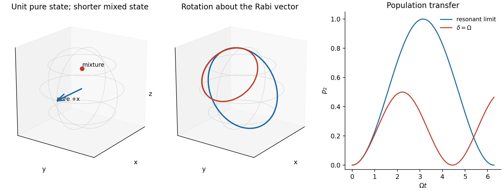
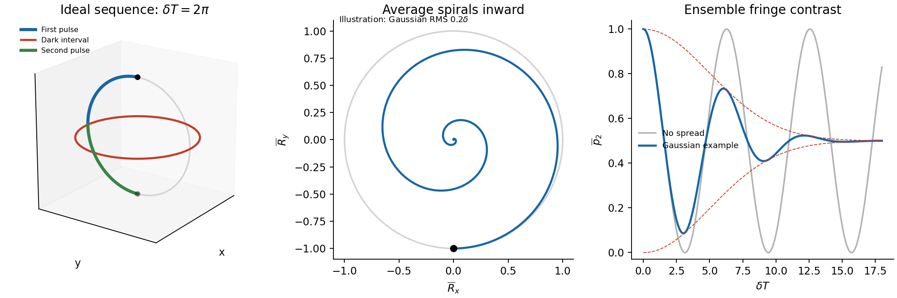
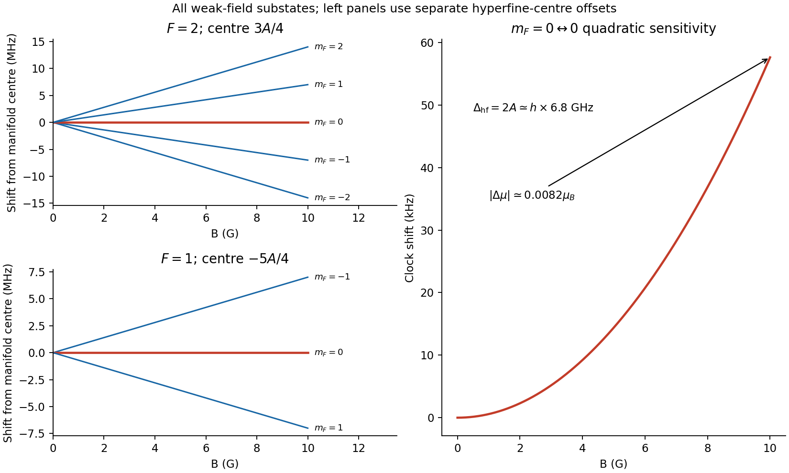
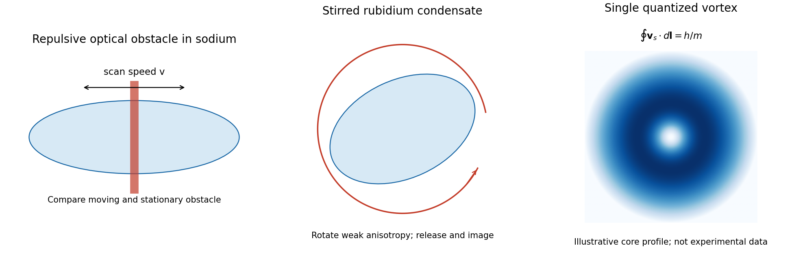

# Paper 1

↑ **Parent:** [2015](../2015.md)

Original paper: [Major Topics, Paper 1/AOP, 14 January 2015; physical PDF pages 710–712](https://www.whatdotheyknow.com/request/natural_science_tripos_physics_e_2/response/2340776/attach/2/FOI%202023%20399%20Zahid%20materials.pdf?cookie_passthrough=1#page=710).

**Table of contents**

- [1](#1)
  - [Solution](#1/solution)
  - [i](#1/i)
    - [Solution](#1/i/solution)
  - [ii](#1/ii)
    - [Solution](#1/ii/solution)
  - [iii](#1/iii)
    - [Solution](#1/iii/solution)
- [2](#2)
  - [Solution](#2/solution)
- [3](#3)
  - [a](#3/a)
    - [Solution](#3/a/solution)
  - [b](#3/b)
    - [Solution](#3/b/solution)
  - [c](#3/c)
    - [Solution](#3/c/solution)

## 1

↑ **Parent:** [Paper 1](paper-1.md)

<h3 id="1/solution">Solution</h3>

↑ **Parent:** [1](#1)

Use the ordered basis $(|1\rangle,|2\rangle)$ and $\sigma_z=\operatorname{diag}(1,-1)$, with

$$
\rho=\tfrac12(I+\mathbf R\cdot\boldsymbol\sigma),\qquad
R_z=p_1-p_2,\quad p_2=\frac{1-R_z}{2}.
$$

A pure [quantum superposition](../../quantum-system.md#quantum-superposition) $|+x\rangle=(|1\rangle+|2\rangle)/\sqrt2$ has $\mathbf R=(1,0,0)$ on the [Bloch sphere](../../density-matrix.md#bloch-sphere). In contrast, a [mixed state](../../density-matrix.md#mixed-state) $\rho=p|1\rangle\langle1|+(1-p)|2\rangle\langle2|$ has $\mathbf R=(0,0,2p-1)$, inside the sphere for $0<p<1$. At equal populations its vector is zero. Equal populations alone therefore do not distinguish a coherent superposition from a mixture; their off-diagonal [density matrix](../../density-matrix.md) elements differ.

Choose the drive [phase](../../wave.md#phase-waves) so the rotating-frame [Hamiltonian](../../hamiltonian-mechanics.md#hamiltonian) is $H_{\rm rot}=\hbar(\Omega\sigma_x+\delta\sigma_z)/2$, where $\delta=\omega-\omega_0$ as specified. The [Rabi vector](../../quantum-system.md#rabi-vector) is the angular-velocity vector

$$
\boxed{\mathbf W=(\Omega,0,\delta),\qquad \dot{\mathbf R}=\mathbf W\times\mathbf R.}
$$

Here $\Omega$ is the on-resonance population oscillation [angular frequency](../../lagrangian-mechanics.md#angular-frequency), not the unhalved coefficient of a cosine coupling. From $\mathbf R(0)=\hat z$, rotation about $\mathbf W$ at $W=\sqrt{\Omega^2+\delta^2}$ gives

$$
\mathbf R(t)=\left(\frac{\Omega\delta}{W^2}[1-\cos Wt],\,-\frac{\Omega}{W}\sin Wt,\,
\frac{\delta^2+\Omega^2\cos Wt}{W^2}\right),
$$

$$
\boxed{p_2(t)=\frac{\Omega^2}{\Omega^2+\delta^2}\sin^2\left(\frac{\sqrt{\Omega^2+\delta^2}\,t}{2}\right).}
$$

For $\Omega\gg|\delta|$, the rotation axis is nearly transverse, the trajectory nearly a great circle, and transfer is almost complete. For $\Omega=\delta>0$, the axis bisects $+x$ and $+z$, the orbit lies in $R_x+R_z=1$, and $p_2=\tfrac12\sin^2(\sqrt2\Omega t/2)$ never exceeds $1/2$. Each member remains a [pure state](../../quantum-theory.md#pure-state) in this coherent evolution.

**[Figure 1](#1/image-pure-and-mixed-bloch-vectors-resonant-and-detuned-trajectories-and-their-population-oscillations). Pure and mixed Bloch vectors, resonant and detuned trajectories, and their population oscillations**.

For the Ramsey free interval, let atom $j$ have detuning $\delta_j=\delta+\eta_j$. Instantaneous ideal pulses give the [Ramsey ensemble coherence](../../quantum-system.md#ramsey-ensemble-coherence) factor $\chi(T)=\langle e^{i\eta_jT}\rangle$. Averaging the free-evolution vector obtained in step (ii) gives

$$
\overline{\mathbf R}(T)=\left(\operatorname{Im}[e^{i\delta T}\chi(T)],\,-\operatorname{Re}[e^{i\delta T}\chi(T)],\,0\right),
\qquad
\boxed{\overline p_2(T)=\tfrac12\{1+\operatorname{Re}[e^{i\delta T}\chi(T)]\}.}
$$

Different atoms fan out around the equator, shortening the ensemble [Bloch vector](../../density-matrix.md#bloch-vector) even though every individual's vector remains unit length. A broad smooth detuning distribution usually makes the average spiral towards the centre and damps the Ramsey fringes towards $1/2$. The [dephasing](../../quantum-information-theory.md#dephasing-channel) time is of order $1/\Delta\omega_0\sim5/\delta$. [inhomogeneous ensemble dephasing](../../quantum-information-theory.md#inhomogeneous-ensemble-dephasing) is not necessarily irreversible decoherence of individual atoms; an appropriate [spin echo](../../nuclear-magnetic-resonance.md#spin-echo) can rephase static [frequency](../../wave.md#frequency) offsets.

The given spread does not specify a [probability distribution](../../probability-distribution.md) or whether it denotes an RMS width. An exact envelope is therefore not determined. The figure illustrates, rather than infers, a [Gaussian distribution](../../probability-distribution.md#normal-distribution) with RMS $\sigma_\delta=0.2\delta$, for which $\chi=e^{-\sigma_\delta^2T^2/2}$. A [uniform distribution](../../continuous-probability-distribution.md#continuous-uniform-distribution) would instead give a sinc envelope and side lobes. Both have the same qualitative initial loss of contrast on the quoted inverse-spread scale.

**[Figure 2](#1/image-an-ideal-ramsey-path-and-an-explicitly-illustrative-gaussian-ensemble-dephasing-envelope). An ideal Ramsey path and an explicitly illustrative Gaussian ensemble-dephasing envelope**.

In the [rubidium-87 ground-state hyperfine structure](../../chemical-substance.md#rubidium-87-ground-state-hyperfine-structure), $J=1/2$ and $I=3/2$, so $F=1,2$. Taking $H_{\rm hf}=A\mathbf I\cdot\mathbf J/\hbar^2$ gives

$$
E_F=\frac A2[F(F+1)-I(I+1)-J(J+1)],\qquad
E_1=-\frac54A,\quad E_2=\frac34A.
$$

The zero-field splitting is $\Delta_{\rm hf}=2A\simeq h\times6.8\,\mathrm{GHz}$. Ignoring the small nuclear magnetic term, the weak-field [Landé g-factors](../../atomic-physics.md#lande-g-factor) are $g_{F=1}\simeq-1/2$ and $g_{F=2}\simeq+1/2$. The diagram labels all three $F=1$ and five $F=2$ substates, with linear shifts $g_F\mu_Bm_FB$.

The pair **$|1\rangle=|F=1,m_F=0\rangle$ and $|2\rangle=|F=2,m_F=0\rangle$** is connected by a [magnetic dipole transition](../../atomic-physics.md#magnetic-dipole-transition) with $\Delta F=1$, $\Delta m_F=0$, driven with its oscillating magnetic component along the quantization axis. Both first-order shifts vanish, giving the [rubidium-87 clock transition](../../quantum-mechanics.md#rubidium-87-clock-transition) first-order insensitivity near zero field. Its insensitivity does not imply absence of quadratic shifts.

For these two $m_F=0$ levels the [Breit-Rabi formula](../../quantum-mechanics.md#breit-rabi-formula) gives the [quadratic Zeeman shift of a clock transition](../../quantum-mechanics.md#quadratic-zeeman-shift-of-a-clock-transition):

$$
\Delta E(B)=\sqrt{(2A)^2+[(g_J-g_I)\mu_BB]^2}
\simeq2A+\frac{\mu_B^2B^2}{A},
$$

where the last expression neglects the nuclear term and sets $g_J\simeq2$. Hence

$$
\frac{\partial\Delta E}{\partial B}\simeq\frac{2\mu_B^2B}{A},\qquad
\boxed{\frac{|\mu_2-\mu_1|}{\mu_B}\simeq\frac{2\mu_BB}{A}\simeq8.2\times10^{-3}\quad(B=10\,\mathrm G).}
$$

This uses $\mu_B/h\simeq1.40\,\mathrm{MHz/G}$ and the supplied $A/h\simeq3.4\,\mathrm{GHz}$. With physical moments defined by $\mu_i=-\partial E_i/\partial B$, the [differential magnetic moment](../../electromagnetism.md#differential-magnetic-moment) is **$\mu_2-\mu_1\simeq-8.2\times10^{-3}\mu_B$**. If effective magnetic moment denotes the positive [energy](../../energy.md) slope instead, that slope difference is positive. The magnitude and physical [frequency](../../wave.md#frequency) sensitivity are the same. Retaining the full atomic factors gives the familiar quadratic clock-frequency coefficient about $575\,\mathrm{Hz/G^2}$; the simplified supplied parameters give about $576\,\mathrm{Hz/G^2}$.[§3, equations (26)–(29); table of magnetic factors and clock-transition quadratic shift](../../physics-bibliography.md#rubidium-87-d-line-data-by-daniel-a-steck)

**[Figure 3](#1/image-weak-field-rubidium-87-hyperfine-manifolds-and-the-quadratic-clock-transition-shift). Weak-field rubidium-87 hyperfine manifolds and the quadratic clock-transition shift**.

**Use a far-detuned [optical dipole trap](../../atomic-physics.md#optical-dipole-trap)**, such as a red-detuned focused-beam trap, to confine both clock states. Their first-order magnetic moments vanish; their residual quadratic magnetic slopes are opposite, so a simple static magnetic-field minimum does not confine both in the same way. An optical potential acts through the electronic [polarizability](../../electrostatics.md#electric-polarizability) and can trap both ground hyperfine states. It is not perfectly state independent: differential [AC Stark shifts](../../mathematical-physics.md#ac-stark-shift), intensity noise and residual magnetic gradients still need control during Ramsey evolution.

<h3 id="1/i">i</h3>

↑ **Parent:** [1](#1)

<h4 id="1/i/solution">Solution</h4>

↑ **Parent:** [I](#1/i)

During a short pulse, detuning is negligible relative to $\Omega$. Rotation through angle $\Omega\Delta t=\pi/2$ about $+x$ takes the initial north-pole [Bloch vector](../../density-matrix.md#bloch-vector) to

$$
\boxed{\mathbf R_1=(0,-1,0).}
$$

The corresponding state is $(|1\rangle-i|2\rangle)/\sqrt2$, since $U_x=\exp(-i\pi\sigma_x/4)$. The [phase](../../wave.md#phase-waves) of this equatorial superposition is defined relative to the oscillator that will supply the second pulse.

<h3 id="1/ii">ii</h3>

↑ **Parent:** [1](#1)

<h4 id="1/ii/solution">Solution</h4>

↑ **Parent:** [Ii](#1/ii)

With the coupling off, $\mathbf W=\delta\hat z$. Precession during the dark interval gives

$$
\boxed{\mathbf R_2(T)=(\sin\delta T,-\cos\delta T,0).}
$$

The populations remain $p_1=p_2=1/2$ during the dark interval; only their relative [phase](../../wave.md#phase-waves) changes. For $T=2\pi/\delta$, the vector makes one complete equatorial circuit and returns to $(0,-1,0)$.

<h3 id="1/iii">iii</h3>

↑ **Parent:** [1](#1)

<h4 id="1/iii/solution">Solution</h4>

↑ **Parent:** [Iii](#1/iii)

The second pulse has the same [phase](../../wave.md#phase-waves) and area as the first, so another $+x$ rotation by $\pi/2$ gives

$$
\mathbf R_3(T)=(\sin\delta T,0,-\cos\delta T),\qquad
\boxed{p_2(T)=\frac{1-R_{3z}}2=\frac{1+\cos\delta T}{2}.}
$$

At $T=2\pi/\delta$, the final vector is the south pole and all population is in $|2\rangle$. The complete path consists of a north-to-equator quarter turn, a full equatorial loop, and an equator-to-south quarter turn. At $\delta T=\pi$ the pulses instead return the population to $|1\rangle$. Finite-pulse detuning corrections are small in $\delta/\Omega$; the result is the stated short-pulse Ramsey limit.

## 2

↑ **Parent:** [Paper 1](paper-1.md)

<h3 id="2/solution">Solution</h3>

↑ **Parent:** [2](#2)

Interpret the box as a hard-wall cube. Its one-particle levels are $\epsilon_{n_xn_yn_z}=\pi^2\hbar^2(n_x^2+n_y^2+n_z^2)/(2mL^2)$ for positive integers, giving $E_0=3\pi^2\hbar^2/(2mL^2)$. Counting lattice points in a positive octant and differentiating the large-radius count gives the supplied continuum [density of states](../../quantum-ideal-gas-statistics.md#density-of-states). Expressing its prefactor through $E_0$ yields

$$
g(\epsilon)=\mathcal A E_0^{-3/2}\sqrt\epsilon,\qquad
\boxed{\mathcal A=\frac{3\sqrt3\pi}{4}.}
$$

Here $\mathcal A$ denotes the dimensionless constant requested in this question, to distinguish it from the unrelated hyperfine constant of question 1. Periodic [boundary conditions](../../differential-equation.md#boundary-condition) would have zero ground [energy](../../energy.md) and would not permit this parametrization by a nonzero $E_0$.

Separate the ground-state occupation from excited particles. The [finite-box ground-energy convention in Bose condensation](../../quantum-ideal-gas-statistics.md#finite-box-ground-energy-convention-in-bose-condensation) makes the [chemical potential](../../chemical-potential.md) approach the ground [energy](../../energy.md) from below as that occupation becomes macroscopic. In the thermodynamic continuum approximation one shifts the [energy](../../energy.md) zero to the ground state and sets the limiting [chemical potential](../../chemical-potential.md) to zero in the excited-state integral. The difference between the exact shifted density and its $\sqrt\epsilon$ bulk form gives finite-size corrections; at the transition $k_BT_c/E_0\sim N^{2/3}\gg1$. Thus

$$
N'_{\max}(T)=\int_0^\infty\frac{\mathcal A E_0^{-3/2}\sqrt\epsilon}{e^{\epsilon/(k_BT)}-1}\,d\epsilon
=\mathcal A\Gamma(3/2)\zeta(3/2)\left(\frac{k_BT}{E_0}\right)^{3/2}.
$$

The identity follows by expanding $(e^x-1)^{-1}=\sum_{r\geq1}e^{-rx}$ and integrating each term. The excited states have a finite saturation capacity. Setting that capacity equal to $N$ determines condensation:

$$
\boxed{k_BT_c=\mathcal B E_0N^{2/3},\qquad
\mathcal B=[\mathcal A\Gamma(3/2)\zeta(3/2)]^{-2/3}
=\frac{4}{3\pi\zeta(3/2)^{2/3}}\simeq0.22375.}
$$

Equivalently $k_BT_c=(2\pi\hbar^2/m)[n/\zeta(3/2)]^{2/3}$, with $n=N/L^3$.

At fixed $N$, below $T_c$ the [chemical potential](../../chemical-potential.md) is pinned to its limiting value and

$$
\boxed{N'=N(T/T_c)^{3/2},\qquad N_0=N[1-(T/T_c)^{3/2}].}
$$

Above $T_c$, $N'\simeq N$ and there is no macroscopic $N_0$; the [chemical potential](../../chemical-potential.md) adjusts rather than allowing the saturation expression to exceed the available particles. At fixed $T$, put $N_c=N'_{\max}(T)$. For $N<N_c$, $N'\simeq N$ and $N_0$ is not macroscopic; for $N>N_c$, **$N'=N_c$ saturates while $N_0=N-N_c$ grows linearly**. This is [particle saturation in a homogeneous Bose gas](../../quantum-ideal-gas-statistics.md#particle-saturation-in-a-homogeneous-bose-gas); the sharp threshold is a thermodynamic-limit approximation to finite-box occupations.

**[Figure 4](#2/image-ideal-box-particle-saturation-and-the-heat-capacity-crossover-from-phonons-to-particle-like-excitations). Ideal-box particle saturation and the heat-capacity crossover from phonons to particle-like excitations**.

The interaction scale compares differently with confinement and transition energies:

$$
\frac{E_I}{E_0}\sim\frac{Na}{L}\gg1,\qquad
\frac{E_I}{k_BT_c}\sim N^{1/3}\frac aL\ll1.
$$

Thus the stated range makes interactions dominate the ground-state confinement [energy](../../energy.md) while remaining small on the thermal scale controlling $T_c$. This is an [interaction-dominated ground state with nearly ideal condensation temperature](../../quantum-ideal-gas-statistics.md#interaction-dominated-ground-state-with-nearly-ideal-condensation-temperature). It also gives the dilute-gas parameter $na^3=N(a/L)^3\ll1$. A contact model has $g=4\pi\hbar^2a/m$ and $\mu\simeq gn$; the question's $E_I$ suppresses order-one factors, and the uniform ground [energy](../../energy.md) per particle is $gn/2$, rather than exactly $gn$. Weak interactions can shift $T_c$ slightly, but their dimensionless strength $an^{1/3}\ll1$ makes that a small relative effect. In a hard-wall box, boundary healing layers do not overturn bulk interaction dominance when their thickness is small compared with $L$.

At $k_BT\ll\mu$, thermally occupied [Bogoliubov modes](../../quantum-ideal-gas-statistics.md#bogoliubov-mode) have $E_k\simeq\hbar c_s k$, with $c_s=\sqrt{\mu/m}$. There is one acoustic branch for this spinless gas. Its thermal [energy](../../energy.md) determines the [phonon heat capacity of a dilute Bose gas](../../quantum-ideal-gas-statistics.md#phonon-heat-capacity-of-a-dilute-bose-gas):

$$
U_{\rm ph}=\frac{V}{2\pi^2}\int_0^\infty\frac{\hbar c_s k^3}{e^{\hbar c_sk/(k_BT)}-1}\,dk
=\frac{\pi^2V}{30}\frac{(k_BT)^4}{\hbar^3c_s^3},
$$

$$
\boxed{C_{V,\rm ph}=\frac{2\pi^2}{15}Vk_B\left(\frac{k_BT}{\hbar c_s}\right)^3\propto T^3.}
$$

The zero-temperature interaction [energy](../../energy.md) does not itself contribute to this leading [temperature](../../temperature.md) derivative at fixed $N,V$. This bulk power law also requires $k_BT\gg\hbar c_s/L$ so that the [phonon](../../quantum-ideal-gas-statistics.md#phonon) spectrum may be treated as continuous; a strictly finite box eventually has discrete-level activated behaviour.

For the noninteracting condensed [Bose gas](../../quantum-ideal-gas-statistics.md#bose-gas), the [ideal Bose-gas heat capacity below condensation](../../quantum-ideal-gas-statistics.md#ideal-bose-gas-heat-capacity-below-condensation) follows by integrating $\epsilon g(\epsilon)f(\epsilon)$:

$$
U=\frac32Nk_BT\frac{\zeta(5/2)}{\zeta(3/2)}(T/T_c)^{3/2},\qquad
\boxed{C_{V,\rm ideal}=\frac{15}{4}Nk_B\frac{\zeta(5/2)}{\zeta(3/2)}(T/T_c)^{3/2}\propto T^{3/2}.}
$$

Its limiting value at $T_c^-$ is about $1.926Nk_B$. At very low [temperature](../../temperature.md) the interacting [phonon](../../quantum-ideal-gas-statistics.md#phonon) curve is suppressed relative to the ideal curve, has slope three on logarithmic axes, and crosses over towards particle-like $T^{3/2}$ behaviour around $k_BT\sim\mu$. Since $\mu\ll k_BT_c$, most of the interval below $T_c$ is approximately ideal at leading weak-coupling order. The figure marks a qualitative extrapolation near the transition: a zero-temperature [Bogoliubov spectrum](../../quantum-ideal-gas-statistics.md#bogoliubov-quasiparticle-dispersion) does not determine precise interacting critical [heat capacity](../../heat.md#heat-capacity) or its small transition shift. The illustrative fixed-$\mu$ interpolation is not claimed as a controlled critical-region calculation.

## 3

↑ **Parent:** [Paper 1](paper-1.md)

<h3 id="3/a">a</h3>

↑ **Parent:** [3](#3)

<h4 id="3/a/solution">Solution</h4>

↑ **Parent:** [A](#3/a)

In the ideal point-nucleus Dirac-Coulomb problem, hydrogen levels depend on $n$ and $j$, so $2S_{1/2}$ and $2P_{1/2}$ are degenerate despite their different orbital angular momenta. The [Lamb shift](../../atomic-physics.md#lamb-shift) removes this degeneracy: the $2S_{1/2}$ level lies about **$h\times1.06\,\mathrm{GHz}$ above $2P_{1/2}$**, an [energy](../../energy.md) of roughly $4.4\,\mathrm{\mu eV}$. This is distinct from the much larger $2P_{3/2}-2P_{1/2}$ fine-structure splitting.

[quantum electrodynamics](../../perturbative-quantum-field-theory.md#quantum-electrodynamics) changes the electron's interaction with the Coulomb field. [electron self-energy](../../perturbative-quantum-field-theory.md#electron-self-energy) and [vacuum polarization](../../perturbative-quantum-field-theory.md#vacuum-polarization) give state-dependent [radiative corrections](../../perturbative-quantum-field-theory.md#radiative-correction); a complete prediction also keeps specified [recoil](../../momentum.md#recoil) and nuclear-size contributions. An $S$ wave samples the nucleus differently from a $P$ wave, so equal $n,j$ no longer ensures equal [energy](../../energy.md). A leading-log estimate for an $nS$ radiative contribution scales as $\alpha(Z\alpha)^4m_ec^2\ln[(Z\alpha)^{-2}]/n^3$, with a numerical prefactor and further state-dependent terms. This is a scale estimate, not a replacement for renormalized bound-state QED. The measurable shift is a difference relative to a specified reference [Hamiltonian](../../hamiltonian-mechanics.md#hamiltonian), rather than an unregulated absolute vacuum [energy](../../energy.md).[§II, definition of level contributions relative to the point-nucleus Dirac value and bound-state QED expansion](../../physics-bibliography.md#theory-of-the-lamb-shift-in-hydrogen-and-light-hydrogen-like-ions-by-vladimir-yerokhin-and-others)

The original microwave experiment used a tungsten oven to dissociate hydrogen, an electron beam to populate metastable $2S$ atoms, and electron ejection from a metal target to measure surviving metastable atoms. Microwaves transferred population to rapidly decaying $2P$, reducing detector current. At a fixed microwave [frequency](../../wave.md#frequency), interruption of the radiation and a scan of static [magnetic field](../../magnetic-field.md) revealed Zeeman-tuned resonances. Comparing resonance locations with the Dirac-level prediction showed the $S$ level shifted upward. Field calibration and homogeneity, excessive microwave intensity, unresolved [hyperfine structure](../../quantum-mechanics.md#hyperfine-structure) and stray-electric-field quenching limit the measurement; the signal is not direct absorption by a large equilibrium excited population.[pp. 241–243, apparatus, Fig. 1 caption and resonance-field comparison](../../physics-bibliography.md#fine-structure-of-the-hydrogen-atom-by-a-microwave-method-by-willis-eugene-lamb-jr-and-robert-curtis-retherford)

**[Figure 5](#3/a/image-original-schematics-of-metastable-beam-microwave-quenching-and-doppler-free-two-photon-excitation). Original schematics of metastable-beam microwave quenching and Doppler-free two-photon excitation**.

<h3 id="3/b">b</h3>

↑ **Parent:** [3](#3)

<h4 id="3/b/solution">Solution</h4>

↑ **Parent:** [B](#3/b)

A [two-photon transition](../../quantum-mechanics.md#two-photon-transition) is a second-order atom-field process. For [two-photon absorption](../../quantum-mechanics.md#two-photon-absorption), [energy](../../energy.md) conservation requires $E_f-E_g=\hbar(\omega_1+\omega_2)$. A [virtual intermediate state in two-photon absorption](../../quantum-mechanics.md#virtual-intermediate-state-in-two-photon-absorption) need not be populated as a real stationary state. In the electric dipole approximation, the two time orderings give an amplitude proportional to

$$
\mathcal M_{fg}=\sum_n\left[
\frac{\langle f|\mathbf d\cdot\boldsymbol\epsilon_2|n\rangle\langle n|\mathbf d\cdot\boldsymbol\epsilon_1|g\rangle}{E_g+\hbar\omega_1-E_n}
+\frac{\langle f|\mathbf d\cdot\boldsymbol\epsilon_1|n\rangle\langle n|\mathbf d\cdot\boldsymbol\epsilon_2|g\rangle}{E_g+\hbar\omega_2-E_n}
\right].
$$

The electric-field amplitudes multiply this expression. Far from intermediate resonance, the denominators are large relative to linewidths and one-photon couplings, keeping real intermediate occupation small. Near an intermediate resonance, sequential absorption, linewidths and saturation require a fuller treatment. For weak unsaturated absorption the rate scales as **$I_1I_2$**, or $I^2$ when both photons come from one field. Absorption followed by [stimulated emission](../../laser.md#stimulated-emission) instead gives a difference-frequency [Raman transition](../../atomic-physics.md#raman-transition); it is not [two-photon absorption](../../quantum-mechanics.md#two-photon-absorption) at the sum [frequency](../../wave.md#frequency).

Two electric dipole interactions change parity twice, so initial and final states have the same parity. For a one-electron orbital, the usual changes are $\Delta\ell=0,\pm2$, subject to angular-momentum and polarization constraints. For identical equal-frequency photons, exchange symmetry removes the antisymmetric rank-one tensor: ranks zero and two survive. Thus $J=0\to0$ is possible, whereas $J=0\to1$ is forbidden in this degenerate electric-dipole approximation. It would be too strong to prohibit every $\Delta J=1$ transition between nonzero angular momenta, since a rank-two tensor can connect some such pairs. Spin remains unchanged to leading electric-dipole order.

A central example is hydrogen $1S\to2S$, forbidden as a one-photon [electric dipole transition](../../quantum-mechanics.md#electric-dipole-transition) but accessible with two photons near $243\,\mathrm{nm}$. Absorption of one photon from each of equal-frequency counterpropagating beams makes the first-order [Doppler shift](../../wave.md#doppler-effect) $(\mathbf k_1+\mathbf k_2)\cdot\mathbf v$ vanish and suppresses net [recoil](../../momentum.md#recoil). The two same-direction absorption paths can still give a broad Doppler background. A primary demonstration used a frequency-doubled pulsed dye [laser](../../laser.md) near this wavelength and compared with a simultaneously recorded Balmer reference.[Phys. Rev. Lett. 34, 307 (1975), abstract: 2430-angstrom source and simultaneous Balmer-beta reference](../../physics-bibliography.md#doppler-free-two-photon-spectroscopy-of-hydrogen-by-theodor-w-hansch-and-others)

Experimentally, scan the sum [frequency](../../wave.md#frequency) and detect the excited state, its subsequent fluorescence or its ionization. Counterpropagating and single-beam spectra distinguish the narrow Doppler-free contribution from its background. Varying intensity tests weak-field scaling and extrapolates [AC Stark shifts](../../mathematical-physics.md#ac-stark-shift) and [power broadening](../../atomic-physics.md#power-broadening); [frequency](../../wave.md#frequency) calibration, beam overlap, residual angle and second-order [Doppler shifts](../../wave.md#doppler-effect) still matter. “Doppler free” here cancels the leading [velocity](../../classical-mechanics.md#velocity) term, not every systematic shift.

<h3 id="3/c">c</h3>

↑ **Parent:** [3](#3)

<h4 id="3/c/solution">Solution</h4>

↑ **Parent:** [C](#3/c)

Two complementary signatures are suppressed low-speed dissipation and [quantized circulation](../../critical-phenomenon.md#quantized-circulation). Condensation alone establishes macroscopic occupation, not all of these flow properties. In a uniform weakly interacting condensate, the [Landau criterion](../../statistical-physics.md#landau-criterion) gives

$$
v_L=\inf_{p>0}\frac{E(p)}p=c_s=\sqrt{\mu/m}
$$

for the [Bogoliubov spectrum](../../quantum-ideal-gas-statistics.md#bogoliubov-quasiparticle-dispersion). Creating an excitation in a flow changes [energy](../../energy.md) by $E(\mathbf p)-\mathbf v\cdot\mathbf p$; a negative value allows [energy](../../energy.md) transfer. Boundaries and vortex nucleation can make an actual measured threshold lower than this ideal bulk sound speed.

In the [moving-obstacle test of atomic superfluidity](../../statistical-physics.md#moving-obstacle-test-of-atomic-superfluidity), a blue-detuned focused [laser](../../laser.md) repelled atoms in a sodium condensate and was scanned at different speeds. After a fixed exposure, time-of-flight [absorption imaging](../../atomic-physics.md#absorption-imaging) measured the reduction of [condensate fraction](../../quantum-ideal-gas-statistics.md#condensate-fraction) as a heating indicator. Low-speed heating was small, with a pronounced onset near $1.6\,\mathrm{mm/s}$, below the peak-density sound speed near $6.2\,\mathrm{mm/s}$. A stationary-beam control showed no heating; above-transition clouds constrained heating through the noncondensed fraction. Changing scan [frequency](../../wave.md#frequency) and amplitude at common obstacle [velocity](../../classical-mechanics.md#velocity) helped separate a flow threshold from a particular trap resonance. Density inhomogeneity, obstacle geometry and vortex nucleation limit identification of the observed onset with a unique homogeneous Landau [velocity](../../classical-mechanics.md#velocity).[pp. 2502–2504, Figs. 1–3, stationary-beam and above-transition controls](../../physics-bibliography.md#evidence-for-a-critical-velocity-in-a-bose-einstein-condensed-gas-by-c-raman-and-others)

**[Figure 6](#3/c/image-original-moving-obstacle-and-rotating-anisotropy-schematics-for-two-superfluidity-tests). Original moving-obstacle and rotating-anisotropy schematics for two superfluidity tests**.

A second experiment stirred [rubidium-87](../../chemical-substance.md#rubidium-87) in a magnetic trap by rotating a small transverse anisotropy generated with a far-detuned attractive [laser](../../laser.md). After stirring, the cloud expanded for $27\,\mathrm{ms}$ and [absorption imaging](../../atomic-physics.md#absorption-imaging) along the rotation axis revealed vortex cores. Below a threshold no cores appeared; faster rotation produced one or several. Ramping the stirrer down before release reduced additional excitation, and waiting after removing it tested vortex survival. Beam-centre stability and residual trap anisotropy are important controls; an isolated density dip without the rotation and persistence evidence would be less conclusive. This [stirred-condensate vortex experiment](../../critical-phenomenon.md#stirred-condensate-vortex-experiment) is a response to rotation, distinct from merely imaging the appearance of a condensate.[preprint pp. 1–3, rotating dipole anisotropy, time-of-flight imaging and single-vortex lifetime](../../physics-bibliography.md#vortex-formation-in-a-stirred-bose-einstein-condensate-by-k-w-madison-and-others)

The [superfluid velocity](../../statistical-physics.md#superfluid-velocity) is $\mathbf v_s=(\hbar/m)\nabla\theta$. A closed loop avoiding a core must return a single-valued [order parameter](../../critical-phenomenon.md#order-parameter), so

$$
\boxed{\oint\mathbf v_s\cdot d\mathbf l=\frac\hbar m\,2\pi\ell=\ell\frac hm,\qquad\ell\in\mathbb Z.}
$$

A singly quantized vortex therefore has $2\pi$ [phase](../../wave.md#phase-waves) winding and circulation $h/m$, with depleted density in a core of order the [healing length](../../quantum-ideal-gas-statistics.md#healing-length). This quantized rotational response differs from ordinary rigid-body flow. The experiment supports that interpretation through controlled stirring and vortex formation; imaging cores alone does not independently measure every [phase](../../wave.md#phase-waves) winding or an absolute zero dissipative rate.

## ↑ Ancestors (11)

1. [2015](../2015.md)
2. [Past exam of the atomic and Optical Physics course of the University of Cambridge](../../past-exam-of-the-atomic-and-optical-physics-course-of-the-university-of-cambridge.md)
3. [Atomic and Optical Physics course of the University of Cambridge](../../university-of-cambridge.md#atomic-and-optical-physics-course-of-the-university-of-cambridge)
4. [Physics course of the year 4 of the natural sciences course of the University of Cambridge](../../university-of-cambridge.md#physics-course-of-the-year-4-of-the-natural-sciences-course-of-the-university-of-cambridge)
5. [Year 4 of the natural sciences course of the University of Cambridge](../../university-of-cambridge.md#year-4-of-the-natural-sciences-course-of-the-university-of-cambridge)
6. [Year of the natural sciences course of the University of Cambridge](../../university-of-cambridge.md#year-of-the-natural-sciences-course-of-the-university-of-cambridge)
7. [Natural sciences course of the University of Cambridge](../../university-of-cambridge.md#natural-sciences-course-of-the-university-of-cambridge)
8. [Course of the University of Cambridge](../../university-of-cambridge.md#course-of-the-university-of-cambridge)
9. [University of Cambridge](../../university-of-cambridge.md)
10. [List of universities](../../README.md#list-of-universities)
11. [Codex Wiki](../../README.md)
